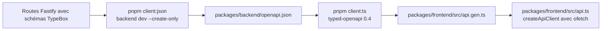

# Contribuer à Patrinotes

Ce guide s'adresse aux développeurs qui rejoignent le projet : installation du poste, organisation du code, conventions,
procédures et pièges connus. L'architecture, l'exploitation et les choix techniques sont décrits dans le dossier
d'architecture technique ([docs/README.md](docs/README.md)).

## Sommaire

1. [Prise en main du poste](#1-prise-en-main-du-poste)
2. [Organisation du code](#2-organisation-du-code)
3. [Conventions](#3-conventions)
4. [Faire évoluer le schéma et la synchronisation](#4-faire-évoluer-le-schéma-et-la-synchronisation)
5. [Contrat OpenAPI et client typé](#5-contrat-openapi-et-client-typé)
6. [Détails par domaine](#6-détails-par-domaine)
7. [Tests](#7-tests)
8. [Branches et procédures d'équipe](#8-branches-et-procédures-déquipe)
9. [Prochain déploiement en production](#9-prochain-déploiement-en-production)
10. [Tâches de nettoyage et code mort](#10-tâches-de-nettoyage-et-code-mort)

## 1. Prise en main du poste

### Outils

Le [README](README.md) donne la trame de l'installation, mais il contient des erreurs :

| Le README dit | Réalité |
| --- | --- |
| `node >= 20` | Le [package.json](package.json) exige Node 22 (`engines.node >= 22`) ; l'image Docker utilise Node 22.23. |
| `pnpm = 8.4.0` | Le [package.json](package.json) déclare `"packageManager": "pnpm@10.12.4"`, comme le [Dockerfile](Dockerfile). Utiliser pnpm 10.12.4 (corepack le choisit). |
| « Copy `.env.dist` to `.env` » | [.env.dist](.env.dist) est obsolète (voir [Fichier d'environnement](#fichier-denvironnement)). Partir de [.env.test](.env.test). |
| « La whitelist n'est pas active en dev » | Vrai seulement si `NODE_ENV` vaut `development` (voir [`NODE_ENV`](#node_env)). |
| `clearDb.sh` | Le script s'appelle [scripts/clear-db.sh](scripts/clear-db.sh). |
| Fichiers POP `monuments.csv` et `mobilier.csv` | Les fichiers importés sont `merimee.csv` et `palissy.csv` (séparateur `\|`). |
| L'API Adresse est appelée par le backend | Elle est appelée par le navigateur. |

L'image [images/db-workflow.png](images/db-workflow.png), citée par le README, montre l'ancienne architecture
ElectricSQL/Prisma.

Le champ `packageManager` est aussi lu par `pnpm/action-setup@v4` en CI. Sans lui, corepack prendrait une version plus
récente de pnpm, qui ignore la configuration pnpm du `package.json`.

### Étapes

```bash
# 1. Outils : Node 22, pnpm 10, Docker + Compose v2
corepack enable && corepack prepare pnpm@10.12.4 --activate

# 2. Dépendances (aucun module natif à compiler)
pnpm install

# 3. Fichier d'environnement : partir de .env.test, puis ajuster
cp .env.test .env
#   - POSTGRES_DB, PS_DATABASE_URL (il pointe en dur sur la base patrinotes-test, à renommer)
#   - ADMINER_PORT (utilisé par docker-compose.yaml)
#   - garder des ports cohérents entre backend, frontend, Keycloak et PowerSync

# 4. Infrastructure locale (Postgres 17, Mongo, PowerSync, MinIO, Keycloak, Mailpit, Adminer)
docker compose up -d
#    Keycloak met environ 1 min à démarrer ; le realm "master" est importé depuis tests/realm-template.json

# 5. Base de données
pnpm migration:up
#    Facultatif : un service de démonstration (noms de conteneur en dur, voir plus bas)
#    sh scripts/fill-db.sh
#    Facultatif : référentiel des monuments (long, nécessite Internet)
#    pnpm backend import-pop

# 6. Lancer
pnpm backend dev     # vite-node --watch, rechargement à chaud (hmr.ts)
pnpm frontend dev    # Vite, sur 127.0.0.1:5173 par défaut

# 7. Courriels : interface Mailpit sur http://localhost:${SMTP_WEB_PORT}
# 8. Documentation de l'API : http://localhost:${PORT}/documentation (@fastify/swagger)
```

Points d'attention :

- **Monuments** : sans `import-pop` ni données de test, l'autocomplétion « Nom ou référence du monument » est vide. Le
  plus rapide est d'insérer le monument fictif de [tests/utils.ts](tests/utils.ts), ou de lancer les tests une fois.
- **Services** : l'inscription exige un `service_id`. Sans [scripts/db/service.sql](scripts/db/service.sql), seul le
  service invisible `no-service` existe ; il est créé au démarrage du backend
  ([packages/backend/src/index.ts](packages/backend/src/index.ts)).
- **Devenir administrateur en local** : `UPDATE internal_user SET role='admin' WHERE email='…';`
- Le service worker est **actif aussi en développement** (`devOptions.enabled: true`, mode module). En cas de
  comportement étrange, vider le stockage du site ou utiliser « Réinitialiser les données locales ».
- `predev` et `prebuild` du frontend lancent `react-dsfr update-icons` (`.npmrc` : `enable-pre-post-scripts=true`).
- **dsfr-chart** : une version patchée est embarquée dans [packages/frontend/dsfr-chart/](packages/frontend/dsfr-chart/)
  (voir [DSFR et graphiques](#dsfr-graphiques-statistiques-et-administration)). La conserver lors des mises à jour.

### Fichier d'environnement

[.env.dist](.env.dist) est le modèle censé être copié en `.env`. Il est incomplet et contient des variables sans usage.
[.env.test](.env.test) est la référence la plus complète ; il contient lui-même deux variables sans effet :
`DATABASE_REQUIRE_SSL` et `VITE_ALERTES_MH_ENABLED`. La liste qui fait foi est celle des schémas zod :
[packages/backend/src/envVars.ts](packages/backend/src/envVars.ts) et
[packages/frontend/src/envVars.ts](packages/frontend/src/envVars.ts).

Présentes dans `.env.dist` mais inutilisées :

| Variable | Remarque |
| --- | --- |
| `ELECTRIC_PORT`, `VITE_ELECTRIC_URL` | Variables de l'ancien moteur ElectricSQL (voir aussi `.electric_migrations_*` dans [.gitignore](.gitignore)). |
| `PG_PROXY_PORT`, `PG_PROXY_PASSWORD` | Proxy PostgreSQL d'ElectricSQL. |
| `KEYCLOAK_CLIENT_SECRET` | Équivalent actuel : `AUTH_CLIENT_SECRET`. |
| `AWS_ACCESS_KEY_ID`, `AWS_SECRET_ACCESS_KEY`, `AWS_BUCKET_NAME`, `AWS_REGION`, `AWS_ENDPOINT` | Équivalent actuel : `MINIO_*`. Le client S3 reçoit ses identifiants explicitement ([uploadService.ts](packages/backend/src/services/uploadService.ts)). |
| `HTTP_PORT` | Équivalent actuel : `PORT`. |
| `COMPOSE_PROFILES` | Aucun profil n'est défini dans les fichiers Compose. |
| `FRONTEND_PORT` | Utilisée seulement par Playwright. |
| `JWT_SECRET` | Exigée par le schéma, sans usage fonctionnel. |
| `DSFR_THEME_*` | Lues par le thème Keycloak, pas par l'application ; aucun fichier Compose ne les transmet au conteneur Keycloak. |

Utilisées par le code mais absentes de `.env.dist` :

| Variable | Conséquence si absente |
| --- | --- |
| `BACKEND_URL`, `EMAIL_EMITTER`, `AUTH_CLIENT_SECRET`, `AUTH_ADMIN_CLIENT_ID`, `AUTH_ADMIN_CLIENT_SECRET`, `JWT_REFRESH_SECRET`, `DATAGOUV_API` | Le backend ne démarre pas (validation zod) et les migrations échouent. |
| `VITE_POWERSYNC_URL` | Le frontend démarre mais la synchronisation est impossible. |
| `PS_DATABASE_URL`, `POWERSYNC_PORT` | PowerSync ne démarre pas, ou son port n'est pas publié en Compose. |
| `KEYCLOAK_PORT`, `KEYCLOAK_ADMIN`, `KEYCLOAK_ADMIN_PASSWORD`, `KEYCLOAK_DB`, `AUTH_CLIENT_ID` | Keycloak ne démarre pas correctement en Compose. |
| `MINIO_SERVER_PORT`, `MINIO_CONSOLE_PORT`, `SMTP_PORT`, `SMTP_WEB_PORT` | Ports non publiés en Compose. |
| `FORCE_REFETCH_POP`, `DEBUG`, `NODE_ENV` | Valeurs par défaut appliquées. |

Variables de l'infrastructure de développement et de test (Compose) :

| Variable | Utilisée par | Description |
| --- | --- | --- |
| `POSTGRES_PORT` | `pg` | Port publié de PostgreSQL. |
| `MINIO_USER`, `MINIO_PASSWORD` | `minio`, `minio-init` | Compte racine MinIO (`MINIO_ROOT_USER/PASSWORD`). |
| `MINIO_SERVER_PORT`, `MINIO_CONSOLE_PORT` | `minio` | Ports publiés (API, console). |
| `POWERSYNC_PORT` | `powersync` | Port publié. |
| `KEYCLOAK_PORT` | `keycloak` | Port publié ; injecté dans `KC_HOSTNAME_PORT`, lui-même réutilisé par `envsubst` dans l'attribut `jwks.url` du client applicatif du realm de test. |
| `ADMINER_PORT` | `adminer` | Port publié d'Adminer. |
| `SMTP_PORT`, `SMTP_WEB_PORT` | `mailpit` | Port SMTP (→ 1025) et interface web (→ 8025) de Mailpit, qui accepte toute authentification. |
| `HEALTHCHECK_PORT` | `healthcheck` (test) | Port du point d'attente nginx. |
| `FRONTEND_PORT`, `BACKEND_PORT`, `DB_PORT`, `MAILPIT_PORT`, `MAILPIT_WEB_PORT` | `.env.test`, specs Playwright | Ports de la pile de test (3010 à 3019). |
| `CI` | Playwright, [tests/teardown.ts](tests/teardown.ts) | Active les relances, `forbidOnly` et la destruction de la pile en fin de test. |

Autres points :

- [envVars.ts](packages/backend/src/envVars.ts) charge `../../.env` (ou `../../.env.test` si `NODE_ENV=test`)
  relativement au répertoire courant, avec `dotenv`, qui n'écrase pas une variable déjà définie.
- Côté frontend, en développement, les variables viennent de `import.meta.env` (`.env` à la racine,
  `envDir: "../.."`). En production, [createEnvFile.ts](packages/frontend/scripts/createEnvFile.ts) écrit toutes les
  `VITE_*` dans `env.js`, servi au navigateur : **ne jamais nommer un secret `VITE_…`**.
- `db/init/1_create_keycloak.sql` crée une base `keycloak` au nom codé en dur, alors que Keycloak lit `KEYCLOAK_DB` :
  les deux doivent concorder.
- [docker-compose.yaml](docker-compose.yaml) : `version: "3.1"` est obsolète, et `minio-init` utilise
  `$MINIO_ACCESS_KEY_ID` alors que le conteneur ne définit que `MINIO_ACCESS_KEY`. Cela fonctionne seulement parce
  que Compose interpole la variable depuis le `.env` de l'hôte.

#### `NODE_ENV`

`isDev` lit `process.env.NODE_ENV` **brut** ; le `default("development")` du schéma zod ne s'applique qu'à
`ENV.NODE_ENV`.

- `pnpm backend dev` passe par `vite-node`, et Vite pose `NODE_ENV=development` quand la variable est absente : la
  liste blanche est désactivée et Sentry inactif. Une valeur de `NODE_ENV` dans le `.env` est alors ignorée.
- `pnpm backend dev-test` et `pnpm migration:up-test` posent `NODE_ENV=test` et lisent `.env.test`. La limitation de
  débit est désactivée en `test`, car les tests de bout en bout se connectent souvent depuis `localhost`.
- `pnpm backend start` pose `NODE_ENV=production`.
- Un lancement direct par `node` sans `NODE_ENV` est traité comme la production : liste blanche active, Sentry actif si
  un DSN est défini.

### Données locales

| Script | Effet | Précautions |
| --- | --- | --- |
| [scripts/clear-db.sh](scripts/clear-db.sh) | `docker compose down`, suppression du volume `compte-rendu-vif_pg_data`, redémarrage, puis `pnpm migration:up`. | Destructif. Le nom du volume dépend du nom du dossier (projet Compose `compte-rendu-vif`) : avec un dossier `patrinotes`, le volume s'appelle `patrinotes_pg_data` et le script ne supprime rien. À adapter. |
| [scripts/fill-db.sh](scripts/fill-db.sh) | Injecte [scripts/db/service.sql](scripts/db/service.sql) dans le conteneur `compte-rendu-vif-pg-1`, base `patrinotes-dev`. | Mêmes noms codés en dur. Outil de développement, pas une procédure de production. |
| [scripts/db/service.sql](scripts/db/service.sql) | Crée un seul service de démonstration : `snum` (« Service du Numérique », département 75, visible). | Pas de clauses, pas de POP, pas d'utilisateur. |
| [tests/setup.ts](tests/setup.ts) | Remise à zéro de la base de test et jeux de données fictifs (services, clauses, POP). | Modèle de données minimales pour un nouvel environnement. |

### Tester sur un mobile Android (adb)

```bash
pnpm adb:forward-ports
# = adb reverse tcp:5173 tcp:5173 && adb reverse tcp:3002 tcp:3002 && adb reverse tcp:8080 tcp:8080
```

Le téléphone branché en USB (débogage USB activé) voit alors `localhost:5173` (frontend), `localhost:3002` et
`localhost:8080` comme le poste. L'adresse reste `localhost` : le contexte reste sécurisé (service worker, OPFS et
`crypto.randomUUID` disponibles sans HTTPS), et l'émetteur des jetons Keycloak (`localhost`) reste cohérent.

La commande suppose un `.env` avec le backend sur **3002** (le défaut du code est 3001) et **un seul** des deux services
Keycloak ou PowerSync sur **8080**. L'autre doit être redirigé à la main (`adb reverse tcp:<port> tcp:<port>`). Pour
iOS, il n'existe pas d'équivalent : passer par un tunnel HTTPS.

### Commandes

| Commande | Effet |
| --- | --- |
| `pnpm frontend dev` | `react-dsfr update-icons`, puis Vite sur `127.0.0.1`, service worker actif en mode module |
| `pnpm frontend build` | `update-icons`, `vite build` (cible `esnext`, workers ES avec WASM et *top-level await*), puis `setVersion` |
| `pnpm frontend preview` | `env:gen` (`dist/env.js`, `dist/swEnv.js`), puis `vite preview --host` |
| `pnpm frontend check` / `lint` | `tsc --noEmit` / ESLint |
| `pnpm backend dev` | `vite-node --watch src/index.ts` ; les rappels HMR ferment Fastify avant le rechargement |
| `pnpm backend dev-test` | Idem avec `NODE_ENV=test` (`.env.test`) |
| `pnpm backend build` | `tsup --publicDir` → `dist/index.js` |
| `pnpm backend start` | `NODE_ENV=production node ./dist/index.js` (l'image passe par `docker-start.sh`) |
| `pnpm backend import-pop` | `vite-node ./src/features/data/pop.ts --standalone` : import Mérimée puis Palissy |
| `pnpm backend check` | `tsc --noEmit` |
| `pnpm backend test` | vitest : règles d'écriture, accès aux fichiers, limites, CORS, alertes, migration 0045 |
| `pnpm migration:generate` / `migration:up` / `migration:up-test` | drizzle-kit `generate` / `migrate` / `migrate` avec `NODE_ENV=test` (migrations dans `db/`) |
| `pnpm backend drizzle push` | Applique le schéma à la base locale sans créer de migration (prototypage) |
| `pnpm client:generate` | Régénère `openapi.json` puis `api.gen.ts` |
| `pnpm e2e` | Tests Playwright de bout en bout (`tests/`) |
| `pnpm adb:forward-ports` | Redirections `adb reverse` pour un mobile Android |

## 2. Organisation du code

```text
packages/
  backend/                 # API Fastify, migrations drizzle, envoi des courriels, import POP
  frontend/                # PWA React, base locale PowerSync, service worker
  pdf/                     # composants react-pdf partagés (compte-rendu, constat)
tests/                     # e2e Playwright
db/                        # migrations SQL (sortie de drizzle-kit) + init Docker
powersync/                 # configuration du service et règles de synchronisation
scripts/                   # scripts de données locales
crvif-redirection/         # redirection de l'ancien domaine
```

### Frontend

```text
packages/frontend/
├── index.html               # charge /env.js, /version.js puis src/main.tsx
├── vite.config.ts           # plugins React, Router, WASM, PWA ; envDir = racine du monorepo
├── scripts/
│   ├── createEnvFile.ts     # génère dist/env.js et dist/swEnv.js à partir des VITE_* (au démarrage)
│   └── setVersion.ts        # génère dist/version.js (version + horodatage hexadécimal)
├── public/                  # env.js et version.js de dev, polices Marianne, logos PDF, icons/, pdfjs, wasm
├── dsfr-chart/              # bundle vendorisé de @gouvfr/dsfr-chart (web components Vue), patché
└── src/
    ├── main.tsx             # point d'entrée : SW, reprise des chunks périmés, providers
    ├── App.tsx              # création du routeur TanStack
    ├── envVars.ts           # lecture et validation de la configuration d'exécution
    ├── api.ts / api.gen.ts  # client HTTP typé, généré depuis l'OpenAPI du backend
    ├── ApiStore.ts          # jetons et utilisateur persistés dans IndexedDB
    ├── db/                  # AppSchema (schéma local), db.ts (PowerSync, Kysely, pièces jointes), Connector
    ├── contexts/            # AuthContext
    ├── routes/              # une route par fichier (TanStack Router)
    ├── features/            # code métier par domaine
    │   ├── state-report/    # constat d'état : étapes, alertes, PDF, menu latéral
    │   ├── fiche/           # fiches MH, UP et objet mobilier, recherche, alertes et annotations hors constat
    │   ├── up/              # unités patrimoniales des MH complexes, rapport groupé
    │   ├── report/          # liste et actions des comptes-rendus
    │   ├── upload/          # photos : machines XState, compression, dessin Konva
    │   ├── map/             # MapLibre, cadastre, plan de situation, localisation
    │   ├── text-editor/     # éditeur TipTap
    │   ├── audio-record/    # dictée vocale (Web Speech API)
    │   ├── menu/            # menu, aide, clauses, partage, services
    │   ├── auth/            # connexion, inscription, session expirée
    │   └── chips/           # puces alimentées par les clauses
    ├── components/          # composants transverses (SyncForm, EmailInput, Tabs, Banner…)
    ├── hooks/               # useCanEditReport, useAppStatus, useFormWithFocus…
    └── service-worker/sw.ts # service worker Workbox sur mesure
```

L'alias d'import `#components/*` pointe vers `src/components/*` (champ `imports` du `package.json` et `paths` du
`tsconfig`).

#### Bibliothèques du frontend

| Domaine | Bibliothèque | Remarque |
| --- | --- | --- |
| Base locale | @powersync/web, @powersync/common (version figée), @powersync/react, @powersync/kysely-driver | Kysely : même version que le backend et le pilote PowerSync |
| SQLite WASM | @journeyapps/wa-sqlite | — |
| Composants | @mui/material, @emotion, tss-react | Mise en page (Box, Stack), Dialog, Autocomplete |
| Formulaires | react-hook-form | Tous les formulaires |
| Machines d'état | xstate, @xstate/react, @xstate/store | Envoi de photos, dictée, menu, stores globaux |
| PDF (affichage) | pdfjs-dist (version figée) | Visionneuse paginée |
| Images | browser-image-compression | Compression dans un *web worker* |
| Recherche | fuse.js | Recherche floue des monuments |
| Divers | idb-keyval, ofetch, zod 4, date-fns, jszip, uuid, bowser, pastable, react-use | — |

#### Démarrage

Ordre dans [packages/frontend/src/main.tsx](packages/frontend/src/main.tsx) :

1. polyfills (`structuredClone`, `Array.prototype.at` pour pdfjs, `crypto.randomUUID`, `globalThis.Buffer`) ;
2. Sentry (production, si `VITE_SENTRY_DSN`) ;
3. `registerSW` ; une nouvelle version attend que la page l'active ;
4. écouteurs de reprise sur *chunk* périmé ;
5. mode clair forcé (`localStorage.scheme = "light"`), `startReactDsfr`, `initFonts()` (polices Marianne pour
   react-pdf) ;
6. providers : `StrictMode` → `MuiDsfrThemeProvider` → `ErrorBoundary` (Sentry) → `QueryClientProvider` →
   `MatomoProvider` → `AuthProvider` → `WithPowersync` → `ServiceSelection` → `RouterProvider`.

- `AuthProvider` affiche un chargement plein écran tant que les jetons ne sont pas relus depuis IndexedDB.
- `WithPowersync` initialise la base locale (voir [Base locale](#base-locale-et-synchronisation-côté-client)).
- `TanStackDevtools` est monté en permanence dans `main.tsx`.

#### Configuration d'exécution

- `createEnvFile.ts` lit le `.env` racine s'il existe, puis l'environnement du processus. Il écrit aussi
  `dist/swEnv.js` (`self.ENV`), que le service worker n'importe jamais : dans le SW, `ENV` vaut `{}` et seul `isDev`
  est utilisé.
- `ApiStore.loadUrl()` mémorise `VITE_BACKEND_URL` dans IndexedDB au premier lancement, mais le client API ne réutilise
  pas cette valeur.
- `pnpm build` lance [setVersion.ts](packages/frontend/scripts/setVersion.ts), qui écrit `dist/version.js` :
  `window.APP_VERSION = "<version>.<horodatage Unix en hexadécimal>"`. `version.js` n'est pas exclu du précache.
- `VITE_AUTH_URL`, `VITE_AUTH_REALM` et `VITE_AUTH_CLIENT_ID` sont obligatoires dans le schéma du frontend mais ne
  servent pas à la connexion, qui passe par le backend.

#### Routage

| Chemin | Fichier |
| --- | --- |
| `/` | `routes/index.tsx` |
| `/monument`, `/monument/$reference?up=…` | `routes/monument.index.tsx`, `routes/monument.$reference.tsx` |
| `/objet/$reference` | `routes/objet.$reference.tsx` |
| `/connexion`, `/inscription` | `routes/connexion.tsx`, `routes/inscription.tsx` |
| `/reset-password/`, `/reset-password/$link` | `routes/reset-password.index.lazy.tsx`, `routes/reset-password.$link.tsx` |
| `/edit/$reportId?tab=info\|notes` | `routes/edit.$reportId.tsx` |
| `/pdf/$reportId?mode=view\|edit\|send\|sent` | `routes/pdf.$reportId.tsx` |
| `/constat/$constatId?step=…&mode=view\|edit` | `routes/constat.$constatId.tsx` (`step` ∈ `informations`, `documents`, `contexte-visite`, `constat-general`, `constat-detaille`) |
| `/constat/$constatId/pdf?mode=view\|send\|sent` | `routes/constat_.$constatId.pdf.tsx` (le `_` évite l'imbrication dans la route du constat) |
| `/constat-validation/$token` | `routes/constat-validation.$token.tsx` |
| `/compte`, `/account` (redirection), `/service` | `routes/compte.tsx`, `routes/account.tsx`, `routes/service.tsx` |
| `/admin`, `/stats` | `routes/admin.lazy.tsx`, `routes/stats.lazy.tsx` |

- L'arbre des routes `routeTree.gen.ts` est généré par le plugin Vite ; les fichiers `*.lazy.tsx` sont chargés à la
  demande, `$param` désigne un paramètre. La route racine `__root.tsx` fixe le titre de l'onglet et entoure les pages
  du `Layout` DSFR.
- Les gardes sont des composants (`EnsureUser`, `RedirectIfUser`), pas des `beforeLoad`.
- L'URL porte l'état d'écran (`step`, `mode`, `tab`) ; une valeur invalide est remplacée par la valeur par défaut
  (`validateSearch`).
- L'étape `documents` existe dans le schéma mais n'a aucun écran.
- Le titre d'onglet ne connaît que `/edit`, `/constat`, `/pdf`, `/connexion`, `/inscription`, `/account` et `/service`
  (pas `/compte`).
- Le routeur remonte en haut de page via le sélecteur `.MuiBox-root` et restaure la position de défilement.

#### Gestion d'état

- `@xstate/store` : `searchStore`, `stateReportSideMenuStore`. Sans onglet mémorisé, l'accueil s'ouvre sur « Mes
  documents » (`searchStore.scope = "my"`).
- Machines XState : `attachmentUploadMachine`, `thumbnailMachine`, `speechToTextMachine`, `menuMachine`.
- TanStack Query en `networkMode: "always"`.
- Statut de connexion : `useAppStatus` (voir [Formulaires](#formulaires-et-sauvegarde-automatique)), d'après
  PowerSync et non `navigator.onLine`.

### Backend

```text
packages/backend/
├── data/udap.json          # ancienne liste de 96 services, non lue ; data/ sert aussi de répertoire temporaire à l'import POP
├── public/                 # logos Marianne et polices, lus à l'exécution pour les courriels
├── openapi.json            # contrat généré (commité), source de api.gen.ts
├── drizzle.config.ts       # configuration drizzle-kit (migrations dans ../../db)
├── docker-start.sh         # point d'entrée de l'image : migration puis serveur
├── tsup.config.ts          # build ESM ; react, @react-pdf en externe
├── vite.config.ts          # pour vite-node en développement
└── src/
    ├── index.ts            # point d'entrée : démarrage ou génération OpenAPI
    ├── router.ts           # instance Fastify, plugins
    ├── envVars.ts          # chargement .env et validation zod
    ├── hmr.ts              # arrêt propre de Fastify au rechargement à chaud
    ├── db/                 # schema.ts (Drizzle, source des migrations), relations.ts (non utilisé), db.ts (Kysely)
    ├── routes/             # un plugin Fastify par domaine (*Routes.ts(x), xxxPlugin, schémas TypeBox) + middlewares d'authentification
    ├── services/           # classes de service (*Service.ts), injectées dans chaque requête par request.services (services.ts)
    └── features/           # auth/keycloak.ts, data/ (import POP), mail/, sync/, bordereau.ts, alertDelivery.ts,
                            # rateLimit.ts, httpSecurity.ts, health.ts, uploadLimits.ts, recipients.ts,
                            # passwordPolicy.ts, sentry.ts, debug.ts, errors.ts
```

- `public/` contient `Marianne-Light@2x.png` et `Marianne-Dark@2x.png` (joints *inline* dans chaque courriel),
  `marianne.png`, `marianne_footer.png` et `fonts/*.ttf` ; seuls les deux premiers servent.
  [dsfrMailWrapper.ts](packages/backend/src/features/mail/dsfrMailWrapper.ts) lit
  `path.join(process.cwd(), "public")`. `tsup --publicDir` copie aussi `public/` dans `dist/`.
- Outils de build et de développement : `tsup` (bundle ESM `dist/index.js`), `vite-node` (rechargement à chaud),
  `vitest`, `typescript`. `reflect-metadata` est déclarée sans être importée.
- `@react-pdf/renderer` est en ^3 dans le backend, qui ne rend aucun PDF et ne le charge qu'au travers de
  `@patrinotes/pdf` ; il est en ^4 dans le frontend et dans `packages/pdf`.
- Le message « Running in … mode » est écrit avant le chargement du `.env`.
- [router.ts](packages/backend/src/router.ts) : `routerOptions.maxParamLength = 5000` ; `@fastify/swagger` enregistré
  en premier (import nommé `swaggerUi`, option `prefix: "/documentation"` sans effet) ; plugins `/api` dans l'ordre
  `auth`, `user`, `staticData`, `upload`, `pdf`, `stateReport`, `up`, `monumentAlert`, `validation`, `sync`, `admin`,
  `stats` ; CORS ouvert à toute origine `localhost` en développement et en test.
- Le paquet backend déclare `exports: "./src/router.ts"` : les tests importent directement ses modules
  (`deleteUserByEmail`, `db`…).
- `AppError` ([errors.ts](packages/backend/src/features/errors.ts)) n'hérite pas d'`Error`.

### Package `pdf`

| Export | Fichier | Rôle |
| --- | --- | --- |
| `@patrinotes/pdf` | [index.ts](packages/pdf/src/index.ts), [report.tsx](packages/pdf/src/report.tsx) | Modèle du compte-rendu, `getReportHtmlString`, nom du fichier, liste `serviceInstructeurs` |
| `@patrinotes/pdf/constat` | [stateReport.tsx](packages/pdf/src/stateReport.tsx) | Modèle du constat, HTML du constat, (dé)sérialisation des préconisations, sections par défaut, correspondance alerte → services |
| `@patrinotes/pdf/utils` | [utils.tsx](packages/pdf/src/utils.tsx) | Polices, post-traitement du HTML, règles « section visitée » et « alerte renseignée », courriels obligatoires, types d'alerte |

- Composants : `MarianneHeader` (logo fixe, `top: -36`, `left: 40`), `Pagination` (« Page X sur Y »),
  `ImagesTable` / `ImageCell` dans [images.tsx](packages/pdf/src/components/images.tsx), sections du constat dans
  [state-report/](packages/pdf/src/state-report/) : `info`, `images`, `general`, `details`, `preconisations`, `alerts`.
- La liste `serviceInstructeurs` ([serviceInstructeur.json](packages/pdf/src/serviceInstructeur.json)) n'est pas
  utilisée : son import est commenté dans
  [ServiceInstructeurSelect.tsx](packages/frontend/src/features/ServiceInstructeurSelect.tsx).

| Bibliothèque | Version | Usage |
| --- | --- | --- |
| `@react-pdf/renderer` | pdf et frontend `^4.1.5` (résolu 4.3.2) ; backend `^3.4.2` (résolu 3.4.5) | Moteur PDF (`pdf().toBlob()`, `BlobProvider`) |
| `react-pdf-html` | `^2.0.4` (résolu 2.1.5) | HTML et CSS → éléments react-pdf |
| `react-dom/server` | 18 | `renderToStaticMarkup` : les sections du constat sont écrites en JSX |
| `linkify-html` | 4 | URL → liens ; une espace de largeur nulle est insérée après `/ - . _` (`processHtml`) |
| `pastable`, `date-fns` | — | Regroupement des alertes, dates des noms de fichiers |
| `pdfjs-dist` | 4.3.136 | Aperçu page par page ([PDFViewerPaginated.tsx](packages/frontend/src/components/PDFViewerPaginated.tsx)) ; *worker* importé en `?url`, précaché |

### Fichiers générés et versionnés

Ne pas les modifier à la main :

- [packages/frontend/src/api.gen.ts](packages/frontend/src/api.gen.ts) et
  [packages/backend/openapi.json](packages/backend/openapi.json) : produits par `pnpm client:generate` (voir
  [section 5](#5-contrat-openapi-et-client-typé)) ;
- [packages/frontend/src/routeTree.gen.ts](packages/frontend/src/routeTree.gen.ts) : arbre des routes, régénéré par le
  plugin Vite ;
- [db/](db/) (`*.sql`) et [db/meta/](db/meta/) : migrations drizzle-kit (voir [section 4](#migrations)).

## 3. Conventions

### Nommage et langue

- Fichiers en camelCase côté backend (`stateReportRoutes.ts`), en PascalCase pour les composants React
  (`MonumentPickerMap.tsx`), et suffixes `.hook.tsx`, `.queries.tsx`, `.view.tsx`, `.machine.tsx` (XState) côté
  frontend.
- Tables SQL en snake_case. Quelques colonnes sont en camelCase entre guillemets (`"createdBy"`, `"userId"`,
  `"createdAt"` sur `whitelist`) : attention aux guillemets en SQL brut.
- Code en anglais. Messages d'erreur, libellés et courriels en français. Vocabulaire métier mélangé : `state_report` =
  constat d'état, `report` = compte-rendu, `udap` / `service`.
- Erreurs HTTP : `throw new AppError(status, message)`. L'absence ou l'invalidité d'un jeton renvoie **403** (et non
  401), par convention.
- Préfixe des espaces de noms `debug` : `cr-vif:` (ancien nom du produit). Les clés de stockage du navigateur gardent
  aussi l'ancien préfixe (voir [Stockage du navigateur](#stockage-du-navigateur)).

### TypeScript et formatage

- Backend ([packages/backend/tsconfig.json](packages/backend/tsconfig.json)) : `strict`, `noUncheckedIndexedAccess`,
  `module: ESNext`, `moduleResolution: bundler`, décorateurs, `jsx: react-jsx` (sans usage).
- Frontend ([packages/frontend/tsconfig.json](packages/frontend/tsconfig.json)) : `strict`, `noUnusedParameters`,
  `allowImportingTsExtensions`, alias `#components/*`, plus
  [tsconfig.node.json](packages/frontend/tsconfig.node.json) pour `vite.config.ts` et `scripts/`. Il existe de
  nombreux `@ts-ignore` et `as any`, surtout autour des composants DSFR et MUI.
- ESLint frontend ([packages/frontend/.eslintrc.cjs](packages/frontend/.eslintrc.cjs)) : `eslint:recommended`,
  `@typescript-eslint/recommended`, `react-hooks`, `react-refresh`, `--max-warnings 0`.
- Prettier ([.prettierrc](.prettierrc)) : guillemets doubles, `printWidth: 120`, `trailingComma: "all"`, `semi`,
  2 espaces, `proseWrap: "always"`.
- Biome : `pnpm.ignoredBuiltDependencies` contient `@biomejs/biome`.

### Identifiants

| Table | Format | Code |
| --- | --- | --- |
| `report` | `"report-" + UUID v4` | [routes/index.tsx](packages/frontend/src/routes/index.tsx), [ReportActions.tsx](packages/frontend/src/features/report/ReportActions.tsx) |
| `state_report` | UUID v4 | [routes/index.tsx](packages/frontend/src/routes/index.tsx) |
| `visited_section` | UUID v4 | [ConstatDetaille.tsx](packages/frontend/src/features/state-report/steps/ConstatDetaille.tsx) |
| `*_attachment`, `delegation` | UUID v7 | [UploadImage.tsx](packages/frontend/src/features/upload/UploadImage.tsx) |
| PDF envoyé | côté serveur | [pdfRoutes.tsx](packages/backend/src/routes/pdfRoutes.tsx) |
| `user` | côté serveur | [authService.ts](packages/backend/src/services/authService.ts) |
| `pop_*.id` | côté serveur | [KyselyBatchWriter.ts](packages/backend/src/features/data/KyselyBatchWriter.ts) |
| Liens courts `/attachment/<id>` | base62 d'un entier aléatoire de 48 bits | [attachmentRedirection.ts](packages/backend/src/features/attachmentRedirection.ts) |

### Données

- PowerSync stocke tout en `text` ou `integer` : booléens `0`/`1`, dates en chaînes ISO. Le backend transmet les
  booléens à PostgreSQL sous forme de texte (`'1'`, `'0'`) ; la conversion repose sur le typage implicite des
  paramètres du pilote `pg`.
- Un CE est créé avec `disabled = 1` et `version = 2` ; il devient visible au choix d'un monument
  ([ImmeubleAutocomplete.tsx](packages/frontend/src/features/ImmeubleAutocomplete.tsx)). Un constat abandonné avant ce
  choix reste invisible en base. Un CR est créé avec `disabled = 0`.
- La suppression est logique (`disabled = 1`), même si la fenêtre de suppression annonce une action « irréversible ».
- `date_visite` d'un CE est enregistrée à 12 h locale
  ([ContexteVisite.tsx](packages/frontend/src/features/state-report/steps/ContexteVisite.tsx)) ; le même fichier
  verrouille le formulaire quand `attachment_id` est renseigné. La date de rendez-vous d'un CR est enregistrée en ISO
  décalé du fuseau local.
- Statut brouillon : `pdf` et `attachment_id` nuls. Statut affiché d'un constat : `validation_status`, sinon
  « brouillon » ou « publié » ([StateReportListItem.tsx](packages/frontend/src/features/state-report/StateReportListItem.tsx)).
- `pdf_snapshot` : une ligne par couple (CR, utilisateur), supprimée puis recréée à chaque sauvegarde
  ([pdf.$reportId.tsx](packages/frontend/src/routes/pdf.$reportId.tsx)).
- `clause_v2` : les clauses `ALL` sont surchargées par celles du service dans
  [useChipOptions.tsx](packages/frontend/src/features/chips/useChipOptions.tsx).
- `suggested_email` : l'erreur d'unicité globale est ignorée par `.catch(() => {})`.
- Type de service (UDAP, CRMH, DRAC) : déduit du nom dans
  [useServiceType.tsx](packages/frontend/src/features/useServiceType.tsx) (`includes("crmh")`, puis `"drac"`, puis
  `"udap"`).
- Monument absent de la base : `reference_pop = "CUSTOM"`.

Valeurs des listes de constat :

| Colonne | Valeurs |
| --- | --- |
| `state_report.nature_visite` | `complète`, `partielle (préciser)` (en minuscules) |
| `etat_general` | `Bon`, `Moyen`, `Mauvais`, `Péril` |
| `proportion_dans_cet_etat` (v1) | `50%` … `100%` |
| `taux_degradation` (v2) | 0 à 100 %, par pas de 10 |
| `vitesse_degradation` (v2) | `Stable`, `Lente`, `Moyenne`, `Rapide` |
| `visited_section.niveau_degradation` (v2) | `Léger`, `Moyen`, `Important`, `Péril` |

Les libellés par défaut des parties visitées sont dans [stateReport.tsx](packages/pdf/src/stateReport.tsx) et
[state-report.general.tsx](packages/pdf/src/state-report/state-report.general.tsx) (dupliqués), les rubriques d'alerte
dans [packages/pdf/src/utils.tsx](packages/pdf/src/utils.tsx).

### Formats sérialisés dans des colonnes texte

| Colonne | Format | Remarque |
| --- | --- | --- |
| `personnes_presentes` | une personne par ligne (`\n`) | — |
| `preconisations` | `option[:commentaire]/option[:commentaire]` | Chaque partie est encodée en URI (`serializePreconisations`, [stateReport.tsx](packages/pdf/src/stateReport.tsx)) |
| `mandatory_emails` | `SERVICE:courriel;SERVICE:courriel` | — |
| `additional_emails`, `contacts`, `furtherInformation`, `default_emails` | valeurs séparées par `,` | Une clause dont l'intitulé contient une virgule est mal relue |
| `attachment_id` (tables `*_attachment`) | identifiants séparés par `;` | Lignes anciennes, encore gérées par la file de pièces jointes |
| `reference_cadastrale` | `SECTION NUMERO;SECTION NUMERO` | — |
| `coordonnees` | `lat,lng` | MapLibre et la BAN attendent `[lng, lat]` : conversions faites à la main |
| `localisation_pins`, `localisation_drawings`, `localisation_zone` | JSON | — |
| `clause_v2.text` | texte avec `\n` littéraux et `**gras**` | `\n` → `<br />`, `**texte**` → gras (`transformBold`, `dangerouslySetInnerHTML`) |

### Stockage du navigateur

| Emplacement | Clés |
| --- | --- |
| `localStorage` | `scheme` (forcé à `light`), `crvif/version`, `crvif/update-popup`, `crvif/no-report-alert-closed`, `patrinotes/home-document` (`compte-rendus` ou `constats`), `patrinotes/home-scope` (`my` ou `service`), `patrinotes/rejected-writes` |
| `sessionStorage` | `chunk-reload-attempt` |
| IndexedDB | `auth` (magasin `access` : `url`, `accessToken`, `refreshToken`, `expiresAt`, `user` en JSON), `crvif-sync.db` (base SQLite locale, si OPFS n'est pas utilisé), `crvif-attachments` (fichiers des pièces jointes), et `toSync`, `toUpload`, `uploadStatus` ([idb.ts](packages/frontend/src/features/idb.ts), alimentés par aucun code) |

- **Ne pas renommer `crvif-sync.db` ni `crvif-attachments`** : les modifications et photos non synchronisées des
  agents seraient perdues.
- Au premier lancement (pas de clé `crvif/version`), `AuthProvider`
  ([AuthContext.tsx](packages/frontend/src/contexts/AuthContext.tsx)) supprime l'ancienne clé d'authentification
  `crvif/auth` (`localStorage` de l'ancienne application), pose `crvif/update-popup` et `crvif/version = "1"`, puis
  recharge la page. Ce n'est pas un versionnement de la base locale. Supprimer ou renommer `crvif/version` provoque ce
  rechargement chez tous les agents.

## 4. Faire évoluer le schéma et la synchronisation

### Migrations

- Générer : `pnpm migration:generate` (= `drizzle-kit generate`) après modification de
  [schema.ts](packages/backend/src/db/schema.ts).
- Prototyper en local : `pnpm backend drizzle push` (applique le schéma sans créer de migration). Générer la migration
  avant le commit.
- Appliquer : `pnpm migration:up` (= `drizzle-kit migrate`) ; `pnpm migration:up-test` sur la base de test. En
  production, l'image applique les migrations au démarrage (`docker-start.sh`).
- Fichiers : SQL dans `db/`, journal `db/meta/_journal.json` et un instantané `db/meta/00NN_snapshot.json` par
  migration.
- **Ne jamais modifier une migration déjà appliquée** : Drizzle ne régénère pas le SQL ajouté à la main (publication
  PowerSync, reprises de données), et l'empreinte enregistrée en base ne correspondrait plus au fichier.

### Ajouter une table ou une colonne synchronisée

1. Modifier [schema.ts](packages/backend/src/db/schema.ts), avec une colonne `id` de type `text` pour une nouvelle
   table : PowerSync l'exige (une table à clé composite comme `user_dept` ne peut pas être synchronisée telle quelle).
   Lancer `pnpm migration:generate`.
2. **Nouvelle table** : ajouter à la main, à la fin de la migration SQL générée,
   `ALTER PUBLICATION powersync ADD TABLE "<table>";`. Drizzle ne le fait pas.
3. Ajouter la table au type `Database` de [packages/backend/src/db/db.ts](packages/backend/src/db/db.ts), maintenu à la
   main avec `Kyselify<typeof table>`.
4. Ajouter la table ou la colonne à [powersync/sync-config.yaml](powersync/sync-config.yaml) :
   - avec un filtre par service (`service_id`) ou par utilisateur (`user_id`) ;
   - en ne sélectionnant explicitement que les colonnes utiles quand la table contient une donnée sensible (modèle :
     la requête sur `user` de `service_stream`, limitée à `id, name, service_id`).
5. Ajouter la table ou la colonne à [AppSchema.ts](packages/frontend/src/db/AppSchema.ts), en types `text` ou
   `integer` uniquement, et à l'objet `_checkTables`. Ce contrôle à la compilation fait échouer `pnpm check` si une
   colonne du client n'existe pas dans le type `Database` du backend. Il ne vérifie pas l'inverse (une colonne backend
   absente d'AppSchema est ignorée côté client), ni la publication, ni les streams.
6. Si le client peut écrire dans la table ou la colonne, l'ajouter à `syncPolicies`
   ([syncPolicy.ts](packages/backend/src/features/sync/syncPolicy.ts)). Sinon ses écritures sont refusées, et l'agent
   le voit dans le bandeau des écritures refusées.
7. Si la table porte des pièces jointes : l'ajouter à l'union de `watchAttachments` dans
   [db.ts](packages/frontend/src/db/db.ts), et donner à `is_deprecated` la valeur par défaut `false`.
8. Déployer dans cet ordre : migration SQL, puis recopie de `sync-config.yaml` et redémarrage de PowerSync, puis
   frontend. Respecter la
   [procédure PowerSync de déploiement des changements de schéma](https://docs.powersync.com/maintenance-ops/deploying-schema-changes).
9. Vérifier : `SELECT * FROM pg_publication_tables WHERE pubname = 'powersync';`, et l'absence d'avertissement
   « table not in publication » dans les journaux PowerSync.

### Compatibilité

- Les anciennes versions de l'application, en cache sur les appareils, continuent d'envoyer des écritures. Un
  changement de schéma doit rester compatible avec elles : ne pas retirer une colonne qu'elles écrivent encore (cas de
  `state_report.bilan_quinquennal`, voir [section 10](#tâches-liées-au-déploiement)).
- Le fichier [powersync/powersync-config.yaml](powersync/powersync-config.yaml) du dépôt a pour émetteur
  `http://keycloak:8080/realms/master`, valable seulement en local. Les fichiers de production sont déposés à la main
  (voir [section 9](#9-prochain-déploiement-en-production)).

### Base locale et synchronisation côté client

- Options PowerSync ([db.ts](packages/frontend/src/db/db.ts)) : `useWebWorker` seulement si OPFS
  (`navigator.storage.getDirectory`) et `crypto.randomUUID` sont disponibles ; `enableMultiTabs` seulement si
  `SharedWorker` existe. Bowser détecte Firefox, mais la variable `isFirefox` n'est pas utilisée.
- `db` est Kysely branché sur PowerSync ; les composants lisent avec `useDbQuery(db.selectFrom(...))`.
- Initialisation au montage de `WithPowersync` ([main.tsx](packages/frontend/src/main.tsx)), placé sous
  `AuthProvider` : `init()` → `connect(connector)` → `attachmentQueue.startSync()` → `syncStorage()`. Sans jeton,
  `fetchCredentials` lève « No token found » et le SDK réessaie.
- Tables locales : `report`, `service`, `user`, `delegation`, `pdf_snapshot`, `service_instructeurs`, `clause_v2`,
  `transactions`, `sent_email`, `suggested_email`, `user_settings`, `pop_immeubles`, `state_report`,
  `visited_section`, `visited_section_attachment`, `report_attachment`, `state_report_attachment`,
  `state_report_sent_email`, `pop_objets`, `pop_images`, `state_report_alert`, `state_report_alert_attachment`,
  `monument_alert`, `monument_alert_attachment`, `monument_correction`, plus `attachments` (table interne de la file).
- Flux : `global_stream`, `service_stream`, `user_stream`, `reports_stream` (automatiques), `pop_stream`
  (automatique, priorité 3), `report_attachments_stream` et `state_report_attachments_stream` (à la demande).
- Les flux à la demande sont ouverts par `useSyncStream` dans quatre écrans :
  [edit.$reportId.tsx](packages/frontend/src/routes/edit.$reportId.tsx),
  [pdf.$reportId.tsx](packages/frontend/src/routes/pdf.$reportId.tsx),
  [constat.$constatId.tsx](packages/frontend/src/routes/constat.$constatId.tsx) et
  [constat_.$constatId.pdf.tsx](packages/frontend/src/routes/constat_.$constatId.pdf.tsx). Quand `hasSynced` devient
  vrai, ils appellent `attachmentQueue.syncStorage()`. Les écrans de PDF attendent `hasSynced` en ligne, pas hors
  ligne.
- [Connector.ts](packages/frontend/src/db/Connector.ts) envoie les écritures par `getCrudBatch(1)` puis `complete()` ;
  les opérations sans données (hors suppressions) sont ignorées.

### Formulaires et sauvegarde automatique

- `useSyncForm` ([SyncForm.tsx](packages/frontend/src/components/SyncForm.tsx)) observe le formulaire (`useWatch`),
  calcule un diff avec la ligne en base (`getDiff`), écrit `UPDATE … SET <champs modifiés>` après 500 ms sans frappe et
  force un dernier envoi au démontage. Même mécanisme dans la fenêtre d'une partie visitée
  ([ConstatDetaille.tsx](packages/frontend/src/features/state-report/steps/ConstatDetaille.tsx)).
- `getDiff` ignore les valeurs non primitives : seuls les champs scalaires sont synchronisés.
- [useFormWithFocus.tsx](packages/frontend/src/hooks/useFormWithFocus.tsx) fusionne les modifications distantes dans le
  formulaire, sauf dans le champ qui a le focus et a été modifié localement.
- Les alertes d'un constat sont enregistrées en comparant le formulaire aux lignes stockées.
- Profil et paramètres du service passent par `updateSyncedRow` ([db.ts](packages/frontend/src/db/db.ts)) : juste
  après l'inscription, l'écran attend la première synchronisation (30 s au plus).
- Écritures refusées par le serveur : [rejectedWrites.ts](packages/frontend/src/features/sync/rejectedWrites.ts) les
  garde dans `localStorage` (`patrinotes/rejected-writes`, 50 au plus) ; le bandeau
  [RejectedWritesBanner.tsx](packages/frontend/src/features/sync/RejectedWritesBanner.tsx) affiche « Une modification
  n'a pas pu être enregistrée. », « Voir le détail », et « J'ai compris » vide la liste.
- Indicateur d'état `useAppStatus` ([useAppStatus.tsx](packages/frontend/src/hooks/useAppStatus.tsx)) : « offline » si
  PowerSync n'est ni `connected` ni `connecting`, « saving » pendant un téléchargement ou un envoi, sinon « saved ».
- Droits d'édition côté interface : [useCanEditReport.tsx](packages/frontend/src/hooks/useCanEditReport.tsx) (CR) et
  [utils.ts](packages/frontend/src/features/state-report/utils.ts) (lecture seule d'un constat). Les droits réels
  sont appliqués par le serveur (`syncPolicies`).

## 5. Contrat OpenAPI et client typé



- `pnpm client:generate` (racine) = `client:json` + `client:ts`. **À lancer après toute modification d'une route.**
  Aucune CI ne le vérifie : oublier la génération ne casse pas le build mais donne des types faux.
- `client:json` lance `vite-node ./src/index.ts --create-only` : Fastify est construit, `fastify.swagger()` est écrit
  dans `openapi.json` du répertoire courant, puis le processus s'arrête. Toutes les variables obligatoires doivent
  être présentes.
- `client:ts` lance `typed-openapi ./packages/backend/openapi.json --output ./packages/frontend/src/api.gen.ts`.
- [api.ts](packages/frontend/src/api.ts) ajoute le jeton (avec rafraîchissement), sauf pour `unauthenticatedApi` ;
  `RouterInputs`, `RouterOutputs` et `AuthUser` dérivent du fichier généré.
- `AuthUser` est dérivé de la réponse de `/api/login-user` : modifier cette réponse change le type de l'utilisateur
  dans tout le frontend après régénération.
- Les routes sans schéma de réponse (`/api/upload/attachment`, `/api/upload/attachment/size`, `/attachment/:id`) sont
  typées `unknown` ; `Schemas` est vide.

## 6. Détails par domaine

### Authentification côté navigateur

- Fichiers : [ApiStore.ts](packages/frontend/src/ApiStore.ts), [Connector.ts](packages/frontend/src/db/Connector.ts),
  [AuthContext.tsx](packages/frontend/src/contexts/AuthContext.tsx), [api.ts](packages/frontend/src/api.ts),
  [LogoutDialogs.tsx](packages/frontend/src/features/auth/LogoutDialogs.tsx).
- Les jetons sont dans IndexedDB, base `auth`, magasin `access` (voir [Stockage du navigateur](#stockage-du-navigateur)).
- `expiresAt` est calculé par le backend à 80 % de la durée de vie du jeton
  ([authService.ts](packages/backend/src/services/authService.ts), `get80PercentOfTokenLifespan`). La copie de cette
  fonction dans le frontend est importée par le connecteur mais jamais appelée.
- `getTokenOrRefresh` partage une seule promesse de rafraîchissement (`refreshPromise`) entre les appels concurrents.
  Un 401 sur `/api/refresh-token` efface les jetons et ouvre la fenêtre « session expirée ».
- `auth.user` est une copie figée à la connexion ; `useLiveUser` et `useLiveService` la complètent avec les lignes
  synchronisées ; `useRefreshUser` la met à jour après un changement de service.
- La page `/stats` appelle `ofetch` directement avec le jeton ; la page de validation appelle le backend sans jeton.
- Déconnexion : fenêtres « Se déconnecter ? » (s'il reste des modifications ou des photos à envoyer : « Attendre » ou
  « Se déconnecter quand même ») et « Déconnexion impossible » hors ligne. `POST /api/logout` est limité à 3 s, ses
  erreurs sont ignorées. L'appareil est vidé par
  [resetLocalData.ts](packages/frontend/src/features/menu/resetLocalData.ts) en gardant le service worker et ses
  caches, puis l'application rouvre sur `/connexion`.
- Choix de service obligatoire pour `no-service` : [UdapSelection.tsx](packages/frontend/src/features/UdapSelection.tsx).
- Fonctions proposées à l'inscription ([compte.tsx](packages/frontend/src/routes/compte.tsx)) : Agent en charge du
  CST, Conservateur, ABF, Ingénieur des services culturels, CAOA, Technicien, Autre (saisie libre).

Messages renvoyés par le backend :

| Cas | Message |
| --- | --- |
| Identifiants refusés par Keycloak (« Invalid user credentials ») | « Courriel ou mot de passe incorrect » |
| Adresse absente de la liste blanche | « Votre courriel n'est pas autorisé… écrire à contact@patrinotes.beta.gouv.fr » |
| Mot de passe oublié | « Si un compte existe pour cette adresse, un courriel vient d'être envoyé. » (même réponse dans tous les cas) |
| Limitation de débit (429) | « Trop de tentatives, réessayez dans quelques minutes. » |
| Requête refusée par le schéma | 400 « Requête invalide » |
| Dépôt de fichier refusé | « Format de fichier non accepté. » ou « Fichier trop volumineux (… Mo maximum). » |

Keycloak :

- [keycloak-theme.jar](keycloak-theme.jar) déclare un thème `DSFR` (types `login` et `account`) et un thème
  `account-v1` (extension *phasetwo* `keycloak-account-v1`). Son code source (`keycloak-theme/*`) est exclu par
  `.gitignore`. Les variables `DSFR_THEME_HOME_URL`, `DSFR_THEME_SERVICE_TITLE` et `DSFR_THEME_BRAND_TOP` de `.env.dist`
  servent vraisemblablement à le paramétrer.
- `DELETE /admin/realms/<realm>/users/<id>` n'est appelé que par les tests (`deleteUserByEmail`).
- L'impossibilité de s'auto-promouvoir administrateur par la synchronisation est couverte par
  [tests/sync.spec.ts](tests/sync.spec.ts) et
  [syncPolicy.test.ts](packages/backend/src/features/sync/syncPolicy.test.ts).

### Constat d'état

- Fichiers : [StateReportForm.tsx](packages/frontend/src/features/state-report/StateReportForm.tsx),
  [WithReferencePop.tsx](packages/frontend/src/features/state-report/WithReferencePop.tsx) (étapes toutes montées,
  masquées par `display: none`), `steps/`, `alerts/`, `pdf/`,
  [planSituationAttachment.ts](packages/frontend/src/features/state-report/planSituationAttachment.ts),
  [localisationAttachment.ts](packages/frontend/src/features/state-report/localisationAttachment.ts).
- Champs obligatoires à la finalisation (`formValuesCheckerV1` et `V2`) : v2 `nature_visite`, `date_visite`,
  `redacted_by`, `proprietaire`, `etat_general` ; v1 la même liste plus `proportion_dans_cet_etat`. S'y ajoutent les
  courriels obligatoires des alertes renseignées et à envoyer. Une photo en cours d'ajout, ou en échec et non écartée,
  bloque la finalisation (« Image(s) en cours d'ajout… »).
- Version 2 : taux de dégradation, vitesse, niveau par partie. Version 1 : « proportion dans cet état ».
  `state_report.version` vaut 1 par défaut ; `useStateReportVersion()` renvoie 1 si `version` est nul.
- Huit parties visitées par défaut : Fondations, sols, sous-sols · Maçonnerie, structure · Parements, enduits ·
  Couverture, charpente · Menuiserie, métallerie, vitraux · Cloisonnement, revêtements, décors, objets, mobiliers ·
  Équipements, sécurité, accessibilité · Environnements, abords, voirie et réseaux. Elles sont reconnues
  (`visited_section.section`) par leur **libellé exact**.
- `getIsSectionVisited` : une partie est visitée si `etat_general` et `proportion_dans_cet_etat` sont renseignés, ou
  `niveau_degradation`, ou si elle a une pièce jointe, ou des `localisation_pins` non vides.
- Constats antérieurs : `reference_pop LIKE '%<référence>'`, hors supprimés et brouillons.
- Dupliquer un constat copie le constat et ses parties visitées, sans photos ni alertes ; la copie conserve `pdf_size`
  et la localisation.
- MH complexe : [UpSelectionModal.tsx](packages/frontend/src/features/up/UpSelectionModal.tsx) (choix niveau par
  niveau, colonnes `up_*`), [rapportGroupe.ts](packages/frontend/src/features/up/rapportGroupe.ts) (même
  `rapport_id`).
- Annotation d'objet : `monument_alert` avec `state_report_id`, modifiable jusqu'à l'envoi.
- Correspondance des champs copiés de POP dans le constat : voir [Import POP](#import-pop).

### Fiches

- [MonumentFiche.tsx](packages/frontend/src/features/fiche/MonumentFiche.tsx),
  [ObjetFiche.tsx](packages/frontend/src/features/fiche/ObjetFiche.tsx),
  [createConstat.ts](packages/frontend/src/features/fiche/createConstat.ts),
  [FicheAlertDrawer.tsx](packages/frontend/src/features/fiche/alerts/FicheAlertDrawer.tsx).
- « Compléter les infos » écrit `monument_correction` par cible (monument, UP, objet) ; la plus récente l'emporte.
- Une référence Mérimée hors format `PA00000000` est retrouvée depuis une fiche objet, qui accepte aussi une URL POP.
- Clé de cache TanStack Query `fiche-objets-images`, distincte de celle de l'étape Informations.

### Compte-rendu

- Listes paginées de 20 éléments ([useDocumentQueries.tsx](packages/frontend/src/features/useDocumentQueries.tsx)) ;
  « Mes documents » : CR dont l'utilisateur est créateur ou rédacteur, CE dont il est créateur.
- Recherche insensible aux accents par une cascade de `REPLACE` SQL ; sur mobile, la recherche ouvre une fenêtre
  dédiée.
- Onglets de saisie ([InfoForm.tsx](packages/frontend/src/features/InfoForm.tsx),
  [NotesForm.tsx](packages/frontend/src/features/NotesForm.tsx)) : « RDV » (rédacteur, demandeur, date, présents,
  description avec dictée, adresse BAN, cadastre, service instructeur, type d'espace) et « Bilan » (décision,
  commentaire, photos, contacts utiles, bonnes pratiques).
- Le rédacteur peut être un collègue qui a donné délégation ; `redactedBy` porte le nom en clair.
- Mise en page : `getReportHtmlString` (paquet `pdf`), éditée dans TipTap et enregistrée comme `pdf_snapshot`,
  réutilisée seulement si le CR n'a pas changé (`getDiff`) : toute modification du formulaire la réinitialise.
- Envoi : destinataires = `user_settings.default_emails` (à défaut le courriel du service) + service instructeur +
  demandeur ; séparateurs `,`, `;` ou espaces.
- Dupliquer un CR donne un brouillon : `pdf`, `attachment_id` et `pdf_size` ne sont pas recopiés
  ([ReportActions.tsx](packages/frontend/src/features/report/ReportActions.tsx)).
- `GET /api/pdf/report` renvoie le PDF le plus récent du CR. Exports ZIP : `GET /api/pdf/state-report` ou
  `/api/pdf/report` par document, en base64.

### Pièces jointes et photos

- [attachmentUploadMachine.ts](packages/frontend/src/features/upload/machines/attachmentUploadMachine.ts) (XState v5) :
  `idle → compressing → saving → inserting → idle`, avec `failed` (RETRY / DISMISS). Ordre délibéré : le fichier est
  compressé (`processImage`), puis écrit par `attachmentQueue.saveFile`, **avant** l'insertion de la ligne métier.
  Sinon, la file verrait une pièce jointe sans fichier local et la mettrait en `QUEUED_DOWNLOAD`.
- [useBatchUpload.ts](packages/frontend/src/features/upload/hooks/useBatchUpload.ts) : même séquence en parallèle pour
  plusieurs fichiers, avec annulation logique et nouvel essai sans re-sélection du fichier.
- [pendingUploadsStore.ts](packages/frontend/src/features/upload/pendingUploadsStore.ts) : registre en mémoire des
  photos en cours par parent. Il bloque « Finaliser » tant qu'une photo est en cours ou en échec ; supprimer ou
  réessayer la photo en échec la libère. Le plan de l'édifice passe par le même chemin.
- Limites : type et 20 Mo, dupliquées côté frontend
  ([packages/frontend/src/features/upload/uploadLimits.ts](packages/frontend/src/features/upload/uploadLimits.ts)) et
  côté backend ([packages/backend/src/features/uploadLimits.ts](packages/backend/src/features/uploadLimits.ts)) : **les
  modifier aux deux endroits**. Messages : « Format de fichier non accepté. », « Fichier trop volumineux (20 Mo
  maximum). », aide « Taille maximale : 20 Mo. Formats acceptés : jpg, png, webp, heic. ». Un refus s'affiche sur la
  vignette.
- Compression ([UploadReportImage.tsx](packages/frontend/src/features/upload/UploadReportImage.tsx), `processImage`) :
  `browser-image-compression` avec `maxSizeMB: 1`, `maxWidthOrHeight: 1920` et `preserveExif: false`.
- [thumbnailMachine.ts](packages/frontend/src/features/upload/machines/thumbnailMachine.ts) :
  `init → waitingForUri | loadingBlob → ready | blobError` ; nouvel essai après 100 ms, puis après 5 s.
- [useUnsyncedReportAttachments.ts](packages/frontend/src/features/upload/hooks/useUnsyncedReportAttachments.ts) :
  photos d'un CR encore en `QUEUED_DOWNLOAD`.
- Le champ fichier est vidé dès la sélection
  ([UploadImageButton.tsx](packages/frontend/src/features/upload/UploadImageButton.tsx)), pour qu'on puisse rechoisir la
  même photo.
- Dessins sur photo ([KonvaDrawingCanvas.tsx](packages/frontend/src/features/upload/KonvaDrawingCanvas.tsx),
  `replaceAttachment` dans [useAttachmentImages.ts](packages/frontend/src/features/upload/hooks/useAttachmentImages.ts)) :
  tracé incrusté dans un JPEG de qualité 0,9, à la taille naturelle de la photo ; fermer la fenêtre (Échap, clic à
  l'extérieur) enregistre.
- File de pièces jointes ([db.ts](packages/frontend/src/db/db.ts)) : synchronisation toutes les 30 s, 100 fichiers
  archivés conservés, observation des cinq tables `*_attachment` avec `is_deprecated = 0`, extension déduite de
  l'identifiant (`jpg` par défaut). `deleteFile` de l'adaptateur distant n'est pas implémenté ; `watchAttachments`
  ignore son `signal` d'annulation ; `getAttachmentUrl` crée un blob typé `image/png` quel que soit le format réel.
- Images de localisation : clé `<id partie visitée>/localisation/<uuidv7>.jpg` ; le segment `/localisation/` les
  identifie ([localisationAttachment.ts](packages/frontend/src/features/state-report/localisationAttachment.ts)).
- La requête des photos d'un CR exclut les identifiants en `.pdf` (le PDF envoyé est rangé dans `report_attachment`).

### PDF

Polices et en-tête :

- `initFonts(folder = "")` ([utils.tsx](packages/pdf/src/utils.tsx)) charge `${folder}/fonts/Marianne-*.ttf` en quatre
  variantes ; côté frontend, elle est appelée dans [main.tsx](packages/frontend/src/main.tsx).
- En-têtes saisis dans [service.tsx](packages/frontend/src/routes/service.tsx) : découpe selon le nombre de mots
  (Marianne 1/3/reste, DRAC 4/reste, service 3/reste) ; retours à la ligne remplacés par des espaces.
- `transformHeaderText` ([stateReport.tsx](packages/pdf/src/stateReport.tsx)) normalise le texte (NFC, sauts de ligne,
  doubles espaces), puis insère des `<br/>` selon le début du texte, sans tenir compte de la casse :

  | Le texte commence par | Retour à la ligne après |
  | --- | --- |
  | `PRÉFET` / `PRÉFÈTE` | « Préfet », « Préfète », « région » |
  | `DIRECTION (RÉGIONALE) DES AFFAIRES CULTURELLES` | « culturelles » |
  | `UNITÉ DÉPARTEMENTALE DE` | « DÉPARTEMENTALE DE », « PATRIMOINE » |
  | `CONSERVATION RÉGIONALE DES MONUMENTS HISTORIQUES` | « MONUMENTS » |

  Un intitulé d'une autre forme donne un en-tête sur une seule ligne.

Génération côté client :

- Constat : [constat_.$constatId.pdf.tsx](packages/frontend/src/routes/constat_.$constatId.pdf.tsx), requêtes dans
  [ConstatPdf.queries.tsx](packages/frontend/src/features/state-report/pdf/ConstatPdf.queries.tsx).
  - La génération et l'écriture du plan de situation (`ensurePlanSituationAttachment`) se font dans une `queryFn`
    TanStack Query (effet de bord), avant la lecture des pièces jointes.
  - Chaque image est lue dans IndexedDB, convertie en `blob:` URL et mesurée (`getImageDimensions`).
  - Le HTML n'est généré qu'une fois par chargement de page (`isSetRef`, `getStateReportHtmlString`), puis le PDF.
  - Le blob de l'aperçu est recopié dans le formulaire (`BlobSync`) pour le bouton « Télécharger le constat (PDF -
    x Mo) ». Le téléchargement local appelle `POST /api/pdf/state-report/log-download`. La mutation `send` régénère le
    PDF.
  - Le constat n'est pas modifiable en HTML : [ConstatPdf.edit.tsx](packages/frontend/src/features/state-report/pdf/ConstatPdf.edit.tsx)
    (`EditConstatPdf`) existe, mais `?mode=edit` ramène à `view`.
- Compte-rendu : [pdf.$reportId.tsx](packages/frontend/src/routes/pdf.$reportId.tsx), modes `view`, `edit`, `send` et
  `sent` ; plus de 20 destinataires sont refusés ; les photos sont ajoutées sur une page dédiée (`PicturesGrid`).
- Les `blob:` URL ne sont jamais révoquées (`URL.revokeObjectURL`) : fuite mémoire mineure.

Mise en page des images ([images.tsx](packages/pdf/src/components/images.tsx)) :

- Rangées de 480 unités de large, de 180 unités de haut, réduites jusqu'à 110 pour garder les photos côte à côte.
  Ratio 4/3 par défaut.
- Chaque légende est calée sur la largeur de sa photo : `react-pdf-html` ne sait pas dimensionner une cellule d'après
  sa légende.
- Chaque rangée est enveloppée dans `<unbreakable>`, rendu en `View wrap={false}`. Chaque `<tr>` du constat est aussi
  insécable.
- Légende en 8 pt gris. Dans le CR, une photo sans légende est étiquetée `N°<i>`.
- Ordre des visuels d'un constat : `plan_situation` (légende « Échelle 1/5000 »), `plan_edifice`, `vue_generale`
  (triées par `created_at`), photos des parties (dont l'image de localisation, sans légende), photos des alertes.

Modèle du constat ([stateReport.tsx](packages/pdf/src/stateReport.tsx)) :

- Ordre des blocs : titre, référence POP et identifiant AgrÉgée ; unité patrimoniale pour un MH complexe ;
  informations ; protection ; plans et vues ; constat général ; constat détaillé ; préconisations ; alertes ;
  « Document créé le … ». Le pied de page porte un texte réglementaire : Code du patrimoine (R621-63), circulaire du
  1er décembre 2009, norme EN 15898.
- v2 : `niveau_degradation`, `taux_degradation`, `vitesse_degradation`, avec des libellés codés en dur dans
  [state-report.general.tsx](packages/pdf/src/state-report/state-report.general.tsx). Si `etat_general` est vide, le
  bloc « Constat général » disparaît.
- Visite partielle : `nature_visite` contient « partielle » ; le texte vient alors de `visite_partielle_details`.
- Rapport groupé : un chapitre « Chapitre n / N » par UP, chacun sur une nouvelle page.
- Le nom du fichier téléchargé contient la date du jour du téléchargement, pas la date d'envoi. Noms des PDF envoyés :
  [report.tsx](packages/pdf/src/report.tsx) (CR) et [stateReport.tsx](packages/pdf/src/stateReport.tsx) (CE).

Modèle du compte-rendu ([report.tsx](packages/pdf/src/report.tsx)) :

- Clauses `clause_v2` utilisées : `type-espace`, `decision`, `contacts-utiles`, `bonnes-pratiques`.
- La mention « Ce compte rendu ne remplace pas la demande d'autorisation de travaux. » est toujours présente.
- Signataire : `redactedBy`, sinon le nom de l'utilisateur.
- `formatPhoneNumber` : un numéro sans espace est supposé avoir 9 chiffres sans le 0 initial.
- La « Ref cadastrale » vaut « non renseignée » par défaut.

Éditeur riche ([features/text-editor](packages/frontend/src/features/text-editor/),
[TextEditorContext.tsx](packages/frontend/src/features/text-editor/TextEditorContext.tsx)) :

- TipTap 3 : StarterKit sans bloc de code, Underline, Color, TextStyle, FontSize, Image, Link, HardBreak,
  TableRow/Header/Cell (l'extension `Table` est commentée), HorizontalRule.
- Un nœud `customHTML` conserve tel quel le HTML des `div.column-block`.
- Chaîne de traitement : `setContent()` → édition → `getHTML()` → `<Html>`.
- Les règles `strong em` / `em strong` sont répétées pour obtenir le gras-italique Marianne. `stateReportExtraCss`
  est partagée entre l'éditeur et le PDF.

### Cartes

- MapLibre 6 est un module ESM qui démarre son *worker* depuis une URL.
  [maplibre.ts](packages/frontend/src/features/map/maplibre.ts) lui donne explicitement le fichier du *worker*, que
  Vite déplacerait sinon. Le contexte est décrit dans [MAP_PLAN.md](MAP_PLAN.md).
- L'attribution est masquée par `.maplibregl-ctrl-attrib { display: none }`. Une alternative commentée vers le style
  `PLAN.IGN` existe dans le code.

| Composant | Où | Mode initial | Ce qu'il enregistre |
| --- | --- | --- | --- |
| `MapLibre` dans [PlanDeSituationModal.tsx](packages/frontend/src/features/state-report/steps/PlanDeSituationModal.tsx) | Constat, étape « Monument historique » | `move` | `coordonnees` et `reference_cadastrale` ; toute modification invalide le plan de situation |
| `MapLibre` dans [CadastreMapModal.tsx](packages/frontend/src/features/CadastreMapModal.tsx) | Compte-rendu | `cadastre`, sélection unique | `projectCadastralRef` |
| [MonumentPickerMap.tsx](packages/frontend/src/features/map/MonumentPickerMap.tsx) dans [MonumentMapModal.tsx](packages/frontend/src/features/map/MonumentMapModal.tsx) | Recherche de monument | — | Immeuble POP choisi sur une carte de marqueurs regroupés |
| [LocalisationMap.tsx](packages/frontend/src/features/map/LocalisationMap.tsx) dans [SectionLocalisationModal.tsx](packages/frontend/src/features/state-report/steps/SectionLocalisationModal.tsx) | Constat détaillé | fond satellite | Repères, traits, zone d'export, image recadrée |

- Modes de [MapLibre.tsx](packages/frontend/src/features/map/MapLibre.tsx) : `move` ; `pin` (point au centre, Valider ou
  Annuler) ; `cadastre` (parcelles visibles dès le zoom 14, étiquetées dès le zoom 16). `initialMode` ouvre directement
  la carte en sélection cadastrale. Centre par défaut : Paris (`[2.3488, 48.8534]`, zoom 13).
- Carte de choix d'un monument : centre par géolocalisation (8 s), sinon dernier monument de l'utilisateur, puis du
  service, sinon le ministère de la Culture (`[2.3376, 48.8637]`).
- `resolveCoordonnees` ([planSituationAttachment.ts](packages/frontend/src/features/state-report/planSituationAttachment.ts))
  cherche le point dans cet ordre : `coordonnees` saisies ; coordonnées WGS84 de la notice POP (sauf si
  `reference_pop = "CUSTOM"`) ; géocodage de l'adresse POP ; géocodage de l'adresse saisie.
- Plan de situation ([planSituationSnapshot.ts](packages/frontend/src/features/map/planSituationSnapshot.ts)) :
  - `SNAPSHOT_WIDTH = 640`, `SNAPSHOT_HEIGHT = 480`, `SCALE_DENOMINATOR = 5000`, `DPI = 96` ;
    zoom = `log2(156543.034 × cos(lat) / (5000 × 0,0254 / 96))` ;
  - `TILE_LOAD_TIMEOUT_MS = 30000` ([waitForIdle.ts](packages/frontend/src/features/map/waitForIdle.ts)) ;
    `waitForIdle` s'appuie sur `map.loaded()` plutôt que sur `areTilesLoaded()` ; les tuiles en erreur (400, 404)
    sont ignorées ;
  - `PlanSituationOfflineError` seulement si l'appareil est réellement hors ligne, avec le bandeau « Reconnectez-vous à
    internet puis rouvrez ce constat pour l'inclure au PDF »
    ([ConstatPdf.view.tsx](packages/frontend/src/features/state-report/pdf/ConstatPdf.view.tsx)) ; en ligne mais en
    échec, `PlanSituationUnavailableError` ;
  - le repère, qui est un élément DOM, est redessiné en SVG bleu France `#000091` ;
  - la carte hors écran utilise `preserveDrawingBuffer: true`, sinon la capture serait noire ;
  - capture en JPEG de qualité 0,92 ; `invalidatePlanSituationAttachment` déprécie l'ancien plan.
  - La génération manuelle (« Générer le plan maintenant ») est commentée.
- Localisation d'une partie ([localisationSnapshot.ts](packages/frontend/src/features/state-report/localisationSnapshot.ts),
  [localisationAttachment.ts](packages/frontend/src/features/state-report/localisationAttachment.ts)) : rectangle
  d'export fixe (« Déplacez la carte dans la zone d'export ») ; recadrage tenant compte du `devicePixelRatio`, JPEG
  0,92 ; repères et traits en couches MapLibre natives ; image sans légende, l'image précédente est dépréciée ; sans
  point résolu, la fenêtre demande de renseigner d'abord « Contexte de la visite ».
- Adresse nettoyée pour la Géoplateforme (refus au-delà de 200 caractères ou si elle commence par une ponctuation).
  [address.tsx](packages/frontend/src/features/address.tsx) n'encode pas la requête dans l'URL (voir
  [section 10](#corrections-à-faire)).

### Alertes

- Bascules « Afficher dans le rapport » (`show_in_report`) et « Envoyer par courriel » (`should_send`), indépendantes :
  [SectionCommentaires.tsx](packages/frontend/src/features/state-report/alerts/SectionCommentaires.tsx). La phrase
  « Alerte transmise par courriel » du PDF dépend seulement de `should_send` de la première alerte du groupe.
- `getIsAlertVisited` ([utils.tsx](packages/pdf/src/utils.tsx)) : une alerte est renseignée si son commentaire est non
  vide ou si elle a une pièce jointe ; pour « Objets et mobiliers », un `probleme` ou un objet choisi suffit aussi.
- Une alerte « Objets et mobiliers » est créée par objet. Dans le PDF, chaque objet renvoie à
  `https://pop.culture.gouv.fr/notice/palissy/<référence>`. La recherche des objets d'un monument utilise
  `reference_a_une_notice_merimee_mh LIKE '%<réf>'` dans
  [MonumentHistorique.tsx](packages/frontend/src/features/state-report/steps/MonumentHistorique.tsx), mais
  `LIKE '%<réf>%'` dans
  [StateReportAlertObjetSectionForm.tsx](packages/frontend/src/features/state-report/alerts/StateReportAlertObjetSectionForm.tsx).
- Courriels obligatoires validés par `<input type="email">.checkValidity()` ; saisie enregistrée après 500 ms.
- Alerte « Sécurité » : le service n'a pas de champ courriel « Mairie », l'adresse obligatoire est donc vide au départ
  et le message « Veuillez renseigner un courriel pour ce service. » s'affiche.
- Phrase du PDF : articles tirés de `servicePronoms`. Encart « N alertes MH signalées » :
  [AlertsReminder.tsx](packages/frontend/src/features/state-report/pdf/AlertsReminder.tsx).

### Courriels

- Destinataires : les champs de saisie ([EmailInput.tsx](packages/frontend/src/components/EmailInput.tsx), alertes de
  constat et de fiche) appliquent la limite de 20 avec la même règle de comptage que le serveur
  ([recipientLimit.ts](packages/frontend/src/features/recipientLimit.ts)). La 21e adresse n'est pas ajoutée et le
  message « 20 destinataires au maximum par envoi. » s'affiche.
- Logos du gabarit : pièces jointes `cid:marianne-light@patrinotes` et `cid:marianne-dark@patrinotes`, lus dans
  `process.cwd()/public`, puis mis en cache en mémoire.
- Photos d'alerte jointes : type MIME forcé à `image/png`
  ([alertPhotos.ts](packages/backend/src/features/mail/alertPhotos.ts)) ; au-delà de 15 Mo, les liens sont listés sous
  « Photos (liens valables 90 jours) : ».
- Liens courts : un est créé à chaque envoi d'un constat pour le courriel, et un autre pour la réponse HTTP (inutilisée
  par le frontend). Une demande de validation en ajoute un pour le validateur, puis un pour le courriel aux
  destinataires après acceptation.
- En développement, Mailpit capte tous les courriels (voir [Fichier d'environnement](#fichier-denvironnement)).

### Dictée, menu et clauses

- [SpeechRecorder.machine.tsx](packages/frontend/src/features/audio-record/SpeechRecorder.machine.tsx) :
  `lang = "fr-FR"`, `continuous = false` avec relance à chaque fin de reconnaissance (`RECOGNITION_END` →
  `restarting`), résultats intermédiaires affichés, texte final précédé d'une espace, état `unsupported` si l'API
  manque.
- Champs concernés : [NotesForm.tsx](packages/frontend/src/features/NotesForm.tsx),
  [InfoForm.tsx](packages/frontend/src/features/InfoForm.tsx), et les commentaires du constat (général, détaillé,
  alertes, menu latéral).
- Menu ([menuMachine.tsx](packages/frontend/src/features/menu/menuMachine.tsx)) : `closed`, `main`, `help`, `clauses`.
- Clauses ([useChipOptions.tsx](packages/frontend/src/features/chips/useChipOptions.tsx)) : clés `decision`,
  `contacts-utiles`, `bonnes-pratiques`, `type-espace` ; remplacement par `key` et `value`.

### PWA et service worker

- Précache : `**/*.{svg,woff2,js,mjs,wasm,css,html,png}`, 16 Mio max par fichier (`2097152 * 8`), dont
  `pdf.worker.min.mjs` importé par [PDFViewerPaginated.tsx](packages/frontend/src/components/PDFViewerPaginated.tsx).
  Exclus : `**/admin*.js`, `**/env.js`, `**/swEnv.js`, `pdfjs/**`, `wa-sqlite-async.mjs`. `includeAssets` :
  `**/*.{svg,woff2,wasm,ttf}` et `marianne_footer.png` ([vite.config.ts](packages/frontend/vite.config.ts)).
- Les navigations et `env.js` sont servis en `NetworkFirst` ([sw.ts](packages/frontend/src/service-worker/sw.ts)).
- Icônes du manifeste : `icons/android-chrome-192x192.png` et `-512x512.png` (copiées du DSFR). `index.html` déclare
  deux jeux de favicons et deux manifestes.
- **Mise à jour** : le service worker est en `registerType: "prompt"` ; la nouvelle version attend que la page
  l'active ([appUpdate.ts](packages/frontend/src/features/update/appUpdate.ts)). Sur les pages de consultation, où rien
  n'est saisi, la page se recharge tout de suite ; ailleurs, le bandeau
  [UpdateBanner.tsx](packages/frontend/src/features/update/UpdateBanner.tsx) affiche « Une nouvelle version de
  Patrinotes est disponible. » et propose « Recharger ». Le SW appelle `skipWaiting()` sur le message `SKIP_WAITING`,
  puis `clients.claim()`.
- **Échec de chargement d'un fragment** (`vite:preloadError`, ou rejet dont le message correspond à
  `dynamically imported module|Importing a module script failed|error loading dynamically`) :
  [main.tsx](packages/frontend/src/main.tsx) suit une escalade mémorisée dans
  `sessionStorage["chunk-reload-attempt"]` : rechargement simple, puis désinscription de tous les service workers et
  vidage de tous les caches, puis abandon (message en console). Hors ligne, rien n'est fait. Le compteur est remis à
  zéro 5 s après un chargement réussi.
- **« Réinitialiser les données locales »** ([HelpMenu.tsx](packages/frontend/src/features/menu/HelpMenu.tsx),
  [resetLocalData.ts](packages/frontend/src/features/menu/resetLocalData.ts)) : refusé hors ligne ; la confirmation
  signale les modifications et photos non envoyées. Il arrête la file des pièces jointes, vide la base PowerSync
  (`disconnectAndClear`), les pièces jointes et l'authentification, supprime les autres bases IndexedDB, vide
  `localStorage` en conservant `crvif/version` et `scheme`, désinscrit les service workers et vide les caches, prévient
  les autres onglets, puis recharge. Chaque étape a un délai maximal et n'empêche pas les suivantes.

### Import POP

- `pnpm backend import-pop` lance `vite-node ./src/features/data/pop.ts --standalone` : téléchargement de
  `merimee.csv` puis `palissy.csv` (séparateur `|`), dans `packages/backend/data/`.
- `FORCE_REFETCH_POP` vaut `true` si la chaîne est `true` (insensible à la casse) ; toute autre valeur vaut `false`.
- `KyselyBatchWriter` relit le catalogue des colonnes de la table à chaque lot de 500 lignes.
- Sans image POP, la vignette `/objet-sans-image.png` s'affiche.
- [up-mock.json](packages/backend/src/features/up/fixtures/up-mock.json) contient des réponses réelles allégées de
  l'API Dataspace des unités patrimoniales et le monument de test `TEST00003` (hiérarchie profonde).

Champs copiés de POP dans le constat ([ImmeubleAutocomplete.tsx](packages/frontend/src/features/ImmeubleAutocomplete.tsx)) :

| POP (`pop_immeubles`) | Constat (`state_report`) |
| --- | --- |
| `reference` | `reference_pop` |
| `titre_editorial_de_la_notice` | `titre_edifice` |
| `denomination_de_l_edifice` | `nature_edifice` |
| `adresse_forme_index` | `adresse` |
| `commune_forme_editoriale` / `commune_forme_index` | `commune` / `commune_historique` |
| `cadastre` | `reference_cadastrale` |
| `siecle_de_la_campagne_principale_de_construction` | `periode_construction` |
| `typologie_de_la_protection` / `precision_de_la_protection` | `nature_protection` / `parties_protegees` |
| `description_de_l_edifice` | `description` |

### Stockage S3 et liens courts

- Client S3 ([uploadService.ts](packages/backend/src/services/uploadService.ts)) : `region: "us-east-1"`,
  `forcePathStyle: true`, `bucketEndpoint: true`.
- Les URL présignées de lecture (`generatePresignedUrl`) ré-encodent chaque segment du chemin après signature, pour les
  noms avec caractères spéciaux.
- `getReportPDF` prend le plus récent des `report_attachment` en `.pdf` rangés sous `<reportId>/`.
- [tests/attachment-redirect.spec.ts](tests/attachment-redirect.spec.ts) vérifie qu'un lien inconnu donne 404, qu'un
  lien de 91 jours donne 410 alors qu'un lien d'exactement 90 jours est encore valide (`differenceInDays > 90`, en
  jours entiers), et qu'un lien sans `name` redirige (302) vers une URL contenant `X-Amz-Signature`. Le cas avec
  `name`, le seul produit par le code, n'est pas couvert.

### DSFR, graphiques, statistiques et administration

- `react-dsfr update-icons` s'exécute avant `dev` et `build`. CSS et favicons DSFR sont chargés depuis `node_modules`
  dans `index.html`.
- Accessibilité : liens d'évitement, focus déplacé à chaque étape du constat, astérisque `.mandatory-field::before`,
  point d'arrêt `lg` (`useIsDesktop`).
- [dsfr-chart/DSFRChart.js](packages/frontend/dsfr-chart/DSFRChart.js) (~860 Ko) : bundle vendorisé de
  `@gouvfr/dsfr-chart`, patché pour accepter un tableau `unitTooltip` par série dans `BarChart`
  ([reference-repos.md](reference-repos.md)) ; importé seulement par
  [StatsCharts.tsx](packages/frontend/src/components/StatsCharts.tsx). Toute mise à jour doit refaire le patch.
- `/stats` : constantes écrites en dur (1 102 agents, 46 000 immeubles, libellés « créés en 2026 », 181 états
  sanitaires dans AgrÉgée en 2024 pour un objectif de 8 000 par an).
- Statistiques : un document « abandonné » se calcule sur la colonne `pdf` pour un CR et sur `attachment_id` pour un
  constat. C'est la même notion : la pièce jointe d'un constat est le PDF envoyé.
- Page d'administration ([admin.lazy.tsx](packages/frontend/src/routes/admin.lazy.tsx)) : onglet liste blanche (liste
  paginée, triable et filtrable par courriel, date, compte créé, dernier constat créé ou finalisé ; ajout,
  suppression, export CSV : `GET/POST/DELETE /api/admin/whitelist`, `GET /api/admin/whitelist/export`) et onglet
  utilisateurs (filtres par nom, courriel, fonction, service, département, rôle, date ; export CSV :
  `GET /api/admin/users`, `GET /api/admin/users/export`).

## 7. Tests

### Tests de bout en bout : lancer en local

Prérequis : Docker avec Compose v2, Node 22, pnpm, ports **3010 à 3019 libres**.

```bash
pnpm install
pnpm exec playwright install --with-deps chromium   # une fois
pnpm e2e                                            # = playwright test
pnpm e2e tests/constat.spec.ts                      # une seule spec
pnpm e2e --ui                                       # mode interactif
pnpm exec playwright show-report                    # rapport HTML
```

- Les tests **vident les tables et suppriment les comptes Keycloak** : ne jamais pointer `.env.test` vers une vraie
  infrastructure.
- En local, la pile Docker **reste démarrée** après les tests (le teardown ne s'exécute qu'avec `CI`). Pour repartir de
  zéro :
  `docker compose -p patrinotes-test -f docker-compose.test.yaml --env-file ./.env.test down --volumes --remove-orphans`.
- Keycloak met jusqu'à environ 60 s à être prêt (`start_period: 60s`, sonde toutes les 30 s).
- Le backend de test tourne en `vite-node --watch` : modifier le code backend pendant les tests le redémarre.
- `pnpm migration:up-test` applique les migrations sur la base de test.

En CI, les tests de bout en bout se lancent à la main (workflow [tests.yml](.github/workflows/tests.yml), déclenchement
manuel) : Node 22, `pnpm install`, Chromium Playwright, puis `pnpm e2e` ; le rapport HTML est conservé 7 jours et la
pile est détruite avec ses volumes ([tests/teardown.ts](tests/teardown.ts)). Ils ne tournent que sous Chromium :
aucun test sur Safari ou iOS, où `SharedWorker` est absent.

### Configuration ([playwright.config.ts](playwright.config.ts))

| Paramètre | Valeur | Conséquence |
| --- | --- | --- |
| Variables | `expand(dotenv.config({ path: "./.env.test" }))` puis `NODE_ENV = "test"` | Le processus de test a toutes les variables de [.env.test](.env.test). |
| `globalSetup` / `globalTeardown` | [tests/setup.ts](tests/setup.ts) / [tests/teardown.ts](tests/teardown.ts) | Remise à zéro de la base / arrêt de la pile (en CI seulement) |
| `fullyParallel: true` mais `workers: 1` | — | Exécution en série de fait. Ne pas augmenter `workers` sans isoler les données. |
| `retries` | 2 en CI, 0 en local | — |
| `timeout` | 30 s par test (plusieurs tests le portent à 60, 90 ou 120 s) | — |
| `forbidOnly` | en CI | Un `test.only` oublié fait échouer la CI. |
| `trace` | `on-first-retry` | Les traces ne sont produites qu'en CI (seul endroit avec des relances). |
| `serviceWorkers: "block"` et `storageState` avec `crvif/version = 1` | — | L'application se recharge à la première visite et à chaque nouveau service worker, ce qui effacerait la saisie en cours d'un test. Les tests démarrent donc comme un visiteur connu, sans service worker. |
| `actionTimeout` / `navigationTimeout` | 10 s / 15 s | Une étape bloquée échoue en quelques secondes. |
| Rapporteurs | `html` (sans ouverture) + `list` | Rapport dans `playwright-report/` |
| Projets | Chromium desktop uniquement ; Firefox, WebKit et mobiles en commentaire | — |
| `baseURL` | `http://localhost:${FRONTEND_PORT}` (3010) | — |

`webServer` lance trois serveurs :

1. `docker compose -p patrinotes-test -f docker-compose.test.yaml --env-file ./.env.test up --wait`. Playwright attend
   que `http://localhost:${HEALTHCHECK_PORT}` (3019) réponde. `reuseExistingServer: !CI` : en local, une pile déjà
   lancée est réutilisée.
2. `pnpm migration:up && pnpm backend dev`, qui attend `GET /health` sur le port 3011. Jamais réutilisé.
3. `pnpm frontend dev --mode test --port 3010`. Vite charge `.env` **puis** `.env.test` depuis la racine
   (`envDir: "../.."`). Un `VITE_*` présent dans le `.env` d'un développeur et absent de `.env.test` (par exemple
   `VITE_SENTRY_DSN`) s'applique donc aussi aux tests.

### Pile Docker de test ([docker-compose.test.yaml](docker-compose.test.yaml))

- Projet `patrinotes-test`, sans volume persistant pour `pg` et `minio`, sans Adminer.
- `healthcheck` : un `nginx:alpine` factice dont le seul rôle est de dépendre de `pg`, `powersync`, `mongo`, `minio` et
  `keycloak` en `service_healthy`, pour que `up --wait` attende toute la pile. Sondes sur Mongo (`rs.status().ok`) et
  PowerSync (`GET /probes/liveness`).
- Postgres `wal_level=logical` ; [db/init/](db/init/) crée la publication `powersync` et la base `keycloak`.
- MinIO : le bucket `my-bucket` est codé en dur dans `minio-init` (il doit correspondre à `MINIO_BUCKET` de
  `.env.test`).
- Keycloak `26.3.5` en `start-dev --import-realm`. [tests/keycloak-entrypoint.sh](tests/keycloak-entrypoint.sh)
  applique `envsubst` à [tests/realm-template.json](tests/realm-template.json) pour produire `realm-export.json`.
  Realm : `registrationEmailAsUsername: true`, client applicatif en `client-secret-jwt` avec grant mot de passe direct,
  client d'administration à compte de service (`manage-users`, `view-users`, `query-users`), profil utilisateur
  déclaratif. Les jetons durent 60 s : ils sont rafraîchis à 80 % de leur durée de vie, soit environ toutes les 48 s.
- Mailpit capte tous les courriels (500 messages au plus). Les tests lisent `http://localhost:3018/api/v1/messages`.

### Données de test ([tests/utils.ts](tests/utils.ts), [tests/setup.ts](tests/setup.ts))

- `mockUsers` : 3 comptes `testrunner{1,2,3}@yopmail.com` (mot de passe de test dans `utils.ts`).
- `mockServices` : `service-1` (département `00`) et `service-multi-dept` (`01,02,03`).
- `mockServiceInstructeur`, `mockClauses` (4 clauses du `service-1`), un monument fictif `TEST00001` « Château de
  Test », deux objets mobiliers `OBJ00001` / `OBJ00002`, et `TEST00003` (hiérarchie profonde d'unités patrimoniales).
- `resetDatabase()` supprime dans l'ordre des clés étrangères `whitelist`, `visited_section*`, `state_report*`,
  `constat_validation`, `attachment_redirection`, `user_settings`, `monument_alert*`, `monument_correction`, `report*`,
  `sent_email`, `internal_user`, `user` ; supprime les comptes Keycloak des `mockUsers` ; réinsère les données fictives
  et met les 3 courriels en liste blanche. Elle est appelée par le `globalSetup` et dans le `beforeAll` / `beforeEach`
  de la plupart des specs.
- Utilitaires d'interface : `signup`, `login`, `waitForLoggedIn` (attend le texte « Déconnexion »),
  `fillMinimalConstat`, `finalizeConstat`, `cleanupDb`.
- Les specs importent directement `packages/backend/src/db/db.ts`, donc `envVars.ts`. Celui-ci cherche
  `../../.env.test` relativement au répertoire courant, hors du dépôt quand Playwright tourne depuis la racine. Cela
  fonctionne uniquement parce que `playwright.config.ts` a déjà chargé `.env.test` dans `process.env`.
- Fixtures : [tests/fixtures/](tests/fixtures/) contient `test-image.jpg`, `test-image.png` et `not-an-image.txt` (créé
  à la volée par `upload-errors.spec.ts`).

### Contenu des specs

| Spec | Type | Couverture |
| --- | --- | --- |
| [user.spec.ts](tests/user.spec.ts) | UI | Redirection vers la connexion, page d'inscription, création de compte, connexion. Création de toutes les lignes `user_dept` quand le service a plusieurs départements. |
| [auth-errors.spec.ts](tests/auth-errors.spec.ts) | UI + Mailpit | Inscription refusée hors liste blanche ou avec un courriel déjà inscrit, mot de passe faible bloqué côté client, mauvais mot de passe. Parcours complet de réinitialisation du mot de passe, avec vérification que le compte ne devient pas admin et que la demande pour une adresse sans compte reçoit le même message. |
| [compte-rendu.spec.ts](tests/compte-rendu.spec.ts) | UI + Mailpit | Parcours complet d'un compte-rendu (création, saisie, PDF, envoi, réception du courriel) |
| [constat.spec.ts](tests/constat.spec.ts) | UI + Mailpit | Parcours complet d'un constat d'état, envoi à plusieurs destinataires, caractères spéciaux et textes très longs |
| [constat-validation.spec.ts](tests/constat-validation.spec.ts) | UI + API + Mailpit | Validation hiérarchique : courriel au validateur, acceptation, refus. Jeton déjà utilisé rejeté, jeton inconnu (404). Après un refus, la page du lien montre la décision et sa date, sans le constat ni le PDF. |
| [constat-with-alerts.spec.ts](tests/constat-with-alerts.spec.ts) | UI + Mailpit | Alertes (objets, parties) et courriels d'alerte. Alertes envoyées au premier envoi et non renvoyées après un refus du validateur. |
| [image-upload-constat.spec.ts](tests/image-upload-constat.spec.ts) | UI | Photos à tous les emplacements d'un constat, plan de l'édifice compris (erreur affichée et « Finaliser » débloqué après suppression), puis génération du PDF |
| [image-upload-compte-rendu.spec.ts](tests/image-upload-compte-rendu.spec.ts) | UI | Photos dans `UploadReportImage` (NotesForm), puis PDF |
| [image-drawing-legend.spec.ts](tests/image-drawing-legend.spec.ts) | UI | Dessin sur une photo (Konva), légende, présence de la légende dans le PDF |
| [upload-errors.spec.ts](tests/upload-errors.spec.ts) | UI + API | Fichier non image rejeté, suppression d'une photo, aller-retour `/api/upload/attachment` et `/size` (avec le type et la taille demandés pour l'URL de dépôt), 404 sur un chemin inconnu, authentification obligatoire. |
| [attachment-redirect.spec.ts](tests/attachment-redirect.spec.ts) | API | `/attachment/:id` : redirection vers une URL S3 présignée, 404, 410 après 90 jours, toujours valide au 90e jour |
| [sync.spec.ts](tests/sync.spec.ts) | API | `/api/upload-data` : authentification obligatoire (403), tables non modifiables refusées sans effet, profil limité à soi, service limité à ses membres, droits auteur, rédacteur et délégation sur les CR, constats modifiables par leur seul auteur, délégations entre collègues. Dernier écrit gagnant. Alerte de fiche soumise par la synchronisation envoyée une seule fois. |
| [logout-and-sync-errors.spec.ts](tests/logout-and-sync-errors.spec.ts) | UI + API | Déconnexion avec des envois en attente (avertissement, refus hors ligne, appareil vidé) ; révocation du jeton hors ligne auprès de Keycloak ; écriture refusée affichée dans le bandeau jusqu'à « J'ai compris ». |
| [admin.spec.ts](tests/admin.spec.ts) | API + UI | Liste blanche (pagination, ajout, 409 si doublon, suppression, 404), `/api/admin/me`, exports, recherche utilisateurs, 403 pour un non-admin. Page `/admin`. Le rôle admin est attribué en SQL. |
| [stats.spec.ts](tests/stats.spec.ts) | API + UI | `/api/stats/public`, `/api/stats/admin` (403, constats abandonnés, envois par service), page `/stats` publique et admin, changement de période |
| [map-smoke.spec.ts](tests/map-smoke.spec.ts) | UI | Ouverture et fermeture de la carte MapLibre « Choisir sur la carte » sans erreur JS. Test de fumée volontaire : cliquer un marqueur sur un canvas WebGL serait instable. Dépend d'Internet (tuiles). |
| [constat-up.spec.ts](tests/constat-up.spec.ts) | UI + Mailpit | MH complexe (API des UP en mode `mock`) : constat sur une UP de second niveau ou sur l'ensemble du monument, constats antérieurs filtrés par UP, rapport groupé envoyé en un seul PDF et un seul courriel, blocage si un constat est incomplet, MH simple sans UP. |
| [fiche-mh.spec.ts](tests/fiche-mh.spec.ts) | UI + Mailpit | Fiche d'un MH simple (informations, objets, corrections reprises par le constat), alerte depuis la fiche, fiche objet (annotation depuis le constat, alerte), arbre de l'ensemble patrimonial et fiche d'une UP. |

### Tests unitaires

- Backend : `pnpm backend test` (vitest) couvre les règles d'écriture de la synchronisation, l'accès aux fichiers, les
  limites, CORS, les alertes et la migration 0045. Ces tests tournent en CI à chaque push, avant la construction des
  images ([main.yml](.github/workflows/main.yml)).
- Le frontend n'a aucun test unitaire. Le package `pdf` a le script `test` par défaut de npm (`exit 1`).
- Bons candidats à ajouter : `KyselyBatchWriter` (déduplication, upsert), le calcul d'échelle et de zoom de
  `planSituationSnapshot.ts`, la sérialisation des courriels obligatoires des alertes, et la composition des PDF du
  package `pdf` (rendu sans navigateur).

## 8. Branches et procédures d'équipe

- `main` : production. Elle reçoit parfois des correctifs directs, à rapporter aussitôt dans `development`.
- `development` : intégration et préproduction. Elle est fusionnée dans `main` à chaque mise en production.
- `feat/*`, `fix/*`, `refactor/*` : branches de fonctionnalité, fusionnées dans `development` par PR (squash).

Proposition : PR obligatoire vers `development` avec tests e2e et `tsc`, puis une PR `development → main` par mise en
production.

Lettre d'information : la liste des abonnés est exportée et importée à la main dans Brevo.

## 9. Prochain déploiement en production

La production tourne sur la branche `main`, dont la dernière migration est la 0036. Le prochain déploiement de
`development` en production demande les actions manuelles suivantes, **dans cet ordre**. Aucune n'est faite par la CI.

### Variables d'environnement (Coolify)

| Environnement | Service | Variable | Valeur | Pourquoi |
| --- | --- | --- | --- | --- |
| Production | backend | `SENTRY_DSN` | la même valeur que `VITE_SENTRY_DSN` du frontend (même projet Sentry) | Le backend n'envoie rien à Sentry sans elle : refus d'écriture, échecs d'alertes et erreurs serveur restent dans les seuls journaux |
| Préproduction | backend | `SENTRY_DSN` | idem | idem |
| Préproduction | backend | `SENTRY_ENVIRONMENT` | `preprod` | L'image pose `NODE_ENV=production` : sans elle, les événements de préproduction sont classés en `production` |
| Préproduction | frontend | `VITE_SENTRY_ENVIRONMENT` | `preprod` | Même raison côté navigateur (défaut `production`) |
| Production et préproduction | backend | `FRONTEND_URL` | l'URL exacte du frontend, schéma compris, sans chemin : `https://app.patrinotes.beta.gouv.fr` en production, `https://patrinotes.incubateur.net` en préproduction | C'est la seule origine autorisée par CORS : une valeur fausse bloque tous les appels de l'API depuis le navigateur. Si le frontend est aussi servi sous un autre domaine, l'ajouter dans `CORS_ORIGINS` |
| Production et préproduction | backend | `TRUST_PROXY_HOPS` | `1` (défaut) si Traefik est le seul proxy devant le backend ; `2` si un autre proxy (CDN, répartiteur) est placé devant Traefik | Sinon la limitation de débit par IP compte mal |

`SENTRY_RELEASE` est posée dans l'image par la CI : rien à définir. `DATABASE_SSL` peut rester absente (connexion non
chiffrée sur le réseau Docker interne).

### Configuration PowerSync, avant les migrations

Les deux fichiers déposés à la main dans Coolify (`/data/coolify/services/a4koswck4g8ggcwc4wsw4oc8/`) sont ceux de
`main`. Les remplacer **avant** que le nouveau backend applique ses migrations, puis **redémarrer PowerSync** :

1. **`sync-config.yaml`** : recopier celui de `development` ([powersync/sync-config.yaml](powersync/sync-config.yaml)).
   Il ne lit ni `pictures` (table supprimée par la migration 0040, que les règles de production lisent encore), ni
   `constat_validation`, et il contient les flux des fiches (`monument_alert`, `monument_alert_attachment`,
   `monument_correction`, tables créées par la migration 0038).
2. **`powersync-config.yaml`** : reprendre le bloc `telemetry` du dépôt, **à la racine du fichier**
   (`disable_telemetry_sharing: true`), en gardant les valeurs de production de `jwks_uri` et `issuer`
   (`https://auth.patrinotes.beta.gouv.fr/realms/patrinotes`).
3. Redémarrer PowerSync. Il retraite toutes les données avec les nouvelles règles, puis les appareils retéléchargent
   les flux modifiés.

Ordre recommandé : configuration PowerSync, redémarrage, puis migrations. Il n'y a ainsi qu'un seul retraitement, et
les flux des fiches sont prêts avant les premières fiches. L'ordre inverse ne casse rien : une table absente ou
supprimée ne bloque ni le démarrage ni la réplication de PowerSync (simple avertissement dans ses diagnostics), et les
tables créées ensuite sont répliquées dès qu'elles entrent dans la publication.

### Déploiement

1. **Sauvegarder la base** juste avant.
2. Déployer le backend : au démarrage, il applique les migrations **0037 à 0046**, dont deux reprises de données (0045 :
   anciennes pièces jointes à `is_deprecated` `NULL` ; 0046 : alertes déjà envoyées). Si une migration échoue, le
   conteneur s'arrête : lire ses journaux.
3. Vérifier `GET /health/ready` (200), puis la connexion, une synchronisation et l'envoi d'un document.
4. Déployer le frontend.

### Après le déploiement

- **Anciennes versions de l'application** : une PWA restée sur une ancienne version (onglet ouvert, appareil hors
  ligne) ne transmet ni le type ni la taille des fichiers. Le backend lui refuse l'URL de dépôt (400), et **ses photos
  restent en attente** sur l'appareil tant que l'agent n'a pas accepté la mise à jour. Prévenir les agents de recharger
  l'application une fois en ligne.
- Surveiller dans Sentry, les premiers jours, les messages « Écriture de synchronisation refusée » et les alertes
  abandonnées.
- Un jour après la mise en production, retirer le repli MD5 (voir [section 10](#tâches-liées-au-déploiement)).

## 10. Tâches de nettoyage et code mort

### Tâches liées au déploiement

- **Repli MD5 des liens de réinitialisation du mot de passe** : les liens sont hachés en SHA-256 et valables 24 h ; les
  liens hachés en MD5, émis avant le passage au SHA-256, restent acceptés pendant leur validité. Une fois la version
  SHA-256 en production depuis plus de 24 h, retirer ce repli de
  [userService.ts](packages/backend/src/services/userService.ts) (fonction `md5` et sa valeur dans `acceptedHashes`).
- **Colonne `state_report.bilan_quinquennal`** : les clients déjà installés l'envoient encore à la création d'un
  constat. Quand tous les clients sont à jour, la retirer de [AppSchema.ts](packages/frontend/src/db/AppSchema.ts), de
  la politique d'écriture ([syncPolicy.ts](packages/backend/src/features/sync/syncPolicy.ts)) et du formulaire
  ([StateReportForm.tsx](packages/frontend/src/features/state-report/StateReportForm.tsx)), puis de la base par une
  migration.

### Corrections à faire

- [README.md](README.md) : versions de Node et pnpm, `.env.dist`, `clearDb.sh`, noms des fichiers CSV, appel de l'API
  Adresse, image ElectricSQL/Prisma (voir [Outils](#outils)).
- [.env.dist](.env.dist) : retirer les variables sans usage, ajouter les variables manquantes (voir
  [Fichier d'environnement](#fichier-denvironnement)).
- [scripts/clear-db.sh](scripts/clear-db.sh) et [scripts/fill-db.sh](scripts/fill-db.sh) : ne plus coder en dur le
  projet Compose `compte-rendu-vif` ni la base `patrinotes-dev`.
- [packages/frontend/README.md](packages/frontend/README.md) est le README générique du modèle Vite.
- [address.tsx](packages/frontend/src/features/address.tsx) : encoder la requête (`encodeURIComponent` manquant) et
  passer à `data.geopf.fr/geocodage`, comme le géocodage du plan de situation
  ([MapLibre.tsx](packages/frontend/src/features/map/MapLibre.tsx)).
- Recherche des objets d'un monument : harmoniser `LIKE '%<réf>'` et `LIKE '%<réf>%'` (voir [Alertes](#alertes)).
- Alerte « Sécurité » : ajouter une colonne `courriel_mairie` au service, ou documenter ce comportement pour les agents.
- [authMiddleware.ts](packages/backend/src/routes/authMiddleware.ts) : vérifier le mot « Bearer » de l'en-tête
  `Authorization`.
- [state-report.info.tsx](packages/pdf/src/state-report/state-report.info.tsx) : supprimer le caractère `` ` ``
  parasite après la ligne « Représentant ».
- Courriel du compte-rendu : la signature `redactedBy` peut afficher « null » si le champ est vide.
- Fenêtre de suppression d'un document : elle annonce une action « irréversible » alors que la suppression est
  logique.
- Effet de bord (génération du plan de situation) dans une `queryFn` TanStack Query.
- Reverser dans [crvif-redirection](crvif-redirection) les fichiers servis en production par `migration-proxy`.
- [docker-compose.yaml](docker-compose.yaml) : retirer `version: "3.1"` et corriger `MINIO_ACCESS_KEY_ID` dans
  `minio-init`.

### Code mort

Backend :

- [relations.ts](packages/backend/src/db/relations.ts) importe `tmpPictures`, table supprimée en migration 0003 : il ne
  compile pas et n'est utilisé nulle part.
- [uploadService.ts](packages/backend/src/services/uploadService.ts) : `uploadAttachment`, `upload`, `getPDFName`,
  `getPictureName` (importé mais inutilisé dans [uploadRoutes.tsx](packages/backend/src/routes/uploadRoutes.tsx)) et
  `addPDFToReport`, qui préfixe de `https://` une `MINIO_URL` qui porte déjà son schéma (`https://https://…`).
- [pop.ts](packages/backend/src/features/data/pop.ts) : `initPopDatasette` (commenté) et `fetchPopDatasetteCSV`
  (inutilisé), liés à la table `merimee_to_memoire`, supprimée en migration 0008.
- [packages/backend/data/udap.json](packages/backend/data/udap.json) : 96 services (un par département, champs vides,
  identifiants base64 hérités), lu par aucun code.
- [template-generique.html](packages/backend/src/features/mail/template-generique.html) (3 252 lignes) et le dossier
  [assets/](packages/backend/src/features/mail/assets/) ne sont pas référencés.
- `public/fonts/`, `marianne.png` et `marianne_footer.png` du backend ne sont pas utilisés.
- Colonnes `pop_immeubles.last_image_check_at` et `pop_objets.last_image_check_at` : lues ni écrites par aucun code.

Variables d'environnement sans usage :

- Backend ([envVars.ts](packages/backend/src/envVars.ts)) : `DATAGOUV_API` (obligatoire), `JWT_SECRET`,
  `JWT_REFRESH_SECRET`, `TOKEN_LIFETIME` et `ASSETS_DIR` sont déclarées mais jamais lues. `PS_JWT_SECRET` est transmise
  à PowerSync sans être référencée.
- Frontend : `VITE_AUTH_URL`, `VITE_AUTH_REALM` et `VITE_AUTH_CLIENT_ID` sont obligatoires dans le schéma mais
  inutilisées.
- `.env.dist` : voir [Fichier d'environnement](#fichier-denvironnement).

Frontend :

- [SpeechRecorder.tsx](packages/frontend/src/features/audio-record/SpeechRecorder.tsx) double le hook
  `useSpeechToTextV2` ; il est encore importé dans `NotesForm` sans y être utilisé.
- `swEnv.js`, généré par [createEnvFile.ts](packages/frontend/scripts/createEnvFile.ts) mais jamais chargé.
- `get80PercentOfTokenLifespan` dans [ApiStore.ts](packages/frontend/src/ApiStore.ts), jamais appelée.
- Variable `isFirefox` de [db.ts](packages/frontend/src/db/db.ts).
- Magasins IndexedDB `toSync`, `toUpload` et `uploadStatus` ([idb.ts](packages/frontend/src/features/idb.ts)),
  alimentés par aucun code (à confirmer, puis supprimer).
- [service-worker.d.ts](packages/frontend/src/service-worker.d.ts), marqué « DEPRECIATED » (à confirmer avant
  suppression).
- Code commenté ou inatteignable : `Layout.AppHeader` (code après le `return`), bouton « Je donne mon avis »
  (Typeform), génération manuelle du plan de situation, extension TipTap `Table`.
- `ConstatPdf.edit.tsx` : la route du constat n'a pas de mode `edit`.
- Ressources de `packages/frontend/public/` a priori inutilisées : `pdfjs/` (le worker vient de `pdfjs-dist`),
  `wa-sqlite-async.*`, `vite.svg`, « Tableau de bord mon compte rendu VIF (1).png ».

Dépôt :

- [Procfile](Procfile) et [scalingo.json](scalingo.json) concernent un hébergement Scalingo inutilisé : `Procfile`
  déclare deux fois `web` avec des serveurs de développement, `scalingo.json` a un `repository` invalide (`"h"`) et un
  add-on PostgreSQL *sandbox*.
