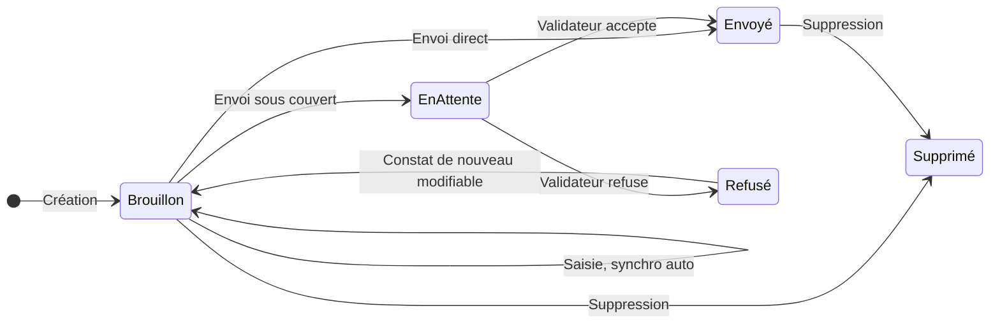
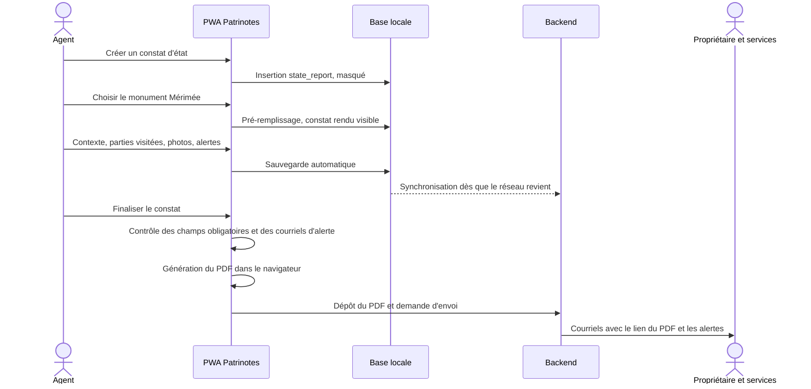

# 01 — Contexte et périmètre

Ce document présente Patrinotes du point de vue métier : à quoi sert le produit, qui l'utilise, quels documents il produit et comment les agents s'en servent sur le terrain. Il fixe aussi le périmètre du présent Dossier d'Architecture Technique (DAT).

Il s'adresse à tous les lecteurs du DAT : équipes de la DSI du ministère de la Culture qui reprennent l'hébergement, nouveaux développeurs, personnes chargées de l'homologation de sécurité, et interlocuteurs non techniques. Les termes métier sont définis dans le [glossaire](17-glossaire.md).

---

## 1. Le produit en une phrase

**Patrinotes** (« Les outils du patrimoine en mobilité ») est une application web installable (PWA) qui permet aux agents du patrimoine de rédiger **sur le terrain, même sans réseau**, deux types de documents. Ces documents sont ensuite mis en page en PDF et envoyés par courriel :

- des **constats d'état** (CE) de monuments historiques ;
- des **comptes-rendus** (CR) de rendez-vous avec des porteurs de projet.

L'application est éditée par la **Direction générale des patrimoines et de l'architecture (DGPA)** du ministère de la Culture, d'après les [CGU](../packages/frontend/src/routes/cgu.tsx) et la [politique de confidentialité](../packages/frontend/src/routes/politique-confidentialite.tsx).

## 2. Contexte beta.gouv.fr et historique

- Patrinotes est une **startup d'État** du programme beta.gouv.fr. Le code source est public (`github.com/betagouv/patrinotes`), sous **licence Etalab 2.0**. La mesure d'audience passe par l'instance Matomo de beta.gouv.fr (`stats.beta.gouv.fr`).
- Le produit s'appelait **« Compte-rendu VIF »**. Il ne couvrait alors que les comptes-rendus des UDAP, puis a été étendu aux constats d'état et renommé Patrinotes. Plusieurs traces de ce nom restent dans le code et l'exploitation :
  - le préfixe `crvif` des bases locales du navigateur (`crvif-sync.db`, `crvif-attachments`) : il ne peut pas changer sans faire perdre les données locales des agents ;
  - les anciens domaines `compte-rendu-vif.beta.gouv.fr` / `.incubateur.net`, encore autorisés par le serveur du frontend ([vite.config.ts](../packages/frontend/vite.config.ts)) ;
  - le mini-site [`crvif-redirection/`](../crvif-redirection) : une page et un *service worker* qui désinscrivent l'ancien *service worker* et redirigent vers `https://app.patrinotes.beta.gouv.fr`.
- La page publique `/stats` présente l'impact visé : environ **46 000 immeubles** classés ou inscrits suivis par les agents du contrôle scientifique et technique des DRAC (CRMH et UDAP) ; en 2024, moins de 2 % des monuments ont fait l'objet d'une fiche de visite ou d'un état sanitaire dans AgrÉgée ; un déploiement sur tout le territoire est visé « d'ici le courant de l'année 2027 ».

## 3. Les utilisateurs

### 3.1 Profils

Seuls des **agents publics habilités** peuvent utiliser l'application (CGU, articles 3 et 4). Chaque adresse doit figurer sur une **liste blanche** tenue par les administrateurs (voir § 6). Les agents sont principalement des architectes des bâtiments de France (ABF), des conservateurs et agents chargés du contrôle scientifique et technique (CST) des monuments historiques, des conservateurs des antiquités et objets d'art (CAOA), des ingénieurs et des techniciens des services patrimoniaux. À l'inscription, l'agent indique sa fonction ; c'est une information déclarative, sans effet sur les droits.

### 3.2 Services

Chaque utilisateur est rattaché à **un seul service** à la fois (table `service`) : **UDAP** (échelle départementale), **CRMH** (au sein d'une DRAC), **DRAC**, ou tout autre service. Le service détermine :

- les documents que l'agent voit et partage avec ses collègues ;
- les départements dont les données patrimoniales sont copiées sur son appareil ;
- les en-têtes des PDF et les adresses préremplies des alertes.

Le type de service (UDAP, CRMH, DRAC) est déduit du **nom** du service, et non d'un champ dédié (voir [15](15-regles-cachees-et-pieges.md)). Des comptes anciens n'ont pas de service (valeur spéciale `no-service`) : l'application leur impose d'en choisir un.

### 3.3 Destinataires externes (non utilisateurs)

L'application envoie des documents à des personnes qui **n'ont pas de compte** :

- **porteurs de projet** (« demandeurs ») et **services instructeurs** (mairies, communautés de communes…), destinataires des CR ;
- **propriétaires** de monuments et leurs **représentants**, destinataires des CE ;
- **services partenaires**, destinataires des *alertes* d'un constat : CRMH, CAOA, UDAP, SRA, DREAL, OFB, Mairie ;
- **validateur** : une personne désignée par l'agent qui accepte ou refuse l'envoi d'un constat, par un lien public sans compte.

Ces personnes reçoivent un courriel avec un **lien public** vers le PDF (voir [07](07-donnees-externes-et-stockage.md)).

## 4. Les documents produits

### 4.1 Le compte-rendu (CR)

Le CR rend compte d'un **rendez-vous** entre un agent (typiquement un ABF en UDAP) et un **demandeur** qui prépare une demande d'autorisation de travaux. Ce n'est pas une pratique réglementaire obligatoire ; elle évite les malentendus et l'allongement de l'instruction des dossiers.

Il contient le rendez-vous (rédacteur, demandeur, date, personnes présentes), le projet (description, adresse, référence cadastrale, service instructeur, type d'espace), la décision et les suites à donner, des photos annotées, et des textes types (**clauses**) nationaux ou propres au service. L'agent peut retoucher la mise en page dans un éditeur de texte riche avant l'envoi.

### 4.2 Le constat d'état (CE)

Le constat d'état est une fiche de **veille sanitaire** d'un **immeuble protégé au titre des monuments historiques**. Il s'appuie sur les notices **Mérimée** (immeubles) et **Palissy** (objets mobiliers) de la plateforme POP, copiées sur l'appareil pour les **départements du service de l'agent** uniquement.

Il comprend :

1. **le monument** : choisi par recherche ou sur une carte, prérempli depuis Mérimée et les corrections du service. Pour un **MH complexe**, l'agent choisit l'ensemble du monument ou une **unité patrimoniale** (UP), lue dans l'API Dataspace du ministère. Un monument absent de la base peut être saisi librement ;
2. **le contexte de la visite** : nature, date, rédacteur, personnes présentes, propriétaire et représentant avec leurs courriels ;
3. **le constat détaillé** : une fiche par **partie visitée** (huit parties proposées, plus des parties libres), avec état, préconisations, photos et localisation sur carte ;
4. **le constat général** : état général, dégradation, plan de l'édifice, vues générales, préconisations ;
5. **les alertes** : signalements thématiques envoyés aux services compétents (voir ci-dessous) ;
6. **la finalisation** : contrôle des champs obligatoires, aperçu du PDF, envoi, éventuellement **sous couvert** d'un validateur. Sur un MH complexe, les constats de plusieurs UP peuvent former un **rapport groupé**, envoyé en un seul PDF.

Sept types d'alerte existent, chacun avec ses services destinataires obligatoires ([stateReport.tsx](../packages/pdf/src/stateReport.tsx)) :

| Alerte | Service(s) destinataire(s) obligatoire(s) |
| --- | --- |
| Édifice en péril | CRMH |
| Abords de l'édifice | UDAP |
| Objets et mobiliers | CAOA, CRMH |
| Archéologie | SRA |
| Site classé ou inscrit | DREAL |
| Biodiversité | OFB |
| Sécurité | Mairie |

Les adresses des services sont **préremplies** depuis les paramètres du service ; l'agent peut les corriger alerte par alerte.

### 4.3 Cycle de vie et statuts

Le CE a quatre statuts : brouillon, en attente de validation, envoyé, refusé. Le CR n'en a que deux : brouillon et envoyé.

Règles de modification, appliquées par l'interface **et** par le serveur :

- un CE envoyé est **en lecture seule**, sauf si le validateur l'a refusé ; seul son **créateur** peut le modifier ;
- un CR peut être modifié par son créateur, par la personne indiquée comme rédacteur, ou par tout collègue qui a reçu une **délégation** du créateur ;
- la suppression est une **suppression logique** : le document reste en base.

## 5. Parcours utilisateurs

### 5.1 Parcours principal : rédiger et envoyer un constat d'état

Toute la saisie fonctionne hors ligne. L'envoi nécessite une **connexion réseau** (URL de dépôt signée, appel API).

### 5.2 Parcours : consulter une fiche monument ou objet

L'accueil propose une **recherche de monument** qui ouvre :

- la **fiche MH** : informations POP corrigées par le service, constats antérieurs (tous services, en ligne), alertes et annotations, objets mobiliers, arbre des unités patrimoniales ;
- la **fiche UP**, pour une unité patrimoniale d'un MH complexe ;
- la **fiche objet mobilier** : notice Palissy, monument de rattachement, annotations.

Depuis une fiche, l'agent peut **créer un constat** prérempli, **corriger les informations** pour son service, ou **signaler une alerte** hors constat. L'alerte est saisie hors ligne et envoyée par courriel par le serveur au retour du réseau.

### 5.3 Parcours : compte-rendu de rendez-vous

L'agent saisit le rendez-vous puis le bilan, prévisualise le PDF (et peut en retoucher la mise en page), choisit les destinataires (préremplis avec ses destinataires par défaut, le service instructeur et le demandeur), puis envoie. Le PDF est généré dans le navigateur.

### 5.4 Parcours : validation d'un constat (validateur externe)

Dans ses paramètres, l'agent peut activer l'envoi des constats **sous couvert** d'un validateur dont il renseigne le nom et le courriel. Le validateur reçoit un lien vers `/constat-validation/<jeton>`, valable 7 jours. Sans se connecter, il y consulte le PDF puis accepte ou refuse l'envoi, avec un commentaire en cas de refus. Un constat demandé sous couvert ne part jamais directement : si le serveur ne trouve pas l'adresse du validateur, il refuse l'envoi.

Les alertes d'un constat partent **dès la première soumission**, avant la décision du validateur, et ne sont pas renvoyées après un refus.

### 5.5 Autres parcours

| Parcours | Remarques |
| --- | --- |
| Inscription, connexion, mot de passe oublié | Inscription réservée aux courriels de la liste blanche |
| Paramètres personnels | Profil, destinataires par défaut, délégation d'édition des CR, validation des constats, export ZIP des documents, changement de service |
| Paramètres du service | En-têtes du PDF, coordonnées, services instructeurs, clauses du service, courriels des alertes |
| Aide | Guides et FAQ (site `patrinotes.beta.gouv.fr`), réinitialisation des données locales, contact |
| Administration | Gestion de la liste blanche et des utilisateurs, avec export. Accès contrôlé par le serveur (rôle `admin`) |
| Statistiques | Indicateurs publics, plus des indicateurs détaillés pour les administrateurs |

> Point d'attention pour l'homologation : **tout membre d'un service** peut modifier les paramètres de ce service (en-têtes PDF, courriels des alertes, clauses, services instructeurs). Aucun rôle n'est vérifié : c'est un choix fonctionnel. Le serveur limite la modification au **propre service** de l'agent (voir [05](05-authentification-securite.md)).

## 6. Fonctionnalités transverses

- **Hors ligne d'abord** : base SQLite dans le navigateur synchronisée par PowerSync. Les lectures et écritures sont locales, puis synchronisées. Voir [03](03-frontend-pwa.md) et [08](08-synchronisation-hors-ligne.md).
- **Photos** : prise de vue ou galerie, compression locale, **annotation au doigt** et légende.
- **Dictée vocale** sur les champs longs, via l'API de reconnaissance vocale du navigateur (voir [03 § 11.4](03-frontend-pwa.md#114-dictée-vocale) pour le flux vers un tiers).
- **Cartes** : localisation du monument, sélection de parcelles cadastrales, plan de situation automatique au 1/5 000, localisation des désordres.
- **Partage au sein du service** : chaque agent voit les documents de tout son service.
- **Délégation** : un agent autorise des collègues de son service à créer, modifier et supprimer ses CR et ses alertes de fiche. Elle ne s'applique pas aux CE.
- **Clauses** : textes types nationaux ou propres au service ; une clause du service remplace la clause nationale équivalente.
- **Liste blanche** : seuls les courriels préalablement autorisés peuvent créer un compte (modération *a priori* prévue par les CGU).

## 7. Pages légales et accessibilité

Les pages légales sont **intégrées au code** de l'application (pas de CMS), dans [`packages/frontend/src/routes`](../packages/frontend/src/routes).

| Page | Contenu notable |
| --- | --- |
| Accessibilité | **« Non conforme »** au RGAA 4 faute d'audit. Conçue avec le DSFR. Déclaration établie le 17/02/2026, mise à jour le 16/09/2026 |
| Mentions légales | Éditeur : ministère de la Culture. Directrice de la publication : la ministre de la Culture (nom écrit en dur). **Hébergeur déclaré : OVH (Roubaix)** |
| Politique de confidentialité | Responsable de traitement : DGPA. Base légale : mission d'intérêt public (RGPD 6-1 e), arrêté du 25 août 2025. Durées de conservation : compte et CR 2 ans après la dernière connexion, contact 6 mois, traces 1 an (LCEN). Sous-traitants déclarés : **OVH** (hébergement) et **Brevo** (lettre d'information). Matomo en mode exempté |
| CGU | Mise à jour du 01/02/2026. Comptes soumis à validation. Rappel : ne pas saisir de données sensibles dans les champs libres ; l'agent informe les personnes dont il saisit les données (propriétaires, demandeurs) |

> Écarts à traiter avant transfert ou homologation :
> - L'hébergeur et les sous-traitants déclarés (OVH, Brevo) **ne correspondent pas** aux services réellement appelés : Sentry (suivi d'erreurs, s'il est configuré), Scaleway (stockage objet S3 et SMTP), Matomo (`stats.beta.gouv.fr`), la reconnaissance vocale du navigateur (sous Chrome, l'audio est traité par les serveurs de Google), les tuiles cartographiques **OpenFreeMap** (tiers non étatique), IGN Géoplateforme, `openmaptiles.geo.data.gouv.fr` et l'API Adresse. L'hébergement actuel est un VPS privé sous Coolify. Ces pages devront être mises à jour lors du transfert.
> - La page « Mentions légales », rubrique Accessibilité, renvoie vers la déclaration d'accessibilité d'un autre produit (Collectif Objets).
> - Le nom de la directrice de la publication est écrit en dur et doit être tenu à jour.

## 8. Périmètre du présent DAT

**Dans le périmètre :**

- le monorepo `patrinotes` : `packages/frontend` (PWA), `packages/backend` (API Node/Fastify, envoi des documents), `packages/pdf` (gabarits partagés) ;
- la synchronisation PowerSync ([`powersync/`](../powersync)), la base PostgreSQL et ses migrations ([`db/`](../db)), l'authentification Keycloak ;
- les dépendances externes appelées (stockage objet, SMTP, données POP, API Dataspace des unités patrimoniales du ministère, cartographie, Sentry, Matomo) ;
- le déploiement actuel (VPS + Coolify, [Dockerfile](../Dockerfile), [docker-compose.yaml](../docker-compose.yaml)) et les besoins pour le transfert vers l'infrastructure du ministère ;
- les éléments utiles à l'homologation de sécurité (données personnelles, flux, comptes, journalisation).

**Hors périmètre :**

- le site vitrine et la FAQ `patrinotes.beta.gouv.fr` (guides d'utilisation), qui sont un autre site ;
- les applications métier du ministère avec lesquelles Patrinotes ne s'interface pas directement, par exemple AgrÉgée ;
- le contenu éditorial des clauses nationales et des données POP.
