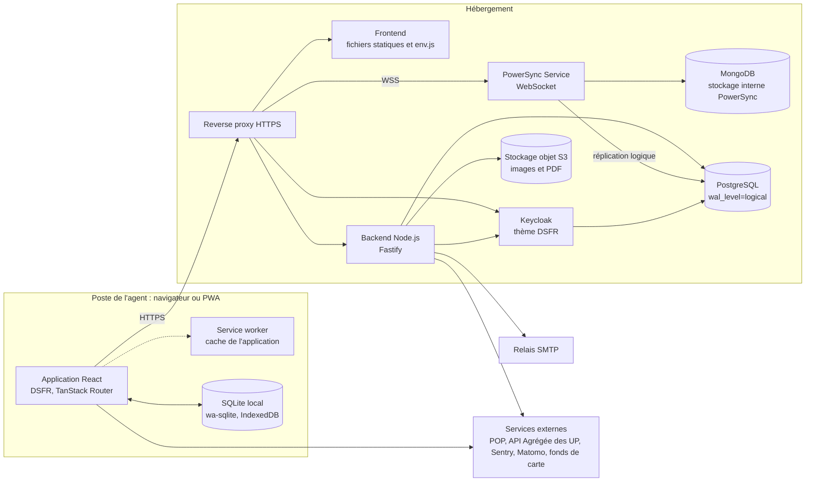
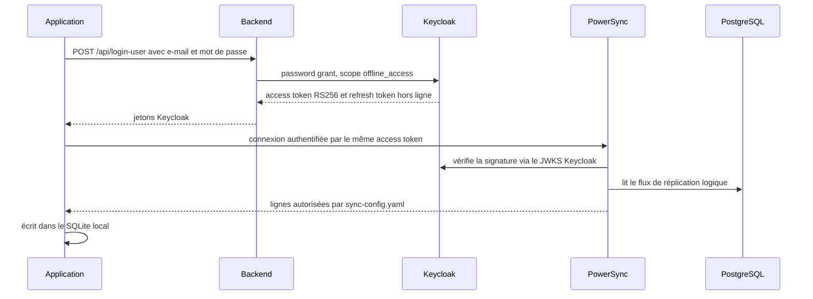
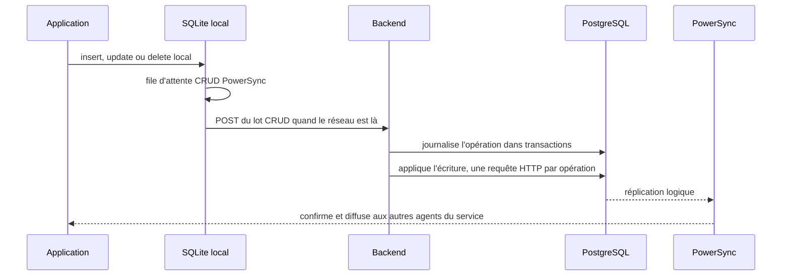

# 02 — Architecture générale

Ce document donne la vue d'ensemble de Patrinotes : les composants, leurs responsabilités, les flux entre eux et les grands choix d'architecture. Chaque composant est détaillé dans un document dédié (voir le [sommaire](README.md)).

## 1. Principes structurants

| Principe | Mise en œuvre | Conséquence |
| --- | --- | --- |
| **Hors ligne d'abord** (*offline-first*) | Le navigateur garde une base SQLite locale (wa-sqlite) synchronisée par **PowerSync**. L'agent peut créer et modifier des comptes-rendus et des constats d'état sur le terrain, sans réseau. | Le serveur n'est pas interrogé à chaque écran. Les écritures sont mises en file puis rejouées vers le backend dès que le réseau revient. Voir [08 — Synchronisation](08-synchronisation-hors-ligne.md). |
| **Application web progressive (PWA)** | Front React + Vite, *service worker* qui met en cache l'application. Installable sur mobile et tablette. | La gestion des versions (vieux *chunks* JS, `env.js`) demande un soin particulier. Voir [03 — Frontend](03-frontend-pwa.md). |
| **Lecture par synchronisation, écriture par API** | Les lectures passent par le flux PowerSync (WebSocket). Les écritures passent par un `POST` vers le backend, qui les applique dans PostgreSQL. | PostgreSQL reste la **seule source de vérité**. PowerSync n'écrit jamais dans la base. |
| **Monorepo TypeScript** | pnpm workspace : `backend`, `frontend`, `pdf` (code partagé). | Les gabarits PDF sont les mêmes côté navigateur (aperçu) et côté serveur (génération). |
| **Contrat d'API typé** | Fastify + TypeBox, OpenAPI généré, client typé généré pour le frontend. | Le frontend et le backend partagent un contrat d'API vérifié à la compilation. |
| **Socle « État »** | Système de design de l'État (DSFR, `@codegouvfr/react-dsfr`), thème Keycloak DSFR. | Respect de la charte de l'État et du RGAA. |

## 2. Vue des composants

| Composant | Technologie | Rôle | Détail |
| --- | --- | --- | --- |
| Frontend | React 18, Vite, TanStack Router, PowerSync Web, DSFR, TipTap, MapLibre, Konva, react-pdf | Interface, base locale, aperçu des PDF, annotation des photos, cartes | [03](03-frontend-pwa.md) |
| Backend | Node.js 22, Fastify 5, TypeBox, Kysely, Drizzle (migrations), Nodemailer, AWS SDK S3 | Intermédiaire d'authentification vers Keycloak, application des écritures, URL pré-signées S3, envoi des e-mails, liens courts, validation des constats, statistiques, import des données patrimoniales, administration, envoi et reprise des alertes (tâche périodique). | [04](04-backend-api.md) |
| Package `pdf` | @react-pdf/renderer, react-pdf-html | Gabarits PDF partagés (compte-rendu, constat d'état) | [09](09-documents-pdf-cartes-emails.md) |
| PostgreSQL 17 | Réplication logique, publication `powersync` | Source de vérité métier, plus la base Keycloak | [06](06-modele-de-donnees.md) |
| PowerSync Service | `journeyapps/powersync-service`, mode `unified` | Diffusion en temps réel des données aux clients, selon des règles d'accès (*sync streams*) | [08](08-synchronisation-hors-ligne.md) |
| MongoDB 7 | *Replica set* `rs0` | Stockage interne de PowerSync (*buckets*). Peut être reconstruit. | [08](08-synchronisation-hors-ligne.md) |
| Keycloak 26 | OIDC, thème DSFR (`keycloak-theme.jar`) | Gestion des comptes et des mots de passe | [05](05-authentification-securite.md) |
| Stockage objet | Scaleway Object Storage en production, MinIO en développement | Photos, pièces jointes, PDF | [07](07-donnees-externes-et-stockage.md) |
| SMTP | Scaleway Transactional Email en production, Mailpit en développement. | Envoi des liens vers les comptes-rendus et constats, des alertes et des demandes de validation | [09](09-documents-pdf-cartes-emails.md) |

## 3. Flux principaux

### 3.1 Lecture : synchronisation descendante

> Le backend **ne signe aucun jeton**. Tous les jetons sont émis par Keycloak. Le même *access token* sert pour le backend (en-tête `Bearer`, vérifié via JWKS) et pour PowerSync. Voir [05](05-authentification-securite.md).

Les règles d'accès se trouvent dans [sync-config.yaml](../powersync/sync-config.yaml) et sont détaillées en [08](08-synchronisation-hors-ligne.md). Elles reposent sur le claim `email` du jeton. En résumé, un agent reçoit :

- les données globales : clauses nationales (`service_id = 'ALL'`) ;
- les données de **son service** : service, collègues, clauses, e-mails suggérés, comptes-rendus (`report`), constats (`state_report`) et leurs sous-objets, alertes et corrections des fiches monument ;
- ses données personnelles : délégations, réglages, *snapshots* PDF ;
- le patrimoine (`pop_immeubles`, `pop_objets`) **de ses départements** (`user_dept`) ;
- les pièces jointes d'un constat ou d'un compte-rendu, **seulement à l'ouverture** (flux à abonnement explicite).

### 3.2 Écriture : synchronisation montante

> **Point d'attention.** Le backend contrôle chaque écriture : table et colonnes autorisées, service de l'utilisateur, auteur du document ou délégation. Un constat envoyé n'accepte aucune modification, sauf sa suppression. En cas de refus ou d'erreur SQL, il répond HTTP 200 avec `success:false` ; le client retire l'opération de sa file et la signale à l'agent dans un bandeau. Voir [08](08-synchronisation-hors-ligne.md) et [16](16-risques-et-dette-technique.md).

### 3.3 Documents : PDF et e-mail

1. L'agent rédige le compte-rendu ou le constat, éventuellement hors ligne.
2. Le PDF est généré **uniquement dans le navigateur** avec le package `pdf`. Le backend ne fait aucun rendu PDF.
3. Le navigateur dépose le PDF **directement sur S3**, avec une URL pré-signée valable 1 h que fournit le backend. Le stockage objet doit donc être joignable depuis les postes des agents, avec une configuration CORS adaptée.
4. Le backend enregistre la pièce jointe, crée un **lien court public** `BACKEND_URL/attachment/:id/:nom`, valable 90 jours sans authentification, et envoie un e-mail par SMTP. L'e-mail contient ce lien, pas le PDF.
5. Pour un constat soumis à validation (« envoi sous-couvert »), un validateur reçoit d'abord un lien à jeton, valable 7 jours.

### 3.4 Données patrimoniales

Le backend importe les exports Mérimée (immeubles) et Palissy (objets mobiliers) de la base POP, publiés sur `ministere-culture.s3.sbg.io.cloud.ovh.net` (`merimee.csv`, `palissy.csv`). La table `pop_images`, prévue pour les URL de photos POP, est vide : les images POP ne sont pas affichées. Les données Mérimée et Palissy alimentent `pop_immeubles` et `pop_objets`, diffusées aux clients selon leurs départements. L'API Adresse et les fonds de carte (IGN Géoplateforme, cadastre, OpenFreeMap) sont appelés **directement par le navigateur**. L'import n'est pas planifié : il se lance au démarrage si `FORCE_REFETCH_POP` est vrai, ou à la main. Pour les MH complexes, le backend lit à la demande les **unités patrimoniales** dans l'API Agrégée (joignable seulement depuis le réseau de production) et les garde en cache. Voir [07](07-donnees-externes-et-stockage.md).

## 4. Organisation du dépôt

| Chemin | Contenu |
| --- | --- |
| [packages/backend](../packages/backend) | API Fastify, schéma Drizzle, services, e-mails, imports |
| [packages/frontend](../packages/frontend) | PWA React |
| [packages/pdf](../packages/pdf) | Gabarits PDF partagés |
| [db](../db) | Migrations SQL générées par Drizzle, plus `db/init` (publication PowerSync, création de la base Keycloak) |
| [powersync](../powersync) | Configuration du service et règles de synchronisation |
| [tests](../tests) | Tests de bout en bout Playwright, realm Keycloak de test |
| [scripts](../scripts) | Scripts de remise à zéro et de chargement de la base |
| [crvif-redirection](../crvif-redirection) | Page de redirection de l'ancien domaine « Compte-rendu VIF » |
| [Dockerfile](../Dockerfile), [docker-compose.yaml](../docker-compose.yaml) | Images et environnement de développement |
| [.github/workflows](../.github/workflows) | Intégration continue : tests unitaires du backend, audit des dépendances, construction des images (ghcr.io) ; tests de bout en bout lancés à la main |

Taille indicative : environ 35 000 lignes de TypeScript et TSX, hors code généré et dépendances.

## 5. Choix techniques et justifications

| Choix | Pourquoi (constaté ou déduit) | Alternatives écartées ou passées |
| --- | --- | --- |
| PowerSync | Travail sur le terrain (monuments, églises, zones blanches) : il faut un vrai mode hors ligne, avec une base locale requêtable en SQL. | ElectricSQL. |
| PostgreSQL avec réplication logique | Exigé par PowerSync pour suivre les changements. | — |
| Keycloak | Comptes locaux (inscription, mot de passe oublié) sans dépendre d'un fournisseur d'identité externe pendant la phase beta. | ProConnect ou un annuaire ministériel : à étudier pour la cible, voir [14](14-migration-vers-infra-ministere.md). |
| Gabarits PDF en React partagés | Aperçu hors ligne identique au document final. | Génération seulement côté serveur (pas d'aperçu hors ligne). |
| Stockage objet S3 | Photos et PDF volumineux, hors de la base. | — |

## 6. Environnements et intégration continue

| Environnement | Déclenchement | Image |
| --- | --- | --- |
| Développement local | `docker compose up -d`, puis backend et frontend lancés en mode développement | — |
| Préproduction | `push` sur la branche `development` | `ghcr.io/<dépôt>-development:backend` et `:frontend` |
| Production | `push` sur la branche `main` | `ghcr.io/<dépôt>-main:backend` et `:frontend` |

À chaque `push` sur ces branches, le workflow [main.yml](../.github/workflows/main.yml) lance les **tests unitaires du backend**, qui conditionnent la publication des images, et un **audit des dépendances de production** (`pnpm audit --prod`), dont le résultat est seulement signalé et ne bloque pas la publication. Les tests de bout en bout ([tests.yml](../.github/workflows/tests.yml)) se lancent à la main. Le workflow construit aussi les images d'une branche historique `compte-rendu-vif`, qu'aucun environnement actuel n'utilise ([10](10-infrastructure-et-deploiement.md) § 3.1).

Le déploiement actuel (VPS avec Coolify) récupère ces images ; il est manuel. Le détail est dans [10 — Infrastructure](10-infrastructure-et-deploiement.md).
