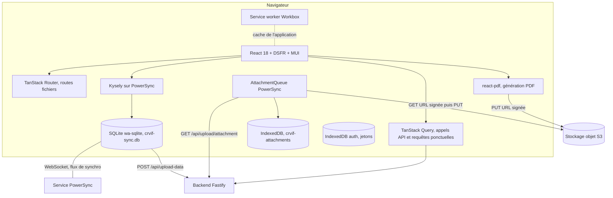
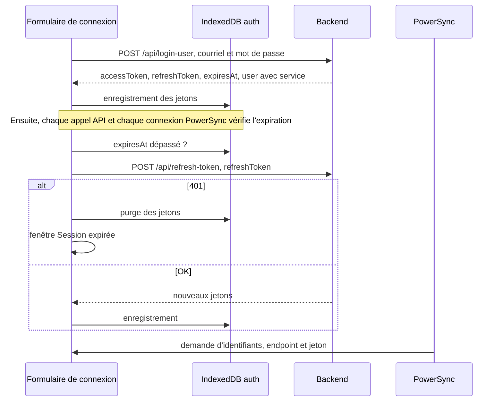
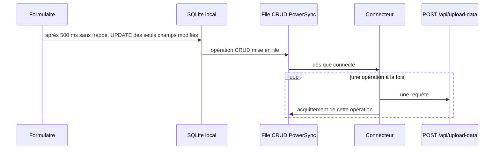
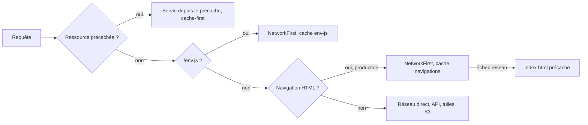
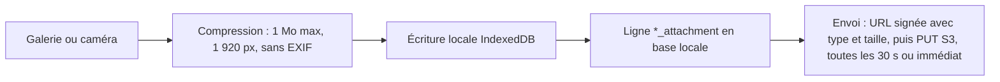

# 03 — Frontend (PWA)

Ce document décrit le paquet [`packages/frontend`](../packages/frontend) : la pile technique, les routes, l'authentification côté client, la base locale synchronisée, la stratégie PWA et *service worker*, l'injection de la configuration au démarrage, les traitements faits dans le navigateur (photos, PDF, cartes, dictée) et le comportement hors ligne.

Pour le contexte métier (constat d'état, compte-rendu, alertes…), voir [01 — Contexte et périmètre](01-contexte-et-perimetre.md). Pour la vue d'ensemble, voir [02 — Architecture générale](02-architecture-generale.md). Les règles implicites du code sont regroupées en [15](15-regles-cachees-et-pieges.md), les risques en [16](16-risques-et-dette-technique.md).

---

## 1. Vue d'ensemble

Le frontend est une **application monopage (SPA) React** construite avec **Vite**, installable comme **PWA**. Elle fonctionne **hors ligne d'abord** :

- toutes les lectures et écritures métier passent par une **base SQLite locale** (wa-sqlite dans le navigateur), synchronisée par **PowerSync** ;
- les écritures locales sont mises en file puis envoyées une par une au backend (`POST /api/upload-data`), qui les applique dans PostgreSQL ;
- les fichiers (photos, PDF) passent par une **file d'attente de pièces jointes** PowerSync : stockage local dans IndexedDB, puis envoi vers S3 par URL signée ;
- les **PDF sont générés dans le navigateur** (`@react-pdf/renderer`) puis déposés sur S3 ; le backend se charge de l'envoi des courriels.

## 2. Pile technique

Versions déclarées dans [package.json](../packages/frontend/package.json) ; les versions installées sont dans `pnpm-lock.yaml`.

| Domaine | Bibliothèque | Rôle |
| --- | --- | --- |
| Langage, interface | TypeScript (strict), React 18 | — |
| Build et service | Vite 5, vite-plugin-pwa (Workbox 7) | Build, *service worker* sur mesure, serveur de production (`vite preview`, § 13) |
| Routage, appels API | TanStack Router, TanStack Query | Routes basées sur des fichiers ; mutations et requêtes en ligne |
| Base locale | PowerSync Web, wa-sqlite, Kysely | SQLite synchronisé, file de pièces jointes, requêtes typées partagées avec le backend |
| Design system | `@codegouvfr/react-dsfr`, MUI | DSFR et thème MUI DSFR |
| Documents | `@react-pdf/renderer`, pdfjs-dist, TipTap 3 | Génération et affichage des PDF, mise en page des CR |
| Cartographie, dessin | maplibre-gl, konva | Cartes, cadastre, plan de situation, annotation des photos |
| Supervision, audience | `@sentry/react` 11, Matomo | Erreurs (données filtrées), mesure d'audience |

## 3. Organisation du code

Le code métier est rangé par domaine dans `src/features/` (constat d'état, fiches, unités patrimoniales, compte-rendu, photos, cartes, dictée, authentification…), les pages dans `src/routes/` (une route par fichier) et la base locale dans `src/db/` ([AppSchema.ts](../packages/frontend/src/db/AppSchema.ts), [db.ts](../packages/frontend/src/db/db.ts), [Connector.ts](../packages/frontend/src/db/Connector.ts)). Le client d'API typé ([api.gen.ts](../packages/frontend/src/api.gen.ts)) est généré depuis le contrat OpenAPI du backend. Le *service worker* est [src/service-worker/sw.ts](../packages/frontend/src/service-worker/sw.ts).

## 4. Démarrage de l'application

Au chargement, [main.tsx](../packages/frontend/src/main.tsx) initialise Sentry (en production, si `VITE_SENTRY_DSN` est défini), enregistre le *service worker*, installe la reprise sur *chunk* périmé (§ 9.3), force le thème clair, puis monte l'application : gestion des erreurs, authentification, connexion PowerSync, choix obligatoire du service pour les comptes qui n'en ont pas, et routeur.

`setupPowersync()` est appelé **même sans utilisateur connecté**. Le connecteur lève alors une erreur (« No token found ») avant toute requête : PowerSync ne contacte pas le serveur et réessaie toutes les 5 secondes, jusqu'à ce qu'un jeton soit disponible. Ces erreurs n'atteignent pas Sentry : PowerSync les intercepte et les écrit au plus dans la console (celle du *worker* de synchronisation), que Sentry ne collecte pas.

## 5. Configuration d'exécution (env.js)

### 5.1 Principe

Les variables `VITE_*` ne sont **pas figées dans le bundle en production**. Elles sont lues à l'exécution depuis `window.ENV` ([envVars.ts](../packages/frontend/src/envVars.ts)), défini par `/env.js`. En développement, elles viennent du fichier `.env` à la racine du dépôt.

Au **démarrage du conteneur**, le script [createEnvFile.ts](../packages/frontend/scripts/createEnvFile.ts) écrit `dist/env.js` (`window.ENV = { VITE_...: "..." }`) à partir de **toutes** les variables d'environnement préfixées `VITE_`. Une même image sert donc tous les environnements.

### 5.2 Variables attendues

| Variable | Obligatoire | Utilisation |
| --- | --- | --- |
| `VITE_BACKEND_URL` | oui | Base de toutes les API |
| `VITE_POWERSYNC_URL` | oui | Point d'accès WebSocket PowerSync |
| `VITE_AUTH_URL`, `VITE_AUTH_REALM`, `VITE_AUTH_CLIENT_ID` | oui pour la validation | **Aucune utilisation dans le code frontend** (la connexion passe par le backend) |
| `VITE_SENTRY_DSN` | non | Active Sentry |
| `VITE_SENTRY_ENVIRONMENT` | non | Environnement des événements Sentry (défaut `production`) |

La référence complète des variables est en [11](11-configuration.md).

> Points d'exploitation :
> - La validation est **tout ou rien** : s'il manque **une seule** variable obligatoire (y compris les trois `VITE_AUTH_*` inutilisées), aucune configuration n'est chargée et toute l'application est hors service, avec pour seul indice « Error parsing env vars » dans la console du navigateur.
> - Les valeurs sont injectées entre guillemets sans échappement : une valeur contenant `"` casse `env.js`.
> - `env.js` est **exclu du précache** et servi en **NetworkFirst** : un changement de configuration est pris en compte dès que le client est en ligne, et la dernière version connue reste disponible hors ligne.

La version affichée dans le pied de page vient de `dist/version.js`, écrit au build (version du paquet suivie d'un horodatage).

## 6. Routage

Le routage utilise **TanStack Router** avec des routes basées sur des fichiers ([src/routes](../packages/frontend/src/routes)).

| Chemin | Accès | Rôle |
| --- | --- | --- |
| `/` | connecté | Accueil : recherche de monument, création de documents, listes des documents de l'agent et de son service |
| `/monument`, `/monument/$reference?up=…`, `/objet/$reference` | connecté | Recherche de monument, fiche MH ou UP, fiche objet mobilier |
| `/connexion`, `/inscription`, `/reset-password/…` | anonyme | Connexion, inscription, mot de passe oublié |
| `/edit/$reportId`, `/pdf/$reportId` | connecté | Saisie, mise en page et envoi d'un CR |
| `/constat/$constatId`, `/constat/$constatId/pdf` | sans garde explicite | Saisie, prévisualisation et envoi d'un CE |
| `/constat-validation/$token` | **public** (sans compte) | Page du validateur : PDF, accepter ou refuser |
| `/compte`, `/service` | connecté | Paramètres personnels et du service |
| `/admin` | connecté + admin (contrôle serveur) | Liste blanche et utilisateurs |
| `/stats` | public ; partie admin si le jeton est admin | Statistiques |
| `/accessibilite`, `/mentions-legales`, `/politique-confidentialite`, `/cgu` | public | Pages légales (voir [01 § 7](01-contexte-et-perimetre.md#7-pages-légales-et-accessibilité)) |

> Les gardes de route sont des composants d'interface : sans session, les routes de constat n'affichent rien, car la base locale est vide. **La sécurité réelle repose sur les règles de synchronisation et sur le backend**, jamais sur le routage.

## 7. Authentification côté client

Le frontend **ne parle jamais directement à Keycloak**. Le backend fait office d'intermédiaire.

> Points de sécurité :
> - Les jetons (accès et rafraîchissement hors ligne) sont stockés dans **IndexedDB** (base `auth`). Ils sont donc lisibles par tout script exécuté sur l'origine : le risque XSS est à prendre en compte dans l'homologation (voir [05](05-authentification-securite.md) et [16](16-risques-et-dette-technique.md)).
> - `expiresAt` est calculé par le backend à **80 %** de la durée de vie du jeton ; le client rafraîchit dès que cette date est dépassée. Les appels concurrents partagent un seul rafraîchissement.
> - Seul un **401** sur `/api/refresh-token` déconnecte l'utilisateur. Une erreur réseau (hors ligne) laisse la session intacte : l'agent continue à travailler localement.
> - **La déconnexion vide l'appareil.** S'il reste des modifications ou des photos non envoyées, l'agent en est averti et peut attendre ; hors ligne, la déconnexion est refusée tant qu'il en reste. En ligne, le jeton de rafraîchissement est d'abord révoqué auprès de Keycloak (`POST /api/logout`), puis les données locales sont effacées comme par « Réinitialiser les données locales » (§ 10). Seuls le *service worker* et ses caches (code de l'application) sont conservés, pour que la page de connexion s'ouvre hors ligne.

## 8. Données locales et synchronisation

### 8.1 Base locale PowerSync

La base locale ([db.ts](../packages/frontend/src/db/db.ts)) est une base SQLite PowerSync (`crvif-sync.db`) dont le schéma est [AppSchema.ts](../packages/frontend/src/db/AppSchema.ts). Elle utilise OPFS dans un *web worker* quand le navigateur le permet, sinon IndexedDB. Le mode multi-onglets n'est actif que si le navigateur fournit `SharedWorker`, ce qui n'est **jamais** le cas sur iOS.

Elle contient 25 tables métier, copies partielles de celles de PostgreSQL (documents, pièces jointes, service, collègues, réglages, données patrimoniales POP, alertes et corrections des fiches), plus la table interne de la file de pièces jointes. Les composants la lisent par des requêtes **réactives**, qui se rafraîchissent à chaque modification locale ou synchronisée.

Certaines tables locales ne sont alimentées par **aucun flux** de synchronisation : `transactions`, `state_report_sent_email` et `pop_images` (cette dernière est lue en ligne par l'API).

### 8.2 Flux de synchronisation utilisés par le client

Les règles de synchronisation sont décrites en [08](08-synchronisation-hors-ligne.md). Côté client :

- les flux du service, de l'utilisateur, des documents et des données patrimoniales (départements du service) sont **abonnés automatiquement** ;
- les **pièces jointes** d'un document ne sont synchronisées **qu'à son ouverture**, quand l'appareil est en ligne. Un document jamais ouvert en ligne sur un appareil n'a donc pas ses photos hors ligne.

### 8.3 Écriture : sauvegarde automatique et envoi au serveur

- La saisie est enregistrée localement **500 ms** après la dernière frappe, et au moment de quitter un formulaire.
- Côté serveur, la règle est **le dernier qui écrit gagne**, sans détection de conflit. Côté client, une modification distante est réinjectée dans le formulaire ouvert, sauf dans le champ en cours de saisie.
- Le connecteur envoie et acquitte les opérations **une par une**, dans l'ordre. Une erreur réseau ou 5xx garde l'opération dans la file ; une même erreur 4xx reçue 5 fois de suite met l'opération de côté (voir [08](08-synchronisation-hors-ligne.md)).
- **Écritures refusées** : un refus du serveur (HTTP 200 `success:false`) ou une opération mise de côté est enregistré localement et signalé à l'agent dans un **bandeau** en haut de toutes les pages, avec le document, la date et le motif. PowerSync renvoie ensuite l'état du serveur, ce qui annule la modification locale.
- Les identifiants des lignes sont générés **côté client** (UUID v4 ou v7).
- Plusieurs colonnes texte stockent des listes avec des séparateurs non échappés (voir [15](15-regles-cachees-et-pieges.md)).

## 9. PWA et service worker

### 9.1 Configuration

[vite.config.ts](../packages/frontend/vite.config.ts) : `VitePWA` en stratégie **`injectManifest`**, *service worker* sur mesure [sw.ts](../packages/frontend/src/service-worker/sw.ts), mise à jour en mode `prompt`.

| Élément | Valeur |
| --- | --- |
| Manifeste | `id: gouv.beta.patrinotes`, nom `Patrinotes`, `lang: fr`, orientation portrait, `start_url: /` |
| Précache | Code de l'application, polices, images, WASM, jusqu'à **16 Mio** par fichier (dont le *worker* pdf.js) |
| Exclus du précache | Page d'administration (non disponible hors ligne), `env.js`, `swEnv.js`, copies inutilisées de pdf.js et wa-sqlite |

### 9.2 Stratégie de cache

- Un nouveau *service worker* installé **attend** que la page l'active (§ 9.3). Les précaches des versions précédentes sont supprimés à l'activation.
- En production, les **navigations sont en NetworkFirst** : après un déploiement, l'`index.html` récent est servi dès que le réseau répond. Hors ligne, c'est l'`index.html` précaché qui est servi.
- Les appels API, le WebSocket PowerSync, les tuiles cartographiques et S3 **ne sont pas mis en cache** par le *service worker*.

### 9.3 Mise à jour et reprise sur *chunk* périmé

- **Mise à jour** : quand une nouvelle version est installée, la page se recharge tout de suite sur les pages de consultation (accueil, fiches, statistiques, pages légales) si aucun champ n'a le focus. Partout ailleurs (saisie, envoi, paramètres, connexion), un bandeau propose de recharger : l'agent choisit le moment.
- **Reprise sur *chunk* périmé** : après un déploiement, une page ancienne peut demander un fichier JavaScript haché qui n'existe plus. Le code intercepte l'erreur, recharge la page une première fois, puis à la deuxième tentative désinscrit les *service workers* et vide tous les caches avant de recharger ; ensuite il abandonne, pour éviter une boucle.

> Contraintes d'exploitation :
> - Tant que l'agent ne recharge pas, la version déjà chargée continue de tourner. Chaque déploiement du backend doit rester **compatible avec la version précédente du frontend**.
> - Le serveur du frontend doit servir `sw.js` et `index.html` **sans cache HTTP longue durée** pour que la mise à jour fonctionne (voir § 13).
> - L'ancien domaine Compte-rendu VIF utilise [`crvif-redirection/sw.js`](../crvif-redirection/sw.js) pour désinscrire l'ancien *service worker* et rediriger les clients.

## 10. Données stockées dans le navigateur

| Stockage | Contenu |
| --- | --- |
| SQLite PowerSync (`crvif-sync.db`, OPFS ou IndexedDB) | Copie locale des données synchronisées, file des écritures en attente |
| IndexedDB `crvif-attachments` | Photos et PDF (fichiers locaux, en attente d'envoi ou téléchargés) |
| IndexedDB `auth` | Jetons d'accès et de rafraîchissement, copie de l'utilisateur |
| `localStorage` | Préférences d'affichage, version de migration locale, liste des écritures refusées (50 au plus) |
| Caches du *service worker* | Code de l'application, `env.js`, dernières pages de navigation |

Toutes ces données contiennent ou peuvent contenir des données personnelles (noms, courriels, photos). Le domaine du frontend porte ces données : en changer fait perdre les écritures non synchronisées.

**« Réinitialiser les données locales »** (menu Aide) efface tout, après avoir indiqué le nombre de modifications et de photos non envoyées qui seront perdues : arrêt de la synchronisation, suppression des bases locales, des jetons, du `localStorage`, des *service workers* et des caches, puis rechargement de tous les onglets. L'action est refusée hors ligne. La déconnexion utilise le même mécanisme (§ 7).

## 11. Traitements réalisés dans le navigateur

### 11.1 Photos et pièces jointes

- Les photos sont compressées sur l'appareil, sans métadonnées EXIF (donc sans coordonnées GPS).
- **Limites** : JPEG, PNG, WebP ou HEIC/HEIF (type lu dans le contenu du fichier), 20 Mo au plus après compression. Le serveur applique les mêmes règles et les signe dans l'URL de dépôt.
- L'annotation d'une photo produit une **nouvelle** image ; l'ancienne est marquée obsolète. Les fichiers sur S3 sont **immuables** et **jamais supprimés par le client**, même quand la photo est supprimée ou remplacée (voir [07](07-donnees-externes-et-stockage.md)).
- Les envois en cours ou en échec bloquent la finalisation d'un document, pour ne pas envoyer un PDF incomplet.
- Clés S3 : `attachment/<id du document>/images/<uuid>.jpg` ; le premier segment sert au contrôle d'accès côté serveur (voir [04 § 4.5](04-backend-api.md#45-fichiers--uploadroutestsx)).

### 11.2 Génération et envoi des PDF

Les PDF des CR et des CE sont produits **dans le navigateur** avec les gabarits du paquet [`packages/pdf`](../packages/pdf), à partir de la base locale et des photos présentes sur l'appareil (voir [09](09-documents-pdf-cartes-emails.md)). L'aperçu fonctionne hors ligne. L'envoi suit toujours la même séquence :

1. demande d'une URL de dépôt au backend (taille du PDF signée) ;
2. `PUT` du PDF sur S3 ;
3. attente de l'envoi des écritures locales en attente (30 s au plus), pour que le serveur ait la dernière version du document ;
4. demande d'envoi au backend (destinataires, alertes, validation éventuelle), qui envoie les courriels.

Pour un CE, le **plan de situation** (image satellite au 1/5 000) est généré à la prévisualisation et enregistré comme pièce jointe ; hors ligne, le PDF est produit sans plan. Pour un MH complexe, les **unités patrimoniales** sont demandées au backend (`GET /api/up/monument`), en ligne seulement ; hors ligne, le constat porte sur l'ensemble du monument.

### 11.3 Cartographie et géocodage

| Fonction | Source de données (appelée par le navigateur) |
| --- | --- |
| Fond « plan » vectoriel | `tiles.openfreemap.org` (tiers non étatique) |
| Fond satellite | IGN Géoplateforme (`data.geopf.fr`), WMTS orthophotos |
| Parcelles cadastrales | `openmaptiles.geo.data.gouv.fr` |
| Géocodage | `api-adresse.data.gouv.fr`, Géoplateforme |
| Choix du monument sur carte | Monuments POP de la base locale |

**Aucune carte ne fonctionne hors ligne** : les tuiles ne sont pas mises en cache.

### 11.4 Dictée vocale

La dictée utilise la **Web Speech API** du navigateur, en français ([SpeechRecorder.machine.tsx](../packages/frontend/src/features/audio-record/SpeechRecorder.machine.tsx)).

> Point d'attention (homologation) : sous Chrome, la reconnaissance vocale est réalisée **par un service distant de Google**. La dictée ne fonctionne donc pas hors ligne et transmet la voix à un tiers ; ce flux est à mentionner dans la politique de confidentialité (voir [09](09-documents-pdf-cartes-emails.md) § 10). Sur les navigateurs sans cette API, le bouton n'est pas utilisable.

### 11.5 Exports

Les exports ZIP des documents d'un agent sont construits dans le navigateur, avec un appel au backend par document. Ils nécessitent le réseau.

## 12. Supervision et mesure d'audience

- **Sentry** : actif seulement en production et si `VITE_SENTRY_DSN` est défini. 10 % des transactions, collecte de données désactivée, ni journaux ni fil d'Ariane console, et un filtre qui retire l'utilisateur et masque les clés de type mot de passe, jeton, courriel ou destinataires. Les écritures refusées par le serveur y sont signalées (table, opération, motif). Le connecteur PowerSync n'écrit ni les jetons ni les opérations de synchronisation dans la console.
- **Matomo** : `stats.beta.gouv.fr`, avec suivi des liens. La politique de confidentialité le déclare en mode « exempté ».

## 13. Service en production

En production, l'étape `frontend` du [Dockerfile](../Dockerfile) construit l'application puis lance **`vite preview`** après avoir généré `env.js`. Le site est donc servi par le **serveur de prévisualisation de Vite**, que la documentation de Vite déconseille en production. Les noms d'hôte acceptés sont limités par `preview.allowedHosts`, écrits en dur dans [vite.config.ts](../packages/frontend/vite.config.ts) (domaines `patrinotes` et anciens domaines `compte-rendu-vif`).

> Pour le transfert :
> - Un **nouveau nom de domaine** doit être ajouté à `allowedHosts`, sinon `vite preview` refuse les requêtes. La meilleure option est de servir `dist/` par un serveur statique (nginx…) qui génère `env.js` au démarrage.
> - Prévoir les en-têtes `Cache-Control` : pas de cache pour `index.html`, `sw.js`, `env.js`, `version.js` et `manifest.webmanifest` ; cache long pour `assets/*` (fichiers hachés).
> - Une **politique CSP** devra autoriser : le backend, le WebSocket PowerSync, le bucket S3 (PUT et GET signés), `api-adresse.data.gouv.fr`, `tiles.openfreemap.org`, `data.geopf.fr`, `openmaptiles.geo.data.gouv.fr`, `stats.beta.gouv.fr`, l'ingestion Sentry, `blob:` (images et PDF), `wasm-unsafe-eval` (wa-sqlite) et les *workers* (`worker-src blob: 'self'`). Aucune CSP n'est définie, ni dans le frontend ni par le proxy de production (aucun en-tête `Content-Security-Policy` sur `app.patrinotes.beta.gouv.fr` le 25/11/2026).
> - Le bucket S3 doit accepter le **CORS** pour les `PUT` depuis l'origine du frontend.
> - Le domaine du frontend ne doit pas changer sans plan de migration : les données locales des agents y sont attachées (§ 10).

## 14. Comportement hors ligne : synthèse

| Fonction | Hors ligne ? | Remarque |
| --- | --- | --- |
| Ouvrir l'application déjà installée | oui | Précache du *service worker* |
| Se connecter pour la première fois | non | Appel au backend |
| Lister, créer et modifier CR et CE | oui | Base locale, synchronisation au retour du réseau |
| Rechercher un monument | oui | Données limitées aux départements du service |
| Consulter une fiche MH ou objet | oui, en partie | Constats des autres services, unités patrimoniales et photos POP en ligne seulement |
| Choisir une unité patrimoniale | non | Hors ligne, constat sur l'ensemble du monument |
| Signaler une alerte ou annoter un objet depuis une fiche | oui | Envoi par courriel par le serveur dès que la ligne est synchronisée |
| Se déconnecter | oui, sauf s'il reste des envois en attente | La déconnexion vide l'appareil |
| Ajouter et annoter des photos | oui | Envoi différé par la file de pièces jointes |
| Voir les photos d'un document jamais ouvert en ligne | non | Flux de pièces jointes à la demande |
| Dictée vocale | non (Chrome) | Service distant |
| Cartes, cadastre, plan de situation, géocodage | non | Tuiles et API en ligne |
| Prévisualiser le PDF | oui | Avec les photos présentes sur l'appareil ; sans plan de situation s'il n'a pas été généré en ligne |
| Envoyer un CR ou un CE, télécharger un PDF envoyé, exports ZIP | non | URL signée et API |
