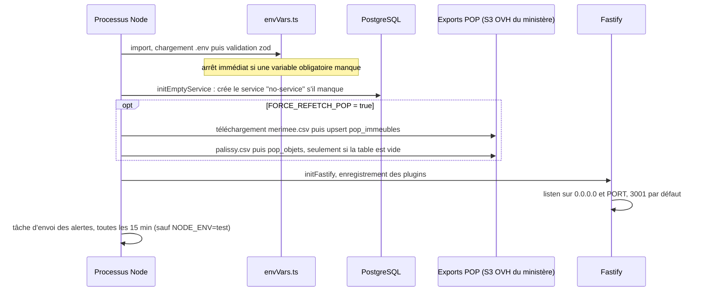
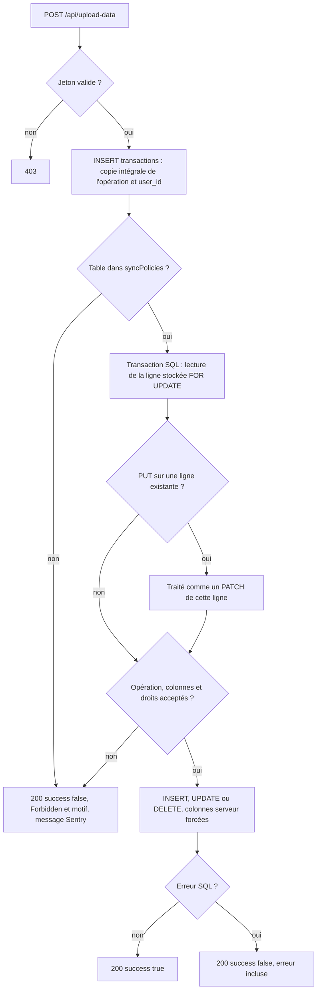
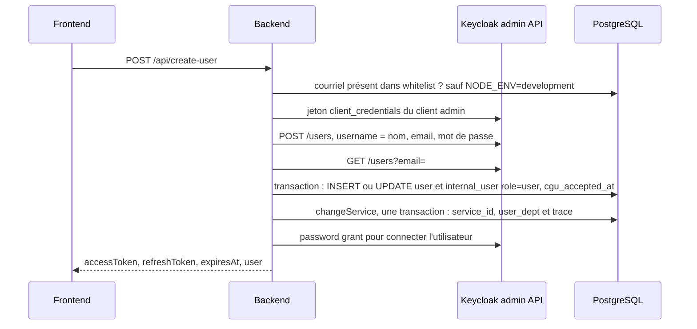
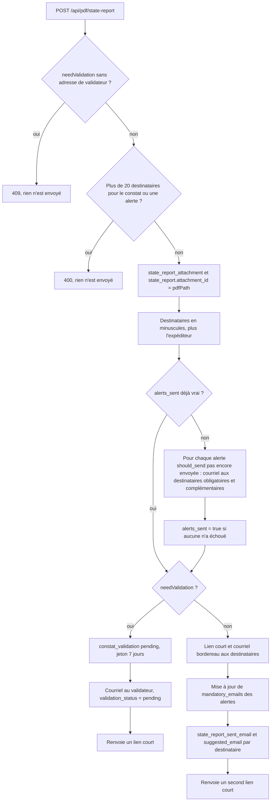

# 04 — Backend et API

Ce document décrit en détail le service backend de Patrinotes (`packages/backend`) : sa pile technique, sa séquence de démarrage, l'organisation du code, **toutes** les routes HTTP exposées, les services métier, le point d'entrée de synchronisation PowerSync (`/api/upload-data`), la gestion des erreurs et des journaux, et la tâche périodique.

Il s'adresse aux développeurs qui reprennent le code et aux équipes d'exploitation du ministère. Les aspects d'authentification et de sécurité sont approfondis dans [05 — Authentification et sécurité](05-authentification-securite.md). Ce qui relève de l'interprétation est signalé « à confirmer ». Les règles implicites sont regroupées en [15](15-regles-cachees-et-pieges.md), les risques en [16](16-risques-et-dette-technique.md).

> **Rôle du backend en une phrase.** Le backend est une API Node.js (Fastify) qui : relaie l'authentification vers Keycloak, applique dans PostgreSQL les écritures envoyées par les clients hors ligne, délivre des URL de dépôt et de lecture des fichiers (S3/MinIO), enregistre les PDF générés **par le navigateur** et envoie les courriels (comptes-rendus, constats d'état, alertes, validation). Il ne sert **pas** les lectures métier courantes : elles passent par PowerSync (voir [08 — Synchronisation](08-synchronisation-hors-ligne.md)).

---

## 1. Pile technique et versions

Versions effectivement résolues dans [pnpm-lock.yaml](../pnpm-lock.yaml) (les plages déclarées sont dans [package.json](../packages/backend/package.json)).

| Domaine | Bibliothèque | Version verrouillée | Usage |
| --- | --- | --- | --- |
| Serveur HTTP | `fastify` | 5.12.8 | Routeur, hooks, plugins encapsulés |
| Validation / typage | `@sinclair/typebox` + `@fastify/type-provider-typebox` | 0.34.52 / 5.2.0 | Schémas de requêtes et réponses, génération OpenAPI |
| CORS | `@fastify/cors` | 11.4.3 | Origines `FRONTEND_URL` et `CORS_ORIGINS` (§3.4) |
| Limitation de débit | `@fastify/rate-limit` | 11.3.0 | Connexion, inscription, mot de passe oublié, routes publiques, API ([05 § 6.1](05-authentification-securite.md#61-limitation-de-débit)) |
| OpenAPI | `@fastify/swagger` | 9.9.5 | Production de `openapi.json` (aucune interface Swagger UI n'est servie) |
| Accès BDD | `kysely` + `pg` | 0.28.20 / 8.20.0 | Toutes les requêtes SQL à l'exécution |
| Schéma et migrations | `drizzle-orm` / `drizzle-kit` | 0.44.7 / 0.31.10 | Déclaration du schéma, génération des migrations SQL dans [db/](../db) ; les types Kysely sont dérivés via `Kyselify` |
| Authentification | `jsonwebtoken`, `jwks-rsa`, `ofetch` | 9.0.3 / 3.2.2 / 1.5.1 | Vérification des jetons Keycloak, appels à l'API OIDC et à l'API d'administration Keycloak |
| Stockage objet | `@aws-sdk/client-s3`, `@aws-sdk/s3-request-presigner` | 3.1175.0 | MinIO / S3 : URL présignées, lecture d'objets |
| Courriel | `nodemailer` | 10.6.1 | Envoi SMTP |
| Supervision | `@sentry/node` | 11.16.0 | Remontée d'erreurs (hors développement) |
| Variables d'env. | `dotenv`, `dotenv-expand`, `zod` | 16.6.1 / 11.0.7 / 4.6.7 | Chargement et validation au démarrage |
| Journaux | `debug` | 4.4.3 | Espace de noms `cr-vif:*` |
| Import POP | `csv-parser` | 3.2.0 | Import des CSV Mérimée/Palissy |
| Partagé | `@patrinotes/pdf` (workspace) | — | Fonctions communes (noms de fichiers PDF, désérialisation des alertes et préconisations) |

Le code appelle l'API d'administration Keycloak directement en HTTP. `react` et `@react-pdf/renderer` restent dans les dépendances, chargés au travers de `@patrinotes/pdf`, bien que le backend ne produise aucun PDF.

Image d'exécution : `node:22.23-alpine`, sans bibliothèque native ni chaîne de compilation, voir [Dockerfile](../Dockerfile).

---

## 2. Organisation du code

Le code est dans [`packages/backend/src`](../packages/backend/src) : un plugin Fastify par domaine dans `routes/`, des services dans `services/`, le schéma de la base dans [db/schema.ts](../packages/backend/src/db/schema.ts) (source de vérité des tables, migrations générées dans [`db/`](../db)), et les fonctions métier dans `features/` (courriels, alertes, limitation de débit, contrôle des fichiers, import POP, Sentry).

> Contrainte d'exploitation : les logos et polices des courriels sont lus dans le dossier `public/` du **répertoire courant**. Le processus doit être lancé depuis `packages/backend` (c'est le cas dans l'image), sinon le premier envoi de courriel échoue. L'import POP utilise aussi `./data/` comme répertoire temporaire.

---

## 3. Démarrage

### 3.1 Séquence



Détails ([index.ts](../packages/backend/src/index.ts)) :

1. **Chargement de l'environnement** ([envVars.ts](../packages/backend/src/envVars.ts)) : fichier `.env` à la racine du dépôt s'il existe, sinon (conteneur) variables du processus seulement.
2. **Validation** : toute variable obligatoire absente arrête le démarrage.
3. **Service « no-service »** ([index.ts](../packages/backend/src/index.ts)) : une ligne `service` d'identifiant `no-service`, invisible (`visible=false`), est créée si elle manque. Elle sert aux comptes anciens qui n'ont pas de service ; le frontend leur affiche un choix de service obligatoire.
4. **Import POP optionnel** si `FORCE_REFETCH_POP=true` (voir §8).
5. **Fastify** écoute sur `0.0.0.0:${PORT}`.
6. **Tâche d'envoi des alertes** ([alertDelivery.ts](../packages/backend/src/features/alertDelivery.ts)) : première exécution une minute après le démarrage, puis toutes les 15 minutes (voir §8). Désactivée quand `NODE_ENV=test`.

Les migrations **ne sont pas** lancées par le backend lui-même : l'image Docker exécute [docker-start.sh](../packages/backend/docker-start.sh) (`set -e`, `pnpm migration:up`, puis `exec node ./dist/index.js` avec `NODE_ENV=production`). **Si la migration échoue, le conteneur s'arrête** sans démarrer le serveur. `node` remplace le shell (PID 1) et reçoit directement les signaux : sur `SIGTERM`, le backend cesse d'accepter des connexions, laisse finir les requêtes en cours et s'arrête (8 s au plus, sous les 10 s de `docker stop`).

### 3.2 Modes d'exécution (`NODE_ENV`)

| Variable | Calcul | Effets |
| --- | --- | --- |
| `isDev` | `NODE_ENV === "development"` | Liste blanche désactivée, Sentry désactivé, pile d'erreur renvoyée au client |
| `isTest` | `NODE_ENV === "test"` | Charge `.env.test` |
| `isProd` | ni dev ni test | Sentry actif si `SENTRY_DSN` est défini |

**Piège** : `isDev` est calculé à partir de `process.env.NODE_ENV` après chargement du `.env`, et non à partir de la valeur par défaut du schéma zod (`"development"`). Si `NODE_ENV` n'est défini nulle part, l'application se comporte comme en **production** (liste blanche active, Sentry actif).

### 3.3 Variables d'environnement

La référence des variables du backend (base, SMTP, stockage objet, Keycloak, CORS, `TRUST_PROXY_HOPS`, API Agrégée, Sentry) est en [11 — Configuration](11-configuration.md). Deux points concernent le démarrage :

- `JWT_SECRET`, `JWT_REFRESH_SECRET` et `DATAGOUV_API` ne sont **jamais lues** mais restent **obligatoires** : sans elles (valeur quelconque), le démarrage échoue ;
- `DEBUG` vaut `cr-vif:*` par défaut : les journaux applicatifs sont actifs en production (§7.2).

### 3.4 Construction de l'instance Fastify

[router.ts](../packages/backend/src/router.ts) assemble :

- la validation des requêtes par schémas TypeBox et la production du contrat OpenAPI (aucune interface Swagger n'est exposée) ;
- **CORS** limité à `FRONTEND_URL` et `CORS_ORIGINS` (voir [11](11-configuration.md)) ;
- des **en-têtes de sécurité** sur chaque réponse (voir [05 § 6](05-authentification-securite.md#6-validation-des-entrées-et-exposition-http)) ;
- la **limitation de débit**, règle par règle (voir [05 § 6.1](05-authentification-securite.md#61-limitation-de-débit)) ; l'adresse IP du client est calculée en faisant confiance à `TRUST_PROXY_HOPS` proxys ;
- un journal de chaque requête par **méthode et modèle de route** (jamais l'URL complète) ;
- les sondes `GET /health` et `GET /health/ready` et la route des liens courts `/attachment/:id`, hors du préfixe `/api` ;
- toutes les autres routes sous le préfixe `/api`, avec un gestionnaire d'erreurs commun (§7).

---

## 4. Catalogue des routes

Légende « Auth » : **Public** = aucun contrôle ; **Jeton** = en-tête `Authorization: Bearer <access token Keycloak>` vérifié par [authMiddleware.ts](../packages/backend/src/routes/authMiddleware.ts) ; **Admin** = jeton + `internal_user.role = 'admin'` ([adminMiddleware.ts](../packages/backend/src/routes/adminMiddleware.ts)). Un jeton absent ou invalide renvoie **403** (et non 401), convention de l'application. Au-delà des limites de débit, toute route concernée répond **429** (voir [05 § 6.1](05-authentification-securite.md#61-limitation-de-débit)).

### 4.1 Santé et liens courts (hors `/api`)

| Méthode | Chemin | Auth | Rôle et logique notable |
| --- | --- | --- | --- |
| GET | `/health` | Public | Sonde de vie : renvoie `{status:"ok"}` dès que le processus répond, sans vérifier la base ni S3 |
| GET | `/health/ready` | Public | Sonde de disponibilité ([health.ts](../packages/backend/src/features/health.ts)) : `select 1` sur PostgreSQL et `HeadBucket` sur le bucket, 3 s au plus chacun. 200 `{status:"ok", checks}` si les deux répondent, **503** sinon. `checks` vaut `ok` ou `error` pour `database` et `storage` ; la cause n'est écrite que dans les journaux du serveur |
| GET | `/attachment/:id/:filename?` | Public (limité par IP) | Lien court inséré dans les courriels, valable **90 jours** (410 au-delà). Le backend relaie le fichier ou redirige vers une URL S3 présignée d'une heure. Détail en [07](07-donnees-externes-et-stockage.md) |

### 4.2 Authentification et compte — [authRoutes.ts](../packages/backend/src/routes/authRoutes.ts), [userRoutes.ts](../packages/backend/src/routes/userRoutes.ts)

| Méthode | Chemin | Auth | Rôle et logique notable |
| --- | --- | --- | --- |
| POST | `/api/login-user` | Public (limité) | Corps `{email,password}`. *Password grant* Keycloak (`scope=offline_access`). Renvoie `{accessToken, refreshToken, expiresAt, user}`. C'est **la** méthode de connexion utilisée par le frontend |
| POST | `/api/create-user` | Public (limité) | Inscription. Contrôle de la **liste blanche** (sauf en dev) et de la **politique de mot de passe** (400), création du compte Keycloak via l'API d'administration, création ou mise à jour de `user` et `internal_user` (rôle `user`, date d'acceptation des CGU), affectation du service et des départements, puis connexion automatique |
| POST | `/api/refresh-token` | Public | Corps `{refreshToken}`. *Refresh grant* Keycloak. 401 « Session expirée » si Keycloak refuse |
| POST | `/api/logout` | Public (limité par IP) | Corps `{refreshToken}`. Révoque le jeton de rafraîchissement (jeton hors ligne) auprès de Keycloak. Renvoie `{revoked}` ; un jeton inconnu ou déjà révoqué donne `revoked: false`, jamais une erreur. Le jeton d'accès peut avoir expiré : le jeton de rafraîchissement fait foi |
| POST | `/api/send-reset-password` | Public (limité) | Corps `{email}`. Si l'adresse a un compte, génère un lien de réinitialisation valable 24 h et l'envoie par courriel. Répond **toujours** le même message, que l'adresse ait un compte ou non |
| POST | `/api/reset-password` | Public (limité) | Corps `{temporaryLink,newPassword}`. Vérifie la politique de mot de passe (400) et le lien, change le mot de passe dans Keycloak, invalide le lien |
| POST | `/api/change-service` | Jeton | Corps `{service_id}`. Change le service de l'utilisateur sans autre vérification que l'existence du service (choix fonctionnel) et remplace ses départements (`user_dept`), en **une seule transaction** qui **journalise le changement** dans `transactions` (`op = CHANGE_SERVICE`, ancien et nouveau service) |
| GET | `/api/created-at` | Jeton | Date de création du compte (`internal_user.createdAt`), `null` si absente |

### 4.3 Données de référence — [staticDataRoutes.ts](../packages/backend/src/routes/staticDataRoutes.ts), [stateReportRoutes.ts](../packages/backend/src/routes/stateReportRoutes.ts)

| Méthode | Chemin | Auth | Rôle et logique notable |
| --- | --- | --- | --- |
| GET | `/api/services` | Public | Services `visible = true`, triés par le **premier mot du nom** puis par `dept_numbers`. Sert à l'écran d'inscription et de choix du service. Expose les adresses de courriel institutionnelles (`courriel_crmh`, `courriel_udap`…) |
| GET | `/api/state-report/objets-images` | Jeton | Query `references` (liste séparée par des virgules). Renvoie les lignes `pop_images` correspondantes. La table `pop_images` n'est pas synchronisée par PowerSync : c'est le seul moyen d'y accéder |
| GET | `/api/state-report/previous` | Jeton | Query `referencePop`. Constats envoyés sur ce monument par **tous les services** (historique des fiches). Liste vide si le monument n'est pas dans l'un des départements du service de l'appelant |

### 4.4 Synchronisation — [syncRoutes.ts](../packages/backend/src/routes/syncRoutes.ts)

| Méthode | Chemin | Auth | Rôle et logique notable |
| --- | --- | --- | --- |
| POST | `/api/upload-data` | Jeton | Applique **une** opération CRUD PowerSync, après contrôle des droits (voir §6.2) |

### 4.5 Fichiers — [uploadRoutes.tsx](../packages/backend/src/routes/uploadRoutes.tsx)

Toutes ces routes exigent un jeton. Le préfixe `attachment/` est toujours ajouté à la clé S3.

| Méthode | Chemin | Auth | Rôle et logique notable |
| --- | --- | --- | --- |
| GET | `/api/upload/attachment/presigned-url` | Jeton | Query `filePath`, `contentType` et `size` (octets). Renvoie une URL **PUT** présignée (1 h) vers `attachment/<filePath>`, dans laquelle le type et la taille sont **signés** : le stockage refuse un fichier différent. Photos JPEG, PNG, WebP, HEIC/HEIF de 20 Mo au plus, PDF de 50 Mo au plus, sinon 400 ([uploadLimits.ts](../packages/backend/src/features/uploadLimits.ts)). Refusée (403) si le document du chemin appartient à un autre service ; **acceptée si le document n'est pas encore en base** (les photos partent avant la ligne du document) |
| GET | `/api/upload/attachment` | Jeton | Query `filePath` (décodé par `decodeURIComponent`) et `stateReportId` optionnel. Renvoie le contenu binaire si le document appartient au service de l'utilisateur (403 sinon, 404 si le document est inconnu). Si `stateReportId` est fourni, insère une ligne `constat_pdf_download` (statistique de téléchargement) |
| GET | `/api/upload/attachment/size` | Jeton | Taille en octets (`HeadObject`), même contrôle, 404 si absent |

Le contrôle ([attachmentAccess.ts](../packages/backend/src/features/attachmentAccess.ts)) lit le **premier segment du chemin** (`<id>/images/<uuid>.jpg`, `<id>/compte_rendu_<epoch>.pdf`…) et cherche ce document dans `report`, `state_report`, `visited_section`, `state_report_alert` et `monument_alert`. Un chemin hors de ce format (ou contenant `..`) est refusé (400).

### 4.6 PDF et envois — [pdfRoutes.tsx](../packages/backend/src/routes/pdfRoutes.tsx)

| Méthode | Chemin | Auth | Rôle et logique notable |
| --- | --- | --- | --- |
| POST | `/api/pdf/report/upload-url` | Jeton | Corps `{reportId, size}`. Calcule `pdfPath = <reportId>/compte_rendu_<epoch s>.pdf` et renvoie une URL PUT présignée où le type (`application/pdf`) et la taille (50 Mo au plus) sont signés. 403 si le compte-rendu existe en base et que l'utilisateur ne peut pas le modifier |
| POST | `/api/pdf/report` | Jeton | **Envoi d'un compte-rendu** : voir §6.4. Réservé à qui peut modifier le document ; `pdfPath` doit être sous `<reportId>/` ; 20 destinataires au plus |
| GET | `/api/pdf/report` | Jeton | Query `reportId`. Renvoie en **base64** le PDF le plus récent parmi les `report_attachment` en `.pdf` **rangés sous `<reportId>/`** (tri par date de création, puis par nom horodaté). 404 si le compte-rendu est inconnu, 403 s'il est d'un autre service |
| POST | `/api/pdf/state-report/upload-url` | Jeton | Corps `{stateReportId, size}`. `pdfPath = <stateReportId>/constat_d_etat_<epoch s>.pdf`. Mêmes contrôles que pour le compte-rendu |
| POST | `/api/pdf/state-report` | Jeton | **Envoi d'un constat d'état** (alertes, validation éventuelle, rapport groupé) : voir §6.5. Réservé à l'auteur du constat ; 20 destinataires au plus pour le constat et pour chaque alerte |
| GET | `/api/pdf/state-report` | Jeton | Query `stateReportId`. PDF courant (`state_report.attachment_id`) en base64. Un autre service n'y a accès que si le monument est dans l'un de ses départements (403 sinon). Erreur 500 (et non 404) si absent |
| POST | `/api/pdf/state-report/log-download` | Jeton | Corps `{stateReportId}`. Trace un téléchargement dans `constat_pdf_download` |
| POST | `/api/pdf/state-report/share-link` | Jeton | Corps `{stateReportId, pdfPath}`. Crée un **lien court public** (90 jours) vers un PDF de constat déjà déposé sur S3, pour le bouton « Copier le lien » de l'écran du PDF. `pdfPath` doit être sous `<stateReportId>/` (400 sinon). Même règle d'accès que `GET /api/pdf/state-report` |

### 4.7 Validation des constats — [validationRoutes.ts](../packages/backend/src/routes/validationRoutes.ts)

Routes **publiques** : l'authentification repose sur la seule connaissance du jeton (UUID v4) envoyé au validateur. Elles sont soumises à la limite de débit des routes publiques.

| Méthode | Chemin | Auth | Rôle et logique notable |
| --- | --- | --- | --- |
| GET | `/api/constat-validation/:token` | Jeton de validation | En attente : titre, commune, date de visite, statut et une URL S3 présignée (1 h) du PDF ; 410 si le lien a plus de 7 jours. **Une fois acceptée ou refusée** : seulement le statut et la date de la décision (`decidedAt`), sans le constat ni le PDF |
| GET | `/api/constat-validation/:token/pdf` | Jeton de validation | Renvoie le PDF (`application/pdf`) tant que la demande est en attente et non expirée ; 410 « Ce constat a déjà été traité » après décision |
| POST | `/api/constat-validation/:token/accept` | Jeton de validation | Corps `{comment?}`. Seulement si `pending` et non expiré. Passe `constat_validation.status` et `state_report.validation_status` à `accepted`, enregistre `decided_at`, envoie le constat aux destinataires (lien court `/attachment/:id` de **90 jours**, comme pour un envoi direct), trace `state_report_sent_email`, puis informe le rédacteur |
| POST | `/api/constat-validation/:token/decline` | Jeton de validation | Corps `{comment}` (obligatoire). Passe les statuts à `declined`, enregistre `decided_at` et informe le rédacteur |

### 4.8 Administration — [adminRoutes.ts](../packages/backend/src/routes/adminRoutes.ts)

| Méthode | Chemin | Auth | Rôle et logique notable |
| --- | --- | --- | --- |
| GET | `/api/admin/me` | Admin | Renvoie l'utilisateur courant (sert au frontend à savoir s'il est administrateur) |
| GET | `/api/admin/whitelist` | Admin | Pagination (`page`, `limit`=20), recherche `ilike`, tri sur 5 colonnes avec `NULLS LAST`. Pour chaque courriel : compte existant (`hasUser`), date du dernier constat créé, date du dernier constat finalisé |
| POST | `/api/admin/whitelist` | Admin | Ajoute un courriel. 409 s'il existe déjà |
| DELETE | `/api/admin/whitelist` | Admin | Corps `{email}`. 404 s'il est absent. **Ne supprime ni ne désactive le compte existant** |
| GET | `/api/admin/whitelist/export` | Admin | Liste complète (courriel, date) |
| GET | `/api/admin/users` | Admin | Utilisateurs avec service, département, rôle et date de création ; recherche par nom, courriel, nom de service ou identifiant exact de service |
| GET | `/api/admin/users/export` | Admin | Même contenu sans pagination |

Il n'existe **aucune route** pour promouvoir un administrateur, supprimer un utilisateur ou modifier un rôle : ces opérations se font directement en base (`internal_user.role`) et dans Keycloak.

### 4.9 Fiches monument — [upRoutes.ts](../packages/backend/src/routes/upRoutes.ts), [monumentAlertRoutes.ts](../packages/backend/src/routes/monumentAlertRoutes.ts)


| Méthode | Chemin | Auth | Rôle et logique notable |
| --- | --- | --- | --- |
| GET | `/api/up/monument` | Jeton | Query `reference` (Mérimée). Arbre des **unités patrimoniales** du monument, ou `null` s'il n'est pas découpé. Lu dans l'API Agrégée (une requête pour la racine, puis une par niveau), mis en cache dans `up_cache` (`UP_CACHE_TTL_HOURS`). Si l'API ne répond pas, le cache périmé est servi ; sans cache, **502** « service des unités patrimoniales indisponible ». En mode `mock`, les données viennent de [up-mock.json](../packages/backend/src/features/up/fixtures/up-mock.json) |
| POST | `/api/monument-alert/send` | Jeton | Corps `{id}`. Envoie par courriel une alerte ou une annotation saisie depuis une fiche (`monument_alert`), si le serveur ne l'a pas déjà fait (§6.6). Renvoie `pending` tant que la ligne ou ses photos ne sont pas arrivées, `not_sent` si l'envoi n'est pas demandé, `sent` sinon. `sent_at` est posé **avant** l'envoi (et effacé en cas d'échec SMTP) : une alerte n'est jamais envoyée deux fois. 403 si l'alerte est d'un autre service ; 400 au-delà de 20 destinataires |

### 4.10 Statistiques — [statsRoutes.ts](../packages/backend/src/routes/statsRoutes.ts)

| Méthode | Chemin | Auth | Rôle et logique notable |
| --- | --- | --- | --- |
| GET | `/api/stats/public` | **Public** (limité par IP) | Indicateurs globaux. Période par défaut : les 3 derniers mois (`from`, `to` au format `AAAA-MM-JJ`) |
| GET | `/api/stats/accounts` | **Public** (limité par IP) | Créations de comptes par mois (par défaut depuis le 1er janvier) |
| GET | `/api/stats/documents` | **Public** (limité par IP) | Comptes-rendus et constats créés et envoyés par mois |
| GET | `/api/stats/admin` | Admin | Constats par service (envoyés, téléchargés, « utilisés »), documents abandonnés |
| GET | `/api/stats/udap` | Admin | Indicateurs par département (services UDAP) |
| GET | `/api/stats/crmh` | Admin | Indicateurs par région (services CRMH), via une table de codes région en dur |
| GET | `/api/stats/jobs` | Admin | Répartition des utilisateurs par fonction (`user.job`) |

Les compteurs « envoyés » des statistiques reposent sur `attachment_id IS NOT NULL` : ils incluent les constats en attente de validation ou refusés (§6.5). Les règles de calcul détaillées sont dans [statsRoutes.ts](../packages/backend/src/routes/statsRoutes.ts).

---

## 5. Services

Les services sont des **singletons** créés au premier appel de `getServices()` et attachés à chaque requête par le hook `onRequest` ([services.ts](../packages/backend/src/services/services.ts)).

| Service | Fichier | Responsabilités |
| --- | --- | --- |
| `AuthService` | [authService.ts](../packages/backend/src/services/authService.ts) | Échanges OIDC avec Keycloak, vérification des jetons (JWKS), correspondance jeton → utilisateur local, inscription, liste blanche |
| `UserService` | [userService.ts](../packages/backend/src/services/userService.ts) | Changement de service, réinitialisation de mot de passe |
| `SyncService` | [syncService.ts](../packages/backend/src/services/syncService.ts) | Application des opérations CRUD PowerSync |
| `UploadService` | [uploadService.ts](../packages/backend/src/services/uploadService.ts) | URL présignées (type et taille signés), lecture d'objets, taille, contrôle du bucket pour `/health/ready` |
| `StaticDataService` | [staticDataService.ts](../packages/backend/src/services/staticDataService.ts) | Liste des services visibles |
| `StateReportService` | [stateReportService.ts](../packages/backend/src/services/stateReportService.ts) | Images POP par référence, constats d'un monument tous services confondus, accès d'un service à un monument (par département) |
| `UpService` | [upService.ts](../packages/backend/src/services/upService.ts) | Arbre des unités patrimoniales (API Agrégée ou données de test, cache `up_cache`) |

---

## 6. Fonctionnalités en détail

### 6.1 Correspondance jeton → utilisateur

L'identifiant pivot entre Keycloak et la base métier est **l'adresse de courriel** (claim `email`), et non l'identifiant Keycloak (`sub`) :

- `getUserFromToken` vérifie le jeton puis cherche `user.email` égal au claim `email` **normalisé** (espaces retirés, minuscules, `normalizeEmail` de [email.ts](../packages/backend/src/features/email.ts)) ([authService.ts](../packages/backend/src/services/authService.ts)).
- Le résultat est enrichi de la ligne `service` complète (`user.service`).
- L'identifiant local `user.id` est un **UUID v7** généré par le backend.

Conséquences cachées :

- Les courriels sont stockés en minuscules et sans espaces (`user`, `internal_user`, `whitelist`). La même normalisation s'applique à l'inscription, à la connexion, à la liste blanche (ajout par l'administration et contrôle à l'inscription) et à la demande de réinitialisation du mot de passe : la casse saisie n'a pas d'effet.
- Un compte Keycloak sans ligne `user` correspondante ne peut pas se connecter (erreur 500).
- Un compte supprimé de la base mais encore valide dans Keycloak est refusé partout : `/api/login-user` répond 403 (« Aucun compte Patrinotes n'est associé à cette adresse »), `/api/refresh-token` répond 401, ce qui déconnecte l'appareil, et les routes authentifiées répondent 403, comme pour un jeton invalide ([authMiddleware.ts](../packages/backend/src/routes/authMiddleware.ts)).

### 6.2 Point d'entrée PowerSync `/api/upload-data`

Le frontend (connecteur PowerSync, [Connector.ts](../packages/frontend/src/db/Connector.ts)) lit sa file locale **une opération à la fois** (`getCrudBatch(1)`), l'envoie en une requête HTTP, puis l'acquitte (`complete()`) avant de passer à la suivante. Les opérations sans données (hors `DELETE`) sont ignorées côté client. Voir [08 § 4.3](08-synchronisation-hors-ligne.md#43-envoi-des-écritures--uploaddata) pour le traitement des refus et des erreurs répétées.

Format attendu ([syncService.ts](../packages/backend/src/services/syncService.ts)) :

```json
{ "op_id": 12, "tx_id": 5, "id": "<id de la ligne>", "type": "<nom de table>", "op": "PUT | PATCH | DELETE", "data": { "...": "..." } }
```



Règles et constats importants :

1. **Journal d'audit systématique** : chaque opération, même refusée ou en échec, est d'abord copiée dans la table `transactions` (données complètes en JSON, utilisateur, horodatage). Cette table grossit sans limite et contient des données personnelles (voir [05](05-authentification-securite.md)). La colonne `transactions.error` n'est jamais renseignée.
2. **Contrôle d'accès par table** : [syncPolicy.ts](../packages/backend/src/features/sync/syncPolicy.ts) liste **les seules tables modifiables** ; toute autre table (`whitelist`, `internal_user`, `user_dept`, `transactions`, `attachment_redirection`, `constat_validation`…) est refusée avant toute requête. Pour chaque table, la politique fixe :
   - les **opérations** permises (par exemple `user` et `service` : `PATCH` seulement ; `suggested_email` : `DELETE` seulement) ;
   - les **colonnes** acceptées (celles du schéma client, vérifié par un test) ; une colonne inconnue fait refuser l'opération ;
   - les **colonnes serveur** (`service_id`, auteur, `attachment_id`, `pdf_size`, `validation_status`, `sent_at`…), forcées par le serveur à la création et ignorées en modification ;
   - les **colonnes figées** après création (document parent, `user.service_id`, `service.dept_numbers`) ;
   - la **règle de droit** : la ligne doit être du service de l'utilisateur ; un compte-rendu ou une alerte de fiche n'est modifiable que par son auteur, son rédacteur (compte-rendu) ou une personne à qui l'auteur a donné **délégation** ; un **constat** n'est modifiable que par son **auteur** (la délégation ne s'y applique pas, comme dans l'interface) ; les lignes filles suivent le droit du document. `user` : son propre profil ; `service` : son propre service (tout membre) ; `delegation` : ses propres délégations, vers un collègue du même service.
   - **Constat verrouillé** ([syncService.ts](../packages/backend/src/services/syncService.ts)) : dès qu'un constat a un PDF (`attachment_id` non nul), sauf si le validateur l'a refusé, toute écriture sur lui ou ses lignes filles (parties visitées, alertes, pièces jointes) est refusée. Seul `disabled` reste modifiable (suppression). C'est la même règle que la lecture seule de l'interface.
   - **Réglages utilisateur** : une seule ligne `user_settings` par couple (utilisateur, service). Un `PUT` ou un `PATCH` venant d'un autre appareil est appliqué à la ligne existante au lieu d'en créer une nouvelle.
3. **Pas de validation métier fine** : `data` reste de type `Any` ; seuls les noms de colonnes sont contrôlés, les valeurs sont filtrées par les contraintes PostgreSQL.
4. **Erreurs et refus** : une erreur SQL **ou un refus de droits** renvoie **HTTP 200** avec `{success:false}` (choix explicite : un 4xx bloquerait la file du client). Un refus porte aussi un motif (`reason`) qui nomme une table, une opération ou des colonnes, jamais des données. Le client enregistre l'opération refusée et l'affiche à l'agent dans un bandeau ; PowerSync renvoie ensuite l'état serveur, ce qui annule la modification locale. Traces : la ligne `transactions` (sans l'erreur), un journal `debug` (identifiant masqué s'il s'agit d'un courriel) et, pour un refus, un message Sentry « Écriture de synchronisation refusée » (table, opération, identifiant, motif).
5. **Transaction par opération seulement** : chaque opération est appliquée dans sa propre transaction SQL, mais les opérations d'une même transaction PowerSync (`tx_id`) restent appliquées une par une. Un échec partiel est possible.
6. **PUT rejoué** : un `PUT` sur une ligne existante (création renvoyée après une réponse perdue) est appliqué comme un `PATCH` de cette ligne, avec les mêmes contrôles (colonnes serveur et figées conservées, droits sur la ligne existante). Les tables sans `PATCH` le refusent (« la ligne existe déjà »). Un `PATCH` sur une ligne absente est accepté sans effet.
7. **Opération inconnue** : toute valeur de `op` non prévue pour la table est refusée.
8. **Alerte de fiche soumise** : quand une ligne `monument_alert` arrive avec le statut `submitted`, le serveur lance son envoi par courriel sans attendre le navigateur de l'auteur (§6.6).

### 6.3 Inscription, liste blanche et changement de service



Règles cachées :

- **Le compte Keycloak est créé avec `username = nom affiché`** (« Prénom Nom ») et `firstName = nom` ; `lastName` n'est pas renseigné. Le realm de production a `registrationEmailAsUsername` actif : Keycloak y remplace le `username` par le courriel, et deux homonymes ne se gênent pas. Sur un realm sans ce réglage, ils produiraient un conflit 409 (règle A8 du [chapitre 15](15-regles-cachees-et-pieges.md)).
- Si une ligne `user` existe déjà pour ce courriel (compte ancien), elle est **mise à jour** et son `id` est conservé.
- Si l'étape locale échoue après la création Keycloak, le compte Keycloak reste orphelin (pas de compensation).
- Le mot de passe est **validé par le backend** avec les mêmes règles que le formulaire (8 caractères, majuscule, minuscule, chiffre, caractère spécial) avant tout appel à Keycloak ([passwordPolicy.ts](../packages/backend/src/features/passwordPolicy.ts)).
- Quand `cgu` est vrai, la date d'acceptation est enregistrée dans `internal_user.cgu_accepted_at`.
- `changeService` ([userService.ts](../packages/backend/src/services/userService.ts)) : le service, les départements et la trace sont écrits dans **une seule transaction**. Chaque changement est tracé dans `transactions` (`type = user`, `op = CHANGE_SERVICE`, `data = {from, to}`). `service.dept_numbers` est une **liste de numéros de départements séparés par des virgules**. Les lignes `user_dept` de l'utilisateur sont remplacées par cette liste. Ces lignes pilotent la synchronisation des données POP (monuments et objets des départements du service). **Si le service n'a pas de `dept_numbers`, les anciens départements sont conservés**, ce qui laisse des données POP d'un ancien service.
- Les paramètres utilisateur `user_settings` sont indexés par **(utilisateur, service)** : changer de service fait « perdre » les paramètres (dont la validation par un tiers) jusqu'au retour dans le service d'origine.

**Réinitialisation du mot de passe** ([userService.ts](../packages/backend/src/services/userService.ts)) : le lien est un UUID v4 aléatoire stocké **haché en SHA-256** dans `internal_user.temporaryLink`, valable 24 h et à usage unique. Les liens hachés en MD5 restent acceptés. Le compte Keycloak est retrouvé par une recherche **exacte** sur le courriel (`exact=true` ; la recherche par défaut de Keycloak est une recherche par sous-chaîne), puis le nouveau mot de passe y est poussé via l'API d'administration (`temporary: false`). La recherche se fait dans `internal_user` : un utilisateur sans `internal_user` ne peut pas réinitialiser son mot de passe par ce biais (il reçoit le même message, sans courriel).

### 6.4 Envoi d'un compte-rendu (`POST /api/pdf/report`)

Le PDF est généré **dans le navigateur**, déposé par le navigateur sur S3 via l'URL présignée (`/api/pdf/report/upload-url`), puis le backend est notifié :

0. Refuse (400) l'envoi à plus de **20 destinataires distincts** ([recipients.ts](../packages/backend/src/features/recipients.ts)).
1. Relit le PDF sur S3 (pour vérifier son existence ; le contenu n'est pas utilisé).
2. Transaction : insère `report_attachment` (id = `pdfPath`) et met à jour `report.attachment_id` et `pdf_size`.
3. Destinataires : la chaîne reçue est découpée sur `,` et `;` ; **l'adresse de l'expéditeur est toujours ajoutée**.
4. Crée un **lien court** public de 90 jours (voir [07](07-donnees-externes-et-stockage.md)) et envoie le courriel « Compte-rendu UDAP ».
5. Pour chaque destinataire : ligne `sent_email` et tentative d'insertion dans `suggested_email` (erreur ignorée). Comme `suggested_email.email` est **unique globalement**, une adresse n'est suggérée qu'au **premier service** qui l'a utilisée.
6. Renvoie une URL S3 présignée (1 h) du PDF.

### 6.5 Envoi d'un constat d'état (`POST /api/pdf/state-report`)



Règles cachées :

- **Droits** : seul l'auteur du constat, dans le même service, peut l'envoyer ; `pdfPath` doit être rangé sous `<stateReportId>/`. Un constat déjà envoyé (hors refus de validation) est refusé (409).
- **Rapport groupé** (MH complexe) : quand le constat porte un `rapport_id`, le PDF contient tous les constats actifs du rapport, et l'envoi les marque tous (`getGroupedStateReports`). Si la liste envoyée par le client ne correspond plus au rapport en base, l'envoi est refusé (409 « Le rapport a changé »).
- **Chaque alerte ne part qu'une seule fois** et **avant** toute validation : un constat soumis à validation, puis refusé, a déjà déclenché ses alertes. L'envoi est suivi **alerte par alerte** ([alertDelivery.ts](../packages/backend/src/features/alertDelivery.ts)) : avant l'envoi, le serveur incrémente `send_attempts` et pose `last_send_attempt_at` ; après, il pose `sent_at`. Une alerte qui a déjà un `sent_at` n'est jamais renvoyée.
- **Échec d'une alerte** (erreur SMTP) : journalisé et envoyé à Sentry, il **n'interrompt pas** l'envoi du constat. Le constat garde alors `alerts_sent = false` : la tâche périodique reprend l'alerte en échec (§8), et un nouvel envoi du même constat la retente aussi. Une alerte dont la ligne n'est pas encore arrivée par la synchronisation est envoyée sans suivi (ni `sent_at` ni reprise).
- Destinataires d'une alerte = `mandatory_emails` (format sérialisé, décodé par `deserializeMandatoryEmails` de `@patrinotes/pdf`) ∪ `additional_emails`, sans doublon, en minuscules. Les photos jointes sont celles qui ne sont ni dépréciées ni ignorées ; leur type est forcé à `image/png`. Au-delà de 15 Mo de photos, elles sont remplacées par des liens courts de 90 jours (voir [09](09-documents-pdf-cartes-emails.md)).
- **Envoi sous couvert** : quand la requête porte `needValidation`, le serveur prend l'adresse du validateur dans `user_settings` du **couple (utilisateur, service courant)** si la validation y est activée et l'adresse valide, sinon l'adresse `validationEmail` transmise par le navigateur (sa copie locale des réglages peut ne pas être encore synchronisée). Sans adresse valide, l'envoi est refusé (409) **avant tout effet** (pièce jointe, alertes, courriels) : un constat demandé sous couvert ne part jamais directement. Si plusieurs lignes de réglages existent, celle qui active la validation est prise en priorité.
- En mode validation, les destinataires sont mémorisés dans `constat_validation.recipients` et le courriel final part à l'acceptation. `suggested_email` n'est pas alimenté dans ce cas.
- Dans le parcours sans validation, **deux** liens courts sont créés (un pour le courriel, un renvoyé à l'appelant).
- Le lien court expire à **90 jours**, durée annoncée dans le texte des courriels (« lien valable 90 jours »). Après acceptation par le validateur, le courriel aux destinataires contient lui aussi un lien court de 90 jours ([attachmentRedirection.ts](../packages/backend/src/features/attachmentRedirection.ts)). Seule la page de validation donne au validateur une URL présignée d'une heure.

### 6.6 Courriels

Tous les courriels passent par `nodemailer` ([mail.ts](../packages/backend/src/features/mail.ts)) avec l'expéditeur `EMAIL_EMITTER` et un habillage DSFR commun ([dsfrMailWrapper.ts](../packages/backend/src/features/mail/dsfrMailWrapper.ts)) qui joint en ligne les logos Marianne (`cid:marianne-light@patrinotes`, `cid:marianne-dark@patrinotes`).

| Courriel | Déclencheur | Destinataires | Contenu notable |
| --- | --- | --- | --- |
| Compte-rendu UDAP | `POST /api/pdf/report` | Saisis + expéditeur | Lien de téléchargement, rappel « ne remplace pas la demande d'autorisation de travaux », signature `report.redactedBy` |
| Constat d'état (bordereau) | Envoi sans validation ou acceptation | Saisis + expéditeur | Texte réglementaire (code du patrimoine R.621-18, R.621-20, R.621-63, R.621-65, L621-32, circulaire 2009-024), liste des préconisations, signature nom et courriel de l'agent ([bordereau.ts](../packages/backend/src/features/bordereau.ts)) |
| Alerte | Envoi d'un constat avec alertes | Adresses obligatoires et complémentaires de l'alerte | Formulation selon le type (édifice en péril, archéologie, objets mobiliers, abords, site classé, biodiversité, sécurité), article « de l'/du/de la » déduit de la présence de `UDAP`, `SRA` ou `CRMH` dans le nom du service ([alertMail.ts](../packages/backend/src/features/mail/alertMail.ts)) |
| Demande de validation | Constat avec validation | Validateur | Lien `FRONTEND_URL/constat-validation/<jeton>`, valable 7 jours |
| Résultat de validation | Acceptation ou refus | Rédacteur | Décision, commentaire, adresse du validateur |
| Réinitialisation de mot de passe | `/api/send-reset-password` | Demandeur | Lien `FRONTEND_URL/reset-password/<lien>` |
| Alerte ou annotation depuis une fiche | Arrivée de la ligne soumise par la synchronisation, `POST /api/monument-alert/send` ou tâche périodique | Adresses obligatoires et complémentaires | Monument, unité patrimoniale et objet mobilier concernés, photos en ligne ([monumentAlertMail.ts](../packages/backend/src/features/mail/monumentAlertMail.ts)) |

Les contenus saisis (titre de l'édifice, commentaires, commentaire du validateur, préconisations) sont échappés avant d'être insérés dans le HTML des courriels ([escapeHtml.ts](../packages/backend/src/features/mail/escapeHtml.ts)). Chaque envoi est limité à **20 destinataires distincts** (400 « 20 destinataires au maximum par envoi. »), vérifié avant toute écriture.

**Alertes de fiche** : le premier qui arrive envoie le courriel, en le réservant par `sent_at` : le serveur dès que la ligne soumise est synchronisée, le navigateur de l'auteur, ou la tâche périodique. L'envoi attend que toutes les photos soient sur S3 ; après 24 h, la tâche envoie l'alerte avec les photos reçues et le signale à Sentry. Le courriel est signé par l'agent qui le déclenche depuis le navigateur, sinon par l'auteur de l'alerte.

Les autres courriels (compte-rendu, constat, validation) sont envoyés de façon synchrone dans la requête HTTP, **sans nouvelle tentative**. Un échec SMTP sur le courriel principal fait échouer la requête **après** l'écriture en base (le document est alors marqué comme envoyé alors que le courriel n'est pas parti). Seules les alertes sont reprises par la tâche périodique (§8).

---

## 7. Gestion des erreurs, journaux et Sentry

### 7.1 Gestionnaire d'erreurs

Défini sur le plugin `/api` ([router.ts](../packages/backend/src/router.ts)) :

- Dépassement d'une limite de débit → **429** avec `Retry-After`, ni journal d'erreur ni Sentry.
- Requête refusée par le schéma TypeBox → **400** `{error: "Requête invalide"}`, sans détail du schéma ; un avertissement est journalisé avec le modèle de route ; pas d'envoi à Sentry.
- Toute autre erreur est écrite sur la sortie d'erreur et envoyée à Sentry avec **seulement la méthode et le modèle de route** (ni corps, ni paramètres). Une erreur d'appel HTTP sortant (`FetchError`, par exemple Keycloak) est journalisée sans la chaîne de requête de l'URL appelée, qui peut contenir un courriel.
- `AppError(status, message)` ([errors.ts](../packages/backend/src/features/errors.ts)) → réponse `{error: message}` avec le statut voulu. Le frontend affiche `error.data.error`.
- Toute autre erreur → **500** `{error: "Une erreur s'est produite"}`, avec `stack` et `message` en plus si `NODE_ENV=development`.

Conséquences cachées :

- Les routes de validation lèvent des `AppError` : lien inconnu → 404, lien expiré ou constat déjà traité → 410.
- Les erreurs métier (`AppError`) n'ont pas de pile d'appel dans Sentry.
- La route `/attachment/:id` est hors du plugin `/api` : ses erreurs inattendues suivent le format par défaut de Fastify.

### 7.2 Journaux

- `makeDebug(namespace)` crée l'espace de noms `cr-vif:<namespace>` ([debug.ts](../packages/backend/src/features/debug.ts)) ; `DEBUG` vaut `cr-vif:*` par défaut. Les journaux applicatifs sont donc **actifs en production** et partent sur la sortie d'erreur standard.
- Chaque requête est journalisée avec sa méthode et son **modèle de route** (`/api/constat-validation/:token`), jamais l'URL complète : jetons de validation, identifiants de liens courts, liens de réinitialisation et paramètres de requête n'apparaissent pas.
- Le journal Fastify intégré (`logger`) n'est pas activé : pas d'accès structurés, pas d'identifiant de requête, pas de code retour.
- Les journaux ne contiennent ni courriels (sauf masqués pour un refus de liste blanche), ni objets utilisateur, ni options des requêtes Keycloak ; les envois d'alertes indiquent le nombre de destinataires. Voir [05 §10](05-authentification-securite.md).

### 7.3 Sentry

[sentry.ts](../packages/backend/src/features/sentry.ts) : initialisé seulement si `NODE_ENV !== "development"` **et** `SENTRY_DSN` est défini. Environnement = `SENTRY_ENVIRONMENT`, sinon `NODE_ENV` ; version = `SENTRY_RELEASE`, sinon `SOURCE_COMMIT`, sinon la version du paquet. 10 % des transactions, collecte de données désactivée (`dataCollection` : ni utilisateurs, ni cookies, ni corps, ni variables locales), pas de fil d'Ariane console, et un filtre `beforeSend` qui retire le corps, les cookies et la chaîne de requête, l'utilisateur, masque toute clé ressemblant à un mot de passe, un jeton, un secret, un courriel ou des destinataires, et remplace les adresses de courriel des messages d'exception par `[email]`. Sentry reçoit les exceptions, le message de refus d'écriture de synchronisation (§6.2) et les messages de la tâche d'envoi des alertes (alerte envoyée sans ses photos, alerte abandonnée). Au relevé du 17/11/2026, aucun `SENTRY_DSN` n'est défini en production : Sentry backend n'y est pas branché.

---

## 8. Tâches planifiées et imports de données

Le backend a **une seule tâche périodique**, lancée dans le processus du serveur ([alertDelivery.ts](../packages/backend/src/features/alertDelivery.ts)) : première exécution une minute après le démarrage, puis **toutes les 15 minutes** (jamais deux exécutions en même temps dans un processus). Elle :

- **reprend les alertes de constat en échec** : alertes `should_send` d'un constat envoyé, non supprimé et pas encore `alerts_sent`, qui ont déjà été essayées (`send_attempts > 0`) sans être envoyées, dont le dernier essai date de plus de 10 minutes, **5 essais au plus**. Une alerte sans destinataire ou dont l'auteur a disparu est abandonnée tout de suite. Quand plus aucune alerte essayée n'est en attente, le constat passe à `alerts_sent = true`. Une alerte abandonnée est signalée à Sentry ;
- **envoie les alertes de fiche** soumises, à envoyer et pas encore envoyées (`send_attempts < 5`), que ni la synchronisation ni le navigateur n'ont pu envoyer (§6.6).

Avec plusieurs réplicas, chaque processus exécute la tâche ; l'envoi reste unique grâce à la réservation en base (`sent_at`, `send_attempts`). Elle est désactivée quand `NODE_ENV=test`.

Il n'existe **aucune autre tâche planifiée** (ni cron, ni file de tâches). Les données POP sont importées :

- au démarrage si `FORCE_REFETCH_POP=true` ;
- ou à la main, par un script du backend qui enchaîne immeubles et objets.

| Étape | Source | Cible | Règle |
| --- | --- | --- | --- |
| Immeubles | `https://ministere-culture.s3.sbg.io.cloud.ovh.net/POP/merimee.csv` (séparateur `|`) | `pop_immeubles` | Upsert par lots de 500 sur `reference` (`id` = `reference`), **toujours exécuté** |
| Objets | `…/POP/palissy.csv` | `pop_objets` | **Ignoré si la table contient déjà une ligne** : pour réimporter, il faut la vider |

Détails cachés de l'import ([pop.ts](../packages/backend/src/features/data/pop.ts), [KyselyBatchWriter.ts](../packages/backend/src/features/data/KyselyBatchWriter.ts)) :

- Les en-têtes CSV sont mis en minuscules et seules les colonnes existant dans la table (introspection) sont conservées.
- Doublons de référence dans un même lot : seule la première occurrence est gardée.
- Images : `pop_images` (URL de photos POP) est vide et n'est alimentée par aucun import ; les images POP ne sont pas affichées.
