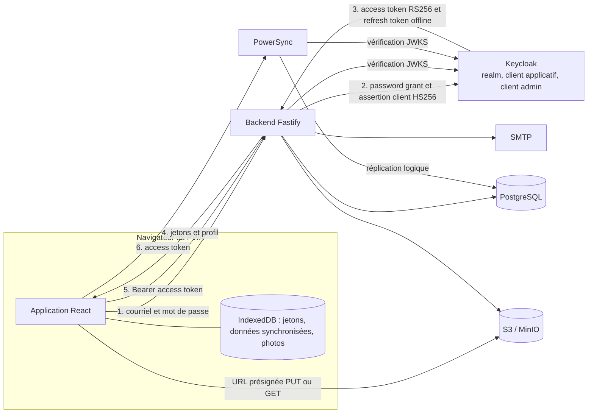
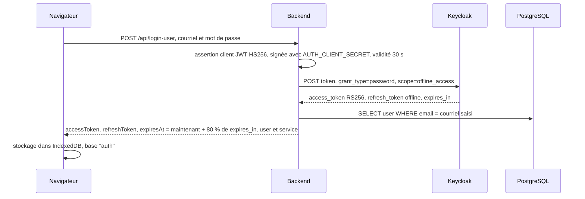

# 05 — Authentification et sécurité

Ce document décrit comment Patrinotes authentifie ses utilisateurs, comment les droits d'accès aux données sont appliqués (backend, PowerSync, stockage S3), quelles données personnelles sont traitées et où, et dresse un bilan orienté **homologation de sécurité** (démarche ANSSI / RGS) : points forts et points de vigilance.

Il s'adresse à l'équipe sécurité (RSSI, SSI du ministère), aux équipes d'exploitation chargées du transfert et aux développeurs. Les constats viennent de la lecture du code et du relevé de production du 17/11/2026 (lecture seule de Coolify, des bases PostgreSQL et de Keycloak) ; ce qui n'a pas pu être vérifié est signalé « à confirmer ». Les routes citées sont détaillées dans [04 — Backend et API](04-backend-api.md).

> **Résumé pour un lecteur non technique.** Les agents se connectent avec un courriel et un mot de passe gérés par Keycloak, un logiciel libre de gestion des identités. Seules les adresses inscrites sur une **liste blanche** peuvent créer un compte. Chaque agent ne reçoit sur son appareil que les données de **son service** (UDAP, CRMH…). Le serveur contrôle aussi les **écritures** et l'accès aux **fichiers** par service, auteur et délégation. Restent à traiter avant une homologation : le durcissement de Keycloak en production, l'absence de limitation de débit, et le changement de service libre (voir §12).

---

## 1. Vue d'ensemble

Points clés :

- **Un seul fournisseur de jetons : Keycloak.** Le backend ne signe **aucun** jeton applicatif. Les variables `JWT_SECRET`, `JWT_REFRESH_SECRET` et `TOKEN_LIFETIME` sont exigées au démarrage mais **jamais utilisées** ([envVars.ts](../packages/backend/src/envVars.ts#L32-L34)). `PS_JWT_SECRET`, transmis à PowerSync dans [docker-compose.yaml](../docker-compose.yaml), n'est pas non plus référencé par la configuration PowerSync.
- **Le même jeton d'accès Keycloak** sert au backend et à PowerSync.
- **Le backend fait office de proxy d'authentification** : le navigateur n'affiche pas la page de connexion Keycloak ; il envoie le mot de passe au backend, qui l'échange auprès de Keycloak (*Resource Owner Password Credentials*).

---

## 2. Keycloak

### 2.1 Rôle et version

Keycloak stocke les comptes et les mots de passe. En développement (image `26.3.5` de [docker-compose.yaml](../docker-compose.yaml)), sa base est une base `keycloak` sur le même serveur PostgreSQL que l'application ([db/init/1_create_keycloak.sql](../db/init/1_create_keycloak.sql)). **En production** : Keycloak **26.7.2**, avec sa propre instance PostgreSQL 16, sur `https://auth.patrinotes.beta.gouv.fr` (projet Coolify `keycloak-auth`).

### 2.2 Modèle de realm (environnement de développement et de test)

Le fichier [tests/realm-template.json](../tests/realm-template.json) est importé au démarrage du conteneur (`start-dev --import-realm`) après substitution des variables d'environnement par [tests/keycloak-entrypoint.sh](../tests/keycloak-entrypoint.sh) (`envsubst`). **Il ne décrit que l'environnement local et de test** ; le realm de production est décrit au § 2.2 bis. Il faudra l'exporter lors du transfert.

| Élément | Valeur dans le modèle | Commentaire |
| --- | --- | --- |
| Realm | `master` | Le realm d'administration de Keycloak est utilisé comme realm applicatif. La production utilise un realm dédié, `patrinotes` |
| `accessTokenLifespan` | **60 secondes** | Le client rafraîchit donc son jeton environ toutes les 48 s (§3.3) |
| `registrationEmailAsUsername` | `true` | |
| Profil utilisateur déclaratif | `username`, `email`, `firstName`, `lastName` **modifiables par l'utilisateur** | Voir le risque lié au courriel, §4.3 |
| Politique de mot de passe, protection contre la force brute | **Non définies** | Valeurs par défaut de Keycloak : pas de politique, détection de force brute désactivée. Pour la production, voir § 2.2 bis |
| Client applicatif `${AUTH_CLIENT_ID}` | Confidentiel, authentification `client-secret-jwt`, *direct access grants* activé, compte de service activé, `redirectUris` et `webOrigins` = `/*` | Seul le *password grant* et le *refresh* sont utilisés en pratique |
| Client d'administration `${AUTH_ADMIN_CLIENT_ID}` | Compte de service avec les rôles `manage-users`, `view-users`, `query-users`, `manage-authorization` sur `master-realm` et `manage-account` | Utilisé par le backend pour créer des comptes et changer des mots de passe |

### 2.2 bis Realm de production (relevé de production du 17/11/2026)

Le realm de l'application est `patrinotes` (216 utilisateurs). Pas de fédération d'annuaire.

> Les réglages de sécurité relevés en production (politique de mot de passe, force brute, durées de session, exposition de la console d'administration) ne sont pas reproduits dans ce dépôt public. Ils figurent dans le relevé de sécurité transmis au ministère, avec les durcissements recommandés.

| Réglage (realm `patrinotes`) | Valeur | Commentaire |
| --- | --- | --- |
| Émetteur | `https://auth.patrinotes.beta.gouv.fr/realms/patrinotes` | Identique dans la configuration PowerSync de production |
| Inscription par Keycloak | désactivée | L'inscription passe par l'API d'administration |
| Courriel comme identifiant, connexion par courriel | activés | `username` = courriel (voir la règle A9 du [chapitre 15](15-regles-cachees-et-pieges.md)) |
| `sslRequired` | `external` | |
| Thèmes | DSFR (connexion et compte) | |
| SMTP | `smtp.tem.scw.cloud:465`, expéditeur `noreply@patrinotes.beta.gouv.fr` | |
| Clients | `patrinotes-prod` et `patrinotes-prod-admin` (confidentiels, flux standard, *direct access grants* et compte de service sur les deux) ; `account` et `account-console` **actifs** | L'espace « mon compte » est accessible aux agents |

Variables d'environnement côté backend : `VITE_AUTH_URL`, `VITE_AUTH_REALM`, `VITE_AUTH_CLIENT_ID`, `AUTH_CLIENT_SECRET`, `AUTH_ADMIN_CLIENT_ID`, `AUTH_ADMIN_CLIENT_SECRET`. Côté frontend : `VITE_AUTH_URL`, `VITE_AUTH_REALM`, `VITE_AUTH_CLIENT_ID` (déclarées mais non utilisées pour la connexion).

### 2.3 Thème DSFR (`keycloak-theme.jar`)

Le fichier [keycloak-theme.jar](../keycloak-theme.jar) à la racine est une archive de thème Keycloak qui déclare :

- un thème **`DSFR`** pour les types `login` et `account` (pages de connexion et espace « mon compte » aux couleurs de l'État) ;
- un thème **`account-v1`** (console de compte « ancienne génération », extension *phasetwo* `keycloak-account-v1`).

Il n'est **monté dans aucun fichier docker-compose** du dépôt : il doit être copié dans `/opt/keycloak/providers/` de l'instance Keycloak et sélectionné dans la configuration du realm. En production, il est monté depuis `/home/ubuntu/keycloak-theme.jar` ; il est identique au fichier du dépôt. Les variables `DSFR_THEME_HOME_URL`, `DSFR_THEME_SERVICE_TITLE` et `DSFR_THEME_BRAND_TOP` de [.env.dist](../.env.dist) servent vraisemblablement à paramétrer ce thème (*à confirmer*). Le code source du thème n'est pas dans le dépôt (`keycloak-theme/*` est dans `.gitignore`).

Comme la connexion passe par le formulaire de l'application et non par la page Keycloak, le thème `login` n'est visible que si un utilisateur accède directement à Keycloak, par exemple à l'espace « compte », qui est **actif** en production (usage réel par les agents inconnu).

### 2.4 Usage du client d'administration

[keycloak.ts](../packages/backend/src/features/auth/keycloak.ts) : avant **chaque** appel à l'API d'administration, le backend obtient un jeton `client_credentials` (pas de cache). Appels effectués :

| Appel | Déclencheur |
| --- | --- |
| `POST /admin/realms/<realm>/users` | Inscription (`/api/create-user`) |
| `GET /users?email=` | Inscription, réinitialisation du mot de passe |
| `PUT /users/<id>/reset-password` | Réinitialisation du mot de passe |
| `DELETE /users/<id>` | Uniquement dans les tests (`deleteUserByEmail`) |

Ce compte de service peut gérer **tous** les utilisateurs du realm : son secret est le plus sensible de l'application.

---

## 3. Flux des jetons

### 3.1 Connexion

Détails ([authService.ts](../packages/backend/src/services/authService.ts#L125-L163)) :

- **Authentification du client** : le backend envoie à la fois `client_secret` et une `client_assertion` (JWT HS256 signé avec `AUTH_CLIENT_SECRET`, `iss`=`sub`=client id, `aud` = URL du realm, `exp` = +30 s, `jti` aléatoire) — méthode `client-secret-jwt` ([authService.ts](../packages/backend/src/services/authService.ts#L275-L287)).
- **`scope=offline_access`** : le jeton de rafraîchissement est un **jeton hors ligne** (*offline token*). Il ne dépend pas de la session SSO et reste valable jusqu'à son expiration d'inactivité hors ligne (réglage du realm, § 2.2 bis). C'est ce qui permet l'usage hors ligne prolongé de la PWA.
- `expiresAt` est calculé **côté backend** à 80 % de la durée de vie ([authService.ts](../packages/backend/src/services/authService.ts#L301)).
- Erreurs : le message Keycloak « Invalid user credentials » est traduit en « Courriel ou mot de passe incorrect ».

### 3.2 Utilisation du jeton

- **Backend** : en-tête `Authorization: Bearer <access_token>`. [authMiddleware.ts](../packages/backend/src/routes/authMiddleware.ts) prend la deuxième partie de l'en-tête **sans vérifier le mot « Bearer »**, puis `checkToken` vérifie la signature avec la clé publique du realm (JWKS `…/protocol/openid-connect/certs`, mise en cache), l'algorithme **RS256**, l'émetteur `VITE_AUTH_URL/realms/VITE_AUTH_REALM` et l'audience **`account`**. L'utilisateur est ensuite retrouvé **par son courriel** (§4.3). Tout échec → 403.
- **PowerSync** : [powersync-config.yaml](../powersync/powersync-config.yaml) déclare `client_auth.jwks_uri` (certificats Keycloak), `issuer` et `audience: ["account"]`. Les règles de synchronisation utilisent `auth.parameter('email')`, c'est-à-dire le claim `email` du jeton.

**Piège de configuration** : l'émetteur (`iss`) d'un jeton Keycloak dépend de l'URL par laquelle il a été demandé. Le backend demande les jetons via `VITE_AUTH_URL` et vérifie `iss` avec cette même URL. PowerSync doit donc être configuré avec **le même émetteur** (URL publique), alors que le fichier du dépôt contient `http://keycloak:8080/realms/master`, valable seulement en local. La configuration PowerSync de production pointe vers `https://auth.patrinotes.beta.gouv.fr/realms/patrinotes` (relevé du 17/11/2026, voir [08](08-synchronisation-hors-ligne.md)).

### 3.3 Rafraîchissement

[Connector.ts](../packages/frontend/src/db/Connector.ts#L49-L97) :

- Avant chaque appel d'API et à chaque demande d'identifiants par PowerSync, `getTokenOrRefresh` compare `expiresAt` à l'heure courante. S'il est dépassé, il appelle `POST /api/refresh-token` (non authentifié). Une seule requête de rafraîchissement est lancée à la fois (promesse partagée), car Keycloak peut faire tourner le jeton de rafraîchissement.
- Si le backend renvoie **401**, les jetons sont effacés et une fenêtre « session expirée » invite à se reconnecter.
- Le rafraîchissement se fait **uniquement d'après l'horloge du client** : un 403 du backend (jeton révoqué) ne déclenche pas de rafraîchissement.

### 3.4 Déconnexion

`useLogout` ([AuthContext.tsx](../packages/frontend/src/contexts/AuthContext.tsx#L113-L122)) efface les jetons localement. **Aucun appel à Keycloak** n'est fait : le jeton hors ligne reste valable côté serveur jusqu'à son expiration. Les données synchronisées (base SQLite locale) et les photos en cache **restent sur l'appareil** : seule la commande « Supprimer les données locales » du menu Aide les efface (voir [08 § 8](08-synchronisation-hors-ligne.md#8-cycle-de-vie-de-la-base-locale)).

### 3.5 Connexion par redirection OIDC

Aucune route n'échange de code d'autorisation OIDC : le seul moyen de créer un compte est `/api/create-user`, soumis à la liste blanche. La connexion par ProConnect et par code fait l'objet d'une PR en relecture (#82), non fusionnée.

---

## 4. Inscription, liste blanche et rôles

### 4.1 Liste blanche

- Table `whitelist(email, createdAt)`.
- Vérifiée **uniquement** dans `/api/create-user`, sans tenir compte de la casse ni des espaces (`lower(trim(email))`) ; le courriel est enregistré en minuscules ([authService.ts](../packages/backend/src/services/authService.ts)). Message d'erreur : « Votre courriel n'est pas autorisé… écrire à contact@patrinotes.beta.gouv.fr ».
- **Désactivée si `NODE_ENV=development`** (fonction `assertEmailInWhitelist`, retour immédiat). Attention : sans `NODE_ENV` défini, l'application se comporte comme en production et la liste blanche est active (voir [04 §3.2](04-backend-api.md)).
- Gérée par les administrateurs via `/api/admin/whitelist` (ajout, suppression, export).
- **Retirer une adresse de la liste ne désactive pas le compte** : la connexion, le rafraîchissement et la synchronisation ne consultent pas la liste blanche. Pour bloquer un agent, il faut désactiver son compte dans Keycloak (et attendre l'expiration de son jeton d'accès).
- La table `whitelist` n'est pas modifiable par la synchronisation (§8).

### 4.2 Rôles

| Rôle | Où | Effet |
| --- | --- | --- |
| `user` | `internal_user.role` (valeur posée à l'inscription) | Accès normal |
| `admin` | `internal_user.role = 'admin'` | Accès aux routes `/api/admin/*` et `/api/stats/{admin,udap,crmh,jobs}` |

- Les rôles **ne viennent pas de Keycloak** (aucun rôle ou groupe du jeton n'est lu).
- Aucune route ne permet de nommer un administrateur : il faut modifier la base directement.
- `internal_user` n'est pas modifiable via la synchronisation, ce qui empêche l'auto-promotion (tests [sync.spec.ts](../tests/sync.spec.ts) et [syncPolicy.test.ts](../packages/backend/src/features/sync/syncPolicy.test.ts)), comme toute table absente de la liste des tables modifiables (§8).
- Le contrôle `authenticateAdmin` est fait **à chaque requête** en base (pas de cache).

### 4.3 Identité pivot : le courriel

L'utilisateur applicatif est retrouvé par `user.email = claim email du jeton`. Conséquences pour la sécurité :

- Le profil Keycloak du modèle autorise l'utilisateur à **modifier son propre courriel** (espace compte). La vérification du courriel (`email_verified`) n'est pas contrôlée par le backend. *À confirmer : si l'espace compte est accessible en production, un utilisateur pourrait prendre l'adresse d'un compte applicatif qui n'existe pas (ou plus) dans Keycloak.*
- Par la synchronisation, un utilisateur ne peut modifier que son propre profil, et seulement `name` et `job` : `user.email` n'est pas modifiable (§8).

### 4.4 Mot de passe

- **Validation** : seulement dans le formulaire d'inscription (8 caractères minimum, majuscule, minuscule, chiffre, caractère spécial). Le backend et le modèle de realm n'imposent **aucune politique**. La route de réinitialisation accepte n'importe quel mot de passe.
- **Réinitialisation** : lien aléatoire (UUID v4, 122 bits), stocké **haché en MD5**, valable **24 h**, à usage unique ([userService.ts](../packages/backend/src/services/userService.ts#L37-L91)). Le MD5 est acceptable ici vu l'entropie du secret, mais un SHA-256 serait préférable pour l'homologation. La fonction intégrée de Keycloak (« mot de passe oublié ») n'est pas utilisée.
- **Énumération de comptes** : `/api/send-reset-password` répond par une erreur 403 si l'adresse est inconnue et par un message de succès sinon. Il est donc possible de tester l'existence d'une adresse.

---

## 5. Cloisonnement des données par service

### 5.1 Principe

Chaque utilisateur appartient à **un** service (`user.service_id`) : UDAP, CRMH, SRA… Les services portent la liste de leurs départements (`service.dept_numbers`). Le cloisonnement est appliqué **en lecture par PowerSync** :

| Flux PowerSync | Données | Filtre |
| --- | --- | --- |
| `global_stream` | `clause_v2` communes | `service_id = 'ALL'` |
| `service_stream` | Service, membres du service (id, nom), services instructeurs, clauses, courriels envoyés et suggérés, corrections des fiches (`monument_correction`) | Service de l'utilisateur |
| `user_stream` | Délégations, `pdf_snapshot`, `user_settings` | Utilisateur |
| `reports_stream` | Comptes-rendus, constats, sections visitées, alertes, état des validations (sans le jeton) | Service de l'utilisateur |
| `reports_stream` (suite) | Alertes et annotations des fiches (`monument_alert`, avec leurs photos) | Service de l'utilisateur |
| `state_report_attachments_stream`, `report_attachments_stream` | Pièces jointes d'un document | Paramètre `state_report_id` / `report_id` fourni par le client, **et document du service de l'utilisateur** |
| `pop_stream` | Monuments et objets POP | Départements de l'utilisateur (`user_dept`) |

Source : [sync-config.yaml](../powersync/sync-config.yaml). Le détail est dans [08 — Synchronisation](08-synchronisation-hors-ligne.md).

> **Production** : le `sync-config.yaml` est **déposé à la main** dans Coolify et n'est pas déployé avec l'application ; il doit être recopié à chaque modification.

### 5.2 Limites du cloisonnement

1. **Le service n'est pas une frontière de sécurité.** `/api/change-service` permet à tout utilisateur connecté de rejoindre **n'importe quel service** existant, sans validation. Il reçoit alors toutes les données de ce service. C'est un **choix assumé** : chaque changement est tracé dans `transactions` (`op = CHANGE_SERVICE`, ancien et nouveau service).
2. Les écritures, les fichiers et les routes PDF sont cloisonnés par service : voir §7 et §8. Exception voulue : `GET /api/pdf/state-report` et `/api/state-report/previous` donnent accès aux constats envoyés d'**autres services** sur un monument situé dans un département du service (historique des fiches).

---

## 6. Validation des entrées et exposition HTTP

| Mesure | État |
| --- | --- |
| Validation des schémas | TypeBox sur la plupart des routes (types simples, pas de format `email`, pas de longueur maximale). Les routes `/api/upload/attachment*` lisent `request.query` sans schéma, mais le chemin est contrôlé (format, pas de `..`). `/api/upload-data` accepte `data: Any`, dont seuls les noms de colonnes sont vérifiés |
| Injection SQL | Kysely paramètre les valeurs et échappe les identifiants. Les seules chaînes SQL brutes (`sql\`…\``) des statistiques interpolent des paramètres liés. Pas d'injection SQL identifiée |
| Injection HTML dans les courriels | **Non protégée** : titres, commentaires, préconisations et commentaire du validateur sont insérés tels quels dans le HTML. Seul le courriel des alertes de fiche échappe les saisies |
| CORS | `origin: "*"` ([router.ts](../packages/backend/src/router.ts#L43-L45)), sans cookies. L'authentification par en-tête limite le risque CSRF, mais n'importe quel site peut appeler l'API avec un jeton volé |
| Limitation de débit | **Aucune** (`@fastify/rate-limit` absent). Les routes publiques (connexion, inscription, réinitialisation, validation, liens courts, statistiques publiques) sont exposées sans limite. La protection contre la force brute dépend de Keycloak |
| En-têtes de sécurité | Aucun (`helmet` absent) côté backend. À traiter au niveau du proxy inverse (Traefik en production, configuration des en-têtes non relevée) |
| Taille des requêtes | Limite par défaut de Fastify (1 Mio pour le corps JSON). `maxParamLength` porté à 5000. Le plugin multipart (15 Mo) est enregistré mais aucune route ne l'utilise |
| Messages d'erreur | Message générique en production ; pile d'appel renvoyée en développement uniquement |
| Interface Swagger | Non exposée |

---

## 7. Fichiers (S3 / MinIO)

### 7.1 Organisation

- Un seul bucket (`MINIO_BUCKET`). Les pièces jointes (photos, plans, PDF) sont sous le préfixe `attachment/`. Les PDF suivent le chemin `attachment/<id du document>/compte_rendu_<epoch>.pdf` ou `…/constat_d_etat_<epoch>.pdf`.
- Le bucket est **privé** : en local (`minio-init` ne définit pas de politique anonyme) comme en production, où le listage anonyme de `patrinotes-prod` (Scaleway, `fr-par`) est refusé. L'accès se fait par URL présignées (SigV4) ou en relais par le backend.
- **CORS en production** : seule l'origine `https://app.patrinotes.beta.gouv.fr` a été trouvée autorisée (GET, HEAD, POST, PUT, DELETE, avec `Allow-Credentials`) ; les origines de préproduction, locales et quelconques sont refusées. La liste complète est à lire dans la console Scaleway.
- Le client S3 utilise des clés d'accès statiques (`MINIO_ACCESS_KEY_ID`, `MINIO_SECRET_KEY`) avec la politique `readwrite` en local.

### 7.2 Mécanismes d'accès

| Mécanisme | Authentification | Durée | Contrôle |
| --- | --- | --- | --- |
| URL PUT présignée (`/api/upload/attachment/presigned-url`) | Jeton | 1 h | Le premier segment du chemin désigne le document (compte-rendu, constat, section, alerte, alerte de fiche) : refus si ce document est d'un autre service. **Acceptée si le document n'est pas encore en base** (photos déposées avant la ligne). Ni taille ni type contrôlés |
| URL PUT présignée des PDF (`/api/pdf/*/upload-url`) | Jeton | 1 h | Chemin imposé par le serveur ; refus si le document existe et que l'utilisateur ne peut pas le modifier (auteur ou délégation) |
| Lecture relayée (`/api/upload/attachment?filePath=`) | Jeton | — | Document du service de l'utilisateur seulement (403 sinon, 404 si inconnu) |
| Lien court `/attachment/:id` (courriels) | **Aucune** | **90 jours** | Identifiant base62 d'un entier aléatoire de 48 bits (`crypto.randomInt`). Pas de limitation de débit contre l'énumération. Le fichier est relayé ou une URL présignée (1 h) est renvoyée |
| Lien court `/attachment/:id` du courriel envoyé après acceptation par le validateur | **Aucune** | **90 jours** | Même mécanisme que la ligne précédente |
| URL présignée GET de la page de validation | Jeton de validation | 1 h | Donnée au validateur pour consulter le PDF |
| Page de validation `/api/constat-validation/:token` | Jeton de validation (UUID v4) | 7 jours tant qu'en attente, **illimitée ensuite** | — |

Les noms de fichiers sont générés par le client (identifiants UUID) ou par le backend (horodatage). Aucun antivirus ni contrôle du contenu n'est appliqué aux fichiers déposés. Le type des photos d'alerte est forcé à `image/png` dans les courriels.

---

## 8. Écritures via la synchronisation : contrôle d'accès

`POST /api/upload-data` ([syncService.ts](../packages/backend/src/services/syncService.ts)) applique les opérations `PUT`, `PATCH` et `DELETE` envoyées par le client. Chaque opération passe par [syncPolicy.ts](../packages/backend/src/features/sync/syncPolicy.ts) :

| Contrôle | Règle |
| --- | --- |
| Tables | **Liste blanche** : documents et leurs lignes filles, alertes et corrections des fiches, `delegation`, `user_settings`, `user` (son profil), `service` (son service), `service_instructeurs`, `suggested_email` (suppression seule), `pdf_snapshot`. `whitelist`, `internal_user`, `user_dept`, `transactions`, `attachment_redirection`, `constat_validation`, `pop_*` sont refusées |
| Colonnes | Liste par table ; une colonne inconnue fait refuser l'opération. Les colonnes de propriété et d'état d'envoi (`service_id`, auteur, `attachment_id`, `pdf_size`, `validation_status`, `sent_at`) sont fixées par le serveur |
| Service | La ligne doit appartenir au service de l'utilisateur |
| Auteur et délégation | Un compte-rendu, un constat ou une alerte de fiche n'est modifiable que par son auteur (ou le rédacteur d'un compte-rendu) ou par une personne à qui l'auteur a donné délégation. Une alerte de fiche envoyée n'est pas modifiable ; une annotation peut être complétée depuis son constat jusqu'à son envoi |
| Constat envoyé | Un constat dont le PDF existe n'est pas modifiable (ni ses sections, alertes et pièces jointes), sauf s'il a été refusé par le validateur ; seul l'indicateur de suppression `disabled` reste modifiable ([syncService.ts](../packages/backend/src/services/syncService.ts)) |

Un refus est répondu en HTTP 200 `{success:false}` (comme une erreur SQL, pour ne pas bloquer la file du client) et signalé à Sentry. Le détail des règles est dans [04 §6.2](04-backend-api.md).

Risques restants :

- `data` n'est pas validé en valeur (seulement en noms de colonnes) ;
- tout membre d'un service peut modifier les paramètres du service, dont les adresses de courriel institutionnelles utilisées pour les alertes (choix assumé) ;
- un refus est invisible pour l'agent (voir [08](08-synchronisation-hors-ligne.md)).

Chaque opération est **tracée** dans `transactions` avec l'identifiant de l'utilisateur avant d'être appliquée. Cette table n'est pas modifiable par les clients.

---

## 9. Gestion des secrets

| Secret | Utilisé par | Sensibilité |
| --- | --- | --- |
| `AUTH_ADMIN_CLIENT_SECRET` | Backend → API d'administration Keycloak | **Très élevée** (gestion de tous les comptes) |
| `AUTH_CLIENT_SECRET` | Backend → Keycloak (secret client et clé HMAC des assertions) | Élevée |
| `DATABASE_URL`, `POSTGRES_PASSWORD` | Backend, migrations, PowerSync (`PS_DATABASE_URL`), Keycloak (`KC_DB_PASSWORD`) | Élevée. Le même compte PostgreSQL sert l'application, PowerSync et Keycloak dans la configuration locale. En production, Keycloak a sa propre instance ; un rôle de réplication dédié à PowerSync est recommandé |
| `MINIO_ACCESS_KEY_ID`, `MINIO_SECRET_KEY` | Backend | Élevée (lecture et écriture de tous les fichiers) |
| `EMAIL_USER`, `EMAIL_PASSWORD` | Backend → SMTP | Moyenne (usurpation de l'expéditeur) |
| `SENTRY_DSN`, `VITE_SENTRY_DSN` | Backend, frontend | Faible (le DSN frontend est public par nature) |
| `JWT_SECRET`, `JWT_REFRESH_SECRET` | Aucun | Inutilisés ; à retirer |

- Les secrets sont fournis par **variables d'environnement** (fichier `.env` à la racine en développement, variables Coolify en production). Aucun gestionnaire de secrets n'est intégré au code.
- Aucun secret n'est commité : `.env.dist` ne contient que des noms. Les variables `VITE_*` sont **publiques** par construction : `createEnvFile.ts` écrit toutes les variables `VITE_*` dans `env.js`, servi au navigateur. Il ne faut jamais nommer un secret `VITE_…`.
- Connexions **sans TLS** vers PostgreSQL (`ssl: false` en dur dans [db.ts](../packages/backend/src/db/db.ts#L11) et `drizzle.config.ts`) et entre PowerSync et PostgreSQL (`sslmode: disable`). C'est le cas en production (réseau Docker interne), où MongoDB tourne aussi **sans authentification**. Acceptable sur un réseau privé de conteneurs, à revoir si la base est distante.
- La télémétrie PowerSync n'est **pas désactivée** (`disable_telemetry_sharing: false`, et la clé est d'ailleurs mal indentée sous `client_auth`). À désactiver pour l'hébergement ministériel.

---

## 10. Données personnelles (RGPD)

### 10.1 Inventaire

| Donnée | Personnes concernées | Où (tables et colonnes) | Copies |
| --- | --- | --- | --- |
| Nom, prénom (concaténés), courriel, fonction | Agents | `user.name`, `user.email`, `user.job` ; Keycloak (`username` = nom, `firstName`, `email`, mot de passe haché) | PowerSync (nom des membres du service), IndexedDB des collègues du service |
| Rôle, date d'inscription, consentement à la lettre d'information, lien de réinitialisation haché | Agents | `internal_user` | — |
| Liste blanche | Agents potentiels | `whitelist.email` | — |
| Courriels des destinataires d'envois | Pétitionnaires, propriétaires, partenaires | `sent_email.sent_to`, `state_report_sent_email.sent_to`, `suggested_email.email`, `attachment_redirection.sent_to`, `constat_validation.recipients` | IndexedDB des agents du service |
| Demandeur d'un compte-rendu | Particuliers | `report.applicantName`, `applicantAddress`, `applicantEmail`, `contacts`, `personnes_presentes`, champs libres | IndexedDB, PDF sur S3, courriels |
| Propriétaire d'un monument et son représentant | Particuliers ou personnes morales | `state_report.proprietaire`, `proprietaire_email`, `proprietaire_representant`, `proprietaire_representant_email`, `personnes_presentes`, champs libres | IndexedDB, PDF, courriels |
| Validateur | Agents | `user_settings.validation_nom`, `validation_prenom`, `validation_email`, `constat_validation.validator_email`, `comment` | — |
| Courriels par défaut | Partenaires | `user_settings.default_emails`, `state_report_alert.mandatory_emails`, `additional_emails`, `monument_alert.mandatory_emails`, `additional_emails`, `service.courriel_*` | — |
| Auteur d'une alerte ou annotation de fiche | Agents | `monument_alert.created_by_name` | IndexedDB des agents du service |
| Photos | Personnes éventuellement visibles | S3 `attachment/…` | Cache local, courriels d'alerte |
| Traces d'usage | Agents | `transactions` (copie intégrale de **toutes** les écritures, dont tous les champs ci-dessus), `constat_pdf_download` | — |
| Contacts de services instructeurs | Agents d'autres administrations | `service_instructeurs.email`, `tel` | — |
| Données POP | Personnes historiques (auteurs, personnes liées) | `pop_immeubles`, `pop_objets` | Données publiques en *open data* |

Autres emplacements : la base MongoDB interne de PowerSync (copie des données synchronisées, non persistante d'après le README), la base locale de chaque appareil (SQLite dans IndexedDB, nommée `crvif-sync.db`), le stockage `crvif-attachments` (photos), les journaux applicatifs, Sentry et la boîte d'envoi SMTP.

### 10.2 Constats

- **Conservation** : la [politique de confidentialité](../packages/frontend/src/routes/politique-confidentialite.tsx) annonce 2 ans après la dernière connexion pour les comptes et comptes-rendus, et 1 an pour la traçabilité. **Aucun mécanisme de purge** n'existe dans le code (ni tâche planifiée, ni suppression de compte). La table `transactions` et les liens courts ne sont jamais purgés. La suppression des documents est **logique** (`disabled = true`).
- **Dernière connexion** : elle n'est pas enregistrée dans la base applicative (seulement dans les sessions Keycloak), ce qui empêche d'appliquer la durée annoncée.
- **CGU** : le champ `cgu` est demandé à l'inscription mais **n'est pas enregistré**. `newsletter` est enregistré dans `internal_user` ; l'équipe exporte la liste des abonnés et l'importe dans Brevo à la main (aucun export dans le code).
- **Sous-traitants** : la politique de confidentialité cite OVH et Brevo. Le code utilise aussi **Sentry** et Scaleway (stockage objet, SMTP, sauvegardes), qui n'y figurent pas. En production, Sentry n'est configuré que côté frontend, sur `sentry.incubateur.net` (instance beta.gouv). OVH n'héberge que le DNS. L'hébergement actuel est un VPS privé (Coolify). La liste est à mettre à jour lors du transfert.
- **Droits des personnes** : aucune fonction d'export ou de suppression des données d'un agent. Les données des tiers (propriétaires, demandeurs) sont dans des champs libres et des PDF.

### 10.3 Données personnelles dans les journaux et la supervision

| Source | Contenu | Fichier |
| --- | --- | --- |
| Sentry backend (non branché en production) | Exceptions avec méthode et modèle de route ; message de refus d'écriture de synchronisation (table, opération, identifiants, motif). `beforeSend` retire corps, cookies, chaîne de requête et utilisateur, et masque les clés de type mot de passe, jeton, secret, courriel, destinataires | [sentry.ts](../packages/backend/src/features/sentry.ts), [router.ts](../packages/backend/src/router.ts) |
| Sentry frontend | Exceptions seulement (ni journaux console ni fil d'Ariane console) ; `beforeSend` retire l'utilisateur et masque les mêmes clés | [sentry.ts](../packages/frontend/src/features/sentry.ts) |
| Journaux backend (`debug`, actifs par défaut) | Courriel à la connexion et à l'inscription, destinataires des alertes, URL des requêtes (chemins de fichiers) ; `console.log` du détail des erreurs Keycloak | [authService.ts](../packages/backend/src/services/authService.ts) |

Sentry ne reçoit ni corps de requête, ni cookies, ni jetons, ni journaux console. En production, seul le frontend envoie des événements. Le masquage repose sur les **noms de clés** : une donnée personnelle rangée sous une autre clé (un titre, un nom) n'est pas masquée.

---

## 11. Dépendances et chaîne d'approvisionnement

Résultat de `pnpm audit --prod` sur le paquet backend, à la date de rédaction : **88 vulnérabilités connues** (2 critiques, 56 élevées, 27 modérées, 3 faibles), en grande partie transitives. Les plus significatives pour ce service :

| Composant | Version | Problème | Correction |
| --- | --- | --- | --- |
| `fastify` | 4.29.1 | Plusieurs avis « élevés » (contournement de validation, contournement d'authentification sur des URL malformées) ; la branche 4 n'est plus maintenue | Migrer vers Fastify 5 (≥ 5.12.2) |
| `nodemailer` | 6.10.1 | Déni de service dans l'analyse des adresses, injection SMTP | ≥ 10.0.6 |
| `kysely` | 0.27.6 | Injections dans des usages spécifiques (MySQL, chemins JSON) non utilisés ici | ≥ 0.28.17 |
| `@sentry/node` | 7.x | Version majeure ancienne | 8 ou plus |
| `proxy-addr`, `tar`, `fast-uri`, `ws`, `@fastify/busboy`… | transitives | Divers | Mises à jour |
| Image `node:20.11-alpine` | Node 20 | Plus maintenu depuis avril 2026 | Node 22 LTS ou plus |
| `journeyapps/powersync-service:latest` | non épinglée | Mise à jour non maîtrisée | Épingler une version |

La CI ([.github/workflows](../.github/workflows)) construit et publie les images Docker sur `ghcr.io` à chaque push sur `main`, `development` et `compte-rendu-vif`, **sans** tests automatiques (les tests de bout en bout sont déclenchés à la main), sans analyse de dépendances ni d'image. `canvas` (module natif) impose une chaîne de compilation dans l'image.

---

## 12. Synthèse pour l'homologation

### 12.1 Points forts

- Authentification déléguée à **Keycloak**, logiciel libre éprouvé : mots de passe hachés et jamais stockés par l'application, jetons signés **RS256** vérifiés par clé publique (JWKS), avec contrôle de l'émetteur et de l'audience.
- Client Keycloak **confidentiel** avec authentification par assertion signée (`client-secret-jwt`, validité 30 s, `jti` unique).
- Jetons d'accès **courts** (60 s dans le modèle de realm) et rafraîchissement centralisé côté client, sans requêtes concurrentes.
- **Liste blanche** des adresses autorisées à créer un compte, gérée par les administrateurs.
- **Cloisonnement en lecture** par service et par département dans les règles PowerSync ; le jeton de validation n'est pas synchronisé.
- **Cloisonnement en écriture** : liste blanche de tables et de colonnes, contrôle du service, de l'auteur et des délégations, testé par des tests unitaires et de bout en bout.
- Accès aux fichiers par **URL présignées** à durée limitée, réservé au service du document ; bucket privé.
- Sentry filtré (`beforeSend`, pas de données personnelles par défaut).
- Requêtes SQL **paramétrées** (Kysely), schémas d'entrée TypeBox sur la plupart des routes.
- Piste d'audit des écritures (`transactions`) et des téléchargements de PDF.
- Liens de réinitialisation aléatoires, hachés, à usage unique, valables 24 h.
- Aucun secret dans le dépôt ; erreurs génériques en production.
- Interface conforme au DSFR, y compris un thème Keycloak DSFR.

### 12.2 Points de vigilance (par priorité)

| Priorité | Constat | Recommandation |
| --- | --- | --- |
| **Élevée** | Aucune limitation de débit dans le backend | `@fastify/rate-limit` ou limitation au proxy |
| **Élevée** | Durcissement de Keycloak et de l'infrastructure de production (§ 2.2 bis) | Détail et recommandations dans le relevé de sécurité transmis au ministère, hors dépôt |
| **Élevée** | Dépendances vulnérables, Fastify 4 en fin de vie, CI sans tests ni audit (§11) | Plan de montée de version, `pnpm audit` et analyse d'image en CI |
| Moyenne | `/api/change-service` sans contrôle : n'importe quel agent peut lire les données de n'importe quel service (§5.2) | Choix assumé, changements journalisés. À réexaminer pour l'homologation |
| Moyenne | Utilisateur identifié par son courriel et non par le `sub` Keycloak (§4.3) | Stocker le `sub` et l'utiliser comme identité pivot |
| Moyenne | Fichiers déposés sans contrôle de taille ni de type ; dépôt accepté pour un document pas encore en base (§7) | Limiter taille et type dans l'URL présignée ; contrôler le contenu |
| Moyenne | Fichiers de configuration PowerSync déposés à la main dans Coolify (§ 5.1) | Les déployer avec l'application |
| Moyenne | Pas de rôle de réplication dédié pour PowerSync ; MongoDB sans authentification dans la configuration fournie | Rôle de réplication dédié, limité aux tables publiées ; authentification MongoDB |
| Moyenne | Liens courts publics de 90 jours (48 bits d'aléa), page de validation consultable sans limite après décision | Raccourcir la durée, augmenter l'aléa, limiter le débit, expirer les jetons de validation traités |
| Moyenne | Écritures refusées ou en erreur perdues sans message pour l'agent (§8) | Répondre en erreur, afficher l'échec |
| Moyenne | Contenus utilisateur insérés sans échappement dans les courriels officiels (sauf alertes de fiche) ; un utilisateur peut envoyer des courriels à des destinataires arbitraires depuis l'adresse de l'application | Échapper le HTML ; journaliser et limiter les envois |
| Moyenne | Déconnexion sans révocation du jeton hors ligne ; données locales conservées | Appeler le *logout* / la révocation Keycloak ; purger la base locale à la déconnexion |
| Moyenne | Retrait de la liste blanche sans effet sur les comptes existants | Désactiver le compte Keycloak en même temps |
| Moyenne | Aucune purge RGPD, CGU non enregistrées, sous-traitants incomplets (Sentry, SMTP) | Tâche de purge, enregistrement du consentement, mise à jour de la politique |
| Moyenne | Compte de service d'administration aux droits larges (la production utilise bien un realm dédié, `patrinotes`) | Droits minimaux (`manage-users` seulement sur ce realm) |
| Faible | CORS `*`, pas d'en-têtes de sécurité, connexions internes sans TLS, télémétrie PowerSync active | Restreindre l'origine au domaine du frontend, en-têtes au proxy, TLS si réseau non maîtrisé, `disable_telemetry_sharing: true` |
| Faible | Énumération des comptes via la réinitialisation ; MD5 pour le lien | Réponse identique dans tous les cas ; SHA-256 |
| Faible | Variables `JWT_*` inutilisées mais obligatoires ; `.env.dist` désynchronisé | Nettoyage |

### 12.3 Éléments à fournir lors du transfert (non présents dans le dépôt)

Les réglages ont été relevés le 17/11/2026 (§ 2.2 bis, [10](10-infrastructure-et-deploiement.md) § 6.0) ; restent à fournir :

- l'export complet du realm Keycloak `patrinotes` (fichier JSON) ;
- les fichiers `powersync-config.yaml` et `sync-config.yaml` déposés sur le serveur ;
- la liste complète des origines CORS et la politique du bucket `patrinotes-prod` (console Scaleway) ;
- la configuration de Traefik (TLS, en-têtes) ;
- la rétention et les accès du projet Sentry frontend (`sentry.incubateur.net`) ;
- le sélecteur DKIM de Scaleway TEM.
