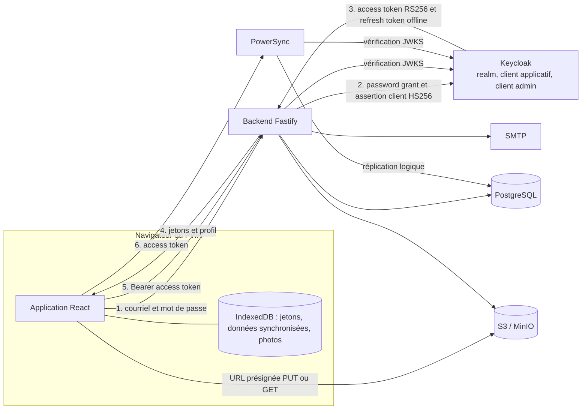
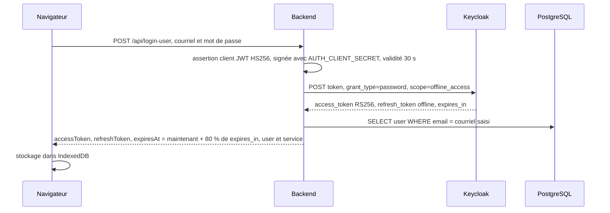

# 05 — Authentification et sécurité

Ce document décrit comment Patrinotes authentifie ses utilisateurs, comment les droits d'accès aux données sont appliqués (backend, PowerSync, stockage S3), quelles données personnelles sont traitées et où, et dresse un bilan orienté **homologation de sécurité** (démarche ANSSI / RGS) : points forts et points de vigilance.

Il s'adresse à l'équipe sécurité (RSSI, SSI du ministère) et aux équipes d'exploitation chargées du transfert. Les constats viennent de la lecture du code et du relevé de production du 17/11/2026 (lecture seule de Coolify, des bases PostgreSQL et de Keycloak) ; ce qui n'a pas pu être vérifié est signalé « à confirmer ». Les routes citées sont détaillées dans [04 — Backend et API](04-backend-api.md), les risques consolidés dans [16 — Risques et dette technique](16-risques-et-dette-technique.md).

> **Résumé pour un lecteur non technique.** Les agents se connectent avec un courriel et un mot de passe gérés par Keycloak, un logiciel libre de gestion des identités. Seules les adresses inscrites sur une **liste blanche** peuvent créer un compte. Chaque agent ne reçoit sur son appareil que les données de **son service** (UDAP, CRMH…). Le serveur contrôle aussi les **écritures** et l'accès aux **fichiers** par service, auteur et délégation, limite le nombre d'essais de connexion et vide l'appareil à la déconnexion. Restent à traiter avant une homologation : le durcissement de Keycloak en production, l'identité fondée sur le courriel, les purges de données personnelles et le changement de service libre (voir §12).

---

## 1. Vue d'ensemble

Points clés :

- **Un seul fournisseur de jetons : Keycloak.** Le backend ne signe **aucun** jeton applicatif. Les variables `JWT_SECRET` et `JWT_REFRESH_SECRET` sont exigées au démarrage mais **jamais utilisées**, comme `TOKEN_LIFETIME` (facultative) ([envVars.ts](../packages/backend/src/envVars.ts)). `PS_JWT_SECRET`, transmis à PowerSync dans [docker-compose.yaml](../docker-compose.yaml), n'est pas non plus référencé par la configuration PowerSync.
- **Le même jeton d'accès Keycloak** sert au backend et à PowerSync.
- **Le backend fait office de proxy d'authentification** : le navigateur n'affiche pas la page de connexion Keycloak ; il envoie le mot de passe au backend, qui l'échange auprès de Keycloak (*Resource Owner Password Credentials*).

---

## 2. Keycloak

### 2.1 Rôle et version

Keycloak stocke les comptes et les mots de passe. En développement (image `26.3.5` de [docker-compose.yaml](../docker-compose.yaml)), sa base est une base `keycloak` sur le même serveur PostgreSQL que l'application ([db/init/1_create_keycloak.sql](../db/init/1_create_keycloak.sql)). **En production** : Keycloak **26.7.2**, avec sa propre instance PostgreSQL 16, sur `https://auth.patrinotes.beta.gouv.fr` (projet Coolify `keycloak-auth`).

### 2.2 Modèle de realm (environnement de développement et de test)

Le fichier [tests/realm-template.json](../tests/realm-template.json) est importé au démarrage du conteneur (`start-dev --import-realm`) après substitution des variables d'environnement par [tests/keycloak-entrypoint.sh](../tests/keycloak-entrypoint.sh) (`envsubst`). **Il ne décrit que l'environnement local et de test** ; le realm de production est décrit au § 2.2 bis. Il faudra l'exporter lors du transfert.

| Élément | Valeur dans le modèle | Commentaire |
| --- | --- | --- |
| Realm | `master` | Le realm d'administration de Keycloak est utilisé comme realm applicatif. La production utilise un realm dédié, `patrinotes` |
| `accessTokenLifespan` | **60 secondes** | Le client rafraîchit donc son jeton environ toutes les 48 s (§3.3) |
| `registrationEmailAsUsername` | `true` | |
| Profil utilisateur déclaratif | `username`, `email`, `firstName`, `lastName` **modifiables par l'utilisateur** | Voir le risque lié au courriel, §4.3 |
| Politique de mot de passe, protection contre la force brute | **Non définies** | Valeurs par défaut de Keycloak : pas de politique, détection de force brute désactivée |
| Client applicatif `${AUTH_CLIENT_ID}` | Confidentiel, authentification `client-secret-jwt`, *direct access grants* activé, compte de service activé, `redirectUris` et `webOrigins` = `/*` | Seul le *password grant* et le *refresh* sont utilisés en pratique |
| Client d'administration `${AUTH_ADMIN_CLIENT_ID}` | Compte de service avec les rôles `manage-users`, `view-users`, `query-users`, `manage-authorization` sur `master-realm` et `manage-account` | Utilisé par le backend pour créer des comptes et changer des mots de passe |

### 2.2 bis Realm de production (relevé de production du 17/11/2026)

Le realm de l'application est `patrinotes` (216 utilisateurs). Pas de fédération d'annuaire.

Les réglages de sécurité du realm de production (politique de mot de passe, protection contre la force brute, durées de session et de jeton hors ligne, accès à la console) sont consignés dans le relevé de sécurité transmis au ministère. Les durcissements à appliquer sont listés au § 12.2.

| Réglage (realm `patrinotes`) | Valeur | Commentaire |
| --- | --- | --- |
| Émetteur | `https://auth.patrinotes.beta.gouv.fr/realms/patrinotes` | Identique dans la configuration PowerSync de production |
| Inscription par Keycloak | désactivée | L'inscription passe par l'API d'administration |
| Courriel comme identifiant, connexion par courriel | activés | `username` = courriel (voir la règle A8 du [chapitre 15](15-regles-cachees-et-pieges.md)) |
| `sslRequired` | `external` | |
| Thèmes | DSFR (connexion et compte) | |
| SMTP | `smtp.tem.scw.cloud:465`, expéditeur `noreply@patrinotes.beta.gouv.fr` | |
| Clients | `patrinotes-prod` et `patrinotes-prod-admin` (confidentiels, flux standard, *direct access grants* et compte de service sur les deux) ; `account` et `account-console` **actifs** | L'espace « mon compte » est accessible aux agents |

Les variables d'environnement Keycloak du backend et du frontend sont décrites dans [11 — Configuration](11-configuration.md) § 2.3.

### 2.3 Thème DSFR (`keycloak-theme.jar`)

L'archive [keycloak-theme.jar](../keycloak-theme.jar) fournit un thème **DSFR** pour les pages de connexion et l'espace « mon compte ». Elle n'est montée dans aucun fichier docker-compose : elle doit être copiée dans `/opt/keycloak/providers/` et sélectionnée dans le realm. En production, elle est montée depuis `/home/ubuntu/keycloak-theme.jar` (identique au fichier du dépôt). Le code source du thème n'est pas dans le dépôt.

Comme la connexion passe par le formulaire de l'application, le thème `login` n'est visible que si un utilisateur accède directement à Keycloak, par exemple à l'espace « compte », **actif** en production.

### 2.4 Usage du client d'administration

[keycloak.ts](../packages/backend/src/features/auth/keycloak.ts) : avant **chaque** appel à l'API d'administration, le backend obtient un jeton `client_credentials` (pas de cache). Appels effectués :

| Appel | Déclencheur |
| --- | --- |
| `POST /admin/realms/<realm>/users` | Inscription (`/api/create-user`) |
| `GET /users?email=` | Inscription ; réinitialisation du mot de passe (recherche exacte, `exact=true`) |
| `PUT /users/<id>/reset-password` | Réinitialisation du mot de passe |
| `DELETE /users/<id>` | Uniquement dans les tests |

Ce compte de service peut gérer **tous** les utilisateurs du realm : son secret est le plus sensible de l'application.

Le client applicatif sert aussi à la **révocation** du jeton hors ligne à la déconnexion (`POST …/protocol/openid-connect/revoke`, § 3.4).

---

## 3. Flux des jetons

### 3.1 Connexion

Détails ([authService.ts](../packages/backend/src/services/authService.ts)) :

- **Authentification du client** : le backend envoie à la fois `client_secret` et une `client_assertion` (JWT HS256 signé avec `AUTH_CLIENT_SECRET`, `iss`=`sub`=client id, `aud` = URL du realm, `exp` = +30 s, `jti` aléatoire) — méthode `client-secret-jwt`.
- **`scope=offline_access`** : le jeton de rafraîchissement est un **jeton hors ligne** (*offline token*). Il ne dépend pas de la session SSO et reste valable jusqu'à son expiration d'inactivité hors ligne, fixée par le realm. C'est ce qui permet l'usage hors ligne prolongé de la PWA.
- `expiresAt` est calculé **côté backend** à 80 % de la durée de vie.
- Erreurs : un échec d'identifiants renvoie un message générique. Le journal ne garde que le statut et la réponse de Keycloak, jamais le courriel ni les options de la requête (qui contiennent le mot de passe).
- **Limitation de débit** : 10 essais par 15 minutes pour une même adresse, 200 par 15 minutes pour une même adresse IP (§ 6.1).

### 3.2 Utilisation du jeton

- **Backend** : en-tête `Authorization: Bearer <access_token>`. [authMiddleware.ts](../packages/backend/src/routes/authMiddleware.ts) prend la deuxième partie de l'en-tête **sans vérifier le mot « Bearer »**, puis `checkToken` vérifie la signature avec la clé publique du realm (JWKS `…/protocol/openid-connect/certs`, mise en cache), l'algorithme **RS256**, l'émetteur `VITE_AUTH_URL/realms/VITE_AUTH_REALM` et l'audience **`account`**. L'utilisateur est ensuite retrouvé **par son courriel** (§4.3). Tout échec → 403.
- **PowerSync** : la configuration déclare `client_auth.jwks_uri` (certificats Keycloak), `issuer` et `audience: ["account"]`. Les règles de synchronisation utilisent le claim `email` du jeton. Détail dans [08](08-synchronisation-hors-ligne.md) § 2.2.

**Piège de configuration** : l'émetteur (`iss`) d'un jeton Keycloak dépend de l'URL par laquelle il a été demandé. Le backend demande les jetons via `VITE_AUTH_URL` et vérifie `iss` avec cette même URL. PowerSync doit donc être configuré avec **le même émetteur** (URL publique). La configuration PowerSync de production pointe vers `https://auth.patrinotes.beta.gouv.fr/realms/patrinotes`.

### 3.3 Rafraîchissement

[Connector.ts](../packages/frontend/src/db/Connector.ts) :

- Avant chaque appel d'API et à chaque demande d'identifiants par PowerSync, le client compare `expiresAt` à l'heure courante. S'il est dépassé, il appelle `POST /api/refresh-token` (non authentifié). Une seule requête de rafraîchissement est lancée à la fois, car Keycloak peut faire tourner le jeton de rafraîchissement.
- Si le backend renvoie **401**, les jetons sont effacés et l'agent doit se reconnecter.
- Le rafraîchissement se fait **uniquement d'après l'horloge du client** : un 403 du backend (jeton révoqué) ne déclenche pas de rafraîchissement.

### 3.4 Déconnexion

La déconnexion **vide l'appareil** :

1. Elle vérifie d'abord qu'il ne reste pas de modifications ou de photos à envoyer. S'il en reste, l'agent est prévenu qu'elles seraient perdues ; **hors ligne, la déconnexion est refusée** tant qu'elles ne sont pas envoyées.
2. En ligne, le frontend appelle `POST /api/logout` avec le jeton de rafraîchissement : le backend le **révoque auprès de Keycloak**, ce qui met fin à la session hors ligne. Cet appel ne bloque jamais la déconnexion (ignoré hors ligne, erreurs ignorées, 3 s au plus).
3. Elle efface ensuite la base locale, les photos en cache, les jetons et le `localStorage`. Seul le code de l'application reste en cache, pour que la page de connexion s'ouvre hors ligne. Les autres onglets ouverts sont rechargés.

Voir aussi [08 § 8](08-synchronisation-hors-ligne.md#8-cycle-de-vie-de-la-base-locale).

### 3.5 Connexion par redirection OIDC

Aucune route n'échange de code d'autorisation OIDC : le seul moyen de créer un compte est `/api/create-user`, soumis à la liste blanche. La connexion par ProConnect et par code fait l'objet d'un développement en relecture, non fusionné (voir [14 § 3.3](14-migration-vers-infra-ministere.md)).

---

## 4. Inscription, liste blanche et rôles

### 4.1 Liste blanche

- Table `whitelist(email, createdAt)`.
- Vérifiée **uniquement** dans `/api/create-user`, sans tenir compte de la casse ni des espaces (`lower(trim(email))`) ; le courriel est enregistré en minuscules ([authService.ts](../packages/backend/src/services/authService.ts)).
- **Désactivée si `NODE_ENV=development`**. Sans `NODE_ENV` défini, l'application se comporte comme en production et la liste blanche est active (voir [04 §3.2](04-backend-api.md)).
- Gérée par les administrateurs via `/api/admin/whitelist` (ajout, suppression, export).
- **Retirer une adresse de la liste ne désactive pas le compte** : la connexion, le rafraîchissement et la synchronisation ne consultent pas la liste blanche. Pour bloquer un agent, il faut désactiver son compte dans Keycloak (et attendre l'expiration de son jeton d'accès).
- La table `whitelist` n'est pas modifiable par la synchronisation (§8).

### 4.2 Rôles

| Rôle | Où | Effet |
| --- | --- | --- |
| `user` | `internal_user.role` (valeur posée à l'inscription) | Accès normal |
| `admin` | `internal_user.role = 'admin'` | Accès aux routes `/api/admin/*` et `/api/stats/{admin,udap,crmh,jobs}` |

- Les rôles **ne viennent pas de Keycloak** (aucun rôle ou groupe du jeton n'est lu).
- Aucune route ne permet de nommer un administrateur : il faut modifier la base directement.
- `internal_user` n'est pas modifiable via la synchronisation, ce qui empêche l'auto-promotion (couvert par des tests), comme toute table absente de la liste des tables modifiables (§8).
- Le contrôle `authenticateAdmin` est fait **à chaque requête** en base (pas de cache).

### 4.3 Identité pivot : le courriel

L'utilisateur applicatif est retrouvé par `user.email = claim email du jeton`. Conséquences pour la sécurité :

- Le profil Keycloak du modèle autorise l'utilisateur à **modifier son propre courriel** (espace compte). La vérification du courriel (`email_verified`) n'est pas contrôlée par le backend. L'espace compte est actif en production : un utilisateur pourrait prendre l'adresse d'un compte applicatif qui n'existe pas (ou plus) dans Keycloak.
- Par la synchronisation, un utilisateur ne peut modifier que son propre profil, et seulement `name` et `job` : `user.email` n'est pas modifiable (§8).

### 4.4 Mot de passe

- **Politique** : 8 caractères minimum, une majuscule, une minuscule, un chiffre et un caractère spécial. Elle est appliquée par les formulaires d'inscription et de réinitialisation **et par le serveur** : `/api/create-user` et `/api/reset-password` refusent (400) un mot de passe qui ne la respecte pas ([passwordPolicy.ts](../packages/backend/src/features/passwordPolicy.ts)). Le modèle de realm n'en définit aucune.
- **Réinitialisation** : lien aléatoire (UUID v4, 122 bits), stocké **haché en SHA-256**, valable **24 h**, à usage unique ([userService.ts](../packages/backend/src/services/userService.ts)). Les liens hachés en MD5 restent acceptés pendant leur validité. Le compte Keycloak est retrouvé par une recherche exacte sur le courriel. La fonction intégrée de Keycloak (« mot de passe oublié ») n'est pas utilisée.
- **Pas d'énumération de comptes** : `/api/send-reset-password` donne la même réponse, que l'adresse ait un compte ou non.
- **Consentement** : la date d'acceptation des CGU est enregistrée à l'inscription (`internal_user.cgu_accepted_at`).

---

## 5. Cloisonnement des données par service

### 5.1 Principe

Chaque utilisateur appartient à **un** service (`user.service_id`) : UDAP, CRMH, SRA… Les services portent la liste de leurs départements (`service.dept_numbers`). Le cloisonnement est appliqué **en lecture par PowerSync** :

- les données métier (comptes-rendus, constats, alertes, fiches, clauses, carnet d'adresses, membres du service réduits à leur identifiant et leur nom) sont filtrées par **service de l'utilisateur** ;
- les délégations, brouillons PDF et préférences sont filtrés par **utilisateur** ;
- les pièces jointes ne sont envoyées qu'à la demande, pour un document **du service de l'utilisateur** ;
- les notices POP sont filtrées par **départements de l'utilisateur** ;
- les clauses nationales (`service_id = 'ALL'`) sont envoyées à tous ;
- le jeton de validation des constats n'est jamais synchronisé.

Les règles détaillées sont dans [08 — Synchronisation](08-synchronisation-hors-ligne.md) § 3. En production, la configuration des règles est **déposée à la main** dans Coolify et n'est pas déployée avec l'application (voir [10](10-infrastructure-et-deploiement.md) § 4.4).

### 5.2 Limites du cloisonnement

1. **Le service n'est pas une frontière de sécurité.** `/api/change-service` permet à tout utilisateur connecté de rejoindre **n'importe quel service** existant, sans validation. Il reçoit alors toutes les données de ce service. C'est un choix fonctionnel : chaque changement est tracé dans `transactions` (`op = CHANGE_SERVICE`, ancien et nouveau service).
2. Les écritures, les fichiers et les routes PDF sont cloisonnés par service : voir §7 et §8. Exception voulue : `GET /api/pdf/state-report` et `/api/state-report/previous` donnent accès aux constats envoyés d'**autres services** sur un monument situé dans un département du service (historique des fiches).

---

## 6. Validation des entrées et exposition HTTP

| Mesure | État |
| --- | --- |
| Validation des schémas | TypeBox sur la plupart des routes (types simples, pas de format `email`, pas de longueur maximale). Une requête refusée par le schéma reçoit **400**, sans détail du schéma. La lecture relayée `/api/upload/attachment` lit `request.query` sans schéma, mais le chemin est contrôlé (format, pas de `..`). `/api/upload-data` accepte `data: Any`, dont seuls les noms de colonnes sont vérifiés |
| Injection SQL | Kysely paramètre les valeurs et échappe les identifiants. Les seules chaînes SQL brutes des statistiques interpolent des paramètres liés. Pas d'injection SQL identifiée |
| Injection HTML dans les courriels | Protégée : toutes les saisies insérées dans le HTML des courriels sont échappées ([escapeHtml.ts](../packages/backend/src/features/mail/escapeHtml.ts)) |
| CORS | Seules les origines `FRONTEND_URL` et `CORS_ORIGINS` sont autorisées ; en développement et en test, toute origine `localhost` l'est aussi ([httpSecurity.ts](../packages/backend/src/features/httpSecurity.ts)). Sans cookies. Une requête sans en-tête `Origin` (curl, serveur à serveur) n'est pas concernée. Variables : [11](11-configuration.md) § 2.2 |
| Limitation de débit | Voir § 6.1 |
| En-têtes de sécurité | Ajoutés à chaque réponse de l'API : `X-Content-Type-Options: nosniff`, `Referrer-Policy: strict-origin-when-cross-origin`, `X-Frame-Options: DENY`, et `Strict-Transport-Security` (1 an) hors développement et test. Pas de CSP côté API (elle sert du JSON et des redirections) ; la CSP du frontend reste à définir |
| Taille des requêtes | Limite par défaut de Fastify (1 Mio pour le corps JSON). `maxParamLength` porté à 5000. Les fichiers ne passent pas par le backend (§ 7) |
| Adresse du client | `request.ip` est l'adresse vue par le dernier proxy de confiance (`TRUST_PROXY_HOPS`, 1 par défaut : Traefik). Un client ne peut donc pas choisir son adresse avec son propre en-tête `X-Forwarded-For`. Réglage : [11](11-configuration.md) § 2.2 |
| Messages d'erreur | Message générique en production ; pile d'appel renvoyée en développement uniquement |
| Interface Swagger | Non exposée |

### 6.1 Limitation de débit

[rateLimit.ts](../packages/backend/src/features/rateLimit.ts) (`@fastify/rate-limit`, compteurs en mémoire du processus) :

| Règle | Routes | Limite | Clé |
| --- | --- | --- | --- |
| Connexion, inscription, mot de passe oublié | `/api/login-user`, `/api/create-user`, `/api/send-reset-password`, `/api/reset-password` | **10 essais par 15 min** par adresse de courriel, et **200 par 15 min** par adresse IP | Courriel normalisé (si le corps en contient un) et IP. Chaque essai compte, réussi ou non |
| Routes publiques | Page de validation (`/api/constat-validation/*`), liens courts `/attachment/:id`, statistiques publiques, `/api/logout` | **60 par minute** | IP |
| API authentifiée | Toutes les routes protégées par jeton, dont `/api/upload-data` | **1 200 par minute** | Utilisateur |

Au-delà, le serveur répond **429** avec l'en-tête `Retry-After`. Ces refus ne sont pas envoyés à Sentry. La limitation est désactivée quand `NODE_ENV=test`.

Les compteurs sont propres à chaque processus : avec plusieurs réplicas, chacun compte de son côté. La limite par IP suppose que `TRUST_PROXY_HOPS` corresponde au nombre réel de proxys devant le backend : trop bas, tous les agents partagent l'adresse du proxy ; trop haut, un client peut choisir son adresse.

---

## 7. Fichiers (S3 / MinIO)

### 7.1 Organisation

- Un seul bucket (`MINIO_BUCKET`), préfixe `attachment/` ; l'organisation des clés est décrite dans [07](07-donnees-externes-et-stockage.md) § 3.2.
- Le bucket est **privé** : en local (`minio-init` ne définit pas de politique anonyme) comme en production, où le listage anonyme de `patrinotes-prod` (Scaleway, `fr-par`) est refusé. L'accès se fait par URL présignées (SigV4) ou en relais par le backend.
- **CORS en production** : seule l'origine `https://app.patrinotes.beta.gouv.fr` a été trouvée autorisée (GET, HEAD, POST, PUT, DELETE, avec `Allow-Credentials`) ; les origines de préproduction, locales et quelconques sont refusées. La liste complète est à lire dans la console Scaleway.
- Le client S3 utilise des clés d'accès statiques (`MINIO_ACCESS_KEY_ID`, `MINIO_SECRET_KEY`) avec la politique `readwrite` en local.

### 7.2 Mécanismes d'accès

| Mécanisme | Authentification | Durée | Contrôle |
| --- | --- | --- | --- |
| URL PUT présignée (`/api/upload/attachment/presigned-url`) | Jeton | 1 h | Le premier segment du chemin désigne le document (compte-rendu, constat, section, alerte, alerte de fiche) : refus si ce document est d'un autre service. **Acceptée si le document n'est pas encore en base** (photos déposées avant la ligne). Le client déclare le type et la taille du fichier ; ils sont contrôlés puis **signés dans l'URL**, et le stockage refuse un autre type ou une autre taille |
| URL PUT présignée des PDF (`/api/pdf/*/upload-url`) | Jeton | 1 h | Chemin imposé par le serveur ; refus si le document existe et que l'utilisateur ne peut pas le modifier ; type PDF et taille signés dans l'URL |
| Lecture relayée (`/api/upload/attachment?filePath=`) | Jeton | — | Document du service de l'utilisateur seulement (403 sinon, 404 si inconnu) |
| Lien court `/attachment/:id` (courriels d'envoi, y compris après acceptation par le validateur) | **Aucune** | **90 jours** | Identifiant base62 d'un entier aléatoire de 48 bits, 60 requêtes par minute et par IP. Détail dans [07](07-donnees-externes-et-stockage.md) § 4 |
| URL présignée GET de la page de validation | Jeton de validation | 1 h | Donnée au validateur pour consulter le PDF, **tant que la demande est en attente** |
| Page de validation `/api/constat-validation/:token` | Jeton de validation (UUID v4) | 7 jours tant qu'en attente | Après acceptation ou refus, la page ne renvoie plus que la décision et sa date : ni le constat ni le PDF (410 sur la route du PDF) |

**Fichiers acceptés** ([uploadLimits.ts](../packages/backend/src/features/uploadLimits.ts)) : photos JPEG, PNG, WebP ou HEIC/HEIF de **20 Mo** au plus, PDF de **50 Mo** au plus. Un autre format ou un fichier trop gros reçoit 400. Le frontend fait le même contrôle avant l'envoi.

Les noms de fichiers sont générés par le client (identifiants UUID) ou par le backend (horodatage). Aucun antivirus ni contrôle du contenu n'est appliqué aux fichiers déposés.

---

## 8. Écritures via la synchronisation : contrôle d'accès

`POST /api/upload-data` ([syncService.ts](../packages/backend/src/services/syncService.ts)) applique les opérations `PUT`, `PATCH` et `DELETE` envoyées par le client. Chaque opération passe par [syncPolicy.ts](../packages/backend/src/features/sync/syncPolicy.ts) :

| Contrôle | Règle |
| --- | --- |
| Tables | **Liste blanche** : documents et leurs lignes filles, alertes et corrections des fiches, `delegation`, `user_settings`, `user` (son profil), `service` (son service), `service_instructeurs`, `suggested_email` (suppression seule), `pdf_snapshot`. `whitelist`, `internal_user`, `user_dept`, `transactions`, `attachment_redirection`, `constat_validation`, `pop_*` sont refusées |
| Colonnes | Liste par table ; une colonne inconnue fait refuser l'opération. Les colonnes de propriété et d'état d'envoi (`service_id`, auteur, `attachment_id`, `pdf_size`, `validation_status`, `sent_at`) sont fixées par le serveur |
| Service | La ligne doit appartenir au service de l'utilisateur |
| Auteur et délégation | Un compte-rendu ou une alerte de fiche n'est modifiable que par son auteur (ou le rédacteur d'un compte-rendu) ou par une personne à qui l'auteur a donné délégation. Un **constat** n'est modifiable que par son **auteur** : la délégation ne s'y applique pas. Une alerte de fiche envoyée n'est pas modifiable ; une annotation peut être complétée depuis son constat jusqu'à son envoi |
| Création rejouée | Un `PUT` reçu pour une ligne qui existe déjà (réponse perdue, l'appareil renvoie la création) est appliqué comme une mise à jour, avec les mêmes contrôles qu'un `PATCH`. Les tables sans `PATCH` le refusent |
| Constat envoyé | Un constat dont le PDF existe n'est pas modifiable (ni ses sections, alertes et pièces jointes), sauf s'il a été refusé par le validateur ; seul l'indicateur de suppression `disabled` reste modifiable |

Un refus est répondu en HTTP 200 `{success:false, reason}` (pour ne pas bloquer la file du client) et signalé à Sentry. Le motif nomme une table, une opération ou des colonnes, jamais des données. Le frontend l'enregistre et l'affiche à l'agent (voir [08 § 4.3](08-synchronisation-hors-ligne.md#43-envoi-des-écritures--uploaddata)). Le détail des règles est dans [04 §6.2](04-backend-api.md).

Risques restants :

- `data` n'est pas validé en valeur (seulement en noms de colonnes) ;
- tout membre d'un service peut modifier les paramètres du service, dont les adresses de courriel institutionnelles utilisées pour les alertes.

Chaque opération est **tracée** dans `transactions` avec l'identifiant de l'utilisateur avant d'être appliquée. Cette table n'est pas modifiable par les clients.

---

## 9. Gestion des secrets

| Secret | Utilisé par | Sensibilité |
| --- | --- | --- |
| `AUTH_ADMIN_CLIENT_SECRET` | Backend → API d'administration Keycloak | **Très élevée** (gestion de tous les comptes) |
| `AUTH_CLIENT_SECRET` | Backend → Keycloak (secret client et clé HMAC des assertions) | Élevée |
| `DATABASE_URL`, `POSTGRES_PASSWORD` | Backend, migrations, PowerSync (`PS_DATABASE_URL`), Keycloak (`KC_DB_PASSWORD`) | Élevée. Le même compte PostgreSQL sert l'application, PowerSync et Keycloak dans la configuration locale. En production, Keycloak a sa propre instance ; un rôle de réplication dédié à PowerSync est recommandé |
| `MINIO_ACCESS_KEY_ID`, `MINIO_SECRET_KEY` | Backend | Élevée (lecture et écriture de tous les fichiers) |
| `EMAIL_USER`, `EMAIL_PASSWORD` | Backend → SMTP | Moyenne (usurpation de l'expéditeur) |
| `SENTRY_DSN`, `VITE_SENTRY_DSN` | Backend, frontend | Faible (le DSN frontend est public par nature) |
| `JWT_SECRET`, `JWT_REFRESH_SECRET` | Aucun | Inutilisés ; à retirer |

- Les secrets sont fournis par **variables d'environnement** (fichier `.env` à la racine en développement, variables Coolify en production). Aucun gestionnaire de secrets n'est intégré au code.
- Aucun secret n'est commité : `.env.dist` ne contient que des noms. Les variables `VITE_*` sont **publiques** par construction : elles sont toutes écrites dans `env.js`, servi au navigateur. Il ne faut jamais nommer un secret `VITE_…`.
- **TLS vers PostgreSQL** : réglé par `DATABASE_SSL` (défaut `false`) pour le backend et les migrations ; à `true`, la connexion est chiffrée et le certificat vérifié avec les autorités du système (`sslmode` et `sslrootcert` dans `DATABASE_URL` restent prioritaires). PowerSync se règle à part (`sslmode`, voir [10](10-infrastructure-et-deploiement.md) § 4.4). En production (réseau Docker interne), les connexions sont sans TLS et MongoDB tourne **sans authentification**. Acceptable sur un réseau privé de conteneurs, à revoir si la base est distante.
- La télémétrie PowerSync est désactivée dans la configuration du dépôt (`telemetry.disable_telemetry_sharing: true`). La production utilise le fichier déposé dans Coolify, qui doit reprendre ce réglage.

---

## 10. Données personnelles (RGPD)

### 10.1 Inventaire

| Donnée | Personnes concernées | Où (tables et colonnes) | Copies |
| --- | --- | --- | --- |
| Nom, prénom (concaténés), courriel, fonction | Agents | `user.name`, `user.email`, `user.job` ; Keycloak (`username` = nom, `firstName`, `email`, mot de passe haché) | PowerSync (nom des membres du service), IndexedDB des collègues du service |
| Rôle, date d'inscription, consentement à la lettre d'information, lien de réinitialisation haché | Agents | `internal_user` | — |
| Liste blanche | Agents potentiels | `whitelist.email` | — |
| Courriels des destinataires d'envois | Pétitionnaires, propriétaires, partenaires | `sent_email.sent_to`, `state_report_sent_email.sent_to`, `suggested_email.email`, `attachment_redirection.sent_to`, `constat_validation.recipients` | IndexedDB des agents du service |
| Demandeur d'un compte-rendu | Particuliers | `report.applicantName`, `applicantAddress`, `applicantEmail`, `contacts`, `personnes_presentes`, champs libres | IndexedDB, PDF sur S3, courriels |
| Propriétaire d'un monument et son représentant | Particuliers ou personnes morales | `state_report.proprietaire`, `proprietaire_email`, `proprietaire_representant`, `proprietaire_representant_email`, `personnes_presentes`, champs libres | IndexedDB, PDF, courriels |
| Validateur | Agents | `user_settings.validation_nom`, `validation_prenom`, `validation_email`, `constat_validation.validator_email`, `comment` | — |
| Courriels par défaut | Partenaires | `user_settings.default_emails`, `state_report_alert.mandatory_emails`, `additional_emails`, `monument_alert.mandatory_emails`, `additional_emails`, `service.courriel_*` | — |
| Auteur d'une alerte ou annotation de fiche | Agents | `monument_alert.created_by_name` | IndexedDB des agents du service |
| Photos | Personnes éventuellement visibles | S3 `attachment/…` | Cache local, courriels d'alerte |
| Traces d'usage | Agents | `transactions` (copie intégrale de **toutes** les écritures, dont tous les champs ci-dessus), `constat_pdf_download` | — |
| Contacts de services instructeurs | Agents d'autres administrations | `service_instructeurs.email`, `tel` | — |
| Données POP | Personnes historiques (auteurs, personnes liées) | `pop_immeubles`, `pop_objets` | Données publiques en *open data* |

Autres emplacements : la base MongoDB interne de PowerSync (copie des données synchronisées), la base locale de chaque appareil (SQLite dans IndexedDB), le cache des photos, les journaux applicatifs, Sentry et la boîte d'envoi SMTP.

### 10.2 Constats

- **Conservation** : la [politique de confidentialité](../packages/frontend/src/routes/politique-confidentialite.tsx) annonce 2 ans après la dernière connexion pour les comptes et comptes-rendus, et 1 an pour la traçabilité. **Aucun mécanisme de purge** n'existe dans le code (ni tâche planifiée, ni suppression de compte). La table `transactions` et les liens courts ne sont jamais purgés. La suppression des documents est **logique** (`disabled = true`).
- **Dernière connexion** : elle n'est pas enregistrée dans la base applicative (seulement dans les sessions Keycloak), ce qui empêche d'appliquer la durée annoncée.
- **CGU** : la date d'acceptation est enregistrée à l'inscription (`internal_user.cgu_accepted_at`) ; elle est vide pour les comptes antérieurs à cette colonne. `newsletter` est enregistré dans `internal_user` ; la liste des abonnés est exportée et importée dans Brevo à la main (aucun export dans le code).
- **Sous-traitants** : la politique de confidentialité cite OVH et Brevo. Le code utilise aussi **Sentry** et Scaleway (stockage objet, SMTP, sauvegardes), qui n'y figurent pas. En production (relevé du 17/11/2026), Sentry n'est configuré que côté frontend, sur `sentry.incubateur.net` (instance beta.gouv). OVH n'héberge que le DNS. L'hébergement actuel est un VPS privé (Coolify). La liste est à mettre à jour lors du transfert.
- **Droits des personnes** : aucune fonction d'export ou de suppression des données d'un agent. Les données des tiers (propriétaires, demandeurs) sont dans des champs libres et des PDF.

### 10.3 Données personnelles dans les journaux et la supervision

| Source | Contenu | Fichier |
| --- | --- | --- |
| Sentry backend (non branché en production au 17/11/2026) | Exceptions avec méthode et modèle de route ; message de refus d'écriture de synchronisation (table, opération, identifiant, motif) ; échecs d'envoi d'alertes. `beforeSend` retire corps, cookies, chaîne de requête et utilisateur, masque les clés de type mot de passe, jeton, secret, courriel, destinataires, et masque les adresses de courriel dans les messages d'exception. `dataCollection` restrictif | [sentry.ts](../packages/backend/src/features/sentry.ts) |
| Sentry frontend | Exceptions seulement (ni journaux console ni fil d'Ariane console) ; écritures refusées par le serveur (table, opération, motif) ; `beforeSend` retire l'utilisateur et masque les mêmes clés | [sentry.ts](../packages/frontend/src/features/sentry.ts) |
| Journaux backend (`debug`, actifs par défaut) | Méthode et **modèle de route** des requêtes (jamais l'URL complète, qui peut contenir un jeton de validation, un identifiant de lien court ou un lien de réinitialisation) ; identifiants d'utilisateurs et de documents ; nombre de destinataires des alertes ; statut et réponse des erreurs Keycloak. Les courriels n'y figurent pas, sauf masqués (`a****e@…`) pour un refus de liste blanche | [router.ts](../packages/backend/src/router.ts), [authService.ts](../packages/backend/src/services/authService.ts) |

Sentry ne reçoit ni corps de requête, ni cookies, ni jetons, ni journaux console. En production (relevé du 17/11/2026), seul le frontend envoie des événements. Le masquage repose sur les **noms de clés** : une donnée personnelle rangée sous une autre clé (un titre, un nom) n'est pas masquée.

---

## 11. Dépendances et chaîne d'approvisionnement

Versions des composants principaux côté serveur :

| Composant | Version |
| --- | --- |
| Node (image et CI) | 22 LTS (`node:22.23-alpine`) |
| `fastify` | 5 (`@fastify/cors` 11, `@fastify/swagger` 9, `@fastify/rate-limit`) |
| `@sentry/node`, `@sentry/react` | 11 |
| `nodemailer` | 10 |
| `kysely` | 0.28 |
| `journeyapps/powersync-service` | `latest`, non épinglée |

Des `overrides` à la racine ([package.json](../package.json)) imposent des versions corrigées de dépendances transitives, sans changer de version majeure. L'image backend ne contient pas de module natif.

La CI ([main.yml](../.github/workflows/main.yml)) lance les **tests unitaires du backend** avant de construire les images : elles ne sont publiées que s'ils passent. Elle lance aussi `pnpm audit --prod` à chaque push ; le rapport est écrit dans le résumé du job et **ne bloque pas** la publication. Il n'y a pas d'analyse d'image. Les tests de bout en bout se lancent à la main. Voir [10](10-infrastructure-et-deploiement.md) § 3.

---

## 12. Synthèse pour l'homologation

### 12.1 Points forts

- Authentification déléguée à **Keycloak** : mots de passe jamais stockés par l'application, jetons signés **RS256** vérifiés par clé publique (JWKS), avec contrôle de l'émetteur et de l'audience ; client **confidentiel** authentifié par assertion signée (`client-secret-jwt`).
- Jetons d'accès **courts** (60 s dans le modèle de realm) ; déconnexion qui révoque le jeton hors ligne et vide l'appareil.
- **Liste blanche** des adresses autorisées à créer un compte ; politique de mot de passe appliquée par le serveur ; liens de réinitialisation aléatoires, hachés, à usage unique, valables 24 h, sans énumération de comptes.
- **Cloisonnement en lecture** par service et par département (PowerSync) et **en écriture** (liste blanche de tables et de colonnes, contrôle du service, de l'auteur et des délégations), couvert par des tests unitaires et de bout en bout.
- Fichiers accessibles par **URL présignées** à durée limitée, réservées au service du document ; bucket privé ; type et taille des dépôts signés dans l'URL.
- **Limitation de débit**, CORS limité au frontend, en-têtes de sécurité, requêtes SQL **paramétrées**, saisies échappées dans les courriels.
- Lien de validation sans accès au constat après décision ; 20 destinataires au plus par envoi de courriel.
- Piste d'audit des écritures (`transactions`) et des téléchargements de PDF ; journaux et Sentry sans jetons ni courriels en clair.
- Aucun secret dans le dépôt ; erreurs génériques en production ; tests unitaires du backend lancés en CI avant toute publication d'image.

### 12.2 Points de vigilance (par priorité)

Le détail et les identifiants de suivi sont dans [16 — Risques et dette technique](16-risques-et-dette-technique.md) § 2 et § 4.

| Priorité | Constat | Recommandation |
| --- | --- | --- |
| **Élevée** | Réglages de sécurité du realm `patrinotes` de production (§ 2.2 bis ; SEC-19) | Activer la protection contre la force brute ; définir une politique de mot de passe dans le realm, identique à celle du serveur ; fixer les durées de session et d'inactivité du jeton hors ligne selon l'usage hors ligne attendu ; restreindre l'accès à la console d'administration au réseau d'administration ; désactiver l'espace « mon compte » ou y interdire la modification du courriel (§ 4.3) |
| Moyenne | Audit des dépendances non bloquant, pas d'analyse d'image, image PowerSync non épinglée (§11 ; SEC-07) | Traiter les avis signalés par l'audit, épingler PowerSync, analyser les images |
| Moyenne | `/api/change-service` sans contrôle : n'importe quel agent peut lire les données de n'importe quel service (§5.2 ; SEC-04) | Changements journalisés. À réexaminer pour l'homologation |
| Moyenne | Utilisateur identifié par son courriel et non par le `sub` Keycloak (§4.3 ; SEC-23) | Stocker le `sub` et l'utiliser comme identité pivot |
| Moyenne | Dépôt accepté pour un document pas encore en base ; contenu des fichiers non contrôlé (§7) | Contrôler le contenu (antivirus) si le ministère l'exige |
| Moyenne | Configuration PowerSync déposée à la main dans Coolify (§ 5.1) | La déployer avec l'application |
| Moyenne | Pas de rôle de réplication dédié pour PowerSync ; MongoDB sans authentification (SEC-11) | Rôle de réplication dédié, limité aux tables publiées ; authentification MongoDB |
| Moyenne | Liens courts publics de 90 jours (48 bits d'aléa) ; nom du demandeur dans le nom du PDF de compte-rendu (SEC-08) | Raccourcir la durée si le métier l'accepte, augmenter l'aléa, nom de fichier neutre |
| Moyenne | Un agent peut envoyer des courriels depuis l'adresse de l'application à des destinataires de son choix, 20 au plus par envoi (SEC-09) | Journal dédié des envois si le ministère l'exige |
| Moyenne | Retrait de la liste blanche sans effet sur les comptes existants (SEC-24) | Désactiver le compte Keycloak en même temps |
| Moyenne | Aucune purge RGPD, sous-traitants incomplets (RGPD-01, RGPD-02) | Tâche de purge, mise à jour de la politique |
| Moyenne | Compte de service d'administration aux droits larges | Droits minimaux (`manage-users` seulement sur le realm `patrinotes`) |
| Faible | Jetons stockés en IndexedDB sans CSP sur le frontend ; connexions internes sans TLS par défaut (SEC-10, SEC-12) | CSP au serveur du frontend ; `DATABASE_SSL=true` si le réseau n'est pas maîtrisé |
| Faible | Limitation de débit en mémoire, par processus (SEC-25) | Stockage partagé (Redis) ou limitation au proxy si plusieurs réplicas |
| Faible | Variables `JWT_*` inutilisées mais obligatoires ; `.env.dist` désynchronisé | Nettoyage |

### 12.3 Éléments à fournir lors du transfert (non présents dans le dépôt)

Les réglages ont été relevés le 17/11/2026 (§ 2.2 bis, [10](10-infrastructure-et-deploiement.md) § 6.0) ; restent à fournir :

- l'export complet du realm Keycloak `patrinotes` (fichier JSON) ;
- les fichiers `powersync-config.yaml` et `sync-config.yaml` déposés sur le serveur ;
- la liste complète des origines CORS et la politique du bucket `patrinotes-prod` (console Scaleway) ;
- la configuration de Traefik (TLS, en-têtes) ;
- la rétention et les accès du projet Sentry frontend (`sentry.incubateur.net`) ;
- le sélecteur DKIM de Scaleway TEM.
