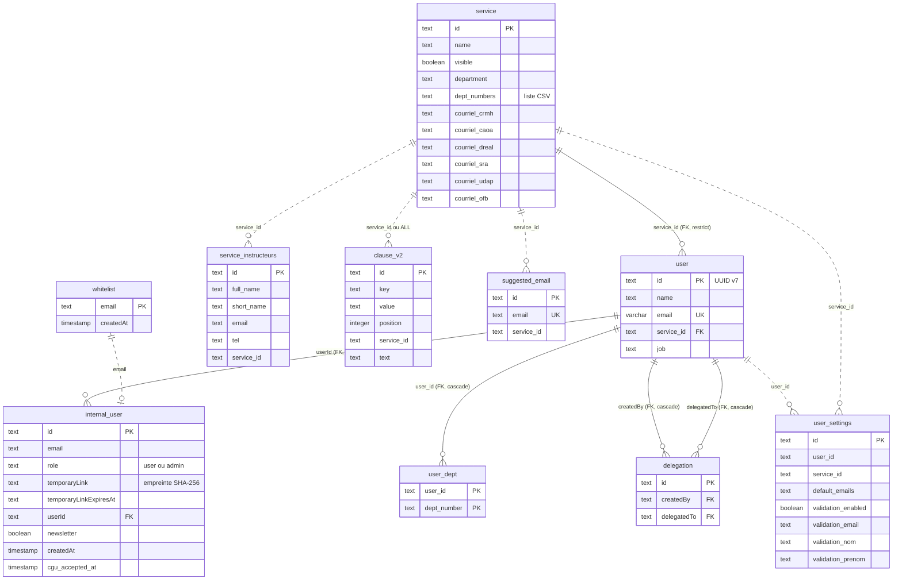
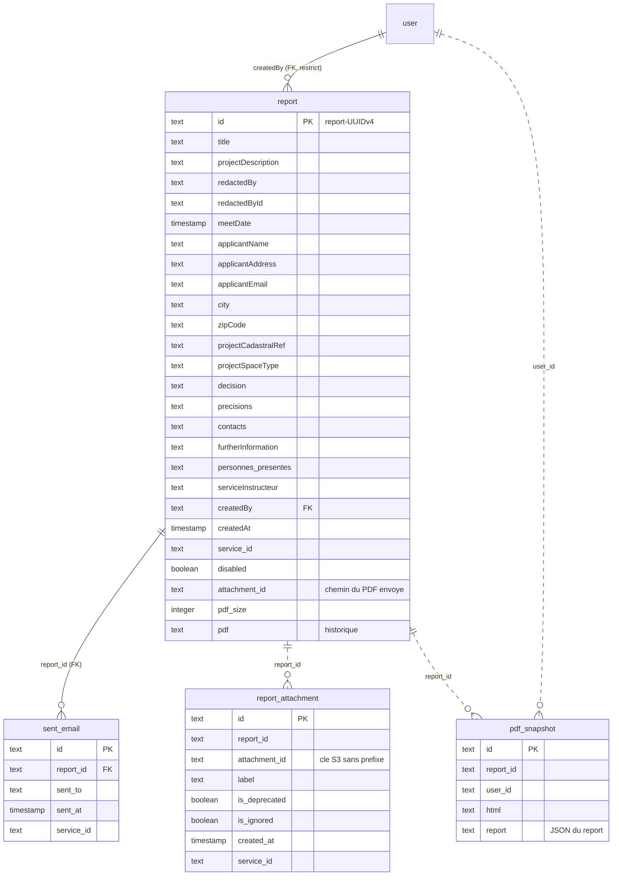
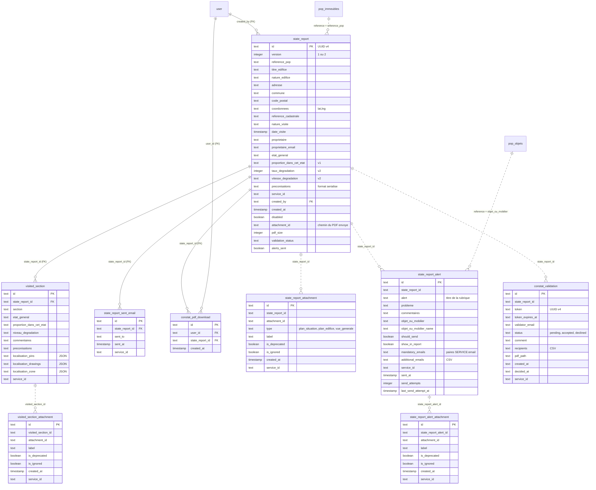
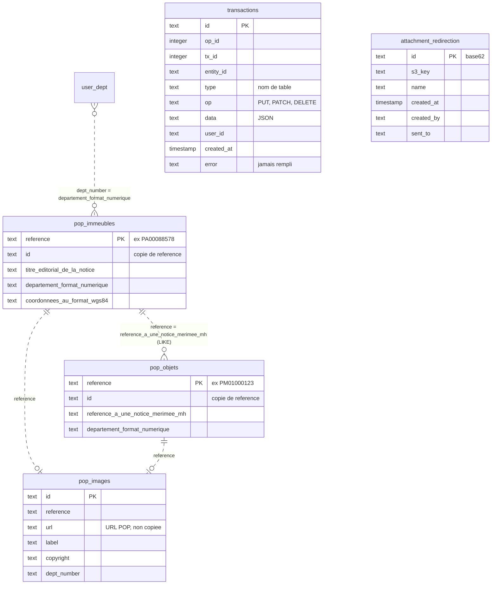

# 06 — Modèle de données

Ce document décrit la base PostgreSQL de Patrinotes : les tables et leurs colonnes, les relations, les conventions (identifiants, dates, suppression logique), les formats sérialisés dans des colonnes texte, les tables envoyées vers les navigateurs par PowerSync, l'historique des migrations et l'outillage (Drizzle, Kysely, scripts).

Source de vérité : [schema.ts](../packages/backend/src/db/schema.ts) (Drizzle). Les types Kysely utilisés à l'exécution sont dérivés de ce fichier dans [db.ts](../packages/backend/src/db/db.ts). Côté navigateur, le schéma SQLite local est déclaré à part dans [AppSchema.ts](../packages/frontend/src/db/AppSchema.ts).

> Les informations ci-dessous viennent de la lecture du code et du relevé de production du 17/11/2026 (lecture seule de la base de production : publication, migrations, volumétrie). Les points déduits mais non vérifiés sur une base réelle sont signalés par « *à confirmer* ».

---

## 1. Vue d'ensemble

### 1.1 Les domaines

| Domaine | Tables | Rôle |
| --- | --- | --- |
| **Utilisateurs et services** | `user`, `internal_user`, `whitelist`, `service`, `user_dept`, `delegation`, `user_settings`, `service_instructeurs`, `suggested_email`, `clause_v2` | Comptes, rattachement à un service (UDAP, CRMH, DRAC…), départements couverts, partage entre agents, préférences, carnet d'adresses, textes types. |
| **Compte-rendu de visite (CR)** | `report`, `report_attachment`, `pdf_snapshot`, `sent_email` | Le compte-rendu (« Compte-rendu VIF » était l'ancien nom du produit), ses photos, son brouillon HTML et les envois par courriel. |
| **Constat d'état (CE)** | `state_report`, `visited_section`, `visited_section_attachment`, `state_report_attachment`, `state_report_alert`, `state_report_alert_attachment`, `state_report_sent_email`, `constat_validation`, `constat_pdf_download` | Le constat d'état d'un monument historique, ses parties visitées, ses photos, ses alertes vers des services tiers, son circuit de validation et le suivi des téléchargements. |
| **Fiches monument** | `monument_alert`, `monument_alert_attachment`, `monument_correction` | Alertes et annotations saisies depuis une fiche (MH, UP, objet) hors constat, leurs photos, et corrections des informations POP par un service (§ 5.7). |
| **Référentiels patrimoniaux (POP)** | `pop_immeubles`, `pop_objets`, `pop_images`, `up_cache` | Copies locales des bases Mérimée (immeubles) et Palissy (objets mobiliers) de la Plateforme ouverte du patrimoine ; cache des réponses de l'API Agrégée des unités patrimoniales. Voir [07 — Données externes et stockage](07-donnees-externes-et-stockage.md). |
| **Technique** | `transactions`, `attachment_redirection`, `drizzle.__drizzle_migrations` | Journal des écritures reçues des navigateurs (et des changements de service), liens courts vers les PDF envoyés par courriel, suivi des migrations. |

La base compte **32 tables applicatives** dans le schéma `public`, plus la table de suivi de Drizzle. En développement, une **deuxième base**, `keycloak`, est créée dans la même instance PostgreSQL pour Keycloak (voir [10](10-infrastructure-et-deploiement.md) § 4.2) ; en production, Keycloak a sa propre instance. Patrinotes n'y accède pas directement.

### 1.2 Particularités globales à connaître

- **Presque aucune contrainte d'intégrité.** Seules 12 clés étrangères existent (liste au § 3). La plupart des liens (`report_id`, `state_report_id`, `service_id`, `visited_section_id`…) sont **logiques** : rien n'empêche une ligne orpheline. La cohérence repose sur l'application.
- **Presque aucun index secondaire** sur les tables métier, hormis les clés primaires, les contraintes d'unicité et 4 index sur les tables des fiches (`monument_alert` : `reference_pop`, `service_id`, `state_report_id` ; `monument_correction` : `reference_pop`). Les requêtes par `service_id`, `state_report_id` ou `departement_format_numerique` passent par des parcours séquentiels (voir § 9).
- **Toutes les clés primaires sont des `text`**, générées par l'application (UUID v4 ou v7, parfois préfixées), jamais par la base (§ 4.1).
- **Les dates sont des `timestamp without time zone`** lues et écrites en chaîne ISO (`mode: "string"`). Le décalage `Z` envoyé par le client est ignoré par PostgreSQL (§ 4.2).
- **Pas de type `enum` ni de `jsonb`** : les listes de valeurs et les structures sont stockées en `text` (§ 5 et § 6).
- **Noms de colonnes hétérogènes** : `camelCase` (`createdBy`, `meetDate`, `temporaryLink`) dans les tables anciennes, `snake_case` ailleurs. Il faut mettre des guillemets en SQL (`"createdBy"`). `pop_immeubles` contient des colonnes accentuées (`"région"`, `"département"`).

---

## 2. Diagrammes entité-relation

Légende : un trait plein (`--`) est une **clé étrangère réelle**. Un trait pointillé (`..`) est un **lien logique** sans contrainte en base.

### 2.1 Utilisateurs, services et paramétrage

### 2.2 Compte-rendu de visite (CR)

### 2.3 Constat d'état (CE)

### 2.4 Référentiels POP et tables techniques

---

## 3. Clés et contraintes réellement présentes en base

| Contrainte | Table.colonne → cible | `ON DELETE` | Source |
| --- | --- | --- | --- |
| `user_service_id_fkey` | `user.service_id` → `service.id` | `RESTRICT` : on ne supprime pas un service qui a des agents | [schema.ts](../packages/backend/src/db/schema.ts) |
| `user_email_key` | `user.email` unique | — | [schema.ts](../packages/backend/src/db/schema.ts) |
| `internal_user_userId_fkey` | `internal_user.userId` → `user.id` | `CASCADE` | [schema.ts](../packages/backend/src/db/schema.ts) |
| `delegation_createdBy_fkey`, `delegation_delegatedTo_fkey` | `delegation` → `user.id` | `CASCADE` | [schema.ts](../packages/backend/src/db/schema.ts) |
| `report_createdBy_fkey` | `report.createdBy` → `user.id` | `RESTRICT` : on ne supprime pas un agent qui a rédigé des comptes-rendus | [schema.ts](../packages/backend/src/db/schema.ts) |
| `sent_email_report_id_fkey` | `sent_email.report_id` → `report.id` | aucune action | [schema.ts](../packages/backend/src/db/schema.ts) |
| `state_report_sent_email_state_report_id_fkey` | → `state_report.id` | aucune action | [schema.ts](../packages/backend/src/db/schema.ts) |
| `suggested_email_email_key` | `suggested_email.email` unique **pour toute la base** | — | [schema.ts](../packages/backend/src/db/schema.ts) |
| `state_report_created_by_fkey` | `state_report.created_by` → `user.id` | aucune action | [schema.ts](../packages/backend/src/db/schema.ts) |
| `visited_section_state_report_id_fkey` | → `state_report.id` | aucune action | [schema.ts](../packages/backend/src/db/schema.ts) |
| `user_dept_user_id_fkey` + PK composite `(user_id, dept_number)` | → `user.id` | `CASCADE` | [schema.ts](../packages/backend/src/db/schema.ts) |
| `constat_pdf_download_*_fkey` | → `user.id`, `state_report.id` | aucune action | [schema.ts](../packages/backend/src/db/schema.ts) |

Conséquences pratiques :

- **Supprimer un service** échoue tant qu'un agent y est rattaché, avec une erreur de clé étrangère explicite.
- **Supprimer un utilisateur** supprime en cascade son `internal_user`, ses `user_dept` et ses délégations. La suppression **échoue** s'il a créé un compte-rendu (`report_createdBy_fkey`) ou un constat (`state_report_created_by_fkey`), ou téléchargé un PDF de constat (`constat_pdf_download`). Ces documents sont des données du service : il n'y a volontairement pas de cascade.
- **Supprimer un constat** échoue tant qu'il a des `visited_section`, des `state_report_sent_email` ou des `constat_pdf_download`. En pratique les constats ne sont jamais supprimés physiquement : ils sont désactivés (§ 4.3).

---

## 4. Conventions transverses

### 4.1 Génération des identifiants

Les identifiants sont générés **par le client** (navigateur, hors ligne) ou par le backend. La base ne génère aucun identifiant. Seule exception : `gen_random_uuid()` dans la reprise de données de la migration 0026.

| Table | Format | Généré par |
| --- | --- | --- |
| `report` | `"report-" + UUID v4` (préfixe obligatoire) | navigateur |
| `state_report`, `visited_section` | UUID v4 | navigateur |
| `*_attachment` (photos) | UUID v7 | navigateur |
| `report_attachment` / `state_report_attachment` du **PDF envoyé** | **l'identifiant est le chemin du PDF** (`<id>/compte_rendu_<epoch>.pdf`) | backend |
| `user` | UUID v7. Le lien avec Keycloak se fait **par l'adresse électronique**, l'identifiant Keycloak n'est pas stocké | backend |
| `pop_immeubles.id`, `pop_objets.id` | copie de `reference` (ajoutée par l'import, nécessaire à PowerSync) | import POP |
| `attachment_redirection` | entier aléatoire de 1 à 2⁴⁸ encodé en base62 (environ 8 caractères) | backend |
| `sent_email` / `suggested_email` | **le même UUID v4** est réutilisé pour les deux lignes | backend |
| `service` | libre (ex. `snum`, `no-service`) | administrateur |

### 4.2 Dates et horodatages

- Type SQL `timestamp without time zone`, mappé en chaîne (`mode: "string"`). Le client envoie `new Date().toISOString()` (UTC, suffixe `Z`). PostgreSQL **ignore le fuseau** : les valeurs stockées sont donc en UTC « naïf ». Tout export ou affichage doit les traiter comme UTC.
- Certaines dates sont du **texte libre** : `constat_validation.created_at`, `constat_validation.token_expires_at`, `constat_validation.decided_at` et `internal_user.temporaryLinkExpiresAt`. Ce sont des chaînes ISO, comparées après `new Date(...)` dans le code.
- `date_visite` est enregistrée **à midi** pour éviter les décalages de fuseau.
- Il n'existe **aucune colonne `updated_at`** : on ne peut pas savoir depuis la base quand une ligne a été modifiée. Le seul historique est la table `transactions` (§ 7.1).
- Valeurs par défaut `now()` seulement sur `internal_user.createdAt`, `whitelist.createdAt`, `state_report_attachment.created_at` et `constat_pdf_download.created_at`.

### 4.3 Suppression logique, « obsolète », « ignoré »

| Marqueur | Tables | Sens | Règles cachées |
| --- | --- | --- | --- |
| `disabled` | `report`, `state_report` | Document supprimé par l'utilisateur (corbeille). La ligne reste en base. | Les statistiques filtrent `disabled IS NOT TRUE`. Les lignes désactivées restent synchronisées vers les navigateurs du service. |
| `is_deprecated` | les 5 tables `*_attachment` (dont `monument_alert_attachment`) | Version remplacée d'une pièce jointe (ex. ancien plan de situation, ancienne image de localisation). | **PowerSync ne synchronise que `is_deprecated = 0`** : une ligne à `NULL` ne le serait pas. La colonne vaut `false` par défaut (voir aussi la reprise 0045, § 10.2). |
| `is_ignored` | les 4 tables `*_attachment` | Pièce jointe que l'utilisateur a choisi d'abandonner (envoi impossible, par exemple). | Exclue des files « non synchronisées » et des courriels d'alerte. |
| Suppression physique | toutes | Une opération `DELETE` venant du navigateur est appliquée si la politique d'écriture l'autorise pour cette table et cette ligne (voir [05 § 8](05-authentification-securite.md#8-écritures-via-la-synchronisation--contrôle-daccès)). | Ne fonctionne que sur les tables qui ont une colonne `id`. |

> **« Envoyé » se lit dans `attachment_id`.** Un CR ou un CE est considéré comme envoyé quand `attachment_id IS NOT NULL` (statistiques, verrouillage du formulaire). Il n'y a pas de colonne de statut dédiée.

### 4.4 Rattachement au service (`service_id`)

`service_id` est dupliqué dans presque toutes les tables, y compris les tables filles (`visited_section`, `*_attachment`, `state_report_alert`). Les règles de synchronisation PowerSync filtrent sur cette colonne. **Une ligne fille dont `service_id` est faux ou vide ne sera pas synchronisée.** La valeur vient du service de l'utilisateur au moment de la création. Elle n'est **pas** recalculée si l'utilisateur change de service : ses anciens documents restent dans l'ancien service.

Valeurs spéciales :

- `no-service` : service technique créé automatiquement au démarrage du backend s'il n'existe pas, avec `visible = false`. Des comptes anciens n'ont pas de service et y sont rattachés.
- `ALL` (dans `clause_v2.service_id` seulement) : clause nationale, visible par tous les services.

---

## 5. Dictionnaire des tables

Colonnes « sensibles » (données personnelles) signalées par 🔒.

### 5.1 `service` — services déconcentrés

Un service est une UDAP (unité départementale de l'architecture et du patrimoine), une CRMH (conservation régionale des monuments historiques) ou une DRAC. Le type est **déduit du nom** : il suffit que le nom contienne « crmh », « drac » ou « udap » ([useServiceType.tsx](../packages/frontend/src/features/useServiceType.tsx)).

| Colonne | Sens |
| --- | --- |
| `id` | Identifiant libre. |
| `visible` | Si `true`, le service est proposé à l'inscription (`GET /api/services`, tri par premier mot du nom puis `dept_numbers`). |
| `name`, `department` (obligatoire, souvent vide), `address`, `zipCode`, `city`, `phone`, `email`, `completeCoords` | Coordonnées imprimées sur les PDF. |
| `marianne_text`, `drac_text`, `service_text` | Textes de l'en-tête « Marianne » des PDF. |
| `dept_numbers` | **Liste de départements séparés par des virgules** (ex. `75` ou `01,38,73`). Recopiée dans `user_dept` quand un utilisateur rejoint le service : elle détermine **quels monuments POP il reçoit**. |
| `courriel_crmh`, `courriel_caoa`, `courriel_dreal`, `courriel_sra`, `courriel_udap`, `courriel_ofb` | Adresses par défaut des services destinataires des **alertes** de constat (§ 6.1). |

### 5.2 `user`, `internal_user`, `whitelist`, `user_dept`

| Table | Colonne | Sens |
| --- | --- | --- |
| `user` | `id`, `name` 🔒, `email` 🔒 (unique), `service_id`, `job` 🔒 (fonction déclarée) | Agent. **L'adresse électronique est la clé de jointure avec Keycloak et avec PowerSync** (`auth.parameter('email')`). |
| `internal_user` | `email` 🔒, `role` (`user` ou `admin`), `temporaryLink` (empreinte SHA-256 du jeton de réinitialisation ; les empreintes MD5 restent acceptées), `temporaryLinkExpiresAt` (+1 jour), `newsletter`, `createdAt`, `cgu_accepted_at` (date d'acceptation des CGU à l'inscription ; vide pour les comptes antérieurs à la colonne) | Données de compte. `role = 'admin'` ouvre `/api/admin` ([adminMiddleware.ts](../packages/backend/src/routes/adminMiddleware.ts)). La base ne stocke aucun mot de passe : l'authentification est déléguée à Keycloak. La réinitialisation du mot de passe en service passe par cette table (jeton haché, 24 h, mot de passe poussé dans Keycloak). **Il n'y a une ligne `internal_user` que pour les comptes créés par le formulaire d'inscription** ; des comptes anciens n'en ont pas. |
| `whitelist` | `email` 🔒, `createdAt` | Adresses autorisées à s'inscrire. La comparaison ignore la casse et les espaces. Le contrôle est **désactivé en développement** ([authService.ts](../packages/backend/src/services/authService.ts)). |
| `user_dept` | `user_id`, `dept_number` | Départements couverts par l'agent. Recalculée par `changeService` : suppression puis réinsertion à partir de `service.dept_numbers`. Si le nouveau service n'a **aucun** département, les anciennes lignes **sont conservées**. |

### 5.3 `delegation`, `user_settings`, `service_instructeurs`, `suggested_email`, `clause_v2`

- **`delegation`** : `createdBy` autorise `delegatedTo` à agir sur ses documents (partage entre collègues, menu « Partager »). Synchronisée pour les deux parties.
- **`user_settings`** (une ligne par utilisateur et par service) : `default_emails` (destinataires par défaut, CSV 🔒), `validation_enabled`, et l'identité du **valideur** (`validation_email`, `validation_nom`, `validation_prenom` 🔒). Quand la validation est active et demandée, le constat part d'abord au valideur (§ 5.6).
- **`service_instructeurs`** : services instructeurs proposés dans les CR (nom long, nom court, courriel, téléphone). Gérés par les agents du service.
- **`suggested_email`** : carnet d'adresses alimenté automatiquement par les envois. ⚠ Unicité **globale** sur `email` : une adresse déjà suggérée pour un service ne peut pas l'être pour un autre ; l'erreur est ignorée.
- **`clause_v2`** : textes types des CR. `key` est la rubrique (`decision`, `type-espace`, `contacts-utiles`, `bonnes-pratiques`), `value` le libellé court, `text` le contenu, `position` l'ordre. **Règle de surcharge** : pour un même couple `key`+`value`, la clause du service remplace la clause `ALL`. ⚠ **Aucun script du dépôt ne crée les clauses `ALL`** : elles n'existent qu'en base de production et font partie des données à reprendre.

### 5.4 `report` — compte-rendu (CR)

| Groupe | Colonnes |
| --- | --- |
| Identité | `id` (`report-…`), `title`, `createdBy`, `createdAt`, `service_id`, `disabled` |
| Visite | `meetDate`, `redactedBy` 🔒, `redactedById`, `personnes_presentes` 🔒 (une personne par ligne, séparateur `\n`), `serviceInstructeur` |
| Pétitionnaire | `applicantName` 🔒, `applicantAddress` 🔒, `applicantEmail` 🔒, `city`, `zipCode`, `projectCadastralRef` |
| Contenu | `projectDescription`, `projectSpaceType`, `decision`, `precisions`, `contacts`, `furtherInformation` (texte riche HTML, alimenté par les clauses) |
| Envoi | `attachment_id` (chemin du dernier PDF envoyé), `pdf_size` (octets), `pdf` (colonne historique, plus écrite ; renseignée seulement sur des CR envoyés jusqu'en avril 2026) |

Le backend renseigne `attachment_id` et `pdf_size` à l'envoi, jamais `pdf`. Un CR est donc envoyé si et seulement si `attachment_id` est renseigné : c'est le critère des compteurs (page Service, statistiques). Le frontend ne remet `pdf` à `null` que lors de la duplication d'un CR, et la règle de synchronisation l'accepte encore en écriture depuis le client ([syncPolicy.ts](../packages/backend/src/features/sync/syncPolicy.ts)).

`pdf_snapshot` contient le **brouillon HTML** du PDF modifié par l'utilisateur (`html`) et une copie JSON du CR (`report`). Il y a une ligne par couple (CR, utilisateur).

### 5.5 `state_report` — constat d'état (CE)

Le constat d'état décrit l'état sanitaire d'un monument historique protégé, établi lors d'une visite (veille sanitaire, bilan quinquennal).

| Groupe | Colonnes | Remarques |
| --- | --- | --- |
| Monument | `reference_pop`, `titre_edifice`, `nature_edifice`, `adresse`, `commune`, `code_postal`, `commune_historique`, `coordonnees`, `reference_cadastrale`, `periode_construction`, `nature_protection`, `parties_protegees`, `description`, `observations` | **Copie figée** de la notice POP au moment du choix. Une mise à jour ultérieure de POP ne modifie pas le constat. |
| Visite | `nature_visite`, `visite_partielle_details`, `visite_details`, `bilan_quinquennal` (plus demandée, voir § 6.2), `date_visite`, `redacted_by` 🔒, `redacted_by_name` 🔒, `redacted_by_id`, `personnes_presentes` 🔒 | |
| Propriétaire | `proprietaire` 🔒, `proprietaire_email` 🔒, `proprietaire_representant` 🔒, `proprietaire_representant_email` 🔒 | Peut être une personne physique. |
| Constat général | `etat_general`, `proportion_dans_cet_etat` (**v1**), `taux_degradation` (entier, **v2**), `vitesse_degradation` (**v2**), `etat_commentaires`, `preconisations`, `preconisations_commentaires`, `notes` | `version` (1 par défaut) choisit le jeu de champs v1 ou v2. |
| Unité patrimoniale (MH complexe) | `up_id` (identifiant Agrégée), `up_identifiant`, `up_intitule`, `up_intitule_complet`, `up_niveau`, `up_protection`, `up_type_immeuble`, `up_monument_identifiant`, `up_chemin` (JSON des UP parentes) | Copie figée de l'UP choisie ; `NULL` = ensemble du monument. Migration 0037. |
| Rapport groupé | `rapport_id` | Identifiant commun aux constats de plusieurs UP d'un monument, envoyés ensemble dans un seul PDF. |
| Cycle de vie | `service_id`, `created_by`, `created_at`, `disabled`, `attachment_id`, `pdf_size`, `validation_status` (`NULL`, `pending`, `accepted`, `declined`), `alerts_sent` | |

`visited_section` : une ligne par **partie visitée** (`section`). Colonnes : `etat_general`, `proportion_dans_cet_etat` (v1), `niveau_degradation` (v2), `commentaires`, `preconisations`, et la localisation sur carte (`localisation_*`, § 6).

`state_report_attachment.type` : `plan_situation` (capture satellite au 1:5000 générée dans le navigateur), `plan_edifice`, `vue_generale`, ou `NULL` (PDF envoyé, autres).

### 5.6 Alertes, validation, envois

- **`state_report_alert`** : une alerte par rubrique (`alert`, voir le [glossaire](17-glossaire.md)). `should_send` : envoyer un courriel au service compétent. `show_in_report` : afficher l'alerte dans le PDF. Pour « Objets et mobiliers », `objet_ou_mobilier` contient la référence Palissy et `objet_ou_mobilier_name` le titre.
- **Chaque alerte ne part qu'une fois**, suivie par trois colonnes : `send_attempts` (essais, incrémenté avant chaque envoi), `last_send_attempt_at`, `sent_at` (posé une fois le courriel parti). `state_report.alerts_sent` passe à `true` quand aucune alerte essayée du constat n'est en attente ; tant qu'il vaut `false`, la tâche périodique du backend reprend les alertes en échec (5 essais au plus) ([alertDelivery.ts](../packages/backend/src/features/alertDelivery.ts)).
- **`constat_validation`** : demande de validation hiérarchique. Le jeton (UUID v4) est **valable 7 jours**. Les routes publiques `/api/constat-validation/:token[/pdf|/accept|/decline]` ne demandent pas d'authentification ([validationRoutes.ts](../packages/backend/src/routes/validationRoutes.ts)). `decided_at` date l'acceptation ou le refus (vide pour les refus anciens) ; après décision, le lien ne donne plus accès au constat ni au PDF. Après acceptation, le PDF part aux `recipients` avec un lien court `attachment_redirection` valable **90 jours**, comme pour un envoi direct.
- **`sent_email` / `state_report_sent_email`** : une ligne par destinataire et par envoi. L'auteur est **toujours ajouté** aux destinataires. Pour les CE, les adresses sont mises en minuscules, pas pour les CR.
- **`constat_pdf_download`** : trace chaque téléchargement de PDF de constat (via `/api/upload/attachment?stateReportId=` ou `/api/pdf/state-report/log-download`), pour les statistiques.

### 5.7 Fiches monument

- **`monument_alert`** : alerte (`kind = alert`) ou annotation d'objet (`kind = annotation`) saisie depuis une fiche. Cible : `reference_pop` (monument), `up_id`/`up_intitule`, `objet_reference`/`objet_titre`. Contenu : `alert`, `probleme`, `presence`, `etat`, `securite`, `commentaires`. Envoi : `should_send`, `mandatory_emails`, `additional_emails` (mêmes formats que `state_report_alert`). Cycle : `status` (`draft` puis `submitted`), `submitted_at`, `sent_at` (posé par le serveur à l'envoi), `send_attempts` (échecs d'envoi de la tâche périodique, qui s'arrête à 5). Auteur : `created_by`, `created_by_name`. `state_report_id` relie une annotation faite depuis un constat.
- **`monument_alert_attachment`** : photos d'une alerte de fiche, clé S3 `<id de l'alerte>/…`.
- **`monument_correction`** : corrections des informations d'une fiche par un service. `target` (`mh`, `up` ou `objet`), `reference_pop`, `up_id`, `objet_reference`, puis les champs corrigés (`nature_edifice`, `adresse`, `commune`, `description`, `emplacement`…). Une valeur vide (`""`) efface le champ, `NULL` le laisse non corrigé. Plusieurs lignes possibles pour une même cible (créations hors ligne) : la plus récente (`updated_at`) l'emporte.
- **`up_cache`** : `key` (`ref:<Mérimée>` ou `id:<UP>`), `payload` (réponse brute JSON, `NULL` si absente), `fetched_at`. Non synchronisée. Peut être vidée sans perte : elle se reconstruit depuis l'API.

---

## 6. Formats sérialisés dans des colonnes `text`

| Colonne | Format | Code de référence |
| --- | --- | --- |
| `service.dept_numbers` | `"01,38,73"` (CSV, espaces tolérés) | [userService.ts](../packages/backend/src/services/userService.ts) |
| `report.personnes_presentes`, `state_report.personnes_presentes` | une personne par ligne (`\n`) | [ContexteVisite.tsx](../packages/frontend/src/features/state-report/steps/ContexteVisite.tsx) |
| `state_report.preconisations` | `option[:commentaire]/option[:commentaire]`, chaque partie encodée avec `encodeURIComponent` | [stateReport.tsx](../packages/pdf/src/stateReport.tsx) |
| `state_report_alert.mandatory_emails` | `SERVICE:email;SERVICE:email` (ex. `CAOA:a@x.fr;CRMH:b@y.fr`) | [utils.tsx](../packages/pdf/src/utils.tsx) |
| `state_report_alert.additional_emails`, `user_settings.default_emails`, `constat_validation.recipients` | CSV ; à l'envoi `;` est accepté et converti en `,` | [pdfRoutes.tsx](../packages/backend/src/routes/pdfRoutes.tsx) |
| `state_report.coordonnees` | `"lat,lng"` (latitude d'abord) | [planSituationSnapshot.ts](../packages/frontend/src/features/map/planSituationSnapshot.ts) |
| `visited_section.localisation_pins` | JSON `[{id, lng, lat}]` | [localisationTypes.ts](../packages/frontend/src/features/map/localisationTypes.ts) |
| `visited_section.localisation_drawings` | JSON `[{points:[{lng,lat}], color, width}]` | idem |
| `visited_section.localisation_zone` | JSON `{sw:[lng,lat], ne:[lng,lat]}` | idem |
| `*_attachment.attachment_id` | chemin relatif dans le stockage, **sans** le préfixe `attachment/` ([07](07-donnees-externes-et-stockage.md) § 3.2) ; peut contenir **plusieurs identifiants séparés par `;`** (lignes anciennes, encore gérées par la file de pièces jointes) | [db.ts](../packages/frontend/src/db/db.ts) |
| `pdf_snapshot.report`, `transactions.data` | JSON | — |
| `pop_immeubles.coordonnees_au_format_wgs84` | texte issu du CSV POP, au format `"lat,lng"` (le frontend le découpe sur la virgule) | — |

### 6.1 Correspondance rubrique d'alerte → courriel du service

La table de correspondance est codée en dur dans [stateReport.tsx](../packages/pdf/src/stateReport.tsx). La colonne lue est `courriel_` + nom du service en minuscules ([StateReportAlert.utils.tsx](../packages/frontend/src/features/state-report/alerts/StateReportAlert.utils.tsx)).

| Rubrique | Services | Colonne lue |
| --- | --- | --- |
| Édifice en péril | CRMH | `courriel_crmh` |
| Abords de l'édifice | UDAP | `courriel_udap` |
| Objets et mobiliers | CAOA, CRMH | `courriel_caoa`, `courriel_crmh` |
| Archéologie | SRA | `courriel_sra` |
| Site classé ou inscrit | DREAL | `courriel_dreal` |
| Biodiversité | OFB | `courriel_ofb` |
| Sécurité | Mairie | `courriel_mairie` → **colonne inexistante** : l'adresse est toujours vide et doit être saisie à la main. |

### 6.2 Incohérences de type connues

- `state_report.bilan_quinquennal` est un `boolean` en base (défaut `true`) et un `text` dans le schéma navigateur. La question n'est pas posée dans le formulaire, mais les clients déjà installés envoient encore la colonne à la création d'un constat : elle reste donc en base et dans la politique d'écriture.
- `pop_immeubles.last_image_check_at` et `pop_objets.last_image_check_at` ne sont lues ni écrites par aucun code.
- Les booléens sont des **entiers 0/1** côté SQLite ; PostgreSQL les reçoit sous forme de texte (`'1'`, `'0'`) et les convertit.

---

## 7. Tables techniques

### 7.1 `transactions` — journal des écritures

Chaque opération envoyée par un navigateur (`POST /api/upload-data`) est **d'abord** insérée dans `transactions` (table visée, opération `PUT`/`PATCH`/`DELETE`, données JSON, utilisateur), **puis** appliquée ([syncService.ts](../packages/backend/src/services/syncService.ts)). Points d'attention :

- La table **grossit sans limite** et contient une copie de toutes les données saisies, donc des données personnelles. Aucune purge n'est prévue.
- La colonne `error` n'est **jamais remplie**. En cas d'échec SQL ou de refus, le backend répond HTTP 200 avec `{ success: false }`. Le navigateur retire l'opération de sa file et la signale à l'agent ([Connector.ts](../packages/frontend/src/db/Connector.ts)) ; l'écriture n'est pas appliquée. Seul `transactions.data` permet de la retrouver.
- Seules les tables listées dans la politique d'écriture sont modifiables ; `transactions` elle-même ne l'est pas. Voir [05 §8](05-authentification-securite.md).
- Le backend y inscrit aussi chaque **changement de service** (`type = user`, `op = CHANGE_SERVICE`, `data = {from, to}`).

### 7.2 `attachment_redirection` — liens courts des courriels

Voir [07 — Données externes et stockage](07-donnees-externes-et-stockage.md#4-liens-courts-vers-les-pdf-attachment_redirection). Les lignes ne sont jamais purgées. Elles deviennent inutilisables après 90 jours.

---

## 8. Synchronisation vers les navigateurs (PowerSync)

Une table n'arrive dans le navigateur que si elle fait partie de la **publication PostgreSQL** `powersync`, si une **règle** de synchronisation la sélectionne et si elle est déclarée dans le **schéma navigateur** ([AppSchema.ts](../packages/frontend/src/db/AppSchema.ts)). PowerSync exige une colonne `id` sur chaque ligne synchronisée. La publication et sa création sont décrites dans [10](10-infrastructure-et-deploiement.md) § 4.2, les règles dans [08](08-synchronisation-hors-ligne.md) § 3.

### 8.1 Tables envoyées aux navigateurs

| Table | Envoyée à | Remarque |
| --- | --- | --- |
| `clause_v2` | tous (`service_id='ALL'`) et le service | |
| `service`, `service_instructeurs`, `sent_email`, `suggested_email`, `monument_correction` | le service | |
| `user` | le service | **`id`, `name`, `service_id` seulement** : ni `email` ni `job` |
| `delegation`, `pdf_snapshot`, `user_settings` | l'utilisateur | |
| `report`, `state_report`, `visited_section`, `state_report_alert`, `monument_alert`, `monument_alert_attachment` | le service | lignes `disabled` et brouillons compris |
| `report_attachment`, `state_report_attachment`, `visited_section_attachment`, `state_report_alert_attachment` | le service, **à la demande** (document ouvert) | `is_deprecated = 0` |
| `pop_immeubles`, `pop_objets` | départements de l'utilisateur (`user_dept`) | priorité la plus basse |
| `transactions` | aucun | publiée mais lue par aucune règle : chaque écriture passe inutilement dans la réplication |
| `constat_validation`, `internal_user`, `whitelist`, `user_dept`, `attachment_redirection`, `constat_pdf_download`, `up_cache`, `state_report_sent_email`, `pop_images` | aucun | serveur uniquement ; le statut de validation arrive aux appareils par `state_report.validation_status` |

Les règles identifient l'utilisateur par **l'adresse électronique contenue dans le jeton Keycloak**. Si l'adresse change dans Keycloak sans être modifiée dans `user.email`, l'agent ne reçoit plus rien.

Le schéma navigateur ne déclare pas toutes les colonnes du serveur : `state_report.redacted_by_name`, `redacted_by_id`, `alerts_sent` et les colonnes de suivi d'envoi des alertes existent en base mais ne sont pas envoyées aux appareils.

Sur une infrastructure cible avec PostgreSQL managé, il faut créer la publication `powersync` et la base `keycloak` **avant** la première migration, activer `wal_level=logical` et fournir un rôle autorisé à la réplication pour PowerSync (`PS_DATABASE_URL`).

---

## 9. Volumétrie

Mesures du relevé de production du 17/11/2026. Base applicative : **719 Mo** (volume Docker 815 Mo).

| Table | Lignes | Taille | Moteur de croissance |
| --- | --- | --- | --- |
| `pop_objets` | 288 948 | 326 Mo | import (tout Palissy, environ 90 colonnes texte) |
| `pop_immeubles` | 46 895 | 231 Mo | réimport complet |
| `transactions` | 158 094 | 137 Mo | une ligne par opération synchronisée, jamais purgée |
| `report` | 2 910 | 4,5 Mo | usage |
| `state_report` | 1 214 | — | usage |
| `state_report_attachment` | 952 | — | usage |
| `user` / `service` | 261 / 118 | — | inscriptions |
| `pop_images` | **0** | — | table des URL de photos POP, lue par les fiches objet ; vide : les images POP ne sont pas affichées |
| Navigateur | — | — | toutes les notices POP des départements de l'agent, téléchargées au premier démarrage |

Qualité des données POP : 42 immeubles et **4 541 objets** ont autre chose qu'une date dans `date_de_la_derniere_mise_a_jour` (texte d'une autre colonne, caractères mal encodés) : décalage de colonnes ou problème d'encodage à l'import (voir [12](12-exploitation-et-supervision.md) § 7.1).

Requêtes coûteuses à surveiller : le filtre `pop_objets.reference_a_une_notice_merimee_mh LIKE '%<ref>'` (exécuté dans SQLite côté navigateur), les filtres PowerSync par `service_id` et `departement_format_numerique` (aucun index), et `KyselyBatchWriter`, qui relit le catalogue de la base à chaque lot de 500 lignes.

---

## 10. Migrations

### 10.1 Outillage

| Élément | Détail |
| --- | --- |
| Outil | `drizzle-kit` 0.31 ([drizzle.config.ts](../packages/backend/drizzle.config.ts)) : schéma `src/db/schema.ts`, fichiers SQL dans `db/` à la racine du dépôt, TLS selon `DATABASE_SSL` (désactivé par défaut). |
| Connexion | `POSTGRES_HOST`, `POSTGRES_PORT`, `POSTGRES_USER`, `POSTGRES_PASSWORD`, `POSTGRES_DB`. ⚠ `drizzle.config.ts` **valide toutes les variables du backend** (SMTP, MinIO, Keycloak…) : une migration échoue si l'une d'elles manque, même si elle ne sert pas à la migration. |
| Suivi | Table `drizzle.__drizzle_migrations` (une ligne par migration appliquée, avec l'empreinte du fichier et la date `when` du journal, qui est la date de **génération** et non d'application) et journal [db/meta/_journal.json](../db/meta/_journal.json). |
| En production | Le conteneur backend exécute [docker-start.sh](../packages/backend/docker-start.sh) : `pnpm migration:up`, puis le serveur. **Si la migration échoue, le conteneur s'arrête** sans démarrer le serveur. Avec plusieurs réplicas, chacun lance la migration au démarrage. |
| SQL ajouté à la main | Plusieurs migrations contiennent du SQL que Drizzle ne génère pas (ajouts à la publication PowerSync, reprises de données en 0025, 0026 et 0045). |

### 10.2 Historique des 47 migrations

Le journal commence le 6 novembre 2025. Les migrations 0000 et 0001 forment une **ligne de base** issue de l'ancien système (`@databases/pg-migrations`, dont les tables `atdatabases_migrations_*` sont créées puis supprimées en 0001). La migration 0001 ajoute `user.email NOT NULL` sans valeur par défaut, ce qui échouerait sur une table non vide : la production a probablement été « marquée » comme migrée jusqu'à ce point plutôt que réellement migrée. Le relevé du 17/11/2026 ne permet pas de trancher (les tables `atdatabases_*` n'existent plus). Il montre en revanche que **le fichier 0000 a été modifié après son application** : l'empreinte enregistrée en production correspond au fichier du 07/11/2025, reformaté le 25/02/2026. Drizzle ne revérifie pas les empreintes, donc sans effet en production, mais une base neuve n'aura pas la même empreinte pour 0000.

| # | Date | Évolution |
| --- | --- | --- |
| 0000 | 2025-11-06 | Ligne de base : `user`, `internal_user` (avec `password`), `delegation`, `whitelist`, `service_instructeurs`, `clause_v2`, `pdf_snapshot`, `tmp_pictures`, `picture_lines`, `pictures`, `transactions`, `report`, `sent_email`, `suggested_email`, **`udap`**, `user_settings` ; publication PowerSync. |
| 0001 | 2025-11-07 | **Renommage `udap` → `service`** et `udap_id` → `service_id` partout ; création de `merimee`, `merimee_to_memoire`, `pop_immeubles`, `state_report`, `visited_section`, `user_dept` ; `user.email` unique. |
| 0002 | 2025-11-07 | Suppression de l'index `pop_immeubles_departement` (sur `departement_format_numerique`). Aucune migration ultérieure ne le recrée et le schéma Drizzle ne déclare aucun index sur `pop_immeubles`. |
| 0003 | 2025-11-08 | Tables `report_attachment` et `state_report_attachment` (nouveau modèle de pièces jointes) ; suppression de `tmp_pictures` et de `internal_user.password`. |
| 0004 | 2025-11-09 | `visited_section_attachment` ; `picture_lines` adaptée au nouveau modèle. |
| 0005 | 2025-11-11 | `state_report_sent_email` ; `state_report.attachment_id`. |
| 0006–0008 | 2025-11-13 → 18 | Référentiel `pop_objets` (Palissy), `pop_images`, `last_image_check_at` (mis à `now()` pour tous les immeubles existants) ; suppression de `merimee_to_memoire`. |
| 0009 | 2025-11-24 | `internal_user.newsletter`. |
| 0010 | 2026-01-15 | Courriels par service destinataire (`courriel_crmh`, `caoa`, `dreal`, `sra`, `udap`, `ofb`). |
| 0011–0018 | 2026-01-19 → 02-05 | **Alertes de constat** : `state_report_alert` et ses pièces jointes, puis itérations sur les destinataires (`email`/`send_email` → `mandatory_emails`/`additional_emails`/`should_send`) ; `state_report.notes` ; `user.job`. |
| 0019–0022 | 2026-03-23 → 26 | **Circuit de validation** : `constat_validation`, `user_settings.validation_*`, `state_report.validation_status`, `alerts_sent`. |
| 0023–0024 | 2026-03-26 → 28 | `is_ignored` sur les 4 tables de pièces jointes ; `createdAt` sur `internal_user` et `whitelist`. |
| 0025 | 2026-03-28 | `bilan_quinquennal` recréé en booléen (défaut `true`, **les anciennes valeurs sont perdues**) ; transfert `visite_partielle_details` → `visite_partielle_parties`. |
| 0026 | 2026-03-31 | **Reprise de données** : les colonnes `plan_situation`, `plan_edifice` et `vue_generale` (liste séparée par `;`) de `state_report` sont converties en lignes typées de `state_report_attachment`, puis supprimées ; suppression de `picture_lines`. |
| 0027 | 2026-04-01 | `report_attachment.label`. |
| 0028–0029 | 2026-04-21 | `attachment_redirection` (liens courts des courriels). |
| 0030 | 2026-04-28 | `visite_partielle_parties` renommée en `visite_details`. |
| 0031–0032 | 2026-05-18 → 06-02 | `report.personnes_presentes`, `state_report.coordonnees`. |
| 0033 | 2026-06-08 | **Constat v2** : `version`, `taux_degradation`, `vitesse_degradation`, `visited_section.niveau_degradation` et `preconisations`. |
| 0034 | 2026-06-17 | `pdf_size` sur `report` et `state_report`. |
| 0035 | 2026-08-05 | Localisation sur carte des parties visitées (`localisation_pins`, `drawings`, `zone`). |
| 0036 | 2026-09-21 | `constat_pdf_download` (suivi des téléchargements). |
| 0037 | 2026-10-20 | **MH complexes** : colonnes `up_*` et `rapport_id` de `state_report` ; table `up_cache`. |
| 0038 | 2026-11-10 | **Fiches** : `monument_alert`, `monument_alert_attachment`, `monument_correction`, index, ajout à la publication. |
| 0039 | 2026-11-10 | `monument_alert.state_report_id` et son index (annotation depuis un constat). |
| 0040 | 2026-11-23 | Suppression des tables `pictures` et `merimee` (retrait de `pictures` de la publication). |
| 0041 | 2026-11-23 | `internal_user.cgu_accepted_at` (preuve du consentement aux CGU). |
| 0042 | 2026-11-23 | `ON DELETE RESTRICT` au lieu de `SET NULL` sur `user.service_id` et `report.createdBy` (colonnes `NOT NULL`). |
| 0043 | 2026-11-23 | `is_deprecated` vaut `false` par défaut sur les cinq tables de pièces jointes. |
| 0044 | 2026-11-23 | `constat_validation.decided_at` (date de la décision du valideur), rempli pour les demandes déjà acceptées. |
| 0045 | 2026-11-23 | **Reprise de données** : valeur donnée aux pièces jointes à `is_deprecated` `NULL` (recopiées par 0026), sans doublon de plan (§ 4.3). Test dédié : [migration0045.test.ts](../packages/backend/src/db/migration0045.test.ts). |
| 0046 | 2026-11-23 | Suivi des envois d'alertes : `state_report_alert.sent_at`, `send_attempts`, `last_send_attempt_at` ; `monument_alert.send_attempts` ; `sent_at` posé sur les alertes des constats déjà marqués `alerts_sent`. |

---

## 11. Données minimales d'un nouvel environnement

Pour démarrer un environnement vierge et utilisable, il faut au minimum : la publication PowerSync, les migrations, au moins un service `visible` avec `dept_numbers`, les clauses `ALL` (§ 5.3), l'import POP (environ 560 Mo de tables, voir [07](07-donnees-externes-et-stockage.md) § 2) et les adresses autorisées dans `whitelist`. Le dépôt ne contient aucun jeu de données de production ; les données fictives des tests de bout en bout ([tests/setup.ts](../tests/setup.ts)) peuvent servir de modèle.
