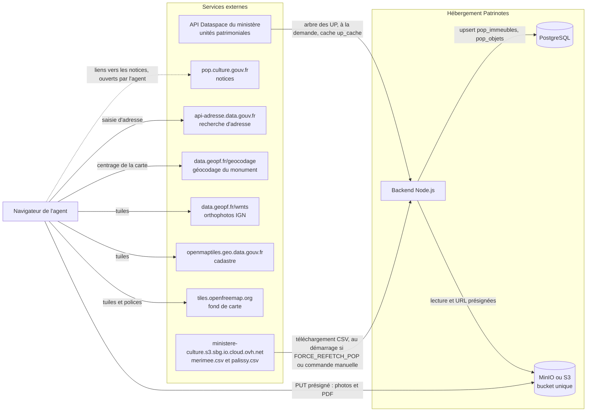
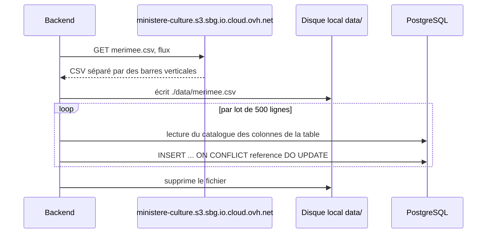
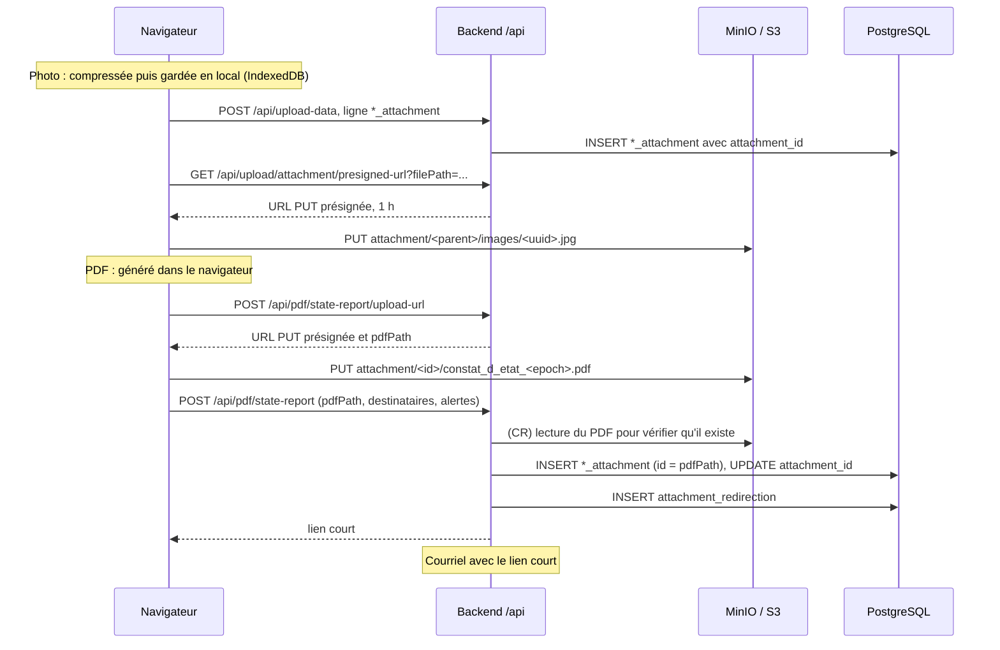
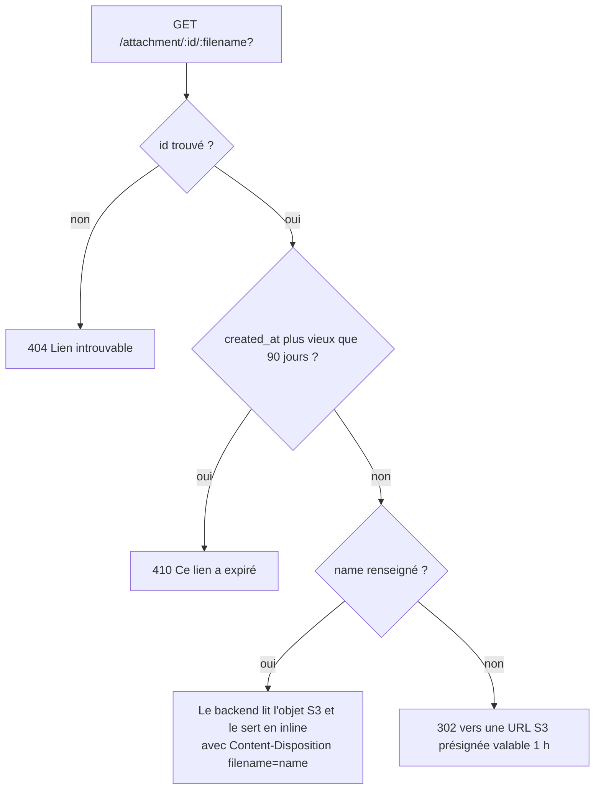

# 07 — Données externes et stockage de fichiers

Ce document décrit les données que Patrinotes **récupère à l'extérieur** (référentiels du patrimoine, géocodage, fonds de carte) et la façon dont il **stocke ses fichiers** (photos, plans, PDF) dans un stockage objet compatible S3 (MinIO). Il couvre aussi les liens courts envoyés par courriel et la redirection de l'ancien domaine « Compte-rendu VIF ».

Voir aussi : [06 — Modèle de données](06-modele-de-donnees.md) pour les tables citées.

> Les informations ci-dessous viennent de la lecture du code et du relevé de production du 17/11/2026. Les points non vérifiés sont signalés « *à confirmer* ».

---

## 1. Vue d'ensemble des flux externes



| Source | Appelée par | Quand | Données | Authentification |
| --- | --- | --- | --- | --- |
| `https://ministere-culture.s3.sbg.io.cloud.ovh.net/POP/merimee.csv` | backend | au démarrage si `FORCE_REFETCH_POP=true`, ou par la commande d'import | notices Mérimée (immeubles protégés) | aucune |
| `https://ministere-culture.s3.sbg.io.cloud.ovh.net/POP/palissy.csv` | backend | idem, **seulement si `pop_objets` est vide** | notices Palissy (objets mobiliers) | aucune |
| `https://api-adresse.data.gouv.fr/search/` | **navigateur** | saisie d'adresse avec suggestions (CR, CE) | adresses de la Base adresse nationale | aucune |
| `https://data.geopf.fr/geocodage/search` | **navigateur** | centrage de la carte du plan de situation sur l'adresse du monument | coordonnées (Géoplateforme de l'IGN) | aucune |
| `https://data.geopf.fr/wmts` (orthophotos IGN), `openmaptiles.geo.data.gouv.fr` (cadastre), `tiles.openfreemap.org` (fond et polices) | **navigateur** | carte du plan de situation et localisation des désordres | tuiles | aucune |
| `UP_API_URL` (par défaut `https://api-ext.stg.cloud.culture.fr/dataspace/patrinote/up`) | backend | ouverture d'un MH complexe (constat ou fiche), si `UP_API_MODE=live` | unités patrimoniales d'un monument | en-tête `apiKey` (`UP_API_KEY`) |

Seule la requête de l'agent (adresse ou référence) est envoyée à ces services ; aucune donnée personnelle n'en sort, hors l'adresse d'un monument ou d'un projet saisie pour le géocodage.

### 1.1 API Dataspace des unités patrimoniales

Code : [upProvider.ts](../packages/backend/src/features/up/upProvider.ts), [upService.ts](../packages/backend/src/services/upService.ts). Route : `GET /api/up/monument` ([04 §4.9](04-backend-api.md)).

- L'API reçoit en `POST` un filtre de type MongoDB (`{UPI_REFERENCE_MERIMEE: "PA…"}` pour la racine, `{$or: [{_id: {$in: […]}}]}` pour les enfants, par lots de 50). Elle ne connaît que le lien parent → enfants : l'arbre est lu **niveau par niveau** (10 niveaux et 1 000 UP au plus).
- Elle répond **404 au lieu d'une liste vide** quand rien ne correspond : le backend le traite comme « aucune UP ».
- Délai de 5 s, une nouvelle tentative. Les réponses sont gardées dans `up_cache` pendant `UP_CACHE_TTL_HOURS` (24 h) ; si l'API ne répond pas, le cache périmé est servi.
- Elle n'est **joignable que depuis le réseau de production** (filtrage par adresse IP ; accès depuis l'hébergement cible : question M25 du [chapitre 19](19-questions-pour-le-ministere.md)). En développement et en test, `UP_API_MODE=mock` lit des réponses enregistrées ([up-mock.json](../packages/backend/src/features/up/fixtures/up-mock.json)).
- Seule la référence Mérimée est envoyée : aucune donnée personnelle ne sort.

La variable `DATAGOUV_API` est **obligatoire** dans [envVars.ts](../packages/backend/src/envVars.ts) mais **aucun code ne la lit**. Il faut quand même la renseigner, sinon le backend refuse de démarrer.

---

## 2. Import des référentiels POP (Mérimée et Palissy)

Code : [pop.ts](../packages/backend/src/features/data/pop.ts) et [KyselyBatchWriter.ts](../packages/backend/src/features/data/KyselyBatchWriter.ts).

### 2.1 Déclenchement

| Mode | Commande | Ce qui est fait |
| --- | --- | --- |
| Au démarrage du backend | variable `FORCE_REFETCH_POP=true` | Import des immeubles puis des objets. **Bloquant** : le serveur HTTP ne démarre qu'à la fin de l'import. |
| Manuel, complet | `pnpm backend import-pop` | Immeubles, objets, puis fin du processus. |
| Planifié | **aucun** | Il n'y a ni cron ni tâche planifiée, ni dans le dépôt ni dans Coolify (relevé du 17/11/2026). Le dernier import des immeubles est postérieur au 06/05/2026 ; celui des objets ne peut pas être daté. |

Points d'attention :

- **Les immeubles sont toujours réimportés** (upsert complet). **Les objets ne le sont que si la table `pop_objets` est vide**. Pour rafraîchir Palissy, il faut vider `pop_objets` avant le lancement.
- Si `FORCE_REFETCH_POP` reste à `true`, **chaque redémarrage** retélécharge Mérimée et retarde la mise en service.

### 2.2 Traitement



1. **Téléchargement en flux** vers `./data/merimee.csv` (ou `palissy.csv`), relatif au répertoire courant (en pratique `packages/backend/data/`). Le conteneur doit donc disposer d'un **disque inscriptible** et de l'espace nécessaire (les tables occupent 231 Mo pour Mérimée et 326 Mo pour Palissy en production ; fichiers CSV d'environ 100 Mo et 365 Mo le 25/11/2026).
2. **Analyse CSV** avec le séparateur `|`. Les en-têtes sont mis en minuscules et débarrassés des espaces. **Les noms de colonnes de la table doivent correspondre exactement aux en-têtes du fichier** (d'où les colonnes `région`, `département`, etc.).
3. **Écriture par lots de 500** :
   - les lignes sans `reference` sont ignorées ;
   - `id` reçoit la valeur de `reference` (PowerSync exige une colonne `id`) ;
   - les doublons de `reference` dans un même lot sont éliminés (la première occurrence est gardée) ;
   - **les colonnes du CSV absentes de la table sont ignorées sans avertissement**. Si POP renomme une colonne, elle reste vide chez nous sans erreur ;
   - `INSERT … ON CONFLICT (reference) DO UPDATE` sur toutes les colonnes, sauf `reference` et `id`.
4. **Suppression du fichier** à la fin.

Limites :

- **Aucune suppression** : une notice retirée de POP (déclassement, fusion) **reste** dans la base et sur les postes.
- **Aucun filtre** : toute la France est importée. Le tri par département se fait dans les règles PowerSync (`departement_format_numerique` ∈ départements de l'agent).

### 2.3 Lien entre immeubles et objets

Aucune clé ne relie `pop_objets` à `pop_immeubles`. Le navigateur cherche les objets d'un monument par une recherche textuelle (`LIKE`) de la référence Mérimée dans `reference_a_une_notice_merimee_mh`, avec deux filtres légèrement différents selon l'écran, qui peuvent donner des résultats différents.

Quand l'agent choisit un monument, les champs utiles de la notice POP sont **copiés** dans le constat (copie figée, voir [06](06-modele-de-donnees.md) § 5.5).

### 2.4 Photos POP (`pop_images`)

La table `pop_images` est prévue pour des URL de photos POP (`url`, `label`, `copyright`, `dept_number`). Elle est lue par les fiches objet, la galerie et le constat via `GET /api/state-report/objets-images`, mais n'est pas synchronisée. Elle est vide en production : les images POP ne sont pas affichées, une vignette par défaut s'affiche à la place.

---

## 3. Stockage objet (S3 / MinIO)

Code : [uploadService.ts](../packages/backend/src/services/uploadService.ts), [uploadRoutes.tsx](../packages/backend/src/routes/uploadRoutes.tsx), [pdfRoutes.tsx](../packages/backend/src/routes/pdfRoutes.tsx), file de pièces jointes du navigateur dans [db.ts](../packages/frontend/src/db/db.ts).

### 3.1 Configuration

| Variable | Rôle |
| --- | --- |
| `MINIO_URL` | Point d'accès S3 utilisé par le backend (ex. `https://s3.exemple.fr`). Sert aussi à signer les URL présignées si `MINIO_PUBLIC_URL` est vide : il doit alors être **joignable depuis les navigateurs des agents**, qui y envoient directement les fichiers. |
| `MINIO_PUBLIC_URL` (facultatif) | Point d'accès utilisé pour **signer** les URL présignées, quand les navigateurs joignent le stockage par une autre adresse que le backend (reverse proxy, réseau interne). |
| `MINIO_BUCKET` | Nom du bucket unique. |
| `MINIO_ACCESS_KEY_ID`, `MINIO_SECRET_KEY` | Identifiants applicatifs (droit `readwrite` en développement). |
| `MINIO_USER`, `MINIO_PASSWORD` | Compte administrateur MinIO (docker-compose seulement). |

Particularités du client S3 : région `us-east-1` en dur, adressage en chemin (*path-style*), et paramètre `Bucket` qui reçoit l'**URL complète** `${MINIO_URL}/${MINIO_BUCKET}`. Toute solution S3 compatible (MinIO, Scaleway, OVH, Outscale…) doit accepter l'adressage en chemin et la région `us-east-1` (ou l'ignorer).

**Prérequis hors code** :

- une **politique CORS** sur le bucket autorisant `PUT` et `GET` depuis l'origine du frontend. Sans elle, l'envoi des photos et des PDF échoue ;
- le bucket ne doit **pas** être public : tous les accès passent par le backend ou par une URL présignée. Le code ne pose aucune ACL.

En production, ces deux conditions sont remplies (voir [05](05-authentification-securite.md) § 7.1).

### 3.2 Organisation des clés

Bucket unique, **un seul préfixe racine `attachment/`**, puis l'identifiant du document parent :

```text
<bucket>/
└── attachment/
    ├── report-<uuid>/                       ← compte-rendu (CR)
    │   ├── images/<uuidv7>.jpg               photos du CR
    │   └── compte_rendu_<epoch>.pdf          un PDF par envoi
    ├── <uuid constat>/                      ← constat d'état (CE)
    │   ├── images/<uuidv7>.jpg               photos générales, plan de situation, plan, vue générale
    │   └── constat_d_etat_<epoch>.pdf        un PDF par envoi
    ├── <uuid partie visitée>/
    │   ├── images/<uuidv7>.jpg               photos de la partie visitée
    │   └── localisation/<uuidv7>.jpg         carte de localisation des désordres
    ├── <uuid alerte>/
    │   └── images/<uuidv7>.jpg               photos jointes à l'alerte
    └── <uuid alerte de fiche>/              ← monument_alert (alerte ou annotation hors constat)
        └── images/<uuidv7>.jpg               photos
```

Le **premier segment** de la clé désigne le document : c'est lui qui décide de l'accès (service du document, [attachmentAccess.ts](../packages/backend/src/features/attachmentAccess.ts)). Ce format ne doit pas changer.

- Les colonnes `attachment_id` des tables `*_attachment`, `report.attachment_id`, `state_report.attachment_id` et `constat_validation.pdf_path` contiennent la clé **sans** le préfixe `attachment/`, que le backend ajoute. `attachment_redirection.s3_key` contient la clé **avec** le préfixe.
- `<epoch>` est en secondes. Chaque envoi produit un **nouveau PDF**. Les anciens restent dans le stockage, et `attachment_id` du document pointe sur le dernier.
- Le segment `/localisation/` est **porteur de sens** : c'est lui qui identifie une carte de localisation. Il ne faut pas changer ce format.
- Les photos sont **recompressées dans le navigateur** en JPEG (1 Mo et 1920 px maximum, **métadonnées EXIF supprimées**, donc pas de coordonnées GPS des photos).
- **Pas d'audio, pas de vidéo** : le code ne stocke que des images et des PDF.

### 3.3 Flux d'écriture et de lecture



| Route (préfixe `/api`, authentifiée) | Effet |
| --- | --- |
| `GET /upload/attachment/presigned-url?filePath=` | URL `PUT` présignée **1 h** pour `attachment/<filePath>`. Refusée si le document est d'un autre service. |
| `GET /upload/attachment?filePath=[&stateReportId=]` | Le backend lit l'objet et le **renvoie lui-même** (pas de redirection), si le document est du service de l'utilisateur. Si `stateReportId` est fourni, une ligne `constat_pdf_download` est créée. |
| `GET /upload/attachment/size?filePath=` | Taille de l'objet (`HEAD`), même contrôle. |
| `POST /pdf/report/upload-url`, `POST /pdf/state-report/upload-url` | URL présignée et chemin du futur PDF, si l'utilisateur peut modifier le document. |
| `POST /pdf/report`, `POST /pdf/state-report` | Enregistre le PDF, envoie les courriels, crée les liens courts. Réservé à qui peut modifier le document. |
| `GET /pdf/report?reportId=`, `GET /pdf/state-report?stateReportId=` | Renvoie le PDF **encodé en base64** dans le JSON (service du document ; pour un constat, aussi un service couvrant le département du monument). |

Points d'attention :

- **La file de pièces jointes du navigateur** (PowerSync `AttachmentQueue`) surveille les 5 tables `*_attachment` (`is_deprecated = 0`). Elle **téléverse** les fichiers locaux et **télécharge** ceux qui manquent, toutes les 30 secondes. La suppression n'est pas implémentée : **rien n'est jamais supprimé du stockage**.
- **Type et taille contrôlés et signés** dans l'URL de dépôt (voir [05](05-authentification-securite.md) § 7.2). Les fichiers ne transitent pas par le backend (envoi direct par URL présignée).
- **Contrôle d'appartenance** : lecture et écriture limitées au service du document désigné par le premier segment de la clé. Exception : une URL d'écriture est délivrée pour un document **pas encore en base**, car les photos peuvent partir avant la ligne.
- Pour les CE, le backend ne vérifie pas que le PDF a bien été téléversé avant d'envoyer les courriels. Pour les CR, il le relit, ce qui échoue s'il est absent.

### 3.4 Cycle de vie et volumétrie

- **Aucune règle de cycle de vie** dans le code : photos remplacées (`is_deprecated`), PDF successifs, pièces jointes de documents désactivés et anciens plans de situation sont **conservés indéfiniment**. La durée de conservation doit être définie avec le ministère (archivage, RGPD) puis mise en œuvre par une règle de cycle de vie S3 ou un script de purge.
- **Volumétrie estimée** (taille réelle du bucket à relever : point P7 du [chapitre 18](18-questions-ouvertes.md)) : environ 1 Mo par photo au maximum. Taille des PDF : colonnes `report.pdf_size` et `state_report.pdf_size` (vides pour les documents envoyés avant la migration 0034). Une requête `SUM(pdf_size)` sur ces colonnes donne la taille des derniers PDF. Pour le total réel, mesurer le bucket (`mc du`).
- **Migration du stockage** : copier le bucket en conservant **exactement les clés** (par exemple `mc mirror` ou `rclone sync`). Les clés sont référencées en base et dans les liens courts déjà envoyés. Seules `MINIO_URL` (et `MINIO_PUBLIC_URL`) et `MINIO_BUCKET` changent.

---

## 4. Liens courts vers les PDF (`attachment_redirection`)

Les courriels d'envoi de CR et de CE ne contiennent pas de pièce jointe, mais un **lien court** servi par le backend **à la racine** (hors préfixe `/api`, **sans authentification**) : `GET {BACKEND_URL}/attachment/:id/:filename?` ([attachmentRedirectRoutes.ts](../packages/backend/src/routes/attachmentRedirectRoutes.ts)). Il est soumis à la limitation de débit des routes publiques ([05](05-authentification-securite.md) § 6.1).

### 4.1 Création

`createAttachmentRedirection` ([attachmentRedirection.ts](../packages/backend/src/features/attachmentRedirection.ts)) :

- `id` = entier aléatoire cryptographique entre 1 et 2⁴⁸ − 1, encodé en **base62** (environ 8 caractères) ;
- `s3_key` = `attachment/<pdfPath>` ; `created_by` ; `sent_to` (CSV des destinataires 🔒) ;
- `name` = nom de fichier affiché :
  - CR : `CR_<commune>_<nom du pétitionnaire>_<jj-MM-aaaa>.pdf`. ⚠ Le **nom du pétitionnaire** (donnée personnelle) figure donc **dans l'URL** et dans les journaux du serveur ;
  - CE : `constat-d-etat-<titre-normalisé>_<jjMMaaaa>.pdf`.
- URL renvoyée : `{BACKEND_URL}/attachment/<id>/<name>`.

Lors de l'envoi d'un CE, **plusieurs lignes** sont créées pour un même PDF : une pour le courriel, une autre renvoyée à l'interface, une pour le valideur si la validation est demandée, puis une nouvelle pour le courriel aux destinataires après acceptation.

### 4.2 Résolution



Un lien est valable **90 jours** (comptés en jours entiers : au 90ᵉ jour il fonctionne encore, au 91ᵉ il renvoie 410). Le segment `:filename` de l'URL est **ignoré** : seul `id` compte, le nom servi est celui de la base. Ces règles sont couvertes par des tests de bout en bout.

Conséquences pour le transfert :

- `BACKEND_URL` est inscrit **en dur dans les courriels déjà envoyés**. Si le domaine du backend change, l'ancien domaine doit continuer à répondre (ou rediriger `/attachment/*`) **pendant 90 jours** après la bascule.
- La table n'est jamais purgée. Les lignes expirées peuvent être supprimées sans risque.
- Pour une validation acceptée, le courriel aux destinataires contient lui aussi un lien court de 90 jours, comme un envoi direct. Seule la page de validation (`GET /api/constat-validation/:token`) donne au valideur une URL S3 présignée valable 1 h.

---

## 5. Redirection de l'ancien domaine (`crvif-redirection`)

L'ancien domaine de l'application, `app.compte-rendu-vif.beta.gouv.fr`, est servi en production par le service Coolify `migration-proxy`, qui renvoie les agents vers `https://app.patrinotes.beta.gouv.fr/inscription` et remplace le *service worker* de l'ancienne PWA. Le dossier [crvif-redirection](../crvif-redirection) contient une version différente de ces fichiers. Le détail est dans [10](10-infrastructure-et-deploiement.md) § 5.2.

Les données locales des navigateurs sont stockées sous des noms hérités de l'ancien produit ; les renommer ferait perdre aux agents leurs données non synchronisées.

Pour le transfert : décider si l'ancien domaine reste servi (et par qui), et prévoir le même mécanisme (`index.html` + `sw.js`) pour le domaine **actuel** `app.patrinotes.beta.gouv.fr` si l'application change de domaine sur l'infrastructure du ministère.

---

## 6. Dossier `packages/backend/data`

Répertoire de travail **temporaire** de l'import POP (`merimee.csv`, `palissy.csv`, supprimés après import). Il doit être inscriptible.

---

## 7. Récapitulatif pour la reprise

| Sujet | Action |
| --- | --- |
| Accès sortants du backend | `ministere-culture.s3.sbg.io.cloud.ovh.net` et l'API Dataspace des UP (`UP_API_URL`) en HTTPS ; à ouvrir sur le pare-feu de l'hébergement cible. L'API Dataspace filtre les adresses IP : l'adresse de sortie de la cible doit y être autorisée. |
| Accès sortants des navigateurs | `api-adresse.data.gouv.fr`, `data.geopf.fr` (tuiles et géocodage), `openmaptiles.geo.data.gouv.fr`, `tiles.openfreemap.org`, point d'accès S3. À autoriser dans la **politique de sécurité de contenu (CSP)** si elle est durcie. |
| Rafraîchissement POP | Définir une tâche planifiée (`pnpm backend import-pop`) en dehors des heures ouvrées et vider `pop_objets` si Palissy doit être rafraîchi. |
| Stockage | Copier le bucket à l'identique, configurer le CORS, définir une durée de conservation, garder le bucket privé. |
| Liens courts | Maintenir l'ancien `BACKEND_URL` au moins 90 jours après la bascule. |
| Ancien domaine | Garder ou retirer `migration-proxy` en connaissance de cause. |
