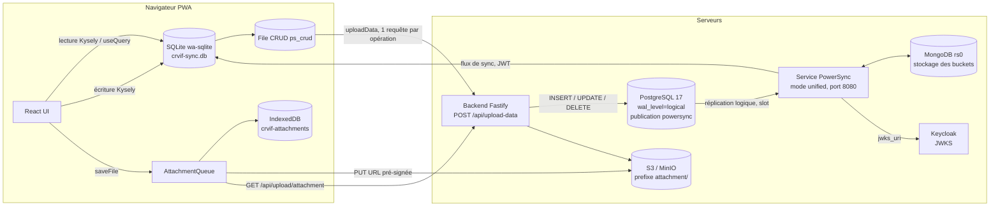
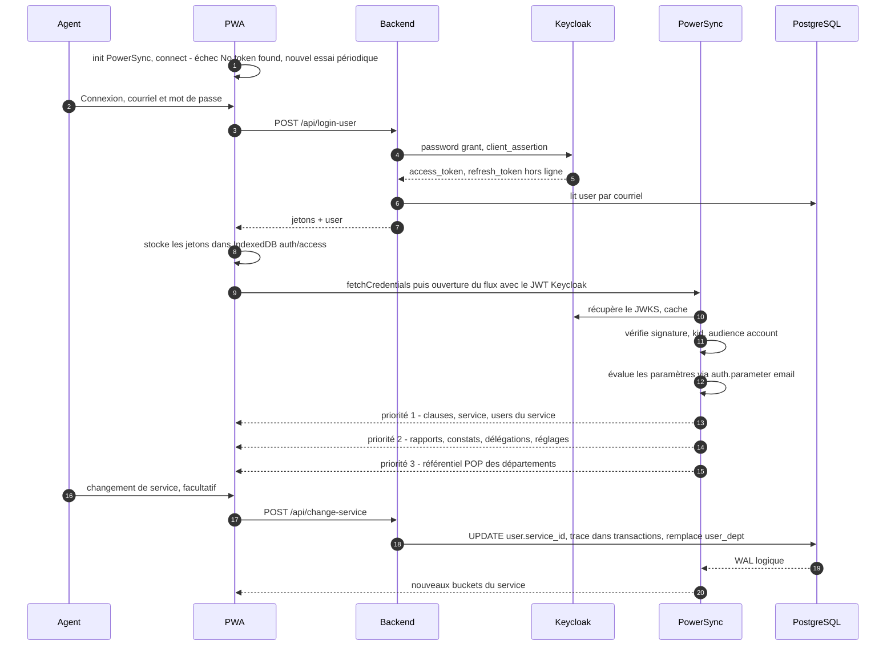
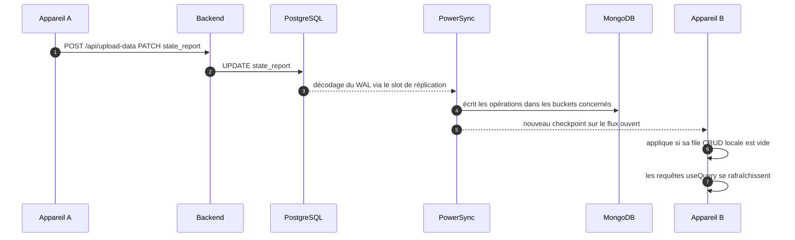
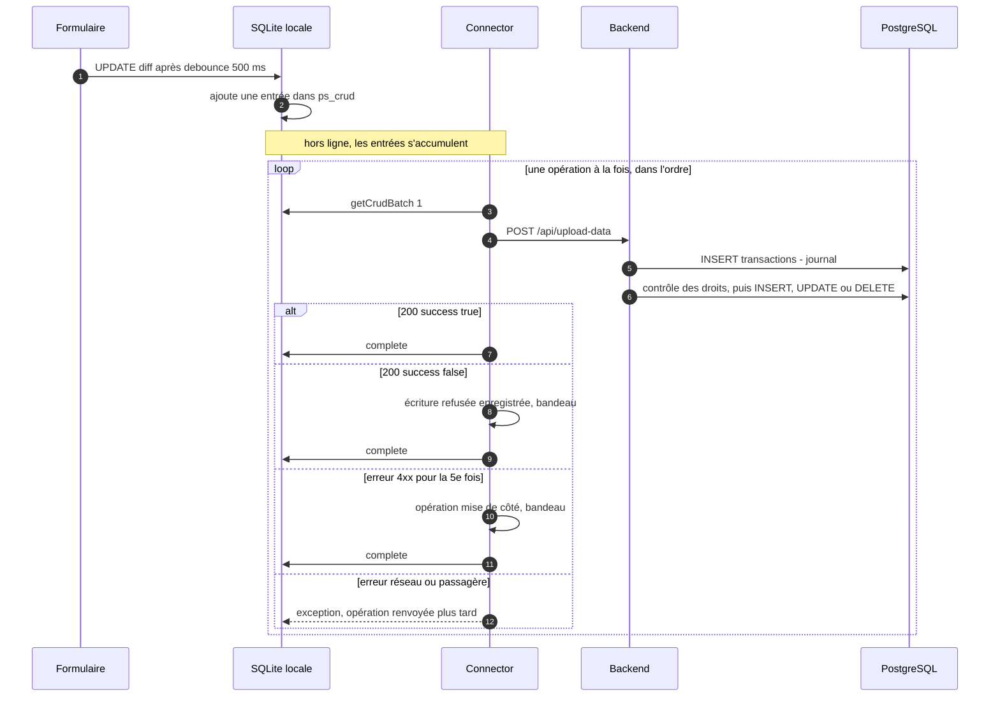
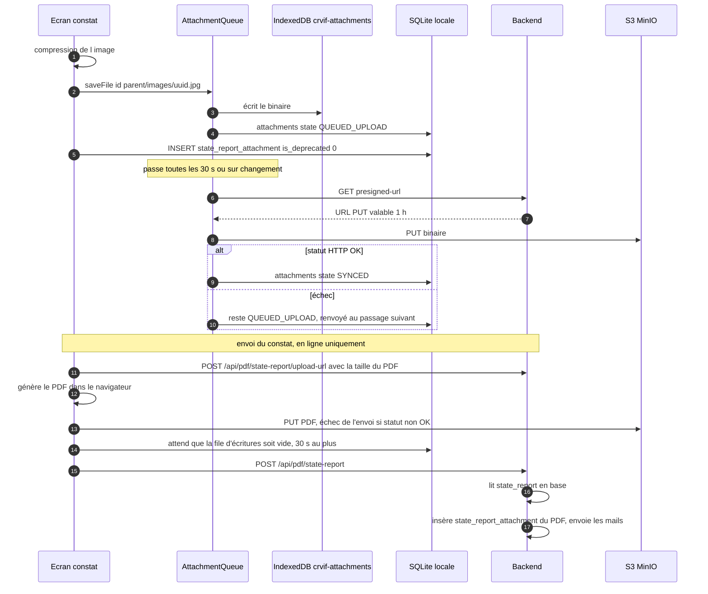

# 08 — Synchronisation et fonctionnement hors ligne

Patrinotes est une application **offline-first** : l'agent sur le terrain (visite d'un monument historique, rédaction
d'un compte-rendu VIF ou d'un constat d'état) lit et écrit dans une **base SQLite locale** embarquée dans le navigateur.
La synchronisation avec le serveur est assurée par **PowerSync** (service open source de JourneyApps) :

- **lecture (descendante)** : PostgreSQL → réplication logique → service PowerSync → WebSocket/HTTP stream → SQLite
  locale ;
- **écriture (montante)** : SQLite locale → file d'attente CRUD locale → `POST /api/upload-data` du backend Node →
  PostgreSQL (puis retour vers tous les clients concernés par la voie descendante) ;
- **fichiers (photos, PDF)** : stockage local IndexedDB → URL pré-signée → stockage objet S3/MinIO, géré par
  l'`AttachmentQueue` du SDK PowerSync.

Ce document décrit ces trois chemins, les règles qui déterminent quelles données chaque utilisateur reçoit, les
contraintes d'un changement de schéma et les points d'exploitation à préserver lors de la migration vers
l'infrastructure du ministère. Le déploiement du service PowerSync (conteneurs, configuration, publication PostgreSQL)
est décrit au [10 § 4](10-infrastructure-et-deploiement.md#4-docker-compose).

> Légende : les affirmations non vérifiables dans le code (comportement interne du service PowerSync) sont signalées par
> **« à confirmer »**. La configuration de production a été relevée le 17/11/2026 (« relevé de production du
> 17/11/2026 ») ; ses écarts avec le dépôt sont signalés dans chaque section.

---

## 1. Vue d'ensemble



Composants et fichiers de référence :

| Élément | Fichier |
| --- | --- |
| Déclaration des services (dev) | [docker-compose.yaml](../docker-compose.yaml) |
| Configuration du service PowerSync | [powersync-config.yaml](../powersync/powersync-config.yaml) |
| Règles de synchronisation (« sync streams ») | [sync-config.yaml](../powersync/sync-config.yaml) |
| Création de la publication PostgreSQL | [0_create-publication.sql](../db/init/0_create-publication.sql) |
| Schéma local client | [AppSchema.ts](../packages/frontend/src/db/AppSchema.ts) |
| Base locale + file des pièces jointes | [db.ts](../packages/frontend/src/db/db.ts) |
| Connecteur (jeton + envoi des écritures) | [Connector.ts](../packages/frontend/src/db/Connector.ts) |
| Endpoint d'application des écritures | [syncRoutes.ts](../packages/backend/src/routes/syncRoutes.ts), [syncService.ts](../packages/backend/src/services/syncService.ts) |
| Schéma serveur (Drizzle) | [schema.ts](../packages/backend/src/db/schema.ts) |

---

## 2. Côté serveur : le service PowerSync

### 2.1 Service et stockage

Le service PowerSync tourne en mode **`unified`** : un seul processus fait à la fois la **réplication** (lecture du
WAL PostgreSQL, écriture des buckets dans MongoDB) et l'**API** (connexions clients). Il peut aussi être éclaté en
`-r sync` (API, extensible horizontalement) et `-r replication` (exactement une instance). Pour le volume actuel,
`unified` suffit. En production : PowerSync **1.20.5** sous l'étiquette `latest`, `mongo:7.0` (7.0.31) en *replica set*
`rs0`, sans authentification, base `powersync_demo`.

MongoDB ne contient **aucune donnée de référence** : tout est reconstructible depuis PostgreSQL, mais sa perte a des
conséquences opérationnelles (§ 9.3). Renommer la base `powersync_demo` équivaut à une perte du stockage.

La configuration du service ([powersync-config.yaml](../powersync/powersync-config.yaml)) et ses pièges (`issuer`
ignoré, `jwks_uri` lié au realm, `sslmode: disable`, image non épinglée, fichiers déposés à la main en production) sont
décrits au [10 § 4.4](10-infrastructure-et-deploiement.md#44-configuration-powersync-versionnée).

### 2.2 Authentification client → PowerSync

- Le client n'obtient **pas** de jeton spécifique à PowerSync : il réutilise **le jeton d'accès Keycloak** (celui-là
  même qu'il envoie au backend), via `fetchCredentials()` dans
  [Connector.ts](../packages/frontend/src/db/Connector.ts), qui renvoie `{ endpoint: VITE_POWERSYNC_URL,
  token }`.
- Vérifications côté PowerSync : signature RS256 via le JWKS Keycloak (choix de la clé par `kid`), audience `account`
  (audience par défaut des access tokens Keycloak), expiration. L'émetteur n'est pas vérifié. La claim `sub` sert
  d'identifiant utilisateur PowerSync.
- Les règles de sync s'appuient sur **`auth.parameter('email')`** : la claim `email` du jeton. **Le jeton doit donc
  contenir l'email** (scope `email` dans Keycloak) et cet email doit correspondre **exactement** (casse comprise) à
  `user.email` en base. Un utilisateur dont l'email Keycloak diffère de celui de la table `user` ne reçoit aucune
  donnée.
- Le rafraîchissement : le client considère le jeton expiré à **80 % de sa durée de vie**, appelle
  `POST /api/refresh-token` et **mutualise** les appels concurrents, pour que PowerSync et le client API ne consomment
  pas deux fois le même refresh token (rotation Keycloak). Un 401 sur le refresh efface les jetons et affiche « session
  expirée ».

### 2.3 PostgreSQL : réplication logique et publication

- `wal_level=logical` est **obligatoire** (passé en argument de commande dans le compose ; sur un PostgreSQL managé
  ministériel, il faudra le demander explicitement — souvent `rds.logical_replication`/paramètre équivalent).
- La publication `powersync` est créée **vide** (pas de `FOR ALL TABLES`) ; chaque table synchronisée y est ajoutée par
  une migration. Sa liste, l'ordre d'installation sur une nouvelle base et le comportement d'un `pg_dump` sont décrits
  au [10 § 4.2](10-infrastructure-et-deploiement.md#42-scripts-dinitialisation-postgresql--dbinit). `constat_validation`
  n'est pas publiée : le jeton de validation ne quitte jamais le serveur.
- Les slots de réplication ne sont pas inclus dans un `pg_dump` (§ 10.3).

---

## 3. Règles de synchronisation (`sync-config.yaml`)

Fichier : [powersync/sync-config.yaml](../powersync/sync-config.yaml). Format **Sync Streams, édition 3**
(`config.edition: 3`). Chaque stream liste des requêtes SQL (dialecte restreint PowerSync) ; `with:` définit des
requêtes de paramètres (sortes de CTE réévaluées à chaque changement des tables sources) ; `auto_subscribe: true`
signifie que tout client connecté est abonné d'office ; `priority` ordonne le téléchargement (**plus le nombre est
petit, plus c'est prioritaire** — les données de priorité 1 sont disponibles avant celles de priorité 3).

Le pivot de presque toutes les règles est l'**email du jeton** → ligne `user` → `service_id` (le service / UDAP de
l'agent). **L'unité de partage est le service, pas l'utilisateur** : tous les agents d'un même service voient tous les
comptes-rendus et constats du service.

### 3.1 Streams

| Stream | Lignes | Abonnement | Prio | Paramètre | Données envoyées |
| --- | --- | --- | --- | --- | --- |
| `global_stream` | [6-10](../powersync/sync-config.yaml) | auto | 1 | aucun | `clause_v2` avec `service_id = 'ALL'` (clauses communes à tous les services) |
| `service_stream` | [12-24](../powersync/sync-config.yaml) | auto | 1 | `current_service` = `service_id` de l'utilisateur (via email) | la ligne `service` ; les `user` du service **limités à `id, name, service_id`** (pas d'email) ; `service_instructeurs`, `clause_v2`, `sent_email`, `suggested_email`, `monument_correction` (corrections des fiches) du service |
| `user_stream` | [26-34](../powersync/sync-config.yaml) | auto | 2 | `current_user_id` | `delegation` où l'utilisateur est créateur **ou** délégataire ; ses `pdf_snapshot` ; ses `user_settings` |
| `reports_stream` | [58-70](../powersync/sync-config.yaml) | auto | 2 | `current_service` | `report`, `state_report`, `visited_section`, `state_report_alert` du service ; `monument_alert` (brouillons compris, masqués par le client) et `monument_alert_attachment` non dépréciées (flux des fiches) |
| `pop_stream` | [72-81](../powersync/sync-config.yaml) | auto | 3 | `my_depts` = `user_dept.dept_number` de l'utilisateur | `pop_immeubles` et `pop_objets` (référentiel POP — monuments et objets protégés) dont `departement_format_numerique` ∈ départements de l'utilisateur |
| `state_report_attachments_stream` | [38-50](../powersync/sync-config.yaml) | **à la demande** | défaut | `subscription.parameter('state_report_id')` | pièces jointes non dépréciées d'un constat **du service de l'utilisateur** : `state_report_attachment`, `visited_section_attachment` (via `visited_section`), `state_report_alert_attachment` (via `state_report_alert`) |
| `report_attachments_stream` | [52-56](../powersync/sync-config.yaml) | **à la demande** | défaut | `subscription.parameter('report_id')` | `report_attachment` non dépréciées d'un compte-rendu **du service de l'utilisateur** |

Les streams à la demande sont ouverts par les écrans d'un constat ou d'un compte-rendu (saisie et aperçu PDF). Une fois
les métadonnées reçues, ces écrans lancent aussitôt le téléchargement des fichiers.

### 3.2 Règles cachées des streams

> [!NOTE]
> **Déploiement.** Le `sync-config.yaml` n'est pas déployé avec l'application : il est déposé à la main dans Coolify
> et doit être recopié (puis PowerSync redémarré) à chaque modification, après les migrations correspondantes.

- **Filtre `is_deprecated = 0`** : la suppression d'une photo est un **soft delete** (`is_deprecated = 1` côté client).
  La ligne disparaît alors des streams, donc des autres appareils. Les booléens PostgreSQL sont convertis par PowerSync
  en entiers `1`/`0` ; **une ligne avec `is_deprecated = NULL` ne serait jamais synchronisée** (`NULL = 0` est faux en
  SQL). Les cinq tables de pièces jointes ont donc la valeur par défaut `false` (voir [06](06-modele-de-donnees.md)).
- **Les photos d'un constat/compte-rendu ne sont disponibles hors ligne que si l'écran a été ouvert en ligne** : les
  métadonnées des pièces jointes passent par des streams à la demande. Après fermeture de l'écran, PowerSync conserve
  l'abonnement pendant une durée de rétention (TTL, 24 h par défaut dans le SDK — **à confirmer** selon la version),
  puis les lignes sont retirées et les fichiers locaux deviennent « archivés » (cf. § 5).
- **Contrôle d'appartenance sur les paramètres d'abonnement** : `state_report_id` / `report_id` sont fournis par le
  client ; les requêtes vérifient que le **document** appartient au service de l'utilisateur (le contrôle passe par le
  document, car des pièces jointes anciennes n'ont pas de `service_id`).
- **Changement de service** : `POST /api/change-service`
  ([userService.ts](../packages/backend/src/services/userService.ts)) met à jour `user.service_id`, le trace dans
  `transactions` et remplace les lignes `user_dept` par les départements de `service.dept_numbers` (liste séparée par
  des virgules), dans **une seule transaction**.
  PowerSync réévalue les paramètres et bascule les buckets : les données de l'ancien service disparaissent de
  l'appareil, celles du nouveau arrivent. **Si le nouveau service n'a pas de `dept_numbers`, les anciens
  `user_dept` sont conservés** : l'agent continue de recevoir le référentiel POP de son ancien service.
- **Compte sans service** (`service_id = 'no-service'`, service technique créé au démarrage du backend, invisible,
  sans département) : l'inscription affecte un service, mais un compte rattaché à `no-service` ne reçoit que
  `global_stream`, ses propres données utilisateur et le service `no-service`.
- **Départements POP** : le rapprochement `departement_format_numerique IN my_depts` est une égalité de chaînes ; le
  format de `dept_numbers` (ex. `01` vs `1`, `2A`) doit correspondre exactement à celui du CSV POP (**à confirmer** par
  un contrôle de données).
- `user_dept` n'est utilisé qu'en paramètre (pas d'`id`, clé primaire composite) et n'est pas synchronisé vers le
  client.

### 3.3 Écarts entre schéma serveur et schéma client

Le schéma client [AppSchema.ts](../packages/frontend/src/db/AppSchema.ts) est déclaratif : PowerSync stocke chaque
ligne reçue sous forme JSON complète dans des tables internes (`ps_data__<table>`) et expose des **vues SQLite**
limitées aux colonnes déclarées. Toutes les colonnes sont `text` ou `integer` (pas de booléen ni de date : dates en
texte ISO, booléens en `0/1`). Conséquences :

| Cas | Tables / colonnes | Effet |
| --- | --- | --- |
| Synchronisé mais absent d'`AppSchema` | colonnes `state_report.redacted_by_name`, `redacted_by_id`, `alerts_sent` ; `state_report_alert.sent_at`, `send_attempts`, `last_send_attempt_at` ; `service.id`… | Données reçues (stockées en JSON / table non typée) mais invisibles des requêtes. Les ajouter à `AppSchema` les rend visibles **sans re-synchronisation** (le JSON contient déjà toutes les colonnes de `SELECT *`). |
| Dans `AppSchema` mais jamais synchronisé | `pop_images`, `state_report_sent_email` (ni publiées, ni dans un stream), `transactions` (pas de stream) ; `user.job` (le stream ne sélectionne que `id, name, service_id`) | Tables/colonnes toujours vides localement. |
| Locale uniquement | `attachments` (`AttachmentTable` du SDK) | État de la file des pièces jointes ; jamais envoyée au serveur. |

La compilation vérifie que chaque colonne du schéma client existe côté serveur, mais pas l'inverse, ni la publication,
ni les streams.

---

## 4. Côté client : base locale et connecteur

### 4.1 Base locale

Créée dans [db.ts](../packages/frontend/src/db/db.ts) :

- SDK `@powersync/web` (≈ 1.37), `@powersync/common` 1.50.0 (épinglé), requêtes typées Kysely ; moteur **wa-sqlite**
  (SQLite compilé en WebAssembly).
- Fichier `crvif-sync.db`. Aucun VFS n'est précisé : le SDK utilise son VFS par défaut, adossé à **IndexedDB**
  (**à confirmer** selon la version ; l'OPFS n'est pas explicitement activé).
- Le partage de la base entre onglets n'est activé que si le navigateur fournit `SharedWorker` (**donc jamais sur
  iOS**, où chaque onglet a sa propre connexion).
- La connexion à PowerSync est lancée au démarrage, **même si l'utilisateur n'est pas connecté** : le SDK réessaie
  périodiquement jusqu'à la connexion.
- Les identifiants des lignes sont **générés côté client** (UUID v4/v7), ce qui permet la création hors ligne.

### 4.2 Écriture locale et granularité

Les formulaires (compte-rendu, constat, service) n'écrivent localement que les **champs modifiés**, environ 500 ms
après la dernière saisie. Chaque écriture locale génère une entrée dans la file CRUD de PowerSync (`ps_crud`) de type
`PUT` (insertion), `PATCH` (mise à jour des seules colonnes modifiées) ou `DELETE`.

L'indicateur d'état de l'application reflète la connexion à PowerSync et les envois de données, mais pas la file des
pièces jointes.

### 4.3 Envoi des écritures : `uploadData`

[Connector.ts](../packages/frontend/src/db/Connector.ts) :

1. **Une opération à la fois** : `getCrudBatch(1)` récupère l'opération suivante, une requête `POST /api/upload-data`
   l'envoie avec le corps `{ op_id, tx_id, id, type, op, data }` (`type` = nom de table), puis `complete()` l'acquitte
   avant de passer à la suivante (100 opérations au plus par appel ; PowerSync rappelle `uploadData` tant que la file
   n'est pas vide). Après une erreur, seule l'opération en cours est renvoyée, pas celles déjà appliquées.
2. Les opérations non-`DELETE` dont `data` est vide sont **ignorées** (avertissement console).
3. **Écriture refusée** : si le serveur répond `success: false` (refus de droits, erreur SQL, utilisateur absent de la
   table `user`), l'opération est acquittée mais **enregistrée localement** (table, identifiant, opération, date,
   motif ; 50 au plus, dans le `localStorage`) et signalée à Sentry (table, opération, motif). Un **bandeau** prévient
   l'agent et lui montre le détail (document, date, motif). La modification locale est ensuite remplacée par l'état
   serveur (§ 4.4).
4. **Erreur répétée** : si le serveur répond **5 fois de suite** à la même opération par une erreur 4xx qui ne dépend
   ni de la session ni de la charge (hors 401, 403, 408, 425 et 429), l'opération est **mise de côté** : retirée de
   la file et ajoutée à la liste des écritures refusées (motif « erreur serveur répétée »). Elle ne bloque donc plus
   les suivantes. Le compteur est en mémoire : un rechargement le remet à zéro.
5. **Erreur passagère** (réseau, 5xx, 401, 403, 408, 425, 429) : l'opération reste dans la file et le SDK la renvoie
   plus tard (délai par défaut ≈ 5 s — **à confirmer**), sans limite.

**Ordre et transactions** : l'ordre de la file locale est respecté (une requête à la fois), mais il n'y a **pas
d'atomicité serveur** : chaque opération est appliquée dans sa propre requête/transaction ; `tx_id` est enregistré
mais pas exploité.

**Blocage** : tant que la file CRUD locale n'est pas vide, le SDK PowerSync **n'applique pas** les nouveaux
checkpoints serveur (il attend que ses propres écritures soient confirmées). Une opération qui échoue en 5xx en
boucle **gèle la réception des données** sur cet appareil jusqu'au retour du serveur ; une erreur 4xx répétée est
mise de côté (point 4).

### 4.4 Résolution des conflits

Il n'y a **aucune logique de conflit explicite** : c'est du **« dernier arrivé au serveur gagne », colonne par
colonne** (les `PATCH` ne contiennent que les champs modifiés). Deux agents modifiant des champs différents d'un même
constat ne se gênent pas ; deux agents modifiant le même champ hors ligne : la valeur de celui qui se reconnecte en
dernier écrase l'autre, sans avertissement. Les droits d'édition (créateur, rédacteur, délégation) sont vérifiés
dans l'interface et par le serveur (§ 6).

Lorsqu'une écriture est rejetée par le serveur (erreur SQL ou droits insuffisants), la valeur locale reste affichée
jusqu'au prochain checkpoint, où PowerSync **remplace l'état local par l'état serveur** : la modification disparaît,
et le bandeau des écritures refusées le signale (§ 4.3).

---

## 5. Pièces jointes (photos, plans, PDF)

### 5.1 Mécanisme

[db.ts](../packages/frontend/src/db/db.ts) utilise l'`AttachmentQueue` du SDK PowerSync :

- **Stockage local** : `IndexDBFileSystemStorageAdapter("crvif-attachments")` (IndexedDB).
- **Table d'état locale** `attachments` (`AttachmentTable`) : `id`, `local_uri`, `state` (`QUEUED_UPLOAD`,
  `QUEUED_DOWNLOAD`, `SYNCED`, `ARCHIVED`…), `has_synced`, etc.
- **Pièces jointes surveillées** (`watchAttachments`) : union des `attachment_id` non dépréciés des tables
  `report_attachment`, `state_report_attachment`, `visited_section_attachment`, `state_report_alert_attachment`,
  `monument_alert_attachment`.
  Un `attachment_id` peut contenir **plusieurs identifiants séparés par `;`** (découpage dans le watcher).
  L'extension est déduite du suffixe de l'id (`jpg` par défaut) — les PDF générés (`…/constat_d_etat_<ts>.pdf`)
  sont donc aussi téléchargés localement.
- **Envoi** (`uploadFile`) : `GET /api/upload/attachment/presigned-url?filePath=<id>&contentType=…&size=…` (type lu
  dans les premiers octets du fichier) puis `PUT` direct vers S3/MinIO (URL valable 3600 s, clé `attachment/<id>`, type
  et taille signés). Le backend refuse l'URL si le document du chemin appartient à un autre service, ou si le type ou
  la taille ne sont pas acceptés ; il l'accepte si ce document n'est pas encore en base (la photo peut partir avant la
  ligne). **Le statut du `PUT` est vérifié** : en cas d'échec, l'envoi lève une erreur et la pièce jointe reste en
  `QUEUED_UPLOAD`, renvoyée au passage suivant.
- **Téléchargement** (`downloadFile`) : `GET /api/upload/attachment?filePath=<id>` (le backend vérifie le service du
  document, lit S3 et renvoie le binaire).
- **Suppression distante** (`deleteFile`) : **non implémentée** (simple log). Les fichiers ne sont jamais supprimés de
  S3 par la synchronisation.
- Paramètres : `syncIntervalMs: 30000` (passe de synchronisation toutes les 30 s), `downloadAttachments: true`,
  `archivedCacheLimit: 100` (au-delà de 100 fichiers locaux non référencés, les plus anciens sont purgés).

Convention d'identifiant d'une photo : `<parentId>/images/<uuidv7>.jpg` (parentId = id du constat ou du
compte-rendu) ; c'est à la fois l'id local et le suffixe de la clé S3.

### 5.2 Ajout d'une photo

La photo est compressée dans le navigateur, contrôlée avec les mêmes limites que le serveur (type, 20 Mo), puis écrite
dans le stockage local **avant** l'insertion de la ligne métier : la file ne voit ainsi jamais une pièce jointe sans
fichier local. Le document ne peut pas être finalisé tant qu'une photo est en cours de traitement ou en échec ; ce
suivi est en mémoire et se perd au rechargement de la page.

### 5.3 Pièges des pièces jointes

- **Ligne et fichier voyagent séparément** : la ligne métier part par la file CRUD (immédiate), le fichier par
  l'AttachmentQueue (toutes les 30 s). Un autre appareil peut recevoir la ligne avant que le fichier soit en S3 →
  téléchargement en 404. Aucun gestionnaire d'erreur n'est configuré, donc le SDK garde la pièce jointe en attente
  et la retente toutes les 30 s et à la reconnexion : la photo s'affiche seule dès que le fichier est en S3. Pas
  d'espacement progressif : si le fichier n'arrive jamais, les essais continuent indéfiniment.

---

## 6. Côté backend : application des écritures

Route : `POST /api/upload-data` ([syncRoutes.ts](../packages/backend/src/routes/syncRoutes.ts)), protégée par
`authenticate` (jeton Keycloak vérifié, utilisateur retrouvé par email). Service :
[syncService.ts](../packages/backend/src/services/syncService.ts), règles dans
[syncPolicy.ts](../packages/backend/src/features/sync/syncPolicy.ts).

Algorithme `applyCrud(operation, user)` :

1. **Journalise l'opération** dans la table `transactions` (`entity_id`, `type`, `op`, `op_id`, `tx_id`, `data` en
   JSON, `user_id`, `created_at`) — **avant** tout contrôle, y compris pour les opérations refusées. La colonne
   `error` existe mais n'est jamais renseignée.
2. Refuse toute table absente de la liste des tables modifiables.
3. Dans une transaction SQL, lit la ligne stockée (`FOR UPDATE`) et évalue l'opération : opération permise, colonnes
   connues, colonnes serveur forcées ou ignorées, droit de l'utilisateur (service, auteur, délégation). Détail dans
   [04 § 6.2](04-backend-api.md).
4. Applique selon `op` : `DELETE`, `PATCH` (colonnes retenues seulement), `PUT` (insertion ; un `PUT` sur une ligne
   déjà présente est appliqué comme un `PATCH`, avec les mêmes contrôles).
5. En cas de refus ou d'erreur SQL : renvoie `{ success: false, error, reason }` **avec un HTTP 200** → le client
   retire l'opération de sa file et la signale à l'agent (§ 4.3). **L'écriture n'est pas appliquée** (traces : la table
   `transactions`, les logs `debug` et, pour un refus, un message Sentry).
6. Après une écriture réussie sur une alerte de fiche (`monument_alert`) au statut `submitted`, lance son envoi par
   courriel (§ 7.5).

Règles et absences notables :

- **Contrôle d'autorisation par table, colonne et ligne**. Les valeurs elles-mêmes ne sont pas validées.
- **Conversion de types implicite** : le client envoie des valeurs SQLite (booléens `0/1`, dates en texte) ;
  PostgreSQL les convertit (`'0'`/`'1'` acceptés pour `boolean`, ISO pour `timestamp`).
- **Un seul effet de bord** dans la synchronisation : l'envoi des alertes de fiche soumises. Les autres effets (envoi
  des documents, génération de PDF) passent par des **routes API dédiées**, appelées explicitement par le client et
  **nécessitant le réseau** (cf. § 7.4).
- Si l'utilisateur authentifié n'existe pas dans `user`, `applyCrud` renvoie `{ success: false, error: "Unauthorized" }`
  en HTTP 200 (le middleware laisse passer un jeton valide sans ligne `user`) : les écritures de cet appareil ne sont
  pas appliquées, et l'agent voit le bandeau des écritures refusées.
- Les écritures directes du backend en base (routes PDF, validation, changement de service, imports POP) **reviennent
  aux clients** par la réplication comme n'importe quelle modification.

---

## 7. Diagrammes de séquence

### 7.1 Premier login et synchronisation initiale



### 7.2 Chemin de lecture (modification faite par un autre agent)



### 7.3 Chemin d'écriture



### 7.4 Chemin des pièces jointes et envoi du PDF



**Course à l'envoi** : les routes `/api/pdf/report` et `/api/pdf/state-report`
([pdfRoutes.tsx](../packages/backend/src/routes/pdfRoutes.tsx)) lisent le rapport **depuis PostgreSQL**, alors que
le PDF est généré **dans le navigateur** à partir des données locales. Avant d'appeler ces routes, le client attend
que la file d'écritures soit vide (`waitForUploadQueueEmpty`, [db.ts](../packages/frontend/src/db/db.ts)),
**30 s au plus**, pendant l'indicateur de chargement. Hors ligne, ou si la file n'est toujours pas vide après 30 s,
il envoie quand même : le courriel peut alors reprendre des données serveur plus anciennes que le PDF, ou recevoir
404 « Constat d'état non trouvé ».

Le dépôt du PDF sur S3 est vérifié : un statut non OK fait échouer l'envoi, et aucun courriel n'est envoyé.

### 7.5 Alertes et annotations des fiches : envoi différé

Une alerte ou une annotation saisie depuis une fiche (MH, unité patrimoniale, objet) est une ligne `monument_alert`
écrite **hors ligne** par la file CRUD, avec ses photos (`monument_alert_attachment`). Le navigateur demande l'envoi au
backend (`POST /api/monument-alert/send`) quand l'appareil est en ligne, que la file CRUD est vide et que toutes les
photos sont envoyées.

Le serveur n'attend pas ce navigateur : dès que la ligne soumise arrive par `/api/upload-data`, il tente l'envoi
(qui attend que toutes les photos soient sur S3), et la tâche périodique du backend reprend toutes les 15 minutes les
alertes soumises qui ne sont pas encore parties ([alertDelivery.ts](../packages/backend/src/features/alertDelivery.ts),
voir [04 § 8](04-backend-api.md#8-tâches-planifiées-et-imports-de-données)). Une alerte validée hors ligne part donc
même si l'appareil de l'auteur ne revient jamais en ligne, pourvu que la ligne ait été synchronisée. Le premier qui
envoie pose `sent_at` avant l'envoi : une alerte n'est envoyée qu'une fois. `sent_at` revient ensuite au client par la
synchronisation.

---

## 8. Cycle de vie de la base locale

| Événement | Comportement constaté dans le code |
| --- | --- |
| **Déconnexion** ([LogoutDialogs.tsx](../packages/frontend/src/features/auth/LogoutDialogs.tsx)) | **Vide l'appareil** comme « Supprimer les données locales » (ligne ci-dessous), en gardant le code de l'application en cache pour que la page de connexion s'ouvre hors ligne. Avant : s'il reste des écritures ou des photos non envoyées, une fenêtre propose « Attendre » ou « Se déconnecter quand même » ; **hors ligne, la déconnexion est refusée** tant qu'elles ne sont pas envoyées. En ligne, le jeton hors ligne est révoqué auprès de Keycloak (`POST /api/logout`). |
| **Session expirée** (refresh refusé) | Efface les jetons et affiche la modale « session expirée ». La base locale et les écritures en attente sont conservées et repartiront après reconnexion. |
| **Changement d'utilisateur sur le même navigateur** | Après une déconnexion, l'appareil est vide : le nouvel utilisateur ne voit pas les données du précédent et n'envoie pas ses écritures. Après une **session expirée** suivie d'une connexion par un autre compte, les écritures en attente du premier partiraient avec le jeton du second. |
| **« Supprimer les données locales »** (menu Aide, [resetLocalData.ts](../packages/frontend/src/features/menu/resetLocalData.ts)) | Refusé hors ligne (l'application ne pourrait ni recharger ni retélécharger les données). La confirmation indique le nombre d'écritures et de photos non envoyées. Puis : vidage de la base PowerSync, des fichiers locaux, des jetons, des autres bases IndexedDB, du `localStorage` (sauf la version et le thème) et des caches, désinscription des service workers et rechargement des onglets. **Les écritures non synchronisées sont perdues.** |
| **Modification juste après l'inscription** | La ligne `service` ou `user` peut ne pas être encore arrivée : le client attend la première synchronisation (30 s au plus) avant l'écriture locale et affiche une erreur si la ligne manque toujours. |
| **Modification d'`AppSchema`** | Pas de migration locale : PowerSync recrée les vues à partir du nouveau schéma au démarrage. Ajouter une colonne déjà présente dans `SELECT *` la rend visible immédiatement ; supprimer une colonne la masque. Renommer une table ou une colonne côté serveur nécessite que les lignes soient renvoyées sous le nouveau nom (cf. § 9.2). |
| **Modification de `sync-config.yaml`** | Au redémarrage, PowerSync détecte une nouvelle version des règles, retraite toutes les données en parallèle de l'ancienne version, puis bascule ; les clients re-téléchargent les buckets modifiés (**à confirmer** : fenêtre et coût selon le volume POP). |

---

## 9. Procédure de changement de schéma

Le README ([README.md](../README.md), section *Migrations*) prévient : pour toute donnée accessible au frontend, il
faut vérifier la **publication** et le **schéma frontend**, et suivre la documentation PowerSync
[Deploying Schema Changes](https://docs.powersync.com/maintenance-ops/deploying-schema-changes).

### 9.1 Ordre de déploiement

Une table ou une colonne synchronisée doit être cohérente à quatre endroits : schéma PostgreSQL, publication
`powersync`, règles [sync-config.yaml](../powersync/sync-config.yaml) et schéma client
[AppSchema.ts](../packages/frontend/src/db/AppSchema.ts). Le déploiement suit l'ordre : migration SQL → recopie de
`sync-config.yaml` et redémarrage de PowerSync → frontend. Contrôle : `SELECT * FROM pg_publication_tables WHERE
pubname = 'powersync';` et les journaux PowerSync (avertissements « table not in publication »).

### 9.2 Ce qui casse si on oublie

| Oubli | Symptôme |
| --- | --- |
| Table absente de la publication | La table n'est jamais répliquée : le stream renvoie vide ; les créations faites hors ligne remontent bien au serveur (via `/api/upload-data`) mais **disparaissent de l'appareil** au checkpoint suivant (PowerSync ne les renvoie pas). Effet « mes données s'effacent ». |
| Table/colonne absente d'`AppSchema` | Données reçues mais invisibles ; écriture impossible (la vue n'existe pas). |
| Table absente des streams | Même effet « données qui s'effacent » après écriture locale. |
| Colonne renommée/supprimée côté serveur sans mise à jour client | Les `PUT` et `PATCH` envoyés avec l'ancien nom sont refusés (colonne inconnue) → écriture **perdue**, signalée à l'agent par le bandeau. C'est pourquoi `state_report.bilan_quinquennal` reste en base et dans la politique d'écriture tant que des clients non mis à jour peuvent l'envoyer. |
| Contrainte NOT NULL ajoutée côté serveur | Les `PUT` des anciens clients (PWA en cache) échouent → écriture perdue, signalée par le bandeau. Prévoir une valeur par défaut. |
| `wal_level` non logique sur la nouvelle base | PowerSync ne démarre pas la réplication. |
| JWKS / realm non mis à jour | Toutes les connexions de sync refusées ; l'application reste « hors ligne ». |

> Les anciennes versions de la PWA restent en service (cache du service worker, appareils hors ligne pendant des
> jours) : tout changement de schéma serveur doit rester **rétrocompatible** avec les écritures que peuvent encore
> envoyer les clients non mis à jour.

### 9.3 Changements qui provoquent un retraitement complet

- modification de `sync-config.yaml` (nouvelle version de règles) ;
- perte ou réinitialisation du stockage MongoDB ;
- invalidation du slot de réplication ;
- import POP forcé (`FORCE_REFETCH_POP`, [index.ts](../packages/backend/src/index.ts)) : l'upsert
  ([KyselyBatchWriter.ts](../packages/backend/src/features/data/KyselyBatchWriter.ts)) met à jour **toutes**
  les lignes (`ON CONFLICT DO UPDATE` sur toutes les colonnes), donc tout le référentiel transite dans le WAL et chaque
  client re-télécharge son référentiel départemental.

---

## 10. Exploitation et migration d'infrastructure

### 10.1 Ports et flux

| Flux | Port | Remarque |
| --- | --- | --- |
| Navigateur → PowerSync | 8080 conteneur (3003 en production) | URL publique `VITE_POWERSYNC_URL` (variable injectée à l'exécution via `env.js`), à exposer en HTTPS derrière le reverse proxy, avec support WebSocket/streaming HTTP et timeouts longs. |
| PowerSync → PostgreSQL | 5432 | Connexion de réplication (`PS_DATABASE_URL`), `sslmode: disable`. |
| PowerSync → MongoDB | 27017 | Interne. **Ne pas publier** ce port en production (exposé sans authentification dans le compose de dev). |
| PowerSync → Keycloak | 8080 (interne) | Récupération du JWKS. |
| Sondes | `/probes/liveness`, `/probes/readiness` | À brancher sur la supervision. |

### 10.2 Ressources

Mesures de production (relevé du 17/11/2026) : MongoDB `powersync_demo` = 14 collections, 3,2 Go de données (1,6 Go
sur disque), volume de 5 Go ; base PostgreSQL répliquée de 719 Mo, dominée par le référentiel POP. La consommation
CPU et mémoire du seul service PowerSync n'a pas été mesurée (ordre de grandeur : ~1 vCPU, 1–2 Go de RAM). Le service limite par défaut à 200 connexions simultanées par processus et
1000 buckets par connexion.

### 10.3 Ce qu'il faut préserver ou recréer lors de la migration

1. **`wal_level=logical`** et `max_replication_slots` ≥ 2 (pendant un redéploiement des règles, deux slots coexistent
   temporairement), `max_wal_senders` suffisant.
2. **La publication `powersync` et sa liste de tables** (vérifier `pg_publication_tables` avant/après).
3. **Le slot de réplication** : il n'est **pas** inclus dans un `pg_dump`. Après restauration de la base sur la
   nouvelle infrastructure, PowerSync crée un nouveau slot et refait un snapshot initial complet. C'est normal, mais
   cela implique un retraitement total et une re-synchronisation des clients.
4. **Stockage MongoDB** : conserver le volume permet d'éviter un retraitement **si et seulement si** la base
   PostgreSQL et son slot sont les mêmes. En pratique, lors d'un changement de serveur PostgreSQL, **repartir d'un
   Mongo vide** est plus sûr que de copier un Mongo dont le slot/LSN ne correspond plus.
5. **Les clients** : les appareils conservent leurs données locales et leur file d'écritures. Après bascule, ils se
   reconnectent à `VITE_POWERSYNC_URL` ; si l'URL change, l'ancienne PWA en cache doit récupérer le nouvel `env.js`
   (servi en `NetworkFirst` par le service worker). **Avant la bascule, demander aux agents de se connecter en ligne
   pour vider leur file d'écritures**, ou maintenir l'ancien backend joignable le temps de la transition.
6. Garder **la même URL backend** pour `/api/upload-data` ou s'assurer que `apiStore.url` (persisté en IndexedDB au
   premier lancement, [ApiStore.ts](../packages/frontend/src/ApiStore.ts)) est bien mis à jour : l'URL du backend est
   **mémorisée côté client** et n'est relue de `VITE_BACKEND_URL` que si elle est absente (**à confirmer** l'impact
   lors d'un changement de domaine).

### 10.4 Risques d'exploitation

- **Croissance du slot de réplication** : si PowerSync est arrêté (ou bloqué), PostgreSQL **conserve tout le WAL**
  depuis la dernière position confirmée du slot, sans limite par défaut → saturation disque de la base principale.
  C'est le réglage de production (`max_slot_wal_keep_size = -1`, relevé du 17/11/2026), où le slot `powersync_5_86e0`
  est actif. Sur la base de l'ancienne application CR VIF, sur le même serveur, un slot inactif retient 46 Mo de WAL.
  Mesures : définir `max_slot_wal_keep_size` (le slot sera invalidé au-delà, PowerSync refera alors un snapshot
  complet) ; **supprimer les slots orphelins** après une perte de Mongo ou une désinstallation de PowerSync
  (`SELECT pg_drop_replication_slot('<nom>')` — les slots PowerSync sont préfixés `powersync_`) ; superviser :

  ```sql
  SELECT slot_name, active,
         pg_size_pretty(pg_wal_lsn_diff(pg_current_wal_lsn(), confirmed_flush_lsn)) AS retard_wal
  FROM pg_replication_slots;
  ```

- **Perte de MongoDB** : reconstruction automatique depuis PostgreSQL (snapshot initial), indisponibilité de la sync
  pendant le retraitement, re-téléchargement par les clients, **et slot précédent laissé orphelin** dans PostgreSQL
  (à supprimer à la main, sinon WAL retenu indéfiniment).
- **Retard de réplication** : exposé par le service via les métriques (option `telemetry.prometheus_port`, non
  configurée) — voir [Replication Lag](https://docs.powersync.com/maintenance-ops/replication-lag) et
  [Monitoring and Alerting](https://docs.powersync.com/maintenance-ops/monitoring-and-alerting). Le retard du slot
  (requête ci-dessus) est un indicateur équivalent côté PostgreSQL.
- **Compactage** : les buckets accumulent l'historique des opérations ; PowerSync propose un job de compactage
  ([Compacting Buckets](https://docs.powersync.com/maintenance-ops/compacting-buckets)), non configuré dans le dépôt
  et absent en production (aucune tâche planifiée dans Coolify).
- **Table `transactions`** : journal de toutes les écritures (avec le contenu complet `data`, données personnelles
  incluses), sans purge — croissance continue, à intégrer à la politique de rétention RGPD.
