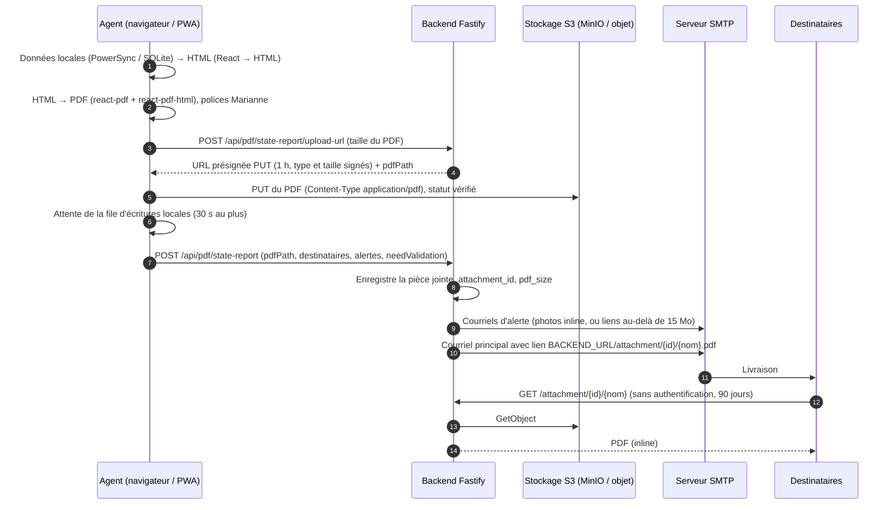
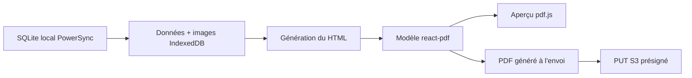
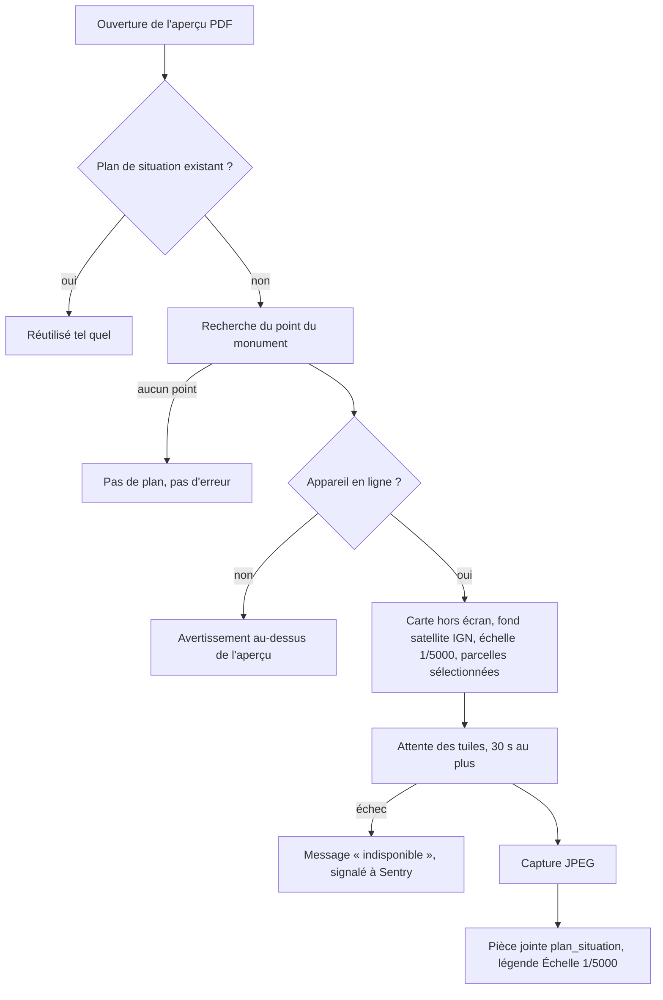
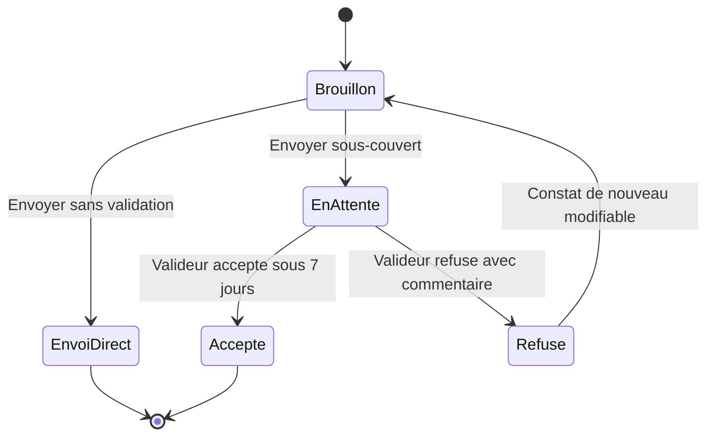

# 09 — Documents PDF, cartes, courriels et services externes

Ce chapitre décrit la chaîne de production des **documents** de Patrinotes (compte-rendu VIF et constat d'état), les **cartes** (plan de situation, localisation par partie d'édifice, sélection cadastrale), les **courriels** envoyés par le backend, la **dictée vocale** et l'inventaire complet des **flux réseau sortants**. Il s'adresse aux développeurs qui reprennent le code, aux équipes d'infrastructure du ministère (ouverture de flux, SMTP, stockage S3) et aux personnes chargées de l'homologation.

> Point clé à retenir : **les PDF sont générés intégralement dans le navigateur** (bibliothèque `@react-pdf/renderer`), puis téléversés directement sur le stockage S3 grâce à une URL présignée. Le backend ne fabrique aucun PDF. Il enregistre la référence du fichier, envoie les courriels avec un **lien** (le PDF n'est pas joint) et sert le fichier via une URL courte.

---

## 1. Vue d'ensemble

| Document | Modèle PDF | Écran front | Route backend d'envoi | Nom du fichier |
|---|---|---|---|---|
| Compte-rendu VIF (« CR », table `report`) | [`ReportPDFDocument`](../packages/pdf/src/report.tsx) | [`pdf.$reportId.tsx`](../packages/frontend/src/routes/pdf.$reportId.tsx) | `POST /api/pdf/report` | `CR_<commune>_<demandeur>_<jj-MM-aaaa>.pdf` ([`getPDFInMailName`](../packages/pdf/src/report.tsx)) |
| Constat d'état (table `state_report`) | [`StateReportPDFDocument`](../packages/pdf/src/stateReport.tsx) | [`constat_.$constatId.pdf.tsx`](../packages/frontend/src/routes/constat_.$constatId.pdf.tsx) | `POST /api/pdf/state-report` | `constat-d-etat-<titre-nettoyé>_<jjMMaaaa>.pdf` ([`getStateReportMailName`](../packages/pdf/src/stateReport.tsx)) |

---

## 2. Le package partagé `packages/pdf`

### 2.1 Contenu

Le package `@patrinotes/pdf` ([packages/pdf](../packages/pdf/)) contient les modèles du compte-rendu et du constat, la génération de leur HTML, les noms de fichiers et les règles partagées entre frontend et backend (sections, alertes, courriels obligatoires). Il n'a pas d'étape de build : il exporte directement les sources TypeScript.

> ⚠️ **Dépendance croisée** : le package `pdf` et le backend importent leurs types depuis le schéma local du frontend ([AppSchema.ts](../packages/frontend/src/db/AppSchema.ts)). Le schéma PowerSync du frontend sert donc de **source de vérité des types** pour les trois packages.

### 2.2 Bibliothèques

Le moteur est `@react-pdf/renderer` (4.x dans le navigateur), avec `react-pdf-html` pour convertir le HTML et sa CSS en éléments PDF. L'aperçu utilise `pdfjs-dist`, dont le *worker* est empaqueté avec l'application (sans CDN).

### 2.3 Polices et en-tête

- Les documents utilisent la police **Marianne** (charte de l'État), servie par le frontend et précachée par le service worker avec le reste de l'application : **la génération du PDF fonctionne hors ligne.**
- L'en-tête institutionnel est construit à partir de trois champs de la table `service` (`marianne_text`, `drac_text`, `service_text`), mis en forme par des règles codées en dur selon l'intitulé (préfet, DRAC, UDAP, CRMH).

---

## 3. Où et comment le PDF est rendu

### 3.1 Rendu côté client (seul mode)

**Constat d'état** ([constat_.$constatId.pdf.tsx](../packages/frontend/src/routes/constat_.$constatId.pdf.tsx)) :

1. En ligne, la page attend les métadonnées des pièces jointes du constat et lance aussitôt le téléchargement des fichiers. Hors ligne, elle s'affiche tout de suite avec les données locales ; une photo pas encore téléchargée sur l'appareil est absente du PDF.
2. Le constat, ses sections, ses alertes et leurs pièces jointes non dépréciées sont lus dans la base locale ; chaque image est lue dans IndexedDB.
3. **Effet de bord** : l'ouverture de l'aperçu **génère et enregistre le plan de situation** s'il n'existe pas encore (voir § 6.3). Elle peut donc créer une ligne `state_report_attachment`, synchronisée ensuite vers le serveur.
4. À l'envoi, le PDF est **régénéré**, téléversé (un statut S3 non OK fait échouer l'envoi), puis le client attend que la file d'écritures locales soit vide (30 s au plus, pas d'attente hors ligne) avant d'appeler le backend.

**Compte-rendu** ([pdf.$reportId.tsx](../packages/frontend/src/routes/pdf.$reportId.tsx)) : même chaîne, avec en plus une mise en page modifiable dans un éditeur riche (§ 5).

### 3.2 Téléversement et stockage

- Le backend fournit une URL présignée **PUT valable 1 h** ([uploadService.ts](../packages/backend/src/services/uploadService.ts)), où le type (`application/pdf`) et la taille déclarée par le navigateur (50 Mo au plus) sont signés :
  - CR : clé `attachment/<reportId>/compte_rendu_<epoch_s>.pdf`
  - constat : clé `attachment/<stateReportId>/constat_d_etat_<epoch_s>.pdf`
- **Le navigateur dépose le fichier directement sur S3.** L'endpoint S3 (`MINIO_URL`) doit donc être joignable **depuis les postes et tablettes des agents**, et pas seulement depuis le backend. C'est un point important pour l'ouverture des flux. La configuration CORS du bucket doit aussi autoriser `PUT` depuis l'origine du frontend. Elle n'est pas dans le dépôt ; l'état de production est décrit au [chapitre 05](05-authentification-securite.md) § 7.1.
- Le client S3 utilise `forcePathStyle`, `bucketEndpoint: true` et la région `us-east-1` (valeur fictive, compatible MinIO).
- Le backend enregistre ensuite une ligne `report_attachment` / `state_report_attachment` (dont l'`id` est le `pdfPath`), puis met à jour `attachment_id` et `pdf_size` sur le document.
- Chaque nouvel envoi crée un **nouveau fichier**. Les anciens PDF restent dans le bucket : aucune suppression n'est implémentée (`deleteFile` est un *no-op* dans [db.ts](../packages/frontend/src/db/db.ts)).

### 3.3 Dépendances serveur liées au PDF

Le backend ne génère aucun PDF. `react`, `react-dom`, `@react-pdf/renderer` et `react-pdf-html` restent pourtant dans ses dépendances : le bundle les charge à l'exécution au travers de `@patrinotes/pdf` (fonctions de noms de fichiers et de désérialisation), et [tsup.config.ts](../packages/backend/tsup.config.ts) les déclare en `external`. L'image n'a ni module natif ni chaîne de compilation.

### 3.4 Téléchargements ultérieurs

| Action | Appel | Remarque |
|---|---|---|
| Télécharger un constat envoyé | `GET /api/upload/attachment?filePath=…&stateReportId=…` | Le backend journalise le téléchargement dans `constat_pdf_download` |
| Télécharger l'aperçu (non envoyé) | blob local + `POST /api/pdf/state-report/log-download` | Journalisé aussi |
| Export ZIP de tous ses documents ([compte.tsx](../packages/frontend/src/routes/compte.tsx)) | `GET /api/pdf/state-report` / `GET /api/pdf/report` (PDF en base64) | ZIP construit côté client (`jszip`) |

> `getReportPDF` ([uploadService.ts](../packages/backend/src/services/uploadService.ts)) prend le **plus récent** des `report_attachment` en `.pdf` rangés sous `<reportId>/` (tri par date de création, puis par nom horodaté).
> Ces routes vérifient le service du document (et, pour un constat d'un autre service, que le monument est dans un département du service). Le dépôt et l'envoi d'un PDF sont réservés à qui peut modifier le document.
> ⚠️ Le nom du constat contient la **date du jour du téléchargement** (`format(new Date())`), et non la date d'envoi.

---

## 4. Images dans les PDF

### 4.1 Préparation des images (en amont)

- Les photos sont compressées dans le navigateur (1 Mo et 1920 px au plus, JPEG). Les métadonnées EXIF, dont la **géolocalisation GPS**, sont supprimées.
- Clés de stockage : `<parentId>/images/<uuidv7>.jpg`, préfixées par `attachment/` dans S3.
- **Dessins sur photo** : les traits sont **incrustés de façon définitive** dans une nouvelle image ; l'ancienne pièce jointe est marquée dépréciée, mais l'original reste stocké. Une image redessinée n'est pas recompressée et peut dépasser 1 Mo.

### 4.2 Mise en page

Les photos sont disposées en grille avec leur légende ; une photo et sa légende ne sont jamais coupées entre deux pages. Un constat présente dans l'ordre le plan de situation, le plan de l'édifice, les vues générales, puis les photos des sections et des alertes.

---

## 5. Contenu des documents

Les modèles reprennent les données saisies, un texte réglementaire fixe et des libellés codés en dur (sections par défaut du constat, types d'alerte, niveaux de dégradation). Plusieurs rapprochements se font **par libellé exact** (sections visitées, types d'alerte) : renommer un libellé dans le code casse les données existantes. Un MH complexe peut produire un **rapport groupé** : un seul PDF avec un chapitre par unité patrimoniale.

**Mise en page modifiable du compte-rendu.** L'agent peut retoucher le HTML du CR dans un éditeur riche (TipTap) avant l'envoi. « Enregistrer » sauvegarde ce HTML et une copie du CR dans `pdf_snapshot`, par utilisateur, synchronisée par PowerSync. Le HTML sauvegardé n'est réutilisé **que si le CR n'a pas changé depuis** : la moindre modification du formulaire réinitialise la mise en page. Le HTML du constat n'est pas modifiable.

---

## 6. Cartes

### 6.1 Bibliothèque et fournisseurs

La cartographie utilise **MapLibre GL JS 6** ([MapLibre.tsx](../packages/frontend/src/features/map/MapLibre.tsx)). **Aucune clé d'API n'est utilisée.**

| Usage | URL | Opérateur |
|---|---|---|
| Fond « Vectoriel » (style par défaut des cartes interactives) | `https://tiles.openfreemap.org/styles/liberty` (le style charge à son tour ses tuiles, sprites et glyphes chez `tiles.openfreemap.org`) | OpenFreeMap (service tiers associatif, **hors administration**) |
| Glyphes du fond satellite (étiquettes des parcelles) | `https://tiles.openfreemap.org/fonts/{fontstack}/{range}.pbf` | OpenFreeMap |
| Fond « Satellite » (orthophotos) | `https://data.geopf.fr/wmts?…LAYER=ORTHOIMAGERY.ORTHOPHOTOS…TILEMATRIXSET=PM` | IGN, Géoplateforme |
| Parcelles cadastrales (tuiles vectorielles) | `https://openmaptiles.geo.data.gouv.fr/data/cadastre.json`, puis les tuiles qu'il référence | Etalab, geo.data.gouv.fr |
| Géocodage d'adresse | `https://data.geopf.fr/geocodage/search?q=…&limit=1` (cartes et plan de situation, adresse nettoyée et limitée à 200 caractères) et `https://api-adresse.data.gouv.fr/search/?q=…&limit=10` (autocomplétion, [address.tsx](../packages/frontend/src/features/address.tsx)) | Base Adresse Nationale, Géoplateforme IGN |

Tous ces appels partent **du navigateur de l'agent**, jamais du backend. L'attribution MapLibre est masquée par CSS : il faut vérifier que ce masquage est conforme aux licences OpenFreeMap / OpenStreetMap (ODbL) et IGN (point P15 du [chapitre 18](18-questions-ouvertes.md)). Le style `PLAN.IGN` de la Géoplateforme permettrait de ne plus dépendre d'OpenFreeMap.

### 6.2 Usages

Les cartes servent à situer le monument d'un constat (coordonnées et parcelles cadastrales enregistrées dans le constat), à choisir les parcelles d'un compte-rendu, à choisir un monument POP sur une carte (données `pop_immeubles` locales) et à localiser une partie de l'édifice dans le constat détaillé (§ 6.4). Le point du monument est pris, dans l'ordre, dans les coordonnées saisies, les coordonnées POP, puis le géocodage de l'adresse.

### 6.3 Plan de situation statique pour le PDF ([planSituationSnapshot.ts](../packages/frontend/src/features/map/planSituationSnapshot.ts))

Règles :

- La capture est faite **au moment de la génération** : si l'agent déplace ensuite le point, l'ancien plan est marqué déprécié, et la prochaine ouverture de l'aperçu le régénère.
- **Hors ligne**, le plan n'est pas généré : un avertissement s'affiche au-dessus de l'aperçu, et **le constat peut quand même être envoyé sans plan**. Sur un appareil en ligne, un échec de génération affiche un message « indisponible » et est signalé à Sentry.
- **Échelle** : la capture est calculée pour le 1/5000 à 640×480 px et 96 DPI, puis réduite dans la grille de photos du PDF ; l'échelle imprimée n'est donc pas garantie.

### 6.4 Localisation d'une section (constat détaillé)

L'agent pose des repères et dessine sur une carte satellite ; à la validation, la zone choisie est capturée en JPEG. Les repères, traits et zone sont enregistrés en JSON dans `visited_section` (`localisation_pins`, `localisation_drawings`, `localisation_zone`) et l'image devient une `visited_section_attachment`, reconnue uniquement par le segment **`/localisation/`** de sa clé.

### 6.5 Fonctionnement hors ligne des cartes

- **Aucune tuile n'est mise en cache.** Le service worker ne gère que le précache de l'application, `env.js` et les navigations ([sw.ts](../packages/frontend/src/service-worker/sw.ts)). Les cartes interactives sont donc **inutilisables hors ligne**.
- Les images déjà produites (plan de situation, localisations) sont des pièces jointes ordinaires, stockées dans IndexedDB et synchronisées. Elles restent disponibles hors ligne dans le PDF.
- Dans l'infrastructure du ministère, le **proxy sortant des postes ou des tablettes** doit autoriser les domaines du § 6.1. Sinon, le plan de situation ne sera pas généré (message « indisponible », signalé à Sentry).

---

## 7. Alertes des constats d'état

### 7.1 Types d'alerte et services destinataires

Les types d'alerte sont **identifiés par leur libellé**, enregistré tel quel dans `state_report_alert.alert`. Renommer une constante casserait donc les données existantes ([utils.tsx](../packages/pdf/src/utils.tsx), [`alertSectionStaticData`](../packages/pdf/src/stateReport.tsx)) :

| Alerte | Services destinataires | Colonne `service` utilisée pour préremplir le courriel |
|---|---|---|
| Édifice en péril | CRMH | `courriel_crmh` |
| Abords de l'édifice | UDAP | `courriel_udap` |
| Objets et mobiliers | CAOA, CRMH | `courriel_caoa`, `courriel_crmh` |
| Archéologie | SRA | `courriel_sra` |
| Site classé ou inscrit | DREAL | `courriel_dreal` |
| Biodiversité | OFB | `courriel_ofb` |
| Sécurité | Mairie | `courriel_mairie`, **colonne inexistante** |

Le nom de colonne est calculé dynamiquement : `"courriel_" + service.toLowerCase()` ([`getEmailsForSection`](../packages/frontend/src/features/state-report/alerts/StateReportAlert.utils.tsx)). ⚠️ Pour l'alerte **Sécurité**, le courriel de la mairie est donc **toujours vide** à la création : l'envoi reste bloqué tant que l'agent ne l'a pas saisi.

### 7.2 Règles

- Création d'une alerte : `show_in_report = 1`, `should_send = 1`, et courriels obligatoires préremplis à partir du service de l'agent.
- Deux réglages **indépendants** par alerte : affichage dans le PDF (`show_in_report`) et envoi par courriel aux services (`should_send`).
- Une alerte sans commentaire ni pièce jointe (ni objet, pour « Objets et mobiliers ») n'est **ni affichée ni envoyée**.
- Avant l'envoi, chaque alerte sélectionnée doit avoir tous ses courriels obligatoires, au format valide. Les courriels additionnels ne sont **pas** validés.
- Dans le PDF, la phrase « Alerte transmise par courriel au CRMH (…) » dépend uniquement de `should_send` sur la première alerte du groupe : elle ne garantit pas que le courriel est réellement parti.

### 7.3 Envoi des alertes (backend, [pdfRoutes.tsx](../packages/backend/src/routes/pdfRoutes.tsx), [alertDelivery.ts](../packages/backend/src/features/alertDelivery.ts))

- Les courriels d'alerte partent **au moment où le constat est soumis**, **y compris en cas d'« envoi sous-couvert »** (validation), donc **avant** la décision du valideur. Ils partent même si le valideur refuse ensuite.
- Avant tout envoi, le backend refuse (400) une alerte à plus de **20 destinataires distincts**, comme le constat lui-même.
- **L'envoi est suivi alerte par alerte** : `send_attempts` et `last_send_attempt_at` avant l'envoi, `sent_at` après. Une alerte déjà envoyée n'est **jamais** renvoyée, ni par un nouvel envoi du constat, ni par la tâche de reprise.
- Il y a un courriel par alerte. Les destinataires sont les courriels obligatoires et additionnels, dédoublonnés et mis en minuscules. Une erreur sur une alerte est remontée à Sentry et **ne bloque pas** les autres alertes ni le constat.
- `state_report.alerts_sent` passe à `true` seulement si aucune alerte du constat n'a échoué. Sinon, **la tâche périodique du backend reprend l'alerte en échec toutes les 15 minutes** (premier nouvel essai au moins 10 minutes après le précédent, **5 essais au plus**, puis abandon signalé à Sentry). Un nouvel envoi du constat la retente aussi.
- Une alerte dont la ligne n'est pas encore arrivée par la synchronisation au moment de l'envoi du constat part quand même, mais **sans suivi** : en cas d'échec SMTP, elle n'est pas reprise.
- Les `mandatory_emails` éventuellement corrigés sur l'écran d'envoi sont réécrits directement en base par le backend, **uniquement dans le parcours sans validation**.

---

## 8. Validation d'un constat (« envoi sous-couvert »)

- **Activation** : la bascule « Envoi sous-couvert » n'apparaît que si `user_settings.validation_enabled` **et** `validation_email` sont renseignés. Elle est activée par défaut dans ce cas.
- **Soumission** ([pdfRoutes.tsx](../packages/backend/src/routes/pdfRoutes.tsx)) : création d'une ligne `constat_validation` avec un jeton UUID v4, une expiration à **J+7**, le statut `pending`, les destinataires et le `pdf_path`. Le constat passe en `validation_status = pending`, puis le valideur reçoit le lien `FRONTEND_URL/constat-validation/<token>`.
- **Routes publiques, sans authentification** ([validationRoutes.ts](../packages/backend/src/routes/validationRoutes.ts)) : `GET /api/constat-validation/:token` (renvoie une URL S3 présignée d'1 h), `GET …/pdf`, `POST …/accept`, `POST …/decline`. La sécurité repose sur le secret du jeton ; ces routes sont soumises à la limitation de débit des routes publiques ([05 § 6.1](05-authentification-securite.md#61-limitation-de-débit)).
- **Accepter** : le statut passe à `accepted` (date dans `decided_at`), le PDF est envoyé aux destinataires mémorisés (dont l'auteur), les envois sont tracés dans `state_report_sent_email` et l'auteur reçoit un courriel « Accepté ». Comme pour un envoi direct, le courriel aux destinataires contient un lien court valable 90 jours.
- **Refuser** : le commentaire est obligatoire, le statut passe à `declined` (date dans `decided_at`) et l'auteur reçoit le commentaire. Le constat redevient modifiable.
- **Après décision** : le lien du valideur ne montre plus que la décision et sa date ; il ne donne plus accès au constat ni au PDF (410 sur la route du PDF). Tant que la demande est en attente, le lien expire au bout de 7 jours (410).
- **Verrouillage** : un constat est en lecture seule dès qu'il a un `attachment_id` (PDF envoyé ou en attente de validation), **sauf** si `validation_status = declined`. De plus, seul son **créateur** peut le modifier (la délégation ne s'applique pas aux constats). Le serveur applique la même règle : `POST /api/upload-data` refuse toute modification d'un constat verrouillé et de ses sections, alertes et pièces jointes, sauf le champ `disabled` ([syncService.ts](../packages/backend/src/services/syncService.ts)). Un nouvel envoi après refus remet `validation_status` à vide, ce qui reverrouille le constat.
- **Adresse du valideur** : quand le navigateur demande une validation, le backend prend l'adresse du valideur dans `user_settings`, ou à défaut celle que le navigateur a vue. S'il n'en trouve aucune, il refuse l'envoi (HTTP 409) : un envoi sous-couvert ne part jamais directement aux destinataires.

---

## 9. Courriels

### 9.1 Configuration SMTP

Le transport est créé une seule fois avec Nodemailer 10 ([mail.ts](../packages/backend/src/features/mail.ts)) :

| Variable | Rôle | Défaut |
|---|---|---|
| `EMAIL_HOST` | Hôte SMTP | — (obligatoire) |
| `EMAIL_PORT` | Port | `465` |
| `EMAIL_USER` / `EMAIL_PASSWORD` | Authentification SMTP | — (obligatoires) |
| `EMAIL_EMITTER` | Adresse `From` de tous les courriels | — (obligatoire) |
| `FRONTEND_URL` / `BACKEND_URL` | Construction des liens | — |

- **Production** : Scaleway Transactional Email (TEM), `smtp.tem.scw.cloud:465`. Scaleway ne figure pas parmi les sous-traitants de la politique de confidentialité (voir [16](16-risques-et-dette-technique.md), RGPD-02).
- **Développement** : Mailpit, qui capture les courriels.
- ⚠️ Aucune option `secure`/`requireTLS` n'est passée à Nodemailer. Sur le port 465 (production actuelle), Nodemailer ouvre une connexion TLS dès le départ. Sur un autre port (587, 25), il passe en STARTTLS seulement si le serveur le propose, sans l'exiger : un relais qui ne l'annonce pas reçoit les courriels en clair. Avec un relais sur un autre port que 465, il faut ajouter `requireTLS`.
- **Reprise des alertes seulement** : la tâche périodique du backend (toutes les 15 minutes) reprend les alertes de constat en échec (§ 7.3) et envoie les alertes de fiche que ni la synchronisation ni le navigateur n'ont pu envoyer (5 essais au plus). Pour les autres courriels, un échec SMTP fait échouer la requête HTTP, sans nouvelle tentative.
- **20 destinataires distincts au plus** par envoi (compte-rendu, constat, chaque alerte de constat, alerte de fiche), contrôlés par le serveur avant tout effet ([recipients.ts](../packages/backend/src/features/recipients.ts)) et par les formulaires de saisie.
- La **réputation du domaine d'envoi** (SPF, DKIM, DMARC de l'adresse `EMAIL_EMITTER`) est à reconfigurer lors du transfert (hors code).

### 9.2 Gabarit

Tous les courriels passent par [`wrapWithDsfrMail`](../packages/backend/src/features/mail/dsfrMailWrapper.ts) : un gabarit HTML en tableaux, dans le style DSFR, compatible avec le mode sombre. Il contient le logo Marianne (versions claire et sombre) **en pièces jointes inline** (environ 5 Ko chacune, lues dans `public/` du backend), le libellé « Ministère de la Culture » et un pied de page d'envoi automatique.

- Le titre, le *preheader* et tous les champs saisis par les agents (commentaires, titres, préconisations, commentaire du valideur) sont échappés ([escapeHtml.ts](../packages/backend/src/features/mail/escapeHtml.ts)) ; les commentaires gardent leurs retours à la ligne.
- ⚠️ Le backend doit être lancé **depuis `packages/backend`**, car le chemin `public/` est relatif au répertoire courant. Sinon, l'envoi échoue. L'image Docker respecte cette contrainte.

### 9.3 Inventaire des courriels

| # | Courriel | Déclencheur | Destinataires | Objet | Contenu et pièces jointes |
|---|---|---|---|---|---|
| 1 | Compte-rendu ([`sendReportMail`](../packages/backend/src/features/mail.ts)) | `POST /api/pdf/report` | Liste saisie (préremplie avec `user_settings.default_emails` + courriel du service instructeur + `applicantEmail`) **+ l'agent émetteur**, ajouté d'office | `Compte-rendu UDAP[ : titre]` | Lien `BACKEND_URL/attachment/<id>/<nom>.pdf` (« lien valable 90 jours ») et liens culture.gouv.fr. **Pas de PDF joint.** |
| 2 | Constat d'état ([`sendStateReportMail`](../packages/backend/src/features/mail.ts) / [bordereau](../packages/backend/src/features/bordereau.ts)) | `POST /api/pdf/state-report` sans validation, ou acceptation par le valideur | Liste saisie (préremplie avec `proprietaire_email` + `proprietaire_representant_email` + `default_emails`) + l'agent, en minuscules | `Constat d'état [ : titre]` | Lien vers le PDF, texte réglementaire, liste des préconisations, liens Légifrance et culture.gouv.fr |
| 3 | Alerte ([`sendAlertEmail`](../packages/backend/src/features/mail.ts), [alertMail.ts](../packages/backend/src/features/mail/alertMail.ts)) | Soumission du constat (une seule fois par alerte), ou reprise par la tâche périodique | Courriels obligatoires et additionnels de l'alerte | `Alerte <type> - <monument>` | Phrase propre au type d'alerte, commentaire, **photos de l'alerte en pièces jointes inline** (`cid`, affichées avec une largeur maximale de 600 px) jusqu'à 15 Mo au total, sinon **liens courts de 90 jours** ([alertPhotos.ts](../packages/backend/src/features/mail/alertPhotos.ts)), coordonnées de l'agent |
| 4 | Demande de validation ([`sendValidationRequestMail`](../packages/backend/src/features/mail.ts)) | Soumission avec envoi sous-couvert | `user_settings.validation_email` | `[Validation requise] Constat d'état[ : titre]` | Lien `FRONTEND_URL/constat-validation/<token>`, valable 7 jours |
| 5 | Résultat de validation ([`sendValidationResultMail`](../packages/backend/src/features/mail.ts)) | Acceptation ou refus | Créateur du constat | `Constat d'état[ : titre] — Accepté/Refusé par le validateur` | Lien vers le constat dans l'application, commentaire |
| 6 | Réinitialisation du mot de passe ([`sendPasswordResetMail`](../packages/backend/src/features/mail.ts)) | `POST /api/send-reset-password` ([userService.ts](../packages/backend/src/services/userService.ts)) | Utilisateur de `internal_user` (aucun courriel si l'adresse n'a pas de compte, avec la même réponse à l'écran) | `Patrinotes - Réinitialisation de mot de passe` | Lien `FRONTEND_URL/reset-password/<uuid>`, valable 1 jour (jeton stocké sous forme d'empreinte SHA-256) ; le nouveau mot de passe est poussé dans Keycloak |
| 7 | Alerte ou annotation de fiche ([`sendMonumentAlertEmail`](../packages/backend/src/features/mail.ts), [monumentAlertMail.ts](../packages/backend/src/features/mail/monumentAlertMail.ts)) | Arrivée de la ligne soumise par la synchronisation (envoi par le serveur), `POST /api/monument-alert/send` (navigateur de l'auteur) ou tâche périodique ; une fois les photos sur S3 (après 24 h, la tâche envoie avec les photos reçues) | Courriels obligatoires et additionnels | `Alerte <type> - <objet — monument — UP>` ou `Annotations de visite - …` | Monument, UP et objet concernés (référence Palissy), observations, photos inline jusqu'à 15 Mo, sinon liens de 90 jours. Envoi unique garanti par `sent_at` |

Règles transverses :

- Les destinataires sont séparés par `,` ou `;`, puis nettoyés. L'agent émetteur est **toujours** ajouté. La comparaison avec son adresse est sensible à la casse pour le CR, mais pas pour le constat.
- Chaque destinataire est tracé dans `sent_email` (CR) ou `state_report_sent_email` (constat), puis ajouté à `suggested_email` du service pour l'autocomplétion.
- **Lien vers le PDF** : lien court `BACKEND_URL/attachment/<id>/<nom>`, **public, sans authentification**, valable **90 jours** (indiqué dans les courriels). Le backend relaie le fichier. Détail (entropie, expiration, stockage) au [07 § 4](07-donnees-externes-et-stockage.md#4-liens-courts-vers-les-pdf-attachment_redirection).
- **Taille des courriels** : les courriels 1, 2, 4, 5 et 6 ne pèsent qu'environ 10 Ko de logos. Les courriels d'alerte (3 et 7) joignent les photos non dépréciées et non ignorées de l'alerte tant que leur total ne dépasse pas **15 Mo** ; au-delà, chaque photo est remplacée par un lien court de 90 jours.
- **Sentry** : aucun message n'est envoyé à chaque courriel. Une erreur d'alerte ne transmet que les identifiants de l'alerte et du constat ; un abandon après 5 essais est signalé.

---

## 10. Dictée vocale (`features/audio-record`)

- Elle utilise **l'API Web Speech native du navigateur** (`SpeechRecognition`), en français ([SpeechRecorder.machine.tsx](../packages/frontend/src/features/audio-record/SpeechRecorder.machine.tsx)).
- Elle sert à dicter dans les champs de notes du CR et dans les commentaires du constat.
- **Aucun fichier audio n'est enregistré ni envoyé au backend Patrinotes.** Seul le texte transcrit est inséré dans le champ.
- ⚠️ **Flux implicite vers un tiers** : dans Chrome/Android (et Edge), l'API Web Speech envoie l'audio aux **serveurs de reconnaissance vocale de Google** (Microsoft pour Edge, Apple pour Safari). Ce flux ne figure pas dans le code, mais il est réel. Il doit être déclaré dans l'analyse de risques et, si nécessaire, autorisé par le proxy (les domaines dépendent du navigateur : Google pour Chrome, Microsoft pour Edge, Apple pour Safari). Si le navigateur ne prend pas en charge l'API, la fonction est désactivée (état `unsupported`).

---

## 11. Inventaire des flux réseau sortants

### 11.1 Depuis le navigateur (frontend)

| Hôte | Protocole | Usage | Fichier |
|---|---|---|---|
| `VITE_BACKEND_URL` | HTTPS | API Patrinotes, liens PDF | [api.ts](../packages/frontend/src/api.ts) |
| `VITE_POWERSYNC_URL` | HTTPS / WebSocket | Synchronisation PowerSync | [Connector.ts](../packages/frontend/src/db/Connector.ts) |
| **`MINIO_URL`** (bucket S3) | HTTPS `PUT` présigné | Téléversement **direct** des photos et des PDF | [db.ts](../packages/frontend/src/db/db.ts) |
| `api-adresse.data.gouv.fr` | HTTPS | Autocomplétion d'adresse | [address.tsx](../packages/frontend/src/features/address.tsx) |
| `data.geopf.fr/geocodage` | HTTPS | Géocodage des cartes et du plan de situation | [MapLibre.tsx](../packages/frontend/src/features/map/MapLibre.tsx) |
| `tiles.openfreemap.org` | HTTPS | Style vectoriel, tuiles, sprites, glyphes | [MapLibre.tsx](../packages/frontend/src/features/map/MapLibre.tsx) |
| `data.geopf.fr` | HTTPS (WMTS) | Orthophotos IGN (fond satellite, plan de situation) | idem |
| `openmaptiles.geo.data.gouv.fr` | HTTPS | Tuiles vectorielles du cadastre | idem |
| Hôte(s) des images POP | HTTPS | Vignettes des objets mobiliers, lues dans la table `pop_images`. Cette table est vide : aucune image POP n'est affichée et aucun appel n'est fait en pratique | [MonumentHistorique.tsx](../packages/frontend/src/features/state-report/steps/MonumentHistorique.tsx) |
| `stats.beta.gouv.fr` | HTTPS | Mesure d'audience Matomo (`siteId` 123) | [main.tsx](../packages/frontend/src/main.tsx) |
| Sentry (`VITE_SENTRY_DSN`) | HTTPS | Erreurs filtrées et 10 % des traces, désactivé en dev | [sentry.ts](../packages/frontend/src/features/sentry.ts) |
| Service de reconnaissance vocale du navigateur (Google, Microsoft ou Apple) | HTTPS (implicite) | Dictée vocale | § 10 |

Simples liens hypertextes, sans appel automatique : `pop.culture.gouv.fr`, `patrinotes.beta.gouv.fr` (aide et FAQ), formulaire Typeform `adtk8x51mbw.eu.typeform.com`, legifrance, service-public, info.gouv.fr, data.gouv.fr, github.com/betagouv/patrinotes, defenseurdesdroits.fr, cnil.fr.

Le navigateur n'appelle jamais Keycloak : la connexion passe par le backend (voir [10 § 6.3](10-infrastructure-et-deploiement.md#63-ce-que-le-navigateur-appelle-réellement)).

### 11.2 Depuis le backend

| Hôte | Protocole | Usage | Fichier |
|---|---|---|---|
| PostgreSQL (`DATABASE_URL`, `POSTGRES_HOST`) | TCP 5432 | Base de données | — |
| `MINIO_URL` | HTTPS (S3) | GetObject, HeadObject, PutObject, URL présignées | [uploadService.ts](../packages/backend/src/services/uploadService.ts) |
| `EMAIL_HOST`:`EMAIL_PORT` | SMTP(S), 465 par défaut | Tous les courriels | [mail.ts](../packages/backend/src/features/mail.ts) |
| Keycloak `VITE_AUTH_URL/realms/<realm>` et `/admin/realms/<realm>` | HTTPS | Obtention et vérification des jetons, révocation à la déconnexion, API d'administration | [authService.ts](../packages/backend/src/services/authService.ts), [keycloak.ts](../packages/backend/src/features/auth/keycloak.ts) |
| `ministere-culture.s3.sbg.io.cloud.ovh.net` | HTTPS | Téléchargement de `merimee.csv` et `palissy.csv` (POP), **uniquement si `FORCE_REFETCH_POP=true`** au démarrage | [pop.ts](../packages/backend/src/features/data/pop.ts) |
| API Agrégée des unités patrimoniales (`UP_API_URL`) | HTTPS | Arbre des UP d'un MH complexe, si `UP_API_MODE=live` ; joignable seulement depuis le réseau de production | [upProvider.ts](../packages/backend/src/features/up/upProvider.ts) |
| Sentry (`SENTRY_DSN`) | HTTPS | Erreurs filtrées (`beforeSend`) et 10 % des traces ; non branché en production au relevé du 17/11/2026 (pas de DSN) | [sentry.ts](../packages/backend/src/features/sentry.ts) |

### 11.3 Flux entrants publics à prévoir

- `GET BACKEND_URL/attachment/:id/:filename` : liens PDF et photos des courriels, sans authentification, pendant 90 jours.
- `GET/POST BACKEND_URL/api/constat-validation/:token[...]` : validation, sans authentification.
- `GET BACKEND_URL/health` et `/health/ready` : sondes de supervision.
- URL S3 présignées d'1 h (page de validation, consultation par le valideur) : le **domaine S3 doit être joignable depuis Internet** par le valideur.

---

## 12. Risques

Les risques propres à ce chapitre sont suivis au chapitre [16](16-risques-et-dette-technique.md) : liens publics `/attachment` (SEC-08), dictée vocale (SEC-15), alertes envoyées avant la décision du valideur (DAT-11) ou avant l'arrivée de leur ligne (DAT-12), sous-traitants non déclarés (RGPD-02), alerte « Sécurité » sans adresse préremplie. S'y ajoutent la dépendance à OpenFreeMap, service hors sphère publique dont l'attribution est masquée (§ 6.1), et l'URL de dépôt délivrée pour un document pas encore en base (risque faible : il faut connaître un identifiant de document inexistant).
