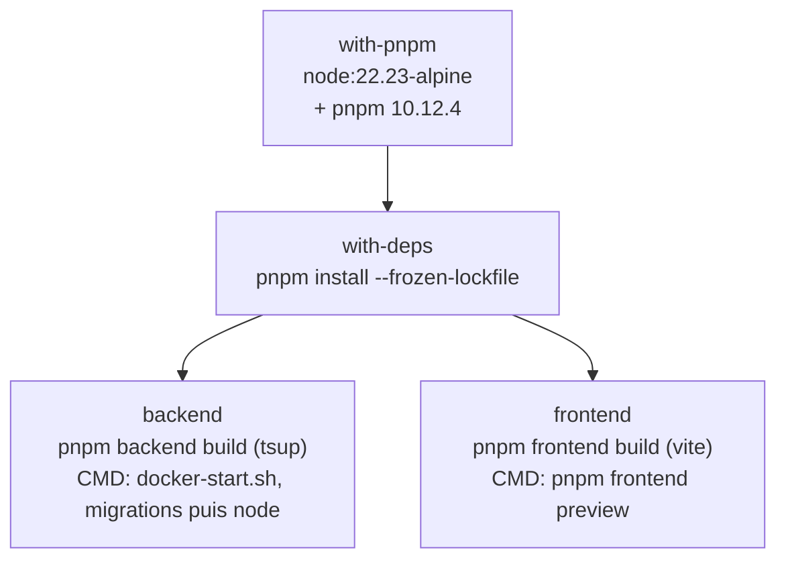
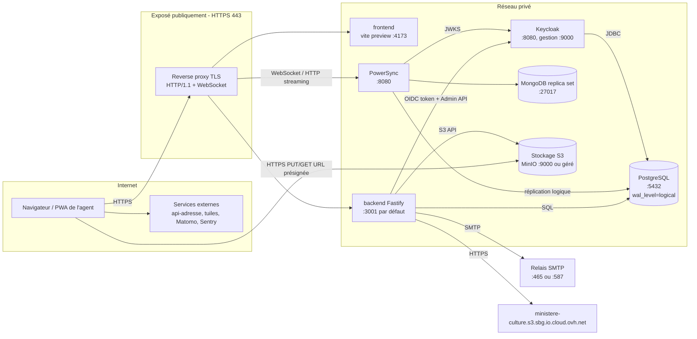
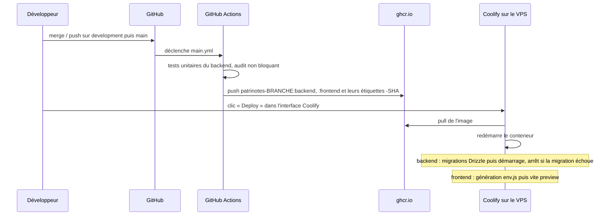

# 10 — Infrastructure et déploiement

Ce document décrit comment Patrinotes est construit, empaqueté et déployé : images Docker, intégration continue (GitHub Actions), fichiers Docker Compose, fichiers d'hébergement inutilisés (Scalingo), redirection de l'ancien domaine « Compte-rendu VIF » et topologie cible de production.

> [!IMPORTANT]
> L'hébergement actuel est un VPS privé (serveur `cr-vif`, 8 vCPU, 31 Go de RAM, 915 Go de disque) piloté par **Coolify 4.4.7** avec Traefik 3.1. La configuration Coolify (services, variables, volumes, domaines) **n'est pas versionnée dans le dépôt**. Elle a été relevée en lecture seule le 17/11/2026 (« relevé de production du 17/11/2026 ») : la production réelle est décrite au § 6.0. Le reste du chapitre décrit ce que montre le code.

La référence de toutes les variables d'environnement se trouve dans [11 — Configuration](11-configuration.md).

## 1. Vue d'ensemble

| Élément | Fichier | Rôle |
| --- | --- | --- |
| Image multi-étapes | [Dockerfile](../Dockerfile) | Construit deux images à partir du monorepo : `backend` et `frontend`. |
| CI de publication | [.github/workflows/main.yml](../.github/workflows/main.yml) | À chaque `push` sur `main`, `development` ou `compte-rendu-vif` : tests unitaires du backend, audit des dépendances (non bloquant), puis construction et publication des deux images sur `ghcr.io`, étiquetées aussi par SHA de commit. |
| CI de tests E2E | [.github/workflows/tests.yml](../.github/workflows/tests.yml) | Tests Playwright, **déclenchement manuel uniquement**. |
| Dépendances de développement | [docker-compose.yaml](../docker-compose.yaml) | PostgreSQL, MongoDB, PowerSync, Keycloak, MinIO, Mailpit, Adminer pour le poste du développeur. |
| Dépendances de test | [docker-compose.test.yaml](../docker-compose.test.yaml) | Même pile, isolée (projet `patrinotes-test`), pilotée par [playwright.config.ts](../playwright.config.ts). |
| Configuration PowerSync | [powersync/powersync-config.yaml](../powersync/powersync-config.yaml), [powersync/sync-config.yaml](../powersync/sync-config.yaml) | Connexion à PostgreSQL, stockage MongoDB, validation des jetons, règles de synchronisation. |
| Initialisation PostgreSQL | [db/init/](../db/init/) | Crée la publication `powersync` et la base `keycloak` (uniquement au premier démarrage d'un volume vide). |
| Thème Keycloak | [keycloak-theme.jar](../keycloak-theme.jar) | Thème DSFR (Keycloakify) pour les écrans Keycloak. |
| Scalingo (inutilisé) | [Procfile](../Procfile), [scalingo.json](../scalingo.json) | Inutilisés, supprimables. |
| Redirection de l'ancien domaine | [crvif-redirection/](../crvif-redirection/) | Site statique qui renvoie vers `app.patrinotes.beta.gouv.fr` et désinstalle l'ancien service worker. **La version servie en production est différente** (§ 5.2). |

## 2. Le Dockerfile

Le [Dockerfile](../Dockerfile) est **unique et multi-étapes**. Il produit deux cibles (`--target backend` et `--target frontend`) qui partagent les mêmes couches de base.



### 2.1 Étape `with-pnpm` (image de base)

- Image : `node:22.23-alpine`, Node 22 LTS (le `package.json` racine déclare `engines.node >= 22` et `packageManager: pnpm@10.12.4`). Au relevé du 17/11/2026, le backend de production tournait encore sous Node 20.11.1 (image antérieure). Aucun paquet système supplémentaire : ni chaîne de compilation, ni bibliothèque native. `pnpm.onlyBuiltDependencies` ([package.json](../package.json)) ne laisse exécuter un script de construction qu'à quelques paquets sans module natif à compiler (`@journeyapps/wa-sqlite`, `esbuild`…).
- Il n'y a pas d'étape d'exécution allégée : les dépendances de développement restent dans l'image (voir § 2.2).
- pnpm est installé globalement en version **10.12.4**, la même que celle du champ `packageManager`, que lit aussi la CI.

### 2.2 Étape `with-deps` (installation)

- Copie des manifestes (`package.json`, `pnpm-lock.yaml`, `pnpm-workspace.yaml`) et des `package.json` des trois paquets, plus les fichiers du frontend nécessaires aux scripts de cycle de vie.
- `pnpm install --frozen-lockfile` installe **toutes** les dépendances, y compris de développement : `drizzle-kit`, `vite`, `vite-node` et `tsup` sont nécessaires à l'exécution (migrations au démarrage, `vite preview`, génération de `env.js`).
- [.dockerignore](../.dockerignore) exclut du contexte de build `.git`, `.github`, tous les fichiers `.env*` (à tous les niveaux), tous les `node_modules`, les résultats Playwright, `.scratch`, `docs` et `tests`. Le Dockerfile ne copie de toute façon que les manifestes, `packages/*`, `db/` et les scripts du frontend. Le jar Keycloak reste dans le contexte, sans être copié dans l'image.

### 2.3 Cible `backend`

```dockerfile
RUN pnpm backend build
ARG SENTRY_RELEASE
ENV SENTRY_RELEASE=$SENTRY_RELEASE
CMD ["sh", "/usr/src/app/packages/backend/docker-start.sh"]
```

([Dockerfile](../Dockerfile), [docker-start.sh](../packages/backend/docker-start.sh))

- Copie `packages/backend`, `packages/pdf` et le dossier [db/](../db/) (migrations SQL Drizzle).
- `pnpm backend build` lance `tsup --publicDir` : bundle ESM unique `packages/backend/dist/index.js`, plus copie du dossier `public/` (polices Marianne, logos utilisés dans les courriels).
- `SENTRY_RELEASE` reçoit le SHA du commit, passé par la CI ; vide en construction locale.
- **Au démarrage**, `docker-start.sh` exécute avec `set -e` les migrations (`pnpm migration:up` → `drizzle-kit migrate`), puis `exec node ./dist/index.js` depuis `packages/backend` avec `NODE_ENV=production`.

Points d'attention (règles cachées) :

1. **Si les migrations échouent, le conteneur s'arrête** sans démarrer le serveur ; l'orchestrateur le relance selon sa politique de redémarrage.
2. **Les migrations n'utilisent pas `DATABASE_URL`** mais `POSTGRES_HOST`, `POSTGRES_PORT`, `POSTGRES_USER`, `POSTGRES_PASSWORD`, `POSTGRES_DB`, avec TLS selon `DATABASE_SSL` ([drizzle.config.ts](../packages/backend/drizzle.config.ts)). Les deux jeux de variables doivent pointer sur la même base.
3. `drizzle.config.ts` importe [envVars.ts](../packages/backend/src/envVars.ts) : **toute la validation des variables du backend s'applique aussi aux migrations**. Une variable obligatoire manquante (même sans rapport avec la base, par exemple `EMAIL_EMITTER`) fait échouer la migration, donc le démarrage.
4. `node` remplace le shell (PID 1) et reçoit directement `SIGTERM` : le serveur cesse d'accepter des connexions, laisse finir les requêtes en cours, puis s'arrête (8 s au plus, sous les 10 s par défaut de `docker stop`).
5. Plusieurs répliques du backend lanceraient les migrations en parallèle au démarrage. Le migrateur (`drizzle-kit migrate` 0.31, qui appelle `migrate()` de drizzle-orm 0.44) ne pose aucun verrou consultatif : il lit la dernière migration appliquée hors transaction, puis applique les suivantes dans une seule transaction. Une seconde réplique attend la fin de la première puis rejoue les mêmes instructions : elle échoue (et son conteneur s'arrête), sauf si ces instructions sont idempotentes. **Garder une seule réplique**, ou sortir les migrations dans une tâche dédiée.
6. Les migrations Drizzle exécutent `ALTER PUBLICATION powersync ADD TABLE …` : la publication `powersync` doit exister **avant** la première migration (voir § 4.2).
7. Au démarrage, le backend insère le service technique `no-service` s'il n'existe pas ; si `FORCE_REFETCH_POP=true`, il télécharge et importe les CSV POP (Mérimée, Palissy) depuis `ministere-culture.s3.sbg.io.cloud.ovh.net` avant d'ouvrir le port, ce qui retarde fortement le démarrage et écrit des fichiers temporaires dans `packages/backend/data/` (système de fichiers inscriptible requis).
8. Le serveur écoute sur `0.0.0.0:${PORT}` (3001 par défaut). L'image ne déclare pas `EXPOSE`. Sondes : `GET /health` (vie : le processus répond) et `GET /health/ready` (disponibilité : PostgreSQL et S3 répondent, sinon 503). Voir [12](12-exploitation-et-supervision.md).
9. Le serveur lance aussi la **tâche d'envoi des alertes** toutes les 15 minutes (voir [04 § 8](04-backend-api.md#8-tâches-planifiées-et-imports-de-données)) : aucune tâche planifiée externe n'est nécessaire pour elle.

### 2.4 Cible `frontend`

```dockerfile
RUN pnpm frontend build
CMD ["pnpm", "frontend", "preview"]
```

- `pnpm frontend build` produit le bundle statique (`vite build`) et un fichier `dist/version.js` qui porte la version affichée par le client (`window.APP_VERSION`).
- Au démarrage, le script `preview` exécute **`pnpm env:gen && vite preview --host`** :
  - `env:gen` lance [createEnvFile.ts](../packages/frontend/scripts/createEnvFile.ts), qui lit **toutes les variables d'environnement préfixées `VITE_`** du conteneur et écrit `dist/env.js` (`window.ENV = {…}`) et `dist/swEnv.js` (`self.ENV = {…}`). C'est l'**injection de configuration à l'exécution** : la même image sert tous les environnements.
  - `vite preview --host` sert ensuite `dist/` sur le port **4173** (port par défaut de `vite preview`, non surchargé).

Implications pour la production :

- **`vite preview` n'est pas un serveur de production** (la documentation Vite le déconseille explicitement) : mono-processus Node, pas de maîtrise fine des en-têtes de cache, de compression ni de sécurité (CSP, HSTS…). Un serveur statique (nginx, Caddy) ou le reverse proxy du ministère serait plus adapté — à condition de reproduire la génération de `env.js` au démarrage.
- **Liste blanche d'hôtes codée en dur.** `vite preview` rejette (HTTP 403 « Blocked request ») tout en-tête `Host` absent de `preview.allowedHosts` ([vite.config.ts](../packages/frontend/vite.config.ts)), qui contient les domaines de production et de préproduction (`app.patrinotes.beta.gouv.fr`, `patrinotes.incubateur.net`…) et les anciens domaines CR VIF. **Tout nouveau nom de domaine (y compris un nom de recette du ministère) impose une modification du code et une reconstruction de l'image.**
- Le système de fichiers du conteneur doit être **inscriptible** (`dist/env.js` est réécrit à chaque démarrage).
- **Toute variable `VITE_*` présente dans l'environnement du conteneur est publiée** dans `env.js`, lisible par n'importe qui. Ne jamais donner un préfixe `VITE_` à un secret. Les valeurs sont insérées entre guillemets sans échappement : une valeur contenant `"` casse `env.js`.
- `env.js` est exclu du précache du service worker et servi en *network-first* ([sw.ts](../packages/frontend/src/service-worker/sw.ts)) : un changement de configuration est pris en compte au prochain chargement en ligne. Les pages de navigation sont aussi en *network-first* en production.

## 3. Intégration continue (GitHub Actions)

### 3.1 Publication des images — `main.yml`

[.github/workflows/main.yml](../.github/workflows/main.yml) :

- Déclencheur : `push` sur les branches **`main`**, **`development`**, **`compte-rendu-vif`**.
- Job `unit-tests` : Node 22, `pnpm install --frozen-lockfile --ignore-scripts`, puis `vitest run` du backend. **Les deux images ne sont construites que s'il passe.**
- Job `audit` : `pnpm audit --prod`, dont les 40 dernières lignes sont écrites dans le résumé du job. Il **ne bloque jamais** la publication (`continue-on-error`).
- Deux jobs de construction (`build-and-push-backend`, `build-and-push-frontend`), même `Dockerfile`, cibles différentes. Le backend reçoit `SENTRY_RELEASE` = SHA du commit.
- Registre : `ghcr.io` (GitHub Container Registry), authentification par `GITHUB_TOKEN` (permission `packages: write`).
- Nom d'image : `${{ github.repository }}-${{ github.ref_name }}`. Chaque image porte deux étiquettes, et les labels OCI `org.opencontainers.image.revision` (SHA) et `org.opencontainers.image.source` :

| Branche | Image backend | Image frontend |
| --- | --- | --- |
| `main` | `ghcr.io/betagouv/patrinotes-main:backend` et `:backend-<sha>` | `ghcr.io/betagouv/patrinotes-main:frontend` et `:frontend-<sha>` |
| `development` | `ghcr.io/betagouv/patrinotes-development:backend` et `:backend-<sha>` | `ghcr.io/betagouv/patrinotes-development:frontend` et `:frontend-<sha>` |
| `compte-rendu-vif` | `ghcr.io/betagouv/patrinotes-compte-rendu-vif:backend` et `:backend-<sha>` | `ghcr.io/betagouv/patrinotes-compte-rendu-vif:frontend` et `:frontend-<sha>` |

Règles cachées :

- **Coolify tire l'étiquette mobile** (`:backend` / `:frontend`), réécrite à chaque `push`. L'étiquette `-<sha>` est immuable : elle permet de savoir quelle version tourne (label `revision`) et de revenir en arrière (voir § 8).
- Seuls les tests unitaires du backend sont lancés avant la publication : ni *lint*, ni contrôle de type, ni tests de bout en bout.
- Aucun scan d'image ni signature d'image ; l'audit des dépendances n'est qu'un rapport.
- La CI ne déclenche pas le déploiement. D'après le relevé de production du 17/11/2026, **tous les déploiements sont lancés à la main depuis l'interface Coolify** (ni webhook, ni appel d'API, pas de déploiement automatique). Coolify enregistre `commit = HEAD` ; la version déployée se lit dans le label `revision` de l'image et, si Sentry est branché, dans la version des événements.
- La branche `compte-rendu-vif` porte l'ancien nom du produit. La préproduction abandonnée de l'ancienne application (§ 6.0, résidus) ne tire pas ces images : elle tourne sur une ancienne image CR VIF, et son backend est en boucle d'erreur.

### 3.2 Tests de bout en bout — `tests.yml`

[.github/workflows/tests.yml](../.github/workflows/tests.yml) : déclenchement **manuel** (`workflow_dispatch`) uniquement. Les tests Playwright démarrent eux-mêmes la pile de test (§ 4.3), le backend et le frontend en mode développement ; ils ne conditionnent pas la publication des images. Voir [13](13-tests-et-qualite.md).

## 4. Docker Compose

### 4.1 `docker-compose.yaml` (développement local)

| Service | Image | Ports exposés sur l'hôte | Rôle | En production ? |
| --- | --- | --- | --- | --- |
| `pg` | `postgres:17-alpine` | `${POSTGRES_PORT}:5432` | Base principale **et** base Keycloak. Lancée avec `wal_level=logical` (réplication logique pour PowerSync). Monte `db/init/` en scripts d'initialisation. | **Oui** (service géré ou conteneur). |
| `mongo` | `mongo:7.0` | `27017:27017` (fixe) | Stockage interne de PowerSync (*buckets*). Lancé en *replica set* `rs0` (exigé par PowerSync). | **Oui**, interne uniquement. |
| `mongo-rs-init` | `mongo:7.0` | — | Tâche ponctuelle : `rs.initiate()` du *replica set*. | Équivalent requis. |
| `powersync` | `journeyapps/powersync-service:latest` | `${POWERSYNC_PORT}:8080` | Service de synchronisation (HTTP + WebSocket). Mode `start -r unified` (API et réplication dans le même processus). | **Oui**, public. |
| `adminer` | `adminer` | `${ADMINER_PORT}:8080` | Interface web d'administration SQL. | **Non** (outil de développement ; ne jamais l'exposer). |
| `minio` | `minio/minio` | `${MINIO_SERVER_PORT}:9000`, `${MINIO_CONSOLE_PORT}:9001` | Stockage objet compatible S3 (pièces jointes, PDF). | Oui **ou** S3 géré. |
| `minio-init` | `minio/mc` | — | Crée le bucket, un utilisateur applicatif et lui attache la politique `readwrite`. | Équivalent requis. |
| `keycloak` | `quay.io/keycloak/keycloak:26.3.5` (production : **26.7.2**) | `${KEYCLOAK_PORT}:8080` | Fournisseur d'identité. Lancé en **`start-dev --import-realm`**, realm importé depuis [tests/realm-template.json](../tests/realm-template.json) via [tests/keycloak-entrypoint.sh](../tests/keycloak-entrypoint.sh) (`envsubst`). | **Oui**, mais en mode `start` (production). |
| `mailpit` | `axllent/mailpit` | `${SMTP_PORT}:1025`, `${SMTP_WEB_PORT}:8025` | Faux serveur SMTP qui capture les courriels. | **Non** : remplacé par un relais SMTP réel. |

Le backend et le frontend **ne sont pas** dans ce fichier : en développement ils tournent sur le poste (`pnpm backend dev`, `pnpm frontend dev`).

Remarques :

- **`powersync-service:latest` n'est pas épinglé** : un redémarrage peut changer de version majeure. À figer en production.
- Mongo est lancé en *replica set* à un seul nœud : le stockage de PowerSync utilise les transactions et les *change streams*, qui l'exigent. Le port 27017 est publié sur l'hôte sans authentification : à ne jamais reproduire en production.
- Le [README](../README.md) indique que Mongo « n'a pas besoin d'être persistant » : il ne contient aucune donnée de référence, mais sa perte force PowerSync à tout re-répliquer (voir [08 § 9.3](08-synchronisation-hors-ligne.md#93-changements-qui-provoquent-un-retraitement-complet) et [14](14-migration-vers-infra-ministere.md)).
- **Le thème `keycloak-theme.jar` n'est monté par aucun fichier Compose.** C'est un jar Keycloakify (thèmes `DSFR` pour `login` et `account`, plus l'extension `account-v1` de Phase Two). Il doit être copié dans `/opt/keycloak/providers/` du Keycloak de production, puis le thème `DSFR` sélectionné dans le realm. Il lit les variables `DSFR_THEME_HOME_URL`, `DSFR_THEME_SERVICE_TITLE`, `DSFR_THEME_BRAND_TOP` (via `${env.…}` dans ses `theme.properties`). En production, il est monté depuis `/home/ubuntu/keycloak-theme.jar` vers `/opt/keycloak/providers/theme.jar` ; le fichier est identique à celui du dépôt (même empreinte), mais il est hors de `/data/coolify` et n'est pas sauvegardé. Note : les utilisateurs finaux ne voient en pratique jamais les écrans Keycloak (voir § 6.3).

### 4.2 Scripts d'initialisation PostgreSQL — `db/init/`

| Fichier | Contenu | Effet |
| --- | --- | --- |
| [0_create-publication.sql](../db/init/0_create-publication.sql) | `CREATE PUBLICATION powersync;` | Publication vide ; les migrations y ajoutent les tables. |
| [1_create_keycloak.sql](../db/init/1_create_keycloak.sql) | `CREATE DATABASE keycloak;` | Base de Keycloak dans **la même instance** PostgreSQL, avec le **même utilisateur** (`KC_DB_USERNAME: ${POSTGRES_USER}`). **En développement seulement** : en production, Keycloak a sa propre instance PostgreSQL 16. |

Ces scripts ne s'exécutent **qu'au premier démarrage d'un volume vide** (mécanisme `docker-entrypoint-initdb.d`). Sur une base gérée ou restaurée, ils doivent être rejoués à la main.

**Contenu de la publication.** La publication est créée vide (pas de `FOR ALL TABLES`) ; chaque table synchronisée y est ajoutée par une migration Drizzle (`ALTER PUBLICATION powersync ADD TABLE …`). Elle contient : `clause_v2`, `delegation`, `monument_alert`, `monument_alert_attachment`, `monument_correction`, `pdf_snapshot`, `pop_immeubles`, `pop_objets`, `report`, `report_attachment`, `sent_email`, `service`, `service_instructeurs`, `state_report`, `state_report_alert`, `state_report_alert_attachment`, `state_report_attachment`, `suggested_email`, `transactions`, `user`, `user_dept`, `user_settings`, `visited_section`, `visited_section_attachment`.

- **`constat_validation` n'est pas publiée** et aucune règle de synchronisation ne la lit : le jeton de validation ne quitte jamais le serveur.
- **`transactions` est publiée sans être lue** par aucune règle : chaque écriture transite inutilement par la réplication.
- Ce qui est envoyé à chaque utilisateur est décrit dans [08 § 3](08-synchronisation-hors-ligne.md#3-règles-de-synchronisation-sync-configyaml).

Vérifier le contenu de la publication avant et après migration : `SELECT * FROM pg_publication_tables WHERE pubname = 'powersync';`. Sur une nouvelle instance, l'ordre est : (1) créer la publication vide, (2) jouer les migrations, (3) démarrer PowerSync. Un `pg_dump` / `pg_restore` restaure la publication et ses tables, mais pas les slots de réplication.

### 4.3 `docker-compose.test.yaml` (tests E2E)

Même pile que le développement, isolée et sans volume persistant ([docker-compose.test.yaml](../docker-compose.test.yaml)). Elle utilise **PostgreSQL 14** (17 en développement et en production) : les tests de bout en bout tournent donc sur une autre version majeure que la production.

### 4.4 Configuration PowerSync versionnée

[powersync/powersync-config.yaml](../powersync/powersync-config.yaml) contient des valeurs **codées en dur** qui ne conviennent qu'à un réseau Docker où les services s'appellent `mongo` et `keycloak` :

| Clé | Valeur | Commentaire |
| --- | --- | --- |
| `replication.connections[0].uri` | `!env PS_DATABASE_URL` | Variable. |
| `replication.connections[0].sslmode` | `disable` | **Pas de TLS vers PostgreSQL.** À changer si la base du ministère impose TLS. |
| `storage.uri` | `mongodb://mongo:27017/powersync_demo` | En dur, sans authentification. |
| `port` | `!env PS_PORT` | 8080 dans Compose. |
| `client_auth.jwks_uri` | `http://keycloak:8080/realms/master/protocol/openid-connect/certs` | En dur : nom d'hôte interne **et** realm `master`. |
| `client_auth.issuer` | `http://keycloak:8080/realms/master` | **Ignorée** par le service (voir ci-dessous). |
| `client_auth.audience` | `["account"]` | Audience par défaut des jetons d'accès Keycloak. |
| `telemetry.disable_telemetry_sharing` | `true` | Télémétrie anonyme vers JourneyApps désactivée. |
| `sync_config.path` | `sync-config.yaml` | Règles de synchronisation, décrites au [08 § 3](08-synchronisation-hors-ligne.md#3-règles-de-synchronisation-sync-configyaml). |

Pièges de ce fichier :

1. **`issuer` n'est pas une option reconnue** sous `client_auth` par le service PowerSync : l'émetteur des jetons n'est pas vérifié. Seuls la signature (JWKS, clé choisie par `kid`), l'audience `account` et l'expiration le sont.
2. **`telemetry` doit rester à la racine** du fichier : rangé sous une autre clé, il est ignoré et la télémétrie reste active.
3. **`jwks_uri` dépend du nom d'hôte et du realm Keycloak.** Si Keycloak est déplacé ou si le realm change, ce fichier doit être modifié en même temps que les variables du backend ; sinon toutes les connexions de synchronisation sont refusées et l'application reste « hors ligne ».
4. **`PS_JWT_SECRET`** (alimenté par `JWT_SECRET` dans le compose) est injecté dans le conteneur mais n'est référencé par aucune clé : il est inutile.
5. L'utilisateur de `PS_DATABASE_URL` doit avoir l'attribut `REPLICATION` (en développement, le superutilisateur `postgres`) : prévoir un rôle dédié sur la cible.
6. Le format `config.edition: 3` (« Sync Streams ») de `sync-config.yaml` exige une version récente du service : épingler la version (1.20.5 en production).

En production, les deux fichiers ont été **déposés à la main** dans `/data/coolify/services/a4koswck4g8ggcwc4wsw4oc8/` et montés dans `/config/` (relevé de production du 17/11/2026). Au relevé, `powersync-config.yaml` ne différait du dépôt que par `jwks_uri` et `issuer`, qui pointent sur `https://auth.patrinotes.beta.gouv.fr/realms/patrinotes`, et par un bloc de télémétrie rangé sous `client_auth`, donc ignoré : la télémétrie de production reste active tant que le fichier du dépôt n'est pas recopié. `sync-config.yaml` y est une copie tenue à jour à la main, dans Coolify et dans le fichier monté. La CI ne déploie pas ces fichiers : toute modification est à recopier sur le serveur, puis PowerSync à redémarrer.

## 5. Fichiers d'hébergement inutilisés et ancien domaine

### 5.1 Scalingo — `Procfile` et `scalingo.json`

[Procfile](../Procfile) et [scalingo.json](../scalingo.json) décrivent un ancien hébergement Scalingo (serveurs de développement, configuration invalide). Ils ne sont pas utilisés par la chaîne actuelle (Docker + Coolify).

### 5.2 Redirection de l'ancien domaine — `crvif-redirection/`

Le produit s'appelait « Compte-rendu VIF » (CR VIF) avant de devenir Patrinotes. Le dossier [crvif-redirection/](../crvif-redirection/) est un **site statique** destiné à l'ancien domaine `app.compte-rendu-vif.beta.gouv.fr` :

- [index.html](../crvif-redirection/index.html) : redirection immédiate (meta refresh + JavaScript) vers `https://app.patrinotes.beta.gouv.fr`, après avoir désinscrit tous les service workers du domaine ;
- [sw.js](../crvif-redirection/sw.js) : un service worker de remplacement. Les navigateurs vérifient périodiquement le script `/sw.js` du service worker installé ; ils récupèrent celui-ci, qui s'active (`skipWaiting`), **se désinscrit**, puis redirige tous les onglets ouverts vers le nouveau domaine. Sans lui, l'ancienne PWA mise en cache continuerait de s'afficher indéfiniment sur l'ancien domaine.

**Ce n'est pas la version servie en production.** D'après le relevé de production du 17/11/2026, `app.compte-rendu-vif.beta.gouv.fr` est servi par le service Coolify `migration-proxy` (nginx par défaut, projet `crvif`), avec des fichiers déposés à la main :

- `index.html` : redirection après 3 s vers `https://app.patrinotes.beta.gouv.fr?from=crvif`, mais un script envoie d'abord vers **`/inscription?from=crvif`** ;
- `sw.js` : service worker qui se désinscrit et renvoie les onglets vers `https://app.patrinotes.beta.gouv.fr?from=crvif` ;
- les liens profonds de l'ancien domaine (`/constat/…`) répondent **404** (pas de réécriture).

Le paramètre `?from=crvif` n'est lu par aucun code du frontend : il ne sert que de marqueur dans les statistiques. Pour une éventuelle reprise, c'est la version de production qu'il faut reprendre, et la reverser dans le dépôt.

> [!IMPORTANT]
> Ce mécanisme rappelle une contrainte forte : **la base locale (IndexedDB / SQLite) et l'installation PWA sont liées à l'origine (domaine)**. Changer de domaine fait perdre aux utilisateurs leurs données locales non synchronisées. Lors de la migration, **conserver le domaine `app.patrinotes.beta.gouv.fr`** est fortement recommandé (voir [14](14-migration-vers-infra-ministere.md)).

## 6. Topologie de production

### 6.0 Production actuelle (relevé de production du 17/11/2026)

Un seul serveur porte tout : tous les domaines ci-dessous y pointent. Trois projets Coolify : `patrimoine-embarque` (Patrinotes, environnements `production` et `preprod`), `keycloak-auth` (Keycloak) et `crvif` (ancienne application).

| Composant | Production | Préproduction (branche `development`) |
| --- | --- | --- |
| Frontend | `ghcr.io/betagouv/patrinotes-main:frontend` (`vite preview`, port 4173) — `https://app.patrinotes.beta.gouv.fr` | `patrinotes-development:frontend` — `https://patrinotes.incubateur.net` |
| Backend | `patrinotes-main:backend` (port 3002) — `https://api.patrinotes.beta.gouv.fr` | `patrinotes-development:backend` — `https://api.patrinotes.incubateur.net` |
| PowerSync | `journeyapps/powersync-service:latest` (= **1.20.5**, port 3003) — `https://sync.patrinotes.beta.gouv.fr` | 1.20.5 — `https://sync.patrinotes.incubateur.net` |
| MongoDB (PowerSync) | `mongo:7.0` (7.0.31, *replica set* `rs0`), interne | idem |
| PostgreSQL applicatif | `postgres:17-alpine` (**17.8**), interne | PostgreSQL 17.6, interne |
| Keycloak | `quay.io/keycloak/keycloak:`**`26.7.2`** + sa propre instance `postgres:16-alpine` (projet `keycloak-auth`) — `https://auth.patrinotes.beta.gouv.fr`, realm **`patrinotes`** | Keycloak partagé avec la production (à séparer) |
| Stockage objet | Scaleway Object Storage, bucket **`patrinotes-prod`**, région `fr-par` (`https://patrinotes-prod.s3.fr-par.scw.cloud`) | bucket `patrimoine-embarque-preprod` |
| SMTP | Scaleway Transactional Email (`smtp.tem.scw.cloud:465`) | idem, même expéditeur |
| Adminer | présent, protégé par authentification | idem |
| Sentry | frontend (`sentry.incubateur.net`) ; backend non branché | — |

Points notables :

- **Déploiement manuel et non tracé** (§ 3.1) ; les migrations s'appliquent au démarrage du conteneur backend.
- **Configurations PowerSync déposées à la main** (§ 4.4) ; image `latest` non épinglée : un redéploiement du service tirerait une autre version.
- **La préproduction s'authentifie sur le Keycloak de production** : à séparer.
- Le frontend et le backend n'ont aucun volume (sans état). Les données sont dans les volumes PostgreSQL, Mongo et Keycloak, et dans le bucket Scaleway.

**Résidus de l'ancienne application CR VIF** (projet `crvif`) : plusieurs services de l'ancienne application tournent encore sur le serveur (stockage, backend, PowerSync, base de production sauvegardée chaque jour). Seul `migration-proxy`, qui redirige `app.compte-rendu-vif.beta.gouv.fr`, est voulu (§ 5.2). Les autres sont à arrêter après une dernière sauvegarde ; leur inventaire détaillé figure dans le relevé de sécurité transmis au ministère, hors dépôt. Environ 7,5 Go de volumes Docker sont récupérables.

### 6.1 Schéma (cible)



### 6.2 Composants, ports et exposition

| Composant | Port interne | Protocole | Exposé publiquement ? | Remarques |
| --- | --- | --- | --- | --- |
| Frontend | 4173 | HTTP | **Oui** (`app.patrinotes.beta.gouv.fr`) | Le nom d'hôte doit figurer dans `preview.allowedHosts`. |
| Backend | `PORT` (3001 par défaut ; 3002 en production) | HTTP (REST JSON) | **Oui** (URL = `VITE_BACKEND_URL` = `BACKEND_URL`) | CORS limité au frontend ([11](11-configuration.md)). Liens courts publics `BACKEND_URL/attachment/:id`, valables 90 jours ([07](07-donnees-externes-et-stockage.md)). Sondes `/health` et `/health/ready`. |
| PowerSync | 8080 (`PS_PORT` ; 3003 en production) | HTTP + **WebSocket** | **Oui** (URL = `VITE_POWERSYNC_URL`) | Le proxy doit accepter l'*upgrade* WebSocket et des connexions longues (pas de coupure à 60 s). |
| Stockage S3 | 9000 (MinIO) | HTTP(S) S3 | **Oui**, au moins en lecture/écriture par URL présignée | Le navigateur envoie les pièces jointes et PDF **directement** sur `MINIO_URL` (PUT présigné) et y est redirigé en lecture. CORS du bucket à configurer. |
| Keycloak | 8080 (HTTP), 9000 (santé, métriques) | HTTP (OIDC) | **Non requis** pour les utilisateurs (le navigateur n'appelle jamais Keycloak) | Doit être joignable par le backend et PowerSync. Exposé publiquement : à restreindre. |
| PostgreSQL | 5432 | PostgreSQL | **Non** | Réplication logique requise. |
| MongoDB | 27017 | MongoDB | **Non** | *Replica set* obligatoire. |
| Console MinIO | 9001 | HTTP | **Non** | Administration uniquement. |
| Adminer, Mailpit | — | — | **Absents en production** | Outils de développement. |

### 6.3 Ce que le navigateur appelle réellement

Déduit du code frontend :

- `VITE_BACKEND_URL` (API, rafraîchissement de jeton, *upload-data*, PDF, statistiques) ;
- `VITE_POWERSYNC_URL` (flux de synchronisation) ;
- l'URL S3 contenue dans les URL présignées (`MINIO_URL`) ;
- des services tiers : `api-adresse.data.gouv.fr`, `tiles.openfreemap.org`, `openmaptiles.geo.data.gouv.fr`, `data.geopf.fr`, `stats.beta.gouv.fr` (Matomo), Sentry (si `VITE_SENTRY_DSN`).

**Le navigateur n'appelle jamais Keycloak** : la connexion passe par un formulaire de l'application, et c'est le backend qui échange identifiant et mot de passe contre des jetons (*Resource Owner Password Credentials*) et crée les comptes via l'API d'administration Keycloak. `VITE_AUTH_URL`, `VITE_AUTH_REALM` et `VITE_AUTH_CLIENT_ID` sont validés par le schéma frontend ([envVars.ts](../packages/frontend/src/envVars.ts)) mais pas utilisés pour des appels.

## 7. Environnements

| Branche Git | Images | Usage supposé | Domaine(s) |
| --- | --- | --- | --- |
| `main` | `patrinotes-main:*` | Production | `app.`, `api.`, `sync.`, `auth.patrinotes.beta.gouv.fr` ; stockage `patrinotes-prod.s3.fr-par.scw.cloud` |
| `development` | `patrinotes-development:*` | Préproduction | `patrinotes.incubateur.net`, `api.` et `sync.patrinotes.incubateur.net` |
| `compte-rendu-vif` | Ancienne image CR VIF | Ancienne préproduction CR VIF, abandonnée | `compte-rendu-vif.incubateur.net` (répond encore), `api.` (503) |

Les autres branches distantes (`e2e`, `feat/*`, `backup/*`, Dependabot) ne produisent pas d'image.

Différences de comportement selon `NODE_ENV` (backend) :

| Comportement | `development` | `test` | autre (dont `production`) |
| --- | --- | --- | --- |
| Liste blanche des adresses à l'inscription ([authService.ts](../packages/backend/src/services/authService.ts)) | **Désactivée** | Active | Active |
| Sentry | Désactivé | Actif si DSN | Actif si DSN |
| Limitation de débit | Active | **Désactivée** | Active |
| CORS : toute origine `localhost` acceptée | Oui | Oui | Non |
| En-tête `Strict-Transport-Security` | Non | Non | Oui |
| Tâche d'envoi des alertes | Active | **Désactivée** | Active |
| Pile d'erreur renvoyée au client | Oui | Non | Non |
| Fichier `.env` chargé | `../../.env` | `../../.env.test` | `../../.env` (s'il existe) |

L'image pose `NODE_ENV=production` ([docker-start.sh](../packages/backend/docker-start.sh)), comme `pnpm backend start` (`cross-env`). C'est le cas en production comme en préproduction : aucune variable `NODE_ENV` n'est définie dans Coolify. C'est pourquoi la préproduction doit définir `SENTRY_ENVIRONMENT=preprod` pour que ses événements Sentry ne soient pas classés en `production`. Un `NODE_ENV` absent équivaut de toute façon à la production (`isProd = !isDev && !isTest`).

## 8. Processus de livraison et retour arrière

### 8.1 Livraison (état actuel)



- Il n'y a ni numéro de version publié, ni changelog, ni étiquette Git de version. La version déployée se retrouve par le label `org.opencontainers.image.revision` de l'image (SHA du commit). La version visible côté client est `window.APP_VERSION` (version de `packages/frontend/package.json` + horodatage du build).
- Les modifications de `sync-config.yaml` et `powersync-config.yaml` sont à recopier à la main sur le serveur, puis PowerSync à redémarrer.
- `development` est fusionnée dans `main` à chaque mise en production.
- Les clients PWA téléchargent la nouvelle version au chargement suivant en ligne ; elle s'active tout de suite sur les pages de consultation, et ailleurs quand l'agent accepte la mise à jour proposée par un bandeau (service worker en mode `prompt`, voir [03 § 9.3](03-frontend-pwa.md#93-mise-à-jour-et-reprise-sur-chunk-périmé)). Un *chunk* JS ancien introuvable force un rechargement, en ligne seulement.
- Une migration touchant des tables synchronisées doit rester compatible avec les clients non mis à jour et être cohérente avec la publication `powersync` et les règles de synchronisation (voir [08 § 9](08-synchronisation-hors-ligne.md#9-procédure-de-changement-de-schéma)).

### 8.2 Retour arrière

| Élément | Possible ? | Procédure |
| --- | --- | --- |
| Image applicative | Oui | Redéployer l'étiquette `:backend-<sha>` / `:frontend-<sha>` du commit précédent (à saisir dans Coolify à la place de `:backend` / `:frontend`), ou faire un `git revert` sur la branche, ce qui republie l'image. |
| Migration de base | **Non automatisé** | Drizzle ne génère pas de migration descendante. Restaurer une sauvegarde ou écrire une migration corrective. Une migration de schéma incompatible avec l'ancienne image rend le retour arrière de l'image impossible sans restauration. |
| Configuration frontend | Oui | Modifier les variables `VITE_*` et redémarrer le conteneur (pas de rebuild). |
| Clients PWA | Partiel | Les clients ayant déjà chargé la nouvelle version la gardent jusqu'au prochain chargement en ligne. |

**Recommandations** : déployer par étiquette `-<sha>` plutôt que par étiquette mobile, découpler les migrations du démarrage si plusieurs réplicas tournent, sauvegarder la base avant chaque livraison comportant une migration.
