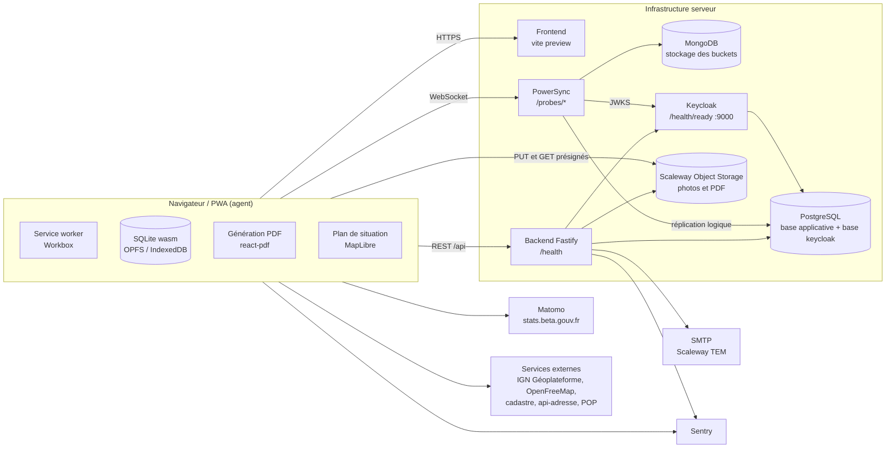
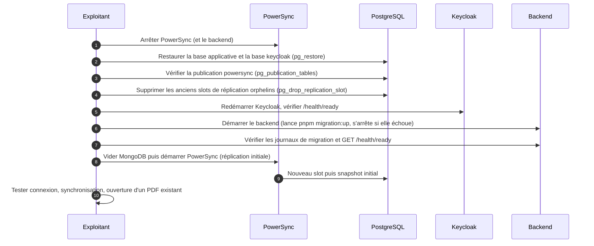
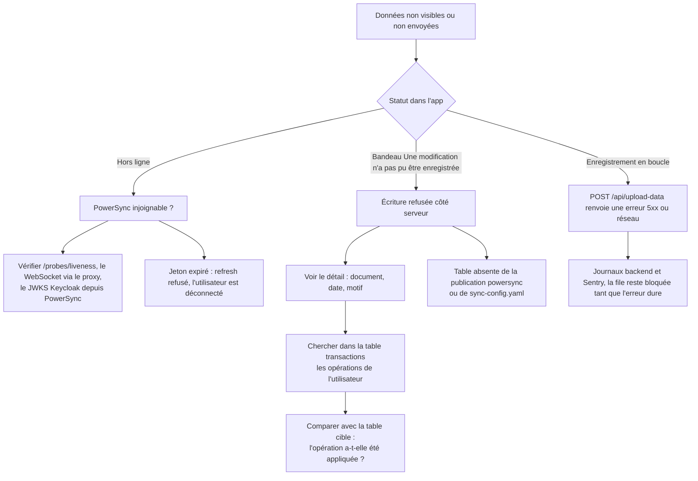
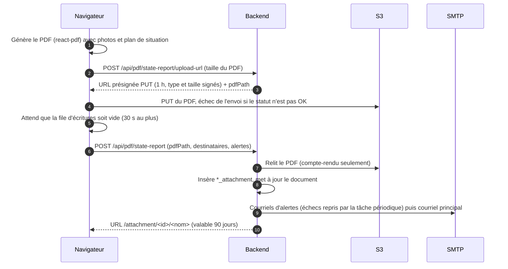

# 12 — Exploitation et supervision

Ce chapitre décrit ce qu'il faut savoir pour **faire tourner Patrinotes en production** : où sont les journaux, ce que
capte Sentry, quels points de contrôle de santé existent, ce qu'il faut superviser, sauvegarder et restaurer, les tâches
d'administration récurrentes et un **runbook** des incidents connus.

Tout ce qui suit est tiré du code du dépôt et du relevé de production du 17/11/2026 (lecture seule de la production :
Coolify, PostgreSQL, Keycloak, DNS). Ce que le relevé n'a pas pu mesurer reste marqué « à confirmer ». Les durées
RPO/RTO sont des **propositions** à valider avec le ministère.

> [!IMPORTANT]
> Point clé pour l'exploitation : l'application est **offline-first**. Une partie importante du travail (saisie,
> génération du PDF, génération des cartes, file d'envoi des photos) se fait **dans le navigateur de l'agent**. Une
> panne côté serveur ne se voit donc pas toujours tout de suite. À l'inverse, certaines erreurs côté client ne laissent
> **aucune trace** côté serveur (voir § 9).

---

## 1. Vue d'ensemble des composants à exploiter



| Composant | Image / runtime | Point de santé disponible | Données persistantes ? |
| --- | --- | --- | --- |
| Backend | `node:22.23-alpine`, cible `backend` du [Dockerfile](../Dockerfile#L29-L44) | `GET /health` (vie) et `GET /health/ready` (PostgreSQL et S3), voir § 3 | Non (sans état) |
| Frontend | cible `frontend` du [Dockerfile](../Dockerfile#L50-L56), sert via `vite preview` | Aucun dédié (`GET /`) | Non |
| PostgreSQL | `postgres:17-alpine` en dev ([docker-compose.yaml](../docker-compose.yaml#L10)), `postgres:14-alpine` en test | `pg_isready` | **Oui, critique** |
| PowerSync | `journeyapps/powersync-service:latest` (**non épinglé**) | `GET /probes/liveness` (utilisé par [docker-compose.test.yaml](../docker-compose.test.yaml#L90-L101)) | Non (reconstructible), voir § 6 |
| MongoDB | `mongo:7.0`, replica set `rs0` | `rs.status().ok` | Non (reconstructible) |
| Keycloak | `quay.io/keycloak/keycloak:26.3.5` en dev, 26.7.2 en production | `GET /health/ready` sur le port de management 9000, `KC_METRICS_ENABLED=true` | Oui (base `keycloak` dans le même Postgres en dev ; instance PostgreSQL 16 dédiée en production) |
| S3 (Scaleway en production, MinIO en dev) | `minio/minio` | `/minio/health/live` | **Oui, critique** |
| SMTP | externe | — | — |

---

## 2. Journalisation (logs)

### 2.1 Backend

Le backend **n'utilise pas le logger intégré de Fastify** : l'instance est créée sans option `logger`
([router.ts](../packages/backend/src/router.ts#L33)), donc Fastify ne journalise rien par lui-même (ni accès, ni temps de
réponse, ni code HTTP).

Les journaux viennent de deux sources :

1. **La bibliothèque `debug`** : [features/debug.ts](../packages/backend/src/features/debug.ts) active les espaces de noms
   donnés par la variable `DEBUG` (par défaut `cr-vif:*`, voir [envVars.ts](../packages/backend/src/envVars.ts#L39)).
   Chaque module crée un sous-espace : `cr-vif:index`, `cr-vif:fastify`, `cr-vif:admin`, `cr-vif:sync-service`,
   `cr-vif:upload`, `cr-vif:pdf-plugin`, `cr-vif:alert-delivery`, `cr-vif:rate-limit`, `cr-vif:sync-pop`,
   `cr-vif:batch-writer`, etc.
2. **`console.log` / `console.warn` / `console.error`** ponctuels, notamment dans le gestionnaire d'erreurs global
   ([router.ts](../packages/backend/src/router.ts#L87-L115)), dans l'envoi des alertes
   ([pdfRoutes.tsx](../packages/backend/src/routes/pdfRoutes.tsx#L435)), dans la tâche d'envoi des alertes
   (`[alert-delivery]`) et dans la sonde `/health/ready` (cause d'un échec).

Caractéristiques :

| Aspect | Constat |
| --- | --- |
| Format | Texte libre, **non structuré** (pas de JSON). Avec `debug`, hors TTY, chaque ligne est préfixée d'un horodatage ISO puis de l'espace de noms (comportement standard de `debug`, à confirmer sur l'image de production). |
| Niveaux | **Aucun niveau** (pas de info / warn / error). Le seul levier est le filtre `DEBUG` (ex. `DEBUG=cr-vif:pdf-plugin,cr-vif:sync-service`). |
| Destination | `debug` écrit sur **stderr**, `console.log` sur **stdout**. En conteneur, tout part donc dans les journaux du conteneur (Docker ou Coolify). Aucun fichier, aucune rotation propre à l'application. |
| Journal des requêtes | Un hook `onRequest` journalise la méthode et le **modèle de route** (`/api/constat-validation/:token`, jamais l'URL complète) pour **chaque requête** ([router.ts](../packages/backend/src/router.ts#L69-L73)), sans code retour ni durée. |
| Démarrage | `Running in <NODE_ENV> mode` puis `Server listening on <PORT>` ; en cas d'échec de migration, le conteneur s'arrête avec la sortie de `drizzle-kit`. Sur `SIGTERM` : `SIGTERM received, closing server`. |

> [!NOTE]
> **Données personnelles dans les journaux.** Les journaux ne contiennent ni jetons, ni URL complètes (jetons de
> validation, identifiants de liens courts, liens de réinitialisation, paramètres), ni objets utilisateur, ni options
> des requêtes Keycloak. Les courriels n'y apparaissent que masqués (`a****e@domaine.fr`), pour un refus d'inscription
> hors liste blanche ou une écriture refusée sur la liste blanche ; les envois d'alertes indiquent le nombre de
> destinataires. Ils contiennent des identifiants d'utilisateurs et de documents. Leur conservation et leur accès
> doivent suivre les règles du ministère.

### 2.2 Frontend

Dans le navigateur, les traces sont des `console.*` (y compris celles de PowerSync via `js-logger`). Elles ne remontent
au serveur que par Sentry (§ 2.3), si `VITE_SENTRY_DSN` est défini.

La version de l'application déployée est affichée en pied de page (« Version x.y.z.<horodatage hexadécimal> ») : elle
est écrite dans `dist/version.js` au build par [setVersion.ts](../packages/frontend/scripts/setVersion.ts). C'est
**l'information à demander en premier à un utilisateur** qui signale un problème (voir § 9.1).

### 2.3 Sentry

#### Backend — `SENTRY_DSN`

Initialisé dans [features/sentry.ts](../packages/backend/src/features/sentry.ts) avec `@sentry/node` **v11** :

- **Inactif en production** au relevé du 17/11/2026 : aucun `SENTRY_DSN` n'y est défini (voir § 11). Ce qui suit vaut
  dès qu'un DSN est ajouté.
- Actif **seulement si** `NODE_ENV !== "development"` **et** `SENTRY_DSN` défini. Attention : il est donc **aussi actif
  en `NODE_ENV=test`** si un DSN traîne dans l'environnement.
- `tracesSampleRate: 0.1` (10 % des transactions), collecte de données désactivée (`dataCollection` : ni utilisateurs,
  ni cookies, ni corps, ni variables locales), pas de fil d'Ariane console.
- `beforeSend` (et `beforeSendTransaction`) retire le corps, les cookies, la chaîne de requête et l'utilisateur,
  remplace par `[Filtered]` toute valeur dont la clé ressemble à un mot de passe, un jeton, un secret, une
  autorisation, un courriel, des destinataires, `to`, `body` ou `data`, et remplace les adresses de courriel des
  messages par `[email]`.
- **Environnement** : `SENTRY_ENVIRONMENT`, sinon `NODE_ENV` (donc `production` dans l'image, y compris en
  préproduction). **Version** : `SENTRY_RELEASE` (SHA du commit posé par la CI), sinon `SOURCE_COMMIT`, sinon la
  version du paquet.

Ce qui est envoyé :

| Où | Quoi | Remarque |
| --- | --- | --- |
| Gestionnaire d'erreurs `/api/*` ([router.ts](../packages/backend/src/router.ts)) | `captureException(error, { extra: { method, route } })` | Toutes les erreurs, y compris les `AppError` attendues (401/403/404/409), **sauf** les dépassements de débit (429) et les requêtes refusées par le schéma (400). Seuls la méthode et le modèle de route sont joints. |
| Refus d'écriture de synchronisation ([syncService.ts](../packages/backend/src/services/syncService.ts)) | `captureMessage("Écriture de synchronisation refusée")`, niveau `warning`, avec table, opération, identifiant (masqué si c'est un courriel) et motif | À surveiller : un volume anormal signale un client désynchronisé ou une tentative d'accès. |
| Envoi S3 ([uploadService.ts](../packages/backend/src/services/uploadService.ts)) | Exceptions S3 avec `filePath` / `reportId` | — |
| Alertes de constat ([pdfRoutes.tsx](../packages/backend/src/routes/pdfRoutes.tsx), [alertDelivery.ts](../packages/backend/src/features/alertDelivery.ts)) | Exception par alerte en échec (identifiants de l'alerte et du constat, numéro d'essai) ; message `error` « Alerte de constat abandonnée après plusieurs essais d'envoi » au 5e échec | La requête d'envoi du constat réussit quand même ; la tâche périodique reprend l'alerte (§ 9.5). |
| Alertes de fiche ([alertDelivery.ts](../packages/backend/src/features/alertDelivery.ts)) | Exception si le courriel échoue ; message `warning` « Alerte de fiche envoyée sans ses photos non reçues » après 24 h d'attente ; message `error` « Alerte de fiche abandonnée après plusieurs essais d'envoi » | `sent_at` est remis à vide : la tâche ou le navigateur réessaiera. |
| Tâche d'envoi des alertes | Exception inattendue de la tâche (`job: alert-delivery`) | — |

> [!NOTE]
> `AppError` n'hérite pas de `Error` ([errors.ts](../packages/backend/src/features/errors.ts)). Sentry reçoit donc un
> objet sans pile d'appel (« Non-Error exception captured »), ce qui gêne le tri.
>
> Les routes hors `/api` (`/attachment/:id`, `/health`) ne passent **pas** par ce gestionnaire.

#### Frontend — `VITE_SENTRY_DSN`

Initialisé dans [features/sentry.ts](../packages/frontend/src/features/sentry.ts) avec `@sentry/react` **v11** :

- Actif hors mode dev si `VITE_SENTRY_DSN` est présent dans `window.ENV` (injecté au démarrage du conteneur, voir
  [createEnvFile.ts](../packages/frontend/scripts/createEnvFile.ts)).
- Environnement : `VITE_SENTRY_ENVIRONMENT` (défaut `production`) ; version : `window.APP_VERSION`.
- `tracesSampleRate: 0.1`, collecte de données désactivée (`dataCollection`).
- Message `warning` « Écriture de synchronisation non appliquée (client) » pour chaque écriture refusée ou mise de
  côté (table, opération, motif ; ni identifiant ni données).
- Ni journaux console ni fil d'Ariane console ; `beforeSend` retire l'utilisateur et masque les mêmes clés que le
  backend : ni les jetons, ni le profil, ni le contenu des opérations de synchronisation ne partent vers Sentry.
- L'`ErrorBoundary` racine envoie les plantages React avec la pile des composants
  ([main.tsx](../packages/frontend/src/main.tsx)).
- Les échecs de génération du plan de situation sur un appareil en ligne sont envoyés à Sentry.
- En production, le seul DSN défini est celui du frontend (`sentry.incubateur.net`).

### 2.4 Mesure d'audience

Matomo est câblé en dur : `https://stats.beta.gouv.fr/`, `siteId: 123` ([main.tsx](../packages/frontend/src/main.tsx#L142-L145)).
Lors du transfert, le ministère devra décider s'il garde l'instance beta.gouv.fr ou la sienne (à confirmer). Changer
d'instance demande une modification du code.

---

## 3. Points de santé (health checks)

| Composant | Point d'accès | Ce qu'il vérifie vraiment |
| --- | --- | --- |
| Backend (vie) | `GET /health` → `{"status":"ok"}` ([router.ts](../packages/backend/src/router.ts#L75-L77)) | **Seulement que le processus répond.** À utiliser comme sonde de vie (redémarrer le conteneur s'il ne répond plus). |
| Backend (disponibilité) | `GET /health/ready` ([router.ts](../packages/backend/src/router.ts#L80-L83), [health.ts](../packages/backend/src/features/health.ts)) | `select 1` sur PostgreSQL et `HeadBucket` sur le bucket S3, 3 s au plus chacun. **200** `{"status":"ok","checks":{"database":"ok","storage":"ok"}}` ou **503** avec `"error"` pour le composant en panne. La cause n'est écrite que dans les journaux du backend (`readiness check "database" failed: …`). Ni Keycloak ni SMTP ne sont testés. À utiliser comme sonde de disponibilité et pour la supervision externe. |
| PowerSync | `GET /probes/liveness` (et `/probes/startup`, `/probes/readiness` d'après la documentation PowerSync, à confirmer pour la version déployée) | État du service PowerSync |
| Keycloak | `GET /health/ready` sur le port **9000** (management), `/metrics` si `KC_METRICS_ENABLED` | Base Keycloak joignable |
| MinIO | `GET /minio/health/live` | Service S3 vivant |
| Postgres | `pg_isready` | Instance acceptant des connexions |
| Frontend | aucun, utiliser `GET /` | — |

> [!NOTE]
> Le backend démarre par [docker-start.sh](../packages/backend/docker-start.sh) : si la migration échoue, **le conteneur
> s'arrête** sans démarrer le serveur. Un conteneur qui redémarre en boucle après un déploiement signale donc une
> migration en échec : lire ses journaux.

---

## 4. Supervision recommandée

Rien n'est fourni dans le dépôt (ni Prometheus, ni alerte). Voici ce qu'il est recommandé de surveiller, par ordre de
criticité.

### 4.1 PostgreSQL et slot de réplication logique (critique)

PowerSync lit Postgres par **réplication logique** (`wal_level=logical`, publication `powersync` créée par
[db/init/0_create-publication.sql](../db/init/0_create-publication.sql)). PowerSync crée et maintient un **slot de
réplication**. Si PowerSync est arrêté ou bloqué, Postgres **garde tous les WAL** depuis la dernière position confirmée :
le disque peut se remplir et **arrêter toute la base** (backend et Keycloak compris).

À surveiller :

```sql
-- Retard et volume de WAL retenu par slot
SELECT slot_name, active,
       pg_size_pretty(pg_wal_lsn_diff(pg_current_wal_lsn(), restart_lsn)) AS wal_retenu
FROM pg_replication_slots;

-- La publication couvre-t-elle bien les tables synchronisées ?
SELECT * FROM pg_publication_tables WHERE pubname = 'powersync';
```

Seuils proposés : alerte si `active = false` plus de 15 min, ou si le WAL retenu dépasse 1 à 2 Go (à ajuster selon le
disque). **Proposition** : régler `max_slot_wal_keep_size` pour éviter de saturer le disque. En contrepartie, PowerSync
devra refaire une réplication complète si le slot est invalidé.

**État relevé le 17/11/2026** (PostgreSQL applicatif 17.8) : `wal_level = logical`, `max_replication_slots = 10`,
`max_wal_senders = 10`, **`max_slot_wal_keep_size = -1` (aucun plafond)**, `wal_keep_size = 0`, `archive_mode = off`,
`max_connections = 100`, `shared_buffers = 128 Mo` (valeur par défaut, faible pour un serveur de 31 Go). Un seul slot
PowerSync, actif, avec un retard de quelques octets. Aucune supervision ni alerte n'existe. Sur la base de l'ancienne application CR VIF, hébergée sur le même serveur, un slot
**inactif** (`powersync_1_f58a`) retient déjà 46 Mo de WAL sans plafond : c'est exactement le scénario de saturation
du disque, en petit.

> [!NOTE]
> La publication `powersync` est créée par le script d'initialisation **sans `FOR ALL TABLES`**
> (`CREATE PUBLICATION powersync;`). Les tables y sont ajoutées par les migrations (`ALTER PUBLICATION powersync ADD TABLE
> …`, par exemple [0000_bright_stone_men.sql](../db/0000_bright_stone_men.sql) ou
> [0011_petite_zarda.sql](../db/0011_petite_zarda.sql)). Une table oubliée **ne se synchronise pas**, sans aucune erreur
> (voir l'avertissement du [README](../README.md)).
>
> **Règle cachée pour une nouvelle infrastructure** : les scripts de [db/init/](../db/init/) ne sont exécutés que par
> l'image Docker Postgres, au **premier** démarrage d'un volume vide. Sur un Postgres managé, il faut d'abord exécuter
> à la main `CREATE PUBLICATION powersync;` et `CREATE DATABASE keycloak;`, et activer `wal_level=logical`. Sinon, les
> migrations qui modifient la publication échouent, et le backend démarre quand même (voir § 3).

Autres indicateurs Postgres : espace disque, nombre de connexions (le pool `pg` du backend utilise les valeurs par
défaut, soit 10 connexions), requêtes lentes (les routes de statistiques font de gros agrégats).

Croissance des tables à suivre :

- `transactions` : **une ligne par opération de synchronisation** envoyée par un client
  ([syncService.ts](../packages/backend/src/services/syncService.ts)), y compris les opérations refusées. Elle
  n'est **jamais purgée**. Elle sert de journal d'audit et de secours (§ 9.2). 158 094 lignes et 137 Mo au 17/11/2026.
- `attachment_redirection`, `constat_pdf_download`, `sent_email`, `state_report_sent_email`, `suggested_email`.
- `pop_immeubles`, `pop_objets` (référentiels, voir § 7.1).

### 4.2 PowerSync et MongoDB

- Disponibilité de `/probes/liveness` et du WebSocket vu depuis l'extérieur.
- Journaux PowerSync : erreurs de réplication, erreurs JWKS (Keycloak injoignable depuis PowerSync, voir `jwks_uri` dans
  [powersync-config.yaml](../powersync/powersync-config.yaml#L21-L24), qui pointe en dur sur `http://keycloak:8080` et le
  realm `master`).
- Volume MongoDB (base `powersync_demo`, [powersync-config.yaml](../powersync/powersync-config.yaml#L13)). Au 17/11/2026 :
  14 collections, 3,2 Go de données (1,6 Go sur disque), volume de 5 Go ; 5,4 Go pour la préproduction.
- Le conteneur PowerSync de production utilise l'image `latest` (1.20.5 au relevé du 17/11/2026). Un redéploiement
  pourrait tirer une autre version : épingler avant le prochain.

> [!NOTE]
> Le bloc `telemetry` de [powersync-config.yaml](../powersync/powersync-config.yaml#L26-L30) est à la racine, avec
> `disable_telemetry_sharing: true` : la télémétrie anonyme vers JourneyApps est désactivée. Le fichier déposé en
> production au relevé du 17/11/2026 portait un bloc `telemetry` rangé sous `client_auth`, donc ignoré : voir § 11.

### 4.3 S3

- Disponibilité du point d'accès **depuis les navigateurs**. Les clients envoient les photos et les PDF directement sur
  S3 par URL présignée (`PUT`, [db.ts](../packages/frontend/src/db/db.ts#L55-L67),
  [ConstatPdf.queries.tsx](../packages/frontend/src/features/state-report/pdf/ConstatPdf.queries.tsx#L265-L272)). Le type
  et la taille du fichier sont signés dans l'URL : S3 refuse un fichier différent (`403 SignatureDoesNotMatch`). Le
  bucket doit donc être joignable publiquement, avec une configuration **CORS** qui autorise l'origine du frontend.
  Relevé du 17/11/2026 sur `patrinotes-prod` (Scaleway, `fr-par`) : l'origine `https://app.patrinotes.beta.gouv.fr` est
  autorisée (GET, HEAD, POST, PUT, DELETE) ; les autres origines testées sont refusées ; le listage anonyme est refusé
  (bucket non public). La liste exacte des origines est à lire dans la console Scaleway.
- Taux d'erreurs 4xx/5xx et volume du bucket (non mesuré : à lire dans la console Scaleway).
- `GET /health/ready` du backend teste l'accès au bucket depuis le serveur (`HeadBucket`), pas depuis les navigateurs.
- Horloge des serveurs : les URL présignées sont signées par le backend, valables 1 h. Un décalage d'horloge les rend
  invalides.

### 4.4 SMTP

`nodemailer` envoie **de façon synchrone dans la requête HTTP**. Une panne SMTP fait échouer l'envoi d'un document
(erreur 500). Pour les alertes, l'échec est signalé à Sentry et **la tâche périodique du backend les reprend toutes les
15 minutes** (5 essais au plus, puis abandon signalé à Sentry). À surveiller : délivrabilité (SPF, DKIM et DMARC du
domaine `EMAIL_EMITTER`), rebonds, quotas du fournisseur, et les messages Sentry d'alertes abandonnées.

État relevé le 17/11/2026 pour `patrinotes.beta.gouv.fr` (DNS chez OVH) : SPF
`v=spf1 include:mx.ovh.com include:_spf.scw-tem.cloud -all` ; **DMARC `p=none`** (surveillance seulement, rapports vers
Scaleway) ; DKIM non trouvé publiquement (sélecteur à relever dans la console Scaleway TEM). Même situation pour
`compte-rendu-vif.beta.gouv.fr`. Au relevé, le backend de production n'avait **pas de Sentry** : une erreur SMTP n'y
laisse qu'une ligne de journal tant que `SENTRY_DSN` n'est pas posé (§ 11).

### 4.5 Keycloak

- `/health/ready` et `/metrics` (port 9000). En production, `KC_HEALTH_ENABLED=true`.
- Surveiller les échecs de connexion, y compris sur le realm d'administration (durcissements recommandés dans le
  relevé de sécurité transmis au ministère, hors dépôt).
- Échecs de connexion, comptes bloqués.
- Le backend appelle l'API d'administration de Keycloak (création de compte, mot de passe) en redemandant **un jeton
  `client_credentials` à chaque appel** ([keycloak.ts](../packages/backend/src/features/auth/keycloak.ts#L5-L28)) : une
  panne Keycloak bloque l'inscription, la connexion et le rafraîchissement des jetons, donc à terme la synchronisation.

### 4.6 Dépendances externes appelées par le navigateur

Le plan de situation et les cartes dépendent de services tiers, sans aucune solution de repli côté serveur :

| Service | Utilisation |
| --- | --- |
| `data.geopf.fr` (IGN Géoplateforme, WMTS orthophotos et géocodage) | Fond satellite, géocodage des cartes, snapshot 1:5000 du plan de situation |
| `tiles.openfreemap.org` | Style vectoriel « liberty » et polices |
| `openmaptiles.geo.data.gouv.fr/data/cadastre.json` | Couche cadastre |
| `api-adresse.data.gouv.fr` | Géocodage |
| `pop.culture.gouv.fr` | Liens vers les notices |
| `ministere-culture.s3.sbg.io.cloud.ovh.net/POP/*.csv` | Import des référentiels (côté backend) |

Si le ministère applique une politique CSP ou un proxy sortant, ces domaines doivent être autorisés.

---

## 5. Sauvegardes

### 5.0 Existant

Les sauvegardes sont planifiées dans **Coolify** (hors dépôt). État relevé le 17/11/2026 : toutes quotidiennes à
minuit, envoyées sur le bucket S3 **`cr-vif-prod`**, dans **le même compte et la même région Scaleway** (`fr-par`) que
les données.

| Sauvegarde | Rétention locale / S3 | Taille de la dernière |
| --- | --- | --- |
| **Base applicative de production** | 7 jours / 90 jours | 83,9 Mo |
| Base Keycloak (instance dédiée) | sans limite | 315 ko |
| Base de préproduction | sans limite | 78 Mo |
| Ancienne base CR VIF de production | sans limite | 11 Mo |

Espace local occupé : 17 Go pour la préproduction, 4 Go pour CR VIF, 640 Mo pour la production, 100 Mo pour Keycloak.

**Ce qui n'est pas couvert** :

- le **bucket de fichiers `patrinotes-prod`** : ni sauvegarde ni réplication visibles côté serveur (versionnement éventuel à vérifier dans la console Scaleway) ;
- MongoDB (reconstructible), le thème Keycloak (`/home/ubuntu/keycloak-theme.jar`) et les fichiers de configuration PowerSync déposés dans `/data/coolify/services/` ;
- **aucune restauration n'a été testée**.

Les sauvegardes sans limite de durée contiennent des données personnelles : leur conservation est à aligner sur la politique RGPD (voir [16](16-risques-et-dette-technique.md), RGPD-01).

### 5.1 Ce qu'il faut sauvegarder

| Élément | Criticité | Contenu | Remarque |
| --- | --- | --- | --- |
| Base Postgres applicative (`POSTGRES_DB`) | **Critique** | Utilisateurs, liste blanche, constats, comptes-rendus, alertes, validations, journal `transactions`, référentiels POP | Seule source de vérité des données métier |
| Base Postgres `keycloak` | **Critique** | Comptes, **mots de passe** (hachés), clients OIDC, configuration du realm | En développement, créée par [db/init/1_create_keycloak.sql](../db/init/1_create_keycloak.sql) dans la même instance ; **en production, instance PostgreSQL 16 dédiée** (70 Mo) |
| Bucket S3 (`MINIO_BUCKET`) | **Critique** | Préfixe `attachment/` : photos, PDF des constats et comptes-rendus | Les liens envoyés par courriel pointent sur ces objets (90 jours) |
| Variables d'environnement / secrets | **Critique** | `JWT_SECRET`, secrets des clients Keycloak, identifiants S3 et SMTP, DSN Sentry | À stocker dans un coffre (Vault ou équivalent), **jamais** dans le dépôt |
| Configuration PowerSync | Moyenne | [powersync-config.yaml](../powersync/powersync-config.yaml), [sync-config.yaml](../powersync/sync-config.yaml) | Versionnée dans le dépôt, mais la version de production est une copie déposée à la main sur le serveur, non sauvegardée |
| Thème Keycloak | Faible | `keycloak-theme.jar` | Identique au dépôt (même empreinte) : reconstructible |
| MongoDB (PowerSync) | **Non nécessaire** | Buckets calculés | Le README indique qu'elle « n'a pas besoin d'être persistante ». Une perte entraîne une **réplication initiale complète** de Postgres par PowerSync, puis une resynchronisation des clients. C'est acceptable, mais coûteux pendant quelques minutes (durée à mesurer). |
| Mailpit, Adminer | Aucune | Outils de dev | Ne pas déployer en production |

> [!WARNING]
> **Données non encore synchronisées.** Les modifications faites hors ligne ne vivent que dans le navigateur de l'agent
> jusqu'à leur envoi. Aucune sauvegarde serveur ne les couvre. Le bouton « Réinitialiser les données locales » (§ 9.2)
> **les efface définitivement**.

### 5.2 Méthode proposée

- **Postgres** : `pg_dump -Fc` quotidien **des deux bases** (applicative et `keycloak`), plus archivage continu des WAL
  (PITR) si l'infrastructure du ministère le permet. Rétention proposée : 30 jours glissants + 1 mensuelle sur 12 mois (à
  aligner sur la politique du ministère).
- **S3** : versioning du bucket + réplication vers un autre site, ou `mc mirror` / `rclone sync` quotidien.
- **Cohérence** : les lignes `*_attachment` et `attachment_redirection` référencent des clés S3. Restaurer une base plus
  récente que le bucket donne des liens cassés (404 ou `NoSuchKey`). Sauvegarder le bucket **après** la base, ou garder le
  versioning, limite ce risque.

### 5.3 Procédure de restauration (proposition)



Points d'attention :

- Après une restauration **dans le passé**, les clients ont des données locales plus récentes que le serveur. La
  synchronisation PowerSync renverra l'état du serveur, mais les opérations encore en file côté client seront rejouées
  (en « dernier écrit gagnant »). Les données perdues entre la sauvegarde et l'incident peuvent être **partiellement
  reconstruites depuis la table `transactions`** si elle a été sauvegardée séparément ou plus récemment (à étudier au cas
  par cas).
- La base `keycloak` et la table `user` de la base applicative sont liées par le **courriel**
  (`auth.parameter('email')` dans [sync-config.yaml](../powersync/sync-config.yaml)). Les deux doivent être restaurées au
  même point.

### 5.4 RPO / RTO (propositions)

| Indicateur | Proposition | Justification |
| --- | --- | --- |
| RPO base de données | 24 h avec `pg_dump` quotidien, ≤ 15 min avec archivage WAL | Les constats sont des actes administratifs. Une partie des saisies reste aussi en local chez les agents tant qu'elles ne sont pas synchronisées. |
| RPO S3 | 24 h (sync quotidienne), ~0 avec réplication et versioning | Photos et PDF ne sont pas reconstructibles côté serveur |
| RTO | 4 h ouvrées | Mode hors ligne : les agents peuvent continuer à saisir pendant la panne, mais ni envoyer, ni générer de PDF avec plan de situation, ni se connecter |
| RTO PowerSync seul | < 1 h | Sans état : redémarrage puis réplication initiale |

---

## 6. Déploiement et redémarrage : règles à connaître

- **Images** : le workflow [main.yml](../.github/workflows/main.yml) lance les tests unitaires du backend, puis
  construit et pousse `ghcr.io/<owner>/<repo>-<branche>:backend` et `:frontend` à chaque push sur `main`,
  `development` et `compte-rendu-vif`, avec aussi les étiquettes immuables `:backend-<sha>` et `:frontend-<sha>`.
  Coolify tire l'étiquette mobile ; pour revenir à une version précise, déployer l'étiquette `-<sha>`.
- **Migrations** : jouées automatiquement au démarrage du backend ; le conteneur s'arrête si elles échouent (§ 3). Si elles touchent des tables
  synchronisées, suivre la procédure PowerSync citée dans le [README](../README.md) : publication, schéma frontend
  [AppSchema.ts](../packages/frontend/src/db/AppSchema.ts), puis redéploiement de la configuration de synchronisation.
- **Variables du frontend à l'exécution** : `vite preview` lance d'abord `env:gen`, qui écrit `dist/env.js` et
  `dist/swEnv.js` à partir des variables `VITE_*` **présentes dans le conteneur au démarrage**. Les variables `VITE_*`
  sont donc des variables **d'exécution**, et non de build, pour le frontend de production.
  `env.js` est exclu du précache et servi en `NetworkFirst` par le service worker
  ([sw.ts](../packages/frontend/src/service-worker/sw.ts#L22), [vite.config.ts](../packages/frontend/vite.config.ts#L56)).
- **Noms d'hôte** : `vite preview` n'accepte que les hôtes listés dans `preview.allowedHosts`
  ([vite.config.ts](../packages/frontend/vite.config.ts#L74-L81)). Le domaine du frontend doit aussi être la valeur de
  `FRONTEND_URL` (ou figurer dans `CORS_ORIGINS`) côté backend, sinon le navigateur refuse les réponses de l'API (CORS). **Un nouveau domaine ministériel doit y être
  ajouté**, sinon le frontend renvoie une erreur « Blocked request ».
- **Import POP au démarrage** : si `FORCE_REFETCH_POP=true`, le backend télécharge et importe les référentiels **avant**
  d'ouvrir son port ([index.ts](../packages/backend/src/index.ts#L19-L22)). Le démarrage peut alors prendre plusieurs
  minutes, et une sonde de santé trop stricte tuera le conteneur en boucle. Remettre la variable à `false` après usage.
- **Service par défaut** : au démarrage, le backend crée si besoin le service technique `no-service` (invisible)
  ([index.ts](../packages/backend/src/index.ts#L42-L47)). Ne pas le supprimer.
- **SSL Postgres** : `DATABASE_SSL=true` chiffre la connexion du backend et des migrations et vérifie le certificat
  ([db.ts](../packages/backend/src/db/db.ts#L11-L12)). La variable `DATABASE_REQUIRE_SSL` présente dans `.env.test`
  **n'est lue nulle part**. PowerSync se règle dans `powersync-config.yaml` (`sslmode`, `disable` dans le dépôt).
- **Perte de connexion à PostgreSQL** : le pool du backend écrit `PostgreSQL idle client error` et se reconnecte à la
  requête suivante, sans arrêter le processus (redémarrage ou bascule de la base).
- **Arrêt** : sur `SIGTERM`, le backend laisse finir les requêtes en cours (8 s au plus) puis s'arrête.
- **Plusieurs réplicas du backend** : chacun lance les migrations au démarrage, compte la limitation de débit de son
  côté (compteurs en mémoire) et exécute la tâche d'envoi des alertes (l'envoi reste unique grâce à la réservation en
  base). Une seule réplique suffit au volume actuel.
- **Adresse des clients** : `TRUST_PROXY_HOPS` (1 par défaut) doit égaler le nombre de proxys inverses devant le
  backend (Traefik seul : 1 ; un répartiteur ou un CDN devant Traefik : 2). Sinon la limitation de débit par IP compte
  mal.
- **Fichier `.env`** : le backend charge `../../.env` **relativement au répertoire courant**
  ([envVars.ts](../packages/backend/src/envVars.ts#L7-L12)), ce qui suppose un lancement depuis `packages/backend` (c'est
  le cas avec `pnpm backend …`). En conteneur, les variables viennent de l'environnement. Le schéma zod fait **planter le
  démarrage** si une variable obligatoire manque.
- `NODE_ENV` absent ou différent de `development` et `test` = **mode production** (`isProd = !isDev && !isTest`).

---

## 7. Tâches d'administration et tâches récurrentes

> Le backend a **une seule tâche périodique**, exécutée dans son propre processus toutes les 15 minutes : la reprise
> des alertes de constat en échec et l'envoi des alertes de fiche que personne n'a encore envoyées
> ([alertDelivery.ts](../packages/backend/src/features/alertDelivery.ts), voir [04 § 8](04-backend-api.md#8-tâches-planifiées-et-imports-de-données)).
> Elle ne demande aucune configuration. Il n'existe **aucune autre tâche planifiée** dans le code, et **aucune dans
> Coolify** (relevé du 17/11/2026 : table `scheduled_tasks` vide). Les autres traitements périodiques sont les
> sauvegardes (§ 5.0) et ce qui tourne **dans le navigateur** (file des pièces jointes PowerSync toutes les 30 s).

### 7.1 Import des référentiels Monuments historiques (POP)

Source : [features/data/pop.ts](../packages/backend/src/features/data/pop.ts).

| Étape | Source | Table | Comportement |
| --- | --- | --- | --- |
| Immeubles (Mérimée) | `https://ministere-culture.s3.sbg.io.cloud.ovh.net/POP/merimee.csv` | `pop_immeubles` | Téléchargement dans `./data/merimee.csv`, puis upsert par lots de 500 sur `reference` |
| Objets (Palissy) | `…/POP/palissy.csv` | `pop_objets` | **Ignoré si la table n'est pas vide.** Une mise à jour demande de vider la table au préalable. |

Lancement :

```bash
# En tâche ponctuelle (depuis la racine du dépôt, avec .env)
pnpm backend import-pop        # = vite-node ./src/features/data/pop.ts --standalone
# Ou au démarrage du backend
FORCE_REFETCH_POP=true          # immeubles + objets
```

Règles cachées :

- Le CSV est écrit dans `./data/` relatif au répertoire courant (`packages/backend/data/`), qui doit être accessible en
  écriture. Le fichier est supprimé après l'import, sauf en cas d'échec en cours de route.
- `import-pop` passe par `vite-node`, une **dépendance de développement**. L'image de production contient bien les
  `devDependencies` (`pnpm install` sans `--prod`), mais c'est fragile.
- Les lignes sans `reference` sont ignorées, les doublons dans un lot sont dédupliqués (le premier gagne).
- Aucune suppression : un monument retiré de POP reste en base.
- **Fréquence proposée** : mensuelle, ou à chaque mise à jour des exports POP. Aucun automatisme n'existe.
- **Dernier import en production** (relevé du 17/11/2026, d'après la date de mise à jour la plus récente des
  notices, faute de date d'import) : après le **06/05/2026** pour les immeubles ; les objets ne peuvent pas être datés
  (notice la plus récente : 31/07/2025). `pop_images` est vide : l'affichage des images POP passera par le protocole
  IIIF.
- **Qualité** : 42 immeubles et **4 541 objets** ont autre chose qu'une date dans `date_de_la_derniere_mise_a_jour`
  (texte d'une autre colonne, caractères mal encodés) : colonnes décalées ou problème d'encodage à l'import. À vérifier
  avant de réimporter.
- [scripts/fill-db.sh](../scripts/fill-db.sh) charge [scripts/db/service.sql](../scripts/db/service.sql) (liste des
  services / UDAP) dans un conteneur de dev nommé `compte-rendu-vif-pg-1`. C'est un outil de dev, pas une procédure de
  production.

### 7.2 Liste blanche (« liste d'utilisateurs autorisés »)

- L'inscription n'est possible que si le courriel figure dans la table `whitelist`
  ([authService.ts](../packages/backend/src/services/authService.ts#L328-L346)), **sauf en `NODE_ENV=development`**, où
  la vérification est désactivée.
- Les courriels sont normalisés (espaces retirés, minuscules) à l'ajout dans la liste blanche, à l'inscription et à la
  connexion. La comparaison ignore donc la casse : `Jean.Dupont@culture.gouv.fr` et `jean.dupont@culture.gouv.fr` sont
  le même courriel.
- Retirer un courriel de la liste blanche **ne désactive pas** un compte existant. Ce retrait ne fait que bloquer une
  nouvelle inscription. Pour couper l'accès, il faut désactiver l'utilisateur dans **Keycloak**.
- Message de refus : renvoie vers `contact@patrinotes.beta.gouv.fr` (en dur). Adresse à changer lors du transfert.

### 7.3 Pages d'administration

Route frontend `/admin` ([admin.lazy.tsx](../packages/frontend/src/routes/admin.lazy.tsx)), réservée aux comptes dont
`internal_user.role = 'admin'` (contrôle serveur dans [adminMiddleware.ts](../packages/backend/src/routes/adminMiddleware.ts)) :

| Onglet | Fonctions | API |
| --- | --- | --- |
| Whitelist | Liste paginée, triable et filtrable (courriel, date, compte créé ?, dernier constat créé ou finalisé), ajout, suppression, export CSV | `GET/POST/DELETE /api/admin/whitelist`, `GET /api/admin/whitelist/export` |
| Utilisateurs | Liste paginée et filtrable (nom, courriel, fonction, service, département, rôle, date), export CSV | `GET /api/admin/users`, `GET /api/admin/users/export` |

Page `/stats` : statistiques publiques (sans authentification, `GET /api/stats/public`) et section admin
(`GET /api/stats/admin`).

> [!IMPORTANT]
> **Aucune interface ne permet de nommer un administrateur.** Il faut le faire en SQL (c'est aussi ce que font les tests,
> [admin.spec.ts](../tests/admin.spec.ts#L28)) :
>
> ```sql
> UPDATE internal_user SET role = 'admin' WHERE email = '<courriel>';
> ```
>
> La table `internal_user` ne fait pas partie des tables modifiables par la synchronisation
> ([syncPolicy.ts](../packages/backend/src/features/sync/syncPolicy.ts)), ce qui empêche un utilisateur de s'attribuer
> ce rôle lui-même.

### 7.4 Autres opérations manuelles courantes

| Besoin | Procédure |
| --- | --- |
| Désactiver un agent | Keycloak : désactiver l'utilisateur. Optionnel : le retirer de la liste blanche. |
| Changer le service d'un agent | L'agent le fait lui-même (`POST /api/change-service`). Sinon, `UPDATE "user" SET service_id = …` (le changement se propage par PowerSync). |
| Ajouter ou modifier un service (UDAP / CRMH…) | SQL sur la table `service` (pas d'interface). Les colonnes `department` et `dept_numbers` (liste séparée par des virgules) pilotent les départements. Un service qui a encore des agents ne peut pas être supprimé (clé étrangère `RESTRICT`). |
| Un agent est bloqué par la limitation de débit (« Trop de tentatives ») | Attendre la fin de la fenêtre (15 min pour la connexion), ou redémarrer le backend, qui remet les compteurs à zéro. Si beaucoup d'agents sont bloqués en même temps, vérifier `TRUST_PROXY_HOPS` (§ 6). |
| Une alerte n'est pas partie après 5 essais | Corriger la cause (destinataire, SMTP), puis remettre `send_attempts` à 0 sur la ligne `state_report_alert` ou `monument_alert` : la tâche la reprend dans les 15 minutes. |
| Clauses et textes types | Table `clause_v2` (`service_id = 'ALL'` pour les clauses globales) |
| Lien de PDF expiré (> 90 jours) | Pas de prolongation possible dans l'interface : l'agent renvoie le document, ou un exploitant met à jour `attachment_redirection.created_at` (à éviter). |

---

## 8. Capacité et performance

**Volumétrie mesurée le 17/11/2026** :

| Élément | Mesure |
| --- | --- |
| Base applicative | 719 Mo (volume Docker 815 Mo) |
| Plus grosses tables | `pop_objets` 326 Mo (288 948 lignes), `pop_immeubles` 231 Mo (46 895), `transactions` 137 Mo (158 094), `report` 4,5 Mo |
| Documents | 2 910 comptes-rendus, 1 214 constats, 952 pièces jointes de constats |
| Utilisateurs | 261 lignes `user`, 118 services ; 216 comptes Keycloak (realm `patrinotes`) |
| MongoDB PowerSync | 3,2 Go de données, volume de 5 Go |
| Bucket de fichiers | non mesuré (console Scaleway) |
| Serveur | 8 vCPU, 31 Go de RAM (17 utilisés), disque de 915 Go utilisé à 10 %, partagé avec la préproduction et l'ancienne application |

- **Le backend est sans état** et peut être répliqué derrière un répartiteur, avec deux limites :
  - aucun partage n'est nécessaire, puisqu'il n'y a ni cache ni session en mémoire ;
  - le pool Postgres (10 connexions par instance) se multiplie avec le nombre d'instances.
- **Taille des envois** : photos de 20 Mo et PDF de 50 Mo au plus, signés dans l'URL de dépôt. Les fichiers passent
  directement par S3 (URL présignée), donc par le backend seulement en lecture (`GET /api/upload/attachment` charge
  l'objet **entier en mémoire** avant de le renvoyer) et pour les courriels d'alerte (photos jointes jusqu'à 15 Mo).
- **Génération PDF** : faite **dans le navigateur** (react-pdf), donc sans charge serveur, mais lourde sur les tablettes
  et téléphones bas de gamme (constats avec beaucoup de photos).
- **Synchronisation montante** : une requête `POST /api/upload-data` **par opération**, chacune précédée d'une insertion
  dans `transactions` ([Connector.ts](../packages/frontend/src/db/Connector.ts#L23-L96)). Un agent qui revient d'une
  journée hors ligne peut envoyer des centaines de requêtes d'affilée ; la limite de 1 200 requêtes par minute et par
  utilisateur le permet, et un dépassement (429) laisse simplement l'opération dans la file.
- **PowerSync** : chaque client reçoit les données de son service (`service_stream`), les siennes (`user_stream`), et
  les pièces jointes des documents ouverts. Le volume côté MongoDB croît avec le nombre de services et de documents.
- **Statistiques** : [statsRoutes.ts](../packages/backend/src/routes/statsRoutes.ts) fait des agrégats sans cache.
  Les statistiques publiques sont limitées à 60 requêtes par minute et par IP.
- **Limitation de débit** ([rateLimit.ts](../packages/backend/src/features/rateLimit.ts)) : connexion, inscription et
  mot de passe oublié à 10 essais par 15 min et par adresse, 200 par 15 min et par IP ; routes publiques à 60 par
  minute et par IP ; API connectée à 1 200 par minute et par utilisateur. Compteurs en mémoire du processus. La
  protection contre la force brute de Keycloak reste à régler (relevé de sécurité, hors dépôt).
- CORS backend : origines `FRONTEND_URL` et `CORS_ORIGINS` seulement ([router.ts](../packages/backend/src/router.ts#L54-L63)).

---

## 9. Runbook des incidents courants

### 9.1 Un utilisateur reste bloqué sur une ancienne version (écran blanc, « Une erreur s'est produite »)

**Cause** : après un déploiement, une page ouverte ou un `index.html` précaché référence des fragments JS hachés qui
n'existent plus sur le serveur.

**Mécanismes en place** :

1. Le service worker est en `registerType: "prompt"` : une nouvelle version attend que la page l'active. Sur les pages
   de consultation, la page se recharge tout de suite ; ailleurs, un bandeau « Une nouvelle version de Patrinotes est
   disponible. » propose « Recharger » ([main.tsx](../packages/frontend/src/main.tsx#L25-L37),
   [UpdateBanner.tsx](../packages/frontend/src/features/update/UpdateBanner.tsx)). Un agent qui ne recharge pas garde
   la version déjà chargée : lui demander de cliquer sur « Recharger ».
2. Les navigations sont servies en **NetworkFirst** : un `index.html` frais est servi dès que l'appareil est en ligne,
   avec repli sur le précache hors ligne ([sw.ts](../packages/frontend/src/service-worker/sw.ts#L22-L41)).
3. En cas d'échec de chargement d'un fragment (`vite:preloadError`, ou rejet non géré « dynamically imported module »),
   [main.tsx](../packages/frontend/src/main.tsx#L43-L110) suit une escalade mémorisée dans `sessionStorage`
   (`chunk-reload-attempt`) :
   - 1re tentative : simple rechargement ;
   - 2e tentative : désinscription de tous les service workers, vidage de **tous** les caches, rechargement ;
   - ensuite : abandon (pas de boucle de rechargement), message en console seulement.

   Hors ligne, rien n'est fait : un fragment manquant n'est pas en cache, et recharger ou vider les caches rendrait
   l'application inutilisable.

   Le compteur est remis à zéro 5 s après un chargement réussi.

**Diagnostic** : demander la version affichée en pied de page, la comparer au dernier déploiement, puis regarder dans
Sentry les erreurs « Failed to fetch dynamically imported module ».

**Résolution manuelle** (si l'escalade a échoué) :

1. Fermer **tous** les onglets Patrinotes, puis rouvrir.
2. Si le problème persiste, et **seulement après avoir vérifié que tout est synchronisé** (indicateur « Enregistré »,
   [useAppStatus.tsx](../packages/frontend/src/hooks/useAppStatus.tsx)) : menu Aide, « Réinitialiser les données
   locales ».
3. En dernier recours : effacer les données du site dans le navigateur (mêmes risques).

**Prévention côté exploitation** : pendant quelques jours après un déploiement, garder les fragments de la version
précédente sur le serveur (impossible avec `vite preview` tel quel : à prévoir si le frontend passe derrière un serveur
statique ou un CDN).

### 9.2 La synchronisation ne se fait pas (« Hors ligne », données absentes chez un collègue)



Règles cachées à connaître :

- **Écritures refusées** : si l'écriture SQL échoue (contrainte…) **ou si elle est refusée** par le contrôle d'accès
  (table, colonne inconnue, droits), le backend répond **HTTP 200** avec `{ success: false, error, reason }`
  ([syncService.ts](../packages/backend/src/services/syncService.ts)). La modification n'est pas appliquée ; le client
  la retire de sa file et **l'affiche à l'agent** dans le bandeau « Une modification n'a pas pu être enregistrée. »
  (détail : document, date, motif). Traces : la ligne dans `transactions` (colonne `error` jamais remplie), les journaux
  `cr-vif:sync-service` (`Error on applyCrud` ou `Refused …`), un message Sentry backend « Écriture de synchronisation
  refusée » pour un refus, et un message Sentry frontend « Écriture de synchronisation non appliquée (client) ».
- Une erreur **4xx** (hors 401, 403, 408, 425, 429) reçue 5 fois de suite pour la même opération la fait **mettre de
  côté** (motif « erreur serveur répétée » dans le bandeau) : les suivantes repartent. Une erreur **5xx**, réseau,
  401, 403 ou 429 **bloque la file** côté client : PowerSync relance la même opération tant que l'erreur dure.
- Écriture vers une table non modifiable (`internal_user`, `whitelist`…) ou sur un document d'un autre service :
  refusée avec 200 `{ success: false, error: "Forbidden" }`. Un agent qui ne voit pas sa modification d'un compte-rendu
  d'un collègue doit avoir reçu une délégation de son auteur ; un constat n'est modifiable que par son auteur.
- Conflits : **dernier écrit gagnant**, sans détection (testé dans [sync.spec.ts](../tests/sync.spec.ts#L117)).
- Les opérations `PUT`/`PATCH` sans données sont ignorées côté client (`skipping empty operation`).
- Accès aux données : un utilisateur ne reçoit que les données de **son service**. Après un changement de service, les
  documents de l'ancien service disparaissent de son appareil (comportement attendu).

**Reconstitution d'une modification perdue** :

```sql
SELECT created_at, op, type, entity_id, data
FROM transactions
WHERE user_id = '<id utilisateur>' AND created_at > now() - interval '2 days'
ORDER BY created_at;
```

**Bouton « Réinitialiser les données locales »** ([HelpMenu.tsx](../packages/frontend/src/features/menu/HelpMenu.tsx)) :
il est refusé hors ligne (l'application ne pourrait ni recharger ni retélécharger les données). En ligne, il compte
d'abord les modifications et les photos non envoyées, puis demande une confirmation qui les signale. Une fois
confirmé, il déconnecte PowerSync, désinscrit les service workers, vide `localStorage` et **supprime toutes les bases
IndexedDB**, puis recharge. Les opérations non envoyées sont alors **définitivement perdues**. C'est aussi une
déconnexion. Ne le conseiller qu'après avoir vérifié que tout est synchronisé.

**Déconnexion** : elle vide aussi l'appareil (en gardant le code de l'application en cache), après avoir averti des
modifications et photos non envoyées ; hors ligne, elle est refusée tant qu'il en reste.

### 9.3 Échec de génération ou d'envoi du PDF

Déroulé réel (constat d'état ; c'est équivalent pour le compte-rendu) :



| Symptôme | Causes probables | Vérifications |
| --- | --- | --- |
| Spinner infini ou erreur dans l'aperçu | Génération côté client : mémoire de l'appareil, photo corrompue, police non chargée | Sentry frontend ; essayer sur un poste fixe |
| Message d'erreur à l'envoi | Le `PUT` vers S3 a échoué (CORS, horloge, droits, taille différente de celle déclarée) ; le navigateur arrête l'envoi ([pdf.$reportId.tsx](../packages/frontend/src/routes/pdf.$reportId.tsx#L72)) | Console réseau du navigateur (statut du `PUT`), journaux S3. |
| 400 « 20 destinataires au maximum par envoi. » | Trop de destinataires pour le document ou une alerte | Réduire la liste. |
| 404 « Constat d'état non trouvé » | Le constat n'est pas encore arrivé sur le serveur : la file d'écritures n'était pas vide après 30 s, ou l'appareil était hors ligne | Attendre la synchronisation (indicateur « Enregistré ») et renvoyer. |
| PDF enregistré mais aucun courriel reçu | Panne SMTP après l'enregistrement en base | Le document est marqué envoyé (`attachment_id` renseigné) même si le courriel a échoué : l'envoi n'est **pas transactionnel**. Le renvoi depuis l'interface recrée un PDF (nouveau `pdfPath` horodaté). |
| Le lien du courriel répond « Ce lien a expiré » (410) | Lien de plus de 90 jours ([attachmentRedirectRoutes.ts](../packages/backend/src/routes/attachmentRedirectRoutes.ts#L30)) | Les liens durent 90 jours, comme l'indiquent les courriels ([mail.ts](../packages/backend/src/features/mail.ts)). |
| Le lien répond « Lien introuvable » (404) | Ligne `attachment_redirection` absente (restauration ?) | Table `attachment_redirection` |

### 9.4 Échec de génération du plan de situation (carte)

Le plan de situation est un **instantané satellite au 1:5000 rendu dans le navigateur**, avec MapLibre sur un canvas
hors écran ([planSituationSnapshot.ts](../packages/frontend/src/features/map/planSituationSnapshot.ts)).

- **Hors ligne** : `PlanSituationOfflineError`. Un bandeau au-dessus du PDF l'indique
  (« Reconnectez-vous à internet puis rouvrez ce constat pour l'inclure au PDF »). Le PDF est produit sans le plan.
- **En ligne mais en échec** : `PlanSituationUnavailableError`, message propre et événement Sentry (avec les tuiles
  en erreur). Causes : tuiles IGN (`data.geopf.fr`) ou cadastre injoignables (proxy ou CSP ministériels, indisponibilité
  IGN), chargement de plus de 30 s, coordonnées invalides (« Coordonnées invalides »), WebGL indisponible (vieux
  navigateurs, certains postes virtualisés). Quelques tuiles en erreur n'empêchent pas la capture.
- **Vérifications** : ouvrir la carte depuis le constat (« Choisir sur la carte »). Si elle ne s'affiche pas, c'est un
  problème réseau ou WebGL côté poste. Tester l'accès à `https://data.geopf.fr/wmts?SERVICE=WMTS&REQUEST=GetCapabilities`
  depuis le poste.

### 9.5 Courriel non reçu

1. **Vérifier l'envoi côté serveur** : tables `state_report_sent_email` / `sent_email` (une ligne par destinataire,
   écrite **après** l'envoi du courriel principal). Pour une alerte de fiche : `monument_alert.sent_at`. Sentry ne
   reçoit pas d'événement par envoi.
2. **Alertes de constat** : chaque alerte porte son suivi d'envoi : `state_report_alert.sent_at` (envoyée),
   `send_attempts` et `last_send_attempt_at`. Une alerte en échec est reprise par la tâche périodique du backend
   toutes les 15 minutes, **5 essais au plus** ; `state_report.alerts_sent` ne passe à `true` qu'une fois plus aucune
   alerte essayée en attente. Une alerte déjà envoyée n'est jamais renvoyée. Au-delà de 5 essais, Sentry reçoit
   « Alerte de constat abandonnée après plusieurs essais d'envoi ». Une alerte dont la ligne n'était pas encore
   synchronisée au moment de l'envoi du constat n'a pas de suivi : en cas d'échec, chercher l'exception Sentry portant
   son identifiant.
   **Alertes de fiche** : `monument_alert.sent_at` et `send_attempts` ; une alerte dont les photos n'arrivent pas est
   envoyée sans elles au bout de 24 h.
3. **Validation hiérarchique** : si l'agent a activé la validation (`user_settings.validation_enabled`), le constat
   part **d'abord au validateur** (`constat_validation`, jeton valable **7 jours**), et les destinataires ne le reçoivent
   qu'après acceptation. Ce n'est pas une panne. Vérifier `constat_validation.status`.
4. **Délivrabilité** : spam, SPF, DKIM, rejet par la passerelle de messagerie ministérielle (pièces jointes images
   Marianne en ligne, liens vers le domaine du backend).
5. **Réinitialisation de mot de passe** : lien temporaire stocké côté backend avec date d'expiration
   ([userService.ts](../packages/backend/src/services/userService.ts#L83-L117)). Un lien expiré doit être redemandé.
   L'écran répond le même message que l'adresse ait un compte ou non : si rien n'arrive, vérifier que l'adresse a
   une ligne `internal_user`.

### 9.6 Connexion impossible / déconnexions intempestives

- Keycloak indisponible : `/health/ready`.
- Jeton de rafraîchissement refusé (401) : l'application vide la session et émet un événement « session expirée »
  ([Connector.ts](../packages/frontend/src/db/Connector.ts#L129)). C'est normal après la durée de vie de session
  Keycloak, ou après une déconnexion sur un autre appareil qui a révoqué le même jeton.
- Durée de vie des jetons : celle de Keycloak (`expires_in`). Le client rafraîchit à **80 %** de la durée de vie
  ([authService.ts](../packages/backend/src/services/authService.ts#L297)).
- « Trop de tentatives, réessayez dans quelques minutes. » (429) : limitation de débit (§ 7.4). Si tous les agents
  sont bloqués en même temps, `TRUST_PROXY_HOPS` est probablement trop bas (ils partagent l'adresse du proxy).
- Appels de l'API refusés par le navigateur (erreur CORS dans la console) : `FRONTEND_URL` ne correspond pas au
  domaine du frontend (§ 6). En test, le realm fixe
  `accessTokenLifespan: 60` s ([realm-template.json](../tests/realm-template.json#L4)).
- « Votre courriel n'est pas autorisé » : liste blanche (§ 7.2).

### 9.7 Le backend ne démarre pas

| Message | Cause |
| --- | --- |
| Erreur zod au démarrage (`invalid_type`, `Required`) | Variable obligatoire manquante dans [envVars.ts](../packages/backend/src/envVars.ts#L24-L76) |
| `ECONNREFUSED` Postgres | `DATABASE_URL` / réseau |
| Erreur de certificat vers Postgres | `DATABASE_SSL=true` avec un certificat non reconnu par les autorités du système : préciser `sslrootcert` dans `DATABASE_URL` |
| Démarrage très long | `FORCE_REFETCH_POP=true` (§ 6) |
| Le conteneur s'arrête juste après `pnpm migration:up` et redémarre en boucle | Migration en échec : lire la sortie de `drizzle-kit` (§ 3) |
| `/health/ready` répond 503 | PostgreSQL ou S3 injoignable depuis le backend : la cause est dans les journaux (`readiness check … failed`) |

---

## 10. Synthèse des actions recommandées avant ou pendant le transfert

1. Faire les actions du § 11 au prochain déploiement (Sentry backend, configuration PowerSync, variables).
2. Brancher la supervision sur `GET /health/ready` (disponibilité) et `GET /health` (vie).
3. Superviser le slot de réplication et régler `max_slot_wal_keep_size` (valeur `-1`, sans plafond) ; supprimer
   le slot inactif de la base CR VIF ; créer un rôle de réplication dédié pour PowerSync.
4. Surveiller dans Sentry les écritures refusées et les alertes abandonnées.
5. Les deux bases Postgres sont sauvegardées (§ 5.0) ; reste à sauvegarder le bucket S3, à placer les sauvegardes
   hors du compte Scaleway des données, à borner la conservation des sauvegardes sans limite, et à **tester une
   restauration** (prévu avant le transfert).
6. Déployer par étiquette `-<sha>` (ou déclencher le déploiement depuis la CI), retirer les résidus CR VIF (prévu ;
   inventaire dans le relevé de sécurité, hors dépôt), passer DMARC en `quarantine` puis `reject` une fois DKIM
   vérifié.
7. Épingler la version de l'image PowerSync et déployer sa configuration avec l'application.
8. Mettre à jour `preview.allowedHosts`, `FRONTEND_URL` / `CORS_ORIGINS`, `TRUST_PROXY_HOPS`, l'adresse de contact,
   l'instance Matomo et les URL Keycloak (`jwks_uri`, realm `master`).

---

## 11. Avant le prochain déploiement en production

Au relevé du 17/11/2026, la production tourne sur la branche `main`, dont la dernière migration est la 0036. Le
prochain déploiement de `development` en production demande les actions manuelles suivantes, **dans cet ordre**.
Aucune n'est faite par la CI.

### 11.1 Variables d'environnement (Coolify)

| Environnement | Service | Variable | Valeur | Pourquoi |
| --- | --- | --- | --- | --- |
| Production | backend | `SENTRY_DSN` | la même valeur que `VITE_SENTRY_DSN` du frontend (même projet Sentry) | Le backend n'envoie rien à Sentry sans elle : refus d'écriture, échecs d'alertes et erreurs serveur restent dans les seuls journaux |
| Préproduction | backend | `SENTRY_DSN` | idem | idem |
| Préproduction | backend | `SENTRY_ENVIRONMENT` | `preprod` | L'image pose `NODE_ENV=production` : sans elle, les événements de préproduction sont classés en `production` |
| Préproduction | frontend | `VITE_SENTRY_ENVIRONMENT` | `preprod` | Même raison côté navigateur (défaut `production`) |
| Production et préproduction | backend | `FRONTEND_URL` | l'URL exacte du frontend, schéma compris, sans chemin : `https://app.patrinotes.beta.gouv.fr` en production, `https://patrinotes.incubateur.net` en préproduction | C'est la seule origine autorisée par CORS : une valeur fausse bloque tous les appels de l'API depuis le navigateur. Si le frontend est aussi servi sous un autre domaine, l'ajouter dans `CORS_ORIGINS` |
| Production et préproduction | backend | `TRUST_PROXY_HOPS` | `1` (défaut) si Traefik est le seul proxy devant le backend ; `2` si un autre proxy (CDN, répartiteur) est placé devant Traefik | Sinon la limitation de débit par IP compte mal (tous les agents partagent une adresse, ou un client peut choisir la sienne) |

`SENTRY_RELEASE` est posée dans l'image par la CI : rien à définir. `DATABASE_SSL` peut rester absente (connexion
non chiffrée sur le réseau Docker interne, comme aujourd'hui).

### 11.2 Configuration PowerSync, avant les migrations

Les deux fichiers déposés à la main dans Coolify (`/data/coolify/services/a4koswck4g8ggcwc4wsw4oc8/`) sont ceux de
`main`. Il faut les remplacer **avant** que le nouveau backend applique ses migrations, puis **redémarrer PowerSync** :

1. **`sync-config.yaml`** : recopier celui de `development` ([powersync/sync-config.yaml](../powersync/sync-config.yaml)).
   Il ne lit ni `pictures` (table supprimée par la migration 0040, que les règles de production lisent encore), ni
   `constat_validation`, et il contient les flux des fiches (`monument_alert`,
   `monument_alert_attachment`, `monument_correction`, tables créées par la migration 0038).
2. **`powersync-config.yaml`** : reprendre le bloc `telemetry` du dépôt, **à la racine du fichier**
   (`disable_telemetry_sharing: true`), en gardant les valeurs de production de `jwks_uri` et `issuer`
   (`https://auth.patrinotes.beta.gouv.fr/realms/patrinotes`).
3. Redémarrer PowerSync. Il retraite toutes les données avec les nouvelles règles, puis les appareils
   retéléchargent les flux modifiés ([08 § 9.3](08-synchronisation-hors-ligne.md#93-changements-qui-provoquent-un-retraitement-complet)).

Vérifié le 23/11/2026 sur PowerSync 1.20.5 (stack jetable, base migrée jusqu'à 0036, configuration de
`development`) : une table absente n'empêche ni le démarrage ni la réplication ; PowerSync la signale seulement en
avertissement dans ses diagnostics (`Table "public"."monument_alert" not found.`) et ses requêtes ne renvoient rien.
Dès que les migrations créent les tables et les ajoutent à la publication, PowerSync les réplique de lui-même, sans
redémarrage, même si le retraitement lancé par la nouvelle configuration n'est pas terminé. À l'inverse, des règles qui
lisent encore `pictures` après la migration 0040 ne bloquent pas la réplication (simple avertissement). L'ordre
« configuration PowerSync, redémarrage, puis migrations » est donc recommandé (un seul retraitement, flux des fiches
prêts avant les premières fiches), mais l'ordre inverse ne casse rien. Les règles actuelles de la production lisent
`constat_validation`, absente de la publication : PowerSync le signale comme erreur dans ses diagnostics, sans effet sur
la réplication ; cela disparaît avec la configuration de `development`.

### 11.3 Déploiement

1. **Sauvegarder la base** juste avant (§ 5).
2. Déployer le backend : au démarrage, il applique les migrations **0037 à 0046** ([06 § 10.2](06-modele-de-donnees.md#102-historique-des-47-migrations)),
   dont deux reprises de données (0045 : anciennes pièces jointes à `is_deprecated` `NULL` ; 0046 : alertes déjà
   envoyées). Si une migration échoue, le conteneur s'arrête : lire ses journaux.
3. Vérifier `GET /health/ready` (200), puis la connexion, une synchronisation et l'envoi d'un document.
4. Déployer le frontend.

### 11.4 Après le déploiement

- **Anciennes versions de l'application** : une PWA restée sur une ancienne version (onglet ouvert, appareil hors
  ligne) ne transmet ni le type ni la taille des fichiers : le backend lui refuse l'URL de dépôt (400) et **ses photos
  restent en attente** sur l'appareil tant que l'agent n'a pas accepté la mise à jour (rechargement). Prévenir les
  agents de recharger l'application une fois en ligne.
- **Repli MD5 des liens de réinitialisation** : les liens envoyés avant le déploiement (empreinte MD5) restent
  acceptés pendant leur validité de 24 h. **Un jour après le déploiement**, retirer ce repli de
  [userService.ts](../packages/backend/src/services/userService.ts#L86-L88) (fonction `md5` et sa valeur dans
  `acceptedHashes`).
- **Colonne `state_report.bilan_quinquennal`** : les clients déjà installés l'envoient encore à la création d'un
  constat. **Quand tous les clients seront à jour**, la retirer de [AppSchema.ts](../packages/frontend/src/db/AppSchema.ts),
  de la politique d'écriture ([syncPolicy.ts](../packages/backend/src/features/sync/syncPolicy.ts)), du formulaire
  ([StateReportForm.tsx](../packages/frontend/src/features/state-report/StateReportForm.tsx)), puis de la base par une
  migration.
- Surveiller dans Sentry, les premiers jours, les messages « Écriture de synchronisation refusée » et les alertes
  abandonnées.
