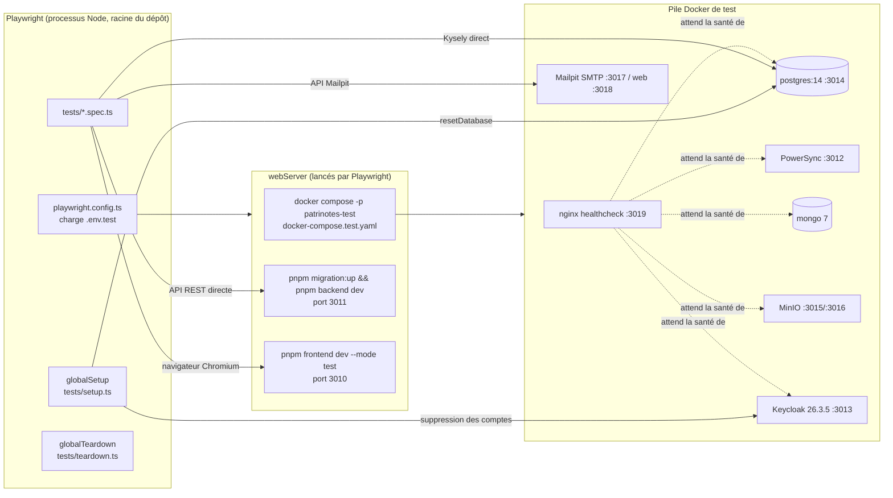

# 13 — Tests et qualité

Ce chapitre décrit la **stratégie de test**, les **outils de qualité** et les **zones non couvertes** par les tests.

En résumé : la qualité repose **surtout sur une suite e2e Playwright** (18 fichiers de specs, 87 tests) qui démarre
une pile complète en Docker et se lance à la main. Les **tests unitaires** vitest du backend (15 fichiers, 67 tests)
sont lancés par la CI avant chaque publication d'image (§ 4).

---

## 1. Vue d'ensemble

---

## 2. Suite e2e Playwright

### 2.1 Fonctionnement

- [playwright.config.ts](../playwright.config.ts) charge [.env.test](../.env.test), lance la pile Docker de test
  ([docker-compose.test.yaml](../docker-compose.test.yaml), projet `patrinotes-test`, sans volume nommé), le backend
  (après les migrations) et le frontend de développement, puis exécute les specs.
- **Exécution en série** (`workers: 1`) : les specs partagent la même base, le même Keycloak et la même boîte Mailpit.
- **Chromium desktop uniquement**. Safari iOS et Android, cibles réelles des agents sur le terrain, ne sont pas testés.
- **Sans service worker** (`serviceWorkers: "block"`) : le cache hors ligne n'est pas testé.
- Le realm Keycloak de test ([tests/realm-template.json](../tests/realm-template.json)) s'appelle `master`, comme
  celui qu'attend la configuration PowerSync du dépôt. Ses jetons durent 60 s, ce qui exerce le rafraîchissement en
  permanence. Ses valeurs (`redirectUris` et `webOrigins` à `/*` notamment) ne sont **pas à reprendre en production**.
  L'environnement de développement local utilise le même realm.
- La pile de test utilise PostgreSQL **14** (17 en développement) et l'image PowerSync `latest`, **non épinglée** :
  une nouvelle version peut casser les tests du jour au lendemain.

> [!CAUTION]
> Avant les tests, `resetDatabase()` ([tests/setup.ts](../tests/setup.ts)) **vide des tables entières** (`user`,
> `report`, `state_report`…) de la base pointée par `DATABASE_URL` et **supprime des comptes** dans le Keycloak pointé
> par `VITE_AUTH_URL`. Les deux valeurs viennent de `.env.test`. **Ne jamais lancer les tests avec un `.env.test` qui
> pointe vers une base ou un Keycloak réels.**

### 2.2 Couverture

Les specs ([tests/](../tests/)) couvrent :

- l'inscription (liste blanche, doublons, mot de passe faible), la connexion, la réinitialisation du mot de passe par
  courriel et la déconnexion (envois en attente, révocation du jeton hors ligne) ;
- les parcours complets de compte-rendu et de constat d'état : saisie, photos, dessin sur photo, génération du PDF,
  envoi et réception du courriel, plusieurs destinataires ;
- la validation hiérarchique des constats (acceptation, refus, jeton déjà utilisé ou inconnu) ;
- les alertes (constat et fiche monument) et leurs courriels, les monuments complexes à unités patrimoniales (API des
  UP en mode `mock`) et le rapport groupé ;
- les fichiers : types refusés, URL de dépôt, authentification obligatoire, liens courts `/attachment` (404, 410 après
  90 jours) ;
- la synchronisation montante `/api/upload-data` : authentification, tables non modifiables, cloisonnement par
  service, droits d'auteur et délégations, dernier écrit gagnant, alerte envoyée une seule fois ;
- l'administration (liste blanche, utilisateurs, exports, refus pour un non-administrateur) et les statistiques ;
- un test de fumée de la carte (ouverture sans erreur JavaScript).

### 2.3 Dépendances réseau des tests

Les tests ne sont **pas hermétiques**. Ils ont besoin d'Internet pour les tuiles et styles de carte (IGN,
OpenFreeMap, cadastre) et pour télécharger les images Docker absentes du cache. Les monuments de test sont insérés
directement en base : aucun import POP n'est nécessaire.

---

## 3. Intégration continue

- [main.yml](../.github/workflows/main.yml), à chaque push sur une branche publiée : lance les **tests unitaires du
  backend**, dont la réussite conditionne la publication des images, et un `pnpm audit --prod` dont le résultat n'est
  pas bloquant.
- [tests.yml](../.github/workflows/tests.yml) : tests e2e, déclenchés **à la main uniquement** (`workflow_dispatch`).
  Aucun test e2e ne tourne automatiquement sur les PR ni sur les push. Durée maximale 30 min, rapport Playwright
  conservé 7 jours en artefact. Ce workflow installe les dépendances sans `--frozen-lockfile`.
- Aucune vérification des types (`tsc`), du formatage ni du lint n'est faite en CI.

**Proposition** : déclencher `tests.yml` sur les PR vers `main` et `development`, et ajouter un contrôle
`tsc --noEmit` (scripts `check` du backend et du frontend).

---

## 4. Tests unitaires

Backend seulement : vitest, 15 fichiers, 67 tests. **Lancés en CI** par [main.yml](../.github/workflows/main.yml)
avant la construction des images. Ils ne demandent ni base ni service externe, sauf
[migration0045.test.ts](../packages/backend/src/db/migration0045.test.ts) et
[alertDelivery.test.ts](../packages/backend/src/features/alertDelivery.test.ts), qui utilisent la base de test et
sont ignorés quand elle ne tourne pas, ce qui est le cas en CI.

| Fichier | Couvre |
| --- | --- |
| [syncPolicy.test.ts](../packages/backend/src/features/sync/syncPolicy.test.ts) | Règles d'écriture de `/api/upload-data` (tables, colonnes, service, auteur, délégation, constats réservés à leur auteur, alertes de fiche, `PUT` rejoué appliqué comme une mise à jour) ; correspondance entre les colonnes déclarées et le schéma client |
| [attachmentAccess.test.ts](../packages/backend/src/features/attachmentAccess.test.ts) | Format des chemins de fichiers |
| [uploadLimits.test.ts](../packages/backend/src/features/uploadLimits.test.ts) | Types et tailles de fichiers acceptés |
| [recipients.test.ts](../packages/backend/src/features/recipients.test.ts) | Limite de 20 destinataires |
| [passwordPolicy.test.ts](../packages/backend/src/features/passwordPolicy.test.ts) | Politique de mot de passe |
| [rateLimit.test.ts](../packages/backend/src/features/rateLimit.test.ts) | Limitation de débit (429 et `Retry-After`) |
| [httpSecurity.test.ts](../packages/backend/src/features/httpSecurity.test.ts) | Origines CORS autorisées, en-têtes de sécurité |
| [errors.test.ts](../packages/backend/src/features/errors.test.ts) | 400 sur une requête refusée par le schéma |
| [email.test.ts](../packages/backend/src/features/email.test.ts) | Normalisation et masquage des courriels |
| [alertPhotos.test.ts](../packages/backend/src/features/mail/alertPhotos.test.ts) | Photos jointes ou en liens selon la taille (15 Mo) |
| [alertDelivery.test.ts](../packages/backend/src/features/alertDelivery.test.ts) | Envoi unique et reprise des alertes |
| [migration0045.test.ts](../packages/backend/src/db/migration0045.test.ts) | Reprise des pièces jointes à `is_deprecated` `NULL`, sans doublon de plan |
| [upService.test.ts](../packages/backend/src/services/upService.test.ts), [upProvider.test.ts](../packages/backend/src/features/up/upProvider.test.ts) | Arbre des unités patrimoniales, cache, réponse 404 de l'API |
| [monumentAlertRoutes.test.ts](../packages/backend/src/routes/monumentAlertRoutes.test.ts) | Destinataires d'une alerte de fiche |

Le frontend et le package `pdf` n'ont aucun test unitaire.

---

## 5. Outils de qualité

| Outil | État |
| --- | --- |
| **TypeScript** | Mode `strict` dans les trois packages. Vérification possible par `pnpm backend check` et `pnpm frontend check`, **jamais lancée en CI** ; les builds (`tsup`, Vite) ne vérifient pas les types. Le package `pdf` n'a pas de script de vérification. |
| **Prettier** 3 | Configuration dans [.prettierrc](../.prettierrc). Aucun script ni contrôle en CI : appliqué via l'éditeur. |
| **ESLint** 8 (frontend) | Script `pnpm frontend lint`, jamais lancé en CI. Nombre d'avertissements actuel à confirmer. |
| **Biome** 1.6.4 | Déclaré en dépendance, sans configuration ni script : doublon de Prettier et ESLint, choix à arbitrer. |
| Hooks Git | Absents |

Les dépendances n'ont aucun correctif local ; seul `restructure` est figé en `3.0.0`.

Le dépôt n'a ni protection de branche ni revue obligatoire visibles (pas de `CODEOWNERS`, pas de modèle de PR).
`main` correspond à la production et `development` à la préproduction.

---

## 6. Zones non couvertes par les tests (écarts)

| Domaine | Écart | Risque |
| --- | --- | --- |
| **Hors ligne** | Aucun test ne coupe le réseau pour vérifier la saisie hors ligne puis la resynchronisation, alors que c'est la promesse centrale du produit. | Élevé |
| Navigateurs | Chromium desktop uniquement. Pas de WebKit/Safari iOS (pas de SharedWorker, OPFS partiel), ni de Firefox, ni de viewport mobile. | Élevé |
| Synchronisation descendante | Pas de test multi-utilisateurs vérifiant qu'un collègue du même service reçoit les données et qu'un autre service **ne les reçoit pas** (règles de synchronisation). | Élevé (cloisonnement des données) |
| Écritures mises de côté | Le signalement des écritures refusées est testé, mais pas la mise de côté après 5 erreurs 4xx répétées. | Faible |
| Fichiers et routes PDF | Le contrôle d'accès aux fichiers et aux PDF d'un autre service n'a qu'un test unitaire de format de chemin ; pas de test e2e d'accès croisé. | Moyen |
| Mise à jour de version (service worker) | Pas de test du mécanisme anti-version périmée. | Moyen |
| Plan de situation | Aucun test de la génération du plan ni de son comportement hors ligne. Le test de fumée ne fait qu'ouvrir la carte. | Moyen |
| Contenu du PDF | Les tests vérifient la présence d'éléments, pas le rendu visuel (pas de comparaison d'images). | Faible à moyen |
| Pannes de dépendances | Pas de test e2e SMTP ou S3 indisponible, ni Keycloak lent ; la reprise des alertes en échec n'est testée qu'en unitaire (la tâche est désactivée en `NODE_ENV=test`). `/health/ready` n'a pas de test. | Moyen |
| Limitation de débit | Testée en unitaire seulement : elle est désactivée en `NODE_ENV=test`, donc dans les tests e2e. | Faible |
| Import POP | Aucun test de l'import des référentiels. | Moyen |
| Expiration des jetons de validation (7 jours) et des liens de réinitialisation | Testés indirectement au mieux. | Faible |
| Accessibilité (RGAA) | Aucun test automatisé (axe…), bien qu'une page « Accessibilité » existe. | Moyen (obligation légale) |
| Performance / charge | Aucun | Moyen |
| Unitaires | Backend seulement (§ 4) ; ni frontend, ni package `pdf` | Moyen |
