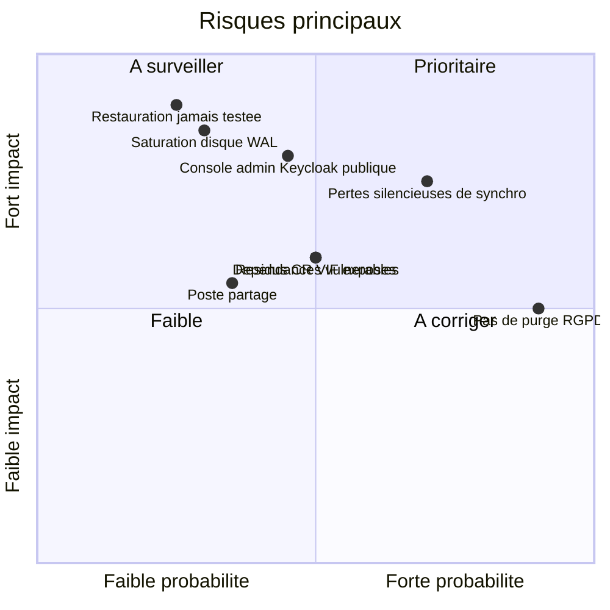

# 16 — Risques et dette technique

Ce document consolide les risques relevés pendant l'analyse du code : sécurité, perte de données, données personnelles, exploitation et dette technique. Il sert de base à l'analyse de risques de l'homologation et au plan d'action avant ou pendant le transfert vers l'infrastructure du ministère.

**Méthode.** Les constats viennent d'une lecture du code de la branche `development` (état au 17/11/2026) et du relevé de production du 17/11/2026 (lecture seule de Coolify, des bases, de Keycloak et des DNS). Ce que le relevé n'a pas pu mesurer reste marqué « à confirmer ».

> [!NOTE]
> **Production et `development`.** La production déploie `main`. Les correctifs de sécurité des PR #83 (Sentry) et #86 (contrôle d'accès) y ont été repris et **sont en production depuis le 17/11/2026**, ainsi que le `sync-config.yaml` qui filtre par service les flux de pièces jointes. La PR #85 (pertes de données) et les fiches (migrations 0037 à 0039) ne sont que dans `development`.

**Niveaux.** Critique : exploitable par un agent connecté ou perte de données avérée, à traiter avant homologation. Élevé : à traiter avant ou pendant le transfert. Moyen : à planifier. Faible : nettoyage.

## 1. Synthèse

| ID | Risque | Niveau | Détail |
| --- | --- | --- | --- |
| DAT-01 | Pertes silencieuses d'écritures de synchronisation (erreurs et refus) | **Critique** | §3 |
| SEC-06 | Aucune limitation de débit | Élevé | §2 |
| SEC-19 | Durcissement de Keycloak en production | Élevé | §2 |
| SEC-20 | Préproduction authentifiée par le Keycloak de production | Élevé | §2 |
| SEC-21 | Résidus de l'ancienne application sur le serveur de production | Élevé | §2 |
| SEC-07 | Dépendances vulnérables ou plus maintenues | Élevé | §2 |
| OPS-01 | Saturation du disque PostgreSQL par le slot de réplication (aucun plafond en production) | Élevé | §5 |
| OPS-11 | Restauration jamais testée, bucket de fichiers non sauvegardé, sauvegardes dans le même compte | Élevé | §5 |
| OPS-12 | Déploiement manuel non tracé, configuration PowerSync déposée à la main | Élevé | §5 |
| OPS-02 | Démarrage malgré une migration en échec | Élevé | §5 |
| RGPD-01 | Aucune durée de conservation appliquée | Élevé | §4 |
| RGPD-02 | Sous-traitants non déclarés | Moyen | §4 |
| SEC-04 | Rattachement libre à un service (choix assumé, journalisé) | Moyen | §2 |
| SEC-02 | Événements Sentry antérieurs au 17/11/2026 (jetons, contenu des écritures) non purgés ; purge prise en charge par l'équipe | Moyen | §2 |
| SEC-17 | Serveur et interface n'appliquent pas les mêmes droits sur les constats | Moyen | §2 |
| OPS-10 | API Dataspace des UP filtrée par adresse IP, mode `mock` par défaut | Moyen | §5 |
| SEC-08 | Liens publics de 90 jours et jetons de validation lisibles indéfiniment | Moyen | §2 |
| SEC-09 | Injection HTML dans les e-mails officiels | Moyen | §2 |
| SEC-10 | Confidentialité sur poste partagé | Moyen | §2 |
| SEC-11 | Transport non chiffré vers PostgreSQL, MongoDB sans authentification | Moyen | §2 |
| OPS-03 | `vite preview` en production | Moyen | §5 |
| SEC-22 | DMARC en `p=none`, DKIM non vérifié | Moyen | §2 |
| OPS-13 | Qualité des données POP, images jamais importées, PostgreSQL non réglé | Faible | §5 |

**Corrigés le 4/11/2026, en production depuis le 17/11/2026** (détail au §2) : SEC-01 écriture libre par `/api/upload-data` et usurpation de compte (PR #86), SEC-02 fuite de jetons et de mots de passe vers Sentry dans le code (PR #83), SEC-03 fichiers S3 non cloisonnés (PR #86), SEC-05 route `/api/authenticate` (PR #86). La perte de commentaires d'alerte, de modifications faites avant la première synchronisation et de photos rechoisies est corrigée par la PR #85 (§3), **dans `development`, pas encore en production**. SEC-18 (correctifs non livrés en production) est résolu depuis le 17/11/2026.

> Des correctifs présents sur `main` au 17/11/2026 ne sont pas encore dans `development` : e-mails mis en minuscules à l'inscription et à la connexion, réinitialisation des données locales sans perte silencieuse (DAT-06), constat envoyé refusé en écriture par le serveur (SEC-17), envoi « sous couvert » jamais direct. Ce chapitre décrit `development`.

## 2. Sécurité

### SEC-01 — Écriture libre dans la base (corrigé le 4/11/2026, PR #86, en production depuis le 17/11/2026)

**Avant** : `POST /api/upload-data` appliquait les opérations **sur n'importe quelle table** sauf `internal_user`, sans vérifier ni le service, ni le propriétaire, ni les colonnes. Un agent pouvait modifier les documents d'autres services, la liste blanche, les adresses d'alerte d'un service, et **usurper un compte** en modifiant `user.email`.

**Depuis** : liste blanche de tables et de colonnes, colonnes de propriété fixées par le serveur, contrôle du service, de l'auteur et des délégations, une transaction par opération ([syncPolicy.ts](../packages/backend/src/features/sync/syncPolicy.ts)). **Reste** : valeurs non validées, refus silencieux (DAT-01), identification par e-mail plutôt que par `sub` Keycloak. Voir [05 §8](05-authentification-securite.md).

### SEC-02 — Fuites vers Sentry (corrigé le 4/11/2026, PR #83, en production depuis le 17/11/2026 ; reste moyen)

**Avant** : le backend envoyait `request.body` (dont **le mot de passe en clair** en cas d'erreur de connexion ou d'inscription) et un événement par e-mail avec le document et ses destinataires ; le frontend transmettait les `console.log`, dont **le jeton d'accès et le jeton hors ligne**.

**Depuis** : `beforeSend` filtre corps, utilisateur et clés sensibles, plus de journaux console, plus de message par e-mail, échantillonnage à 10 %. **Reste, hors code** : purger les événements existants (pris en charge par l'équipe), héberger Sentry sur une instance acceptée par le ministère. Le filtre repose sur les noms de clés. Voir [12](12-exploitation-et-supervision.md).

**En production** (relevé du 17/11/2026) : le backend n'a pas de DSN, donc aucun mot de passe n'y est parti ; le frontend a envoyé ses journaux, jetons compris, à `sentry.incubateur.net` jusqu'au déploiement du correctif le 17/11/2026.

### SEC-03 — Fichiers non cloisonnés (corrigé le 4/11/2026, PR #86, en production depuis le 17/11/2026)

**Avant** : `/api/upload/attachment/presigned-url` et `/api/upload/attachment` acceptaient **n'importe quel chemin** : un agent pouvait lire ou écraser un PDF d'un autre service ; les flux PowerSync de pièces jointes et les routes PDF ne vérifiaient pas le service.

**Depuis** : lecture et dépôt limités au service du document, dépôt et envoi des PDF réservés à qui peut modifier le document, flux de pièces jointes filtrés par service (en production, par mise à jour manuelle du `sync-config.yaml` le 17/11/2026). **Reste** : aucune limite de taille ni de type ; une URL de dépôt est délivrée pour un document pas encore en base.

### SEC-04 — Rattachement libre à un service (moyen)

`/api/change-service` permet de rejoindre n'importe quel service et d'en lire les données. C'est un **choix assumé** (décision du 4/11/2026) ; chaque changement est tracé dans `transactions`. À réexaminer pour l'homologation (validation par un administrateur, ou liste d'affectations).

### SEC-05 — `/api/authenticate` (supprimée le 4/11/2026, PR #86, en production depuis le 17/11/2026)

La route, inutilisée, créait des comptes sans liste blanche. Elle est supprimée.

### SEC-17 — Droits différents entre serveur et interface (moyen)

Le serveur accepte la délégation sur les constats (l'interface non) et ne bloque pas la modification d'un constat déjà envoyé (l'interface oui). Un client modifié peut donc changer un constat envoyé. En production, ce dernier point est corrigé : `main` refuse côté serveur la modification d'un constat envoyé (`2d67bfb`). **Recommandation** : reporter ce correctif dans `development` et aligner les deux règles.

### SEC-18 — Correctifs de sécurité non livrés en production (résolu le 17/11/2026)

Le relevé de production du 17/11/2026 a montré que la production (`main`) n'avait pas les PR #83 et #86 et que son `sync-config.yaml` ne filtrait pas par service les flux de pièces jointes. Les correctifs ont été repris sur `main` (`12cd081`, `60b393a`, `559f208`) et déployés le soir même ; le `sync-config.yaml` a été mis à jour et PowerSync redémarré.

### SEC-06 — Pas de limitation de débit (élevé)

Aucune limitation sur l'API, y compris `/api/login-user`, `/api/create-user`, la réinitialisation de mot de passe (qui permet de savoir si un compte existe) et les routes publiques. La protection contre la force brute repose donc entièrement sur Keycloak (voir SEC-19).

### SEC-19 à SEC-21 — Exposition de l'hébergement actuel (élevé)

Le détail de ces constats (réglages, noms d'hôte, ports) n'est pas reproduit dans ce dépôt public ; il figure dans le relevé de sécurité du 17/11/2026 transmis au ministère.

- **SEC-19** : réglages de sécurité du Keycloak de production (mots de passe, force brute, durées de session, exposition de l'administration). **Recommandation** : appliquer les durcissements du relevé.
- **SEC-20** : la préproduction s'authentifie sur le Keycloak de production. Une fausse manipulation en préproduction touche la production. **Recommandation** : Keycloak ou realm dédié à la préproduction.
- **SEC-21** : résidus de l'ancienne application sur le même serveur, dont certains exposés. **Recommandation** : arrêter et supprimer ces services après une dernière sauvegarde. Voir [10](10-infrastructure-et-deploiement.md) § 6.0.

### SEC-07 — Dépendances (élevé)

`pnpm audit` sur le backend : 88 vulnérabilités dont 2 critiques et 56 élevées (relevé au moment de l'analyse). Fastify 4 n'est plus maintenu, Node 20 non plus depuis avril 2026, Sentry v7, image PowerSync `:latest` non épinglée. La CI publie les images **sans test ni audit**. Voir [05](05-authentification-securite.md) §11.

### Autres points de sécurité

| ID | Constat | Recommandation |
| --- | --- | --- |
| SEC-08 | Liens `/attachment/:id` publics pendant 90 jours ; nom du fichier de CR contenant le nom du demandeur. Jeton de validation lisible sans limite après décision. Lien S3 pré-signé de 7 jours après validation. | Durée alignée sur le texte (1 mois), nom de fichier neutre, expiration après décision. |
| SEC-09 | Textes saisis (commentaires, titres, préconisations, motif de refus) insérés **sans échappement** dans le HTML des e-mails, sauf pour les alertes de fiche ; tout agent peut envoyer un e-mail officiel à n'importe quelle adresse. | Échapper, limiter le nombre de destinataires, journaliser. |
| SEC-10 | La déconnexion ne vide pas la base locale ni la file d'écritures et ne révoque pas le jeton hors ligne. Jetons stockés en IndexedDB, lisibles par un script injecté. | Purge locale à la déconnexion (après envoi des écritures), révocation, CSP. |
| SEC-11 | `ssl:false` en dur vers PostgreSQL, `sslmode: disable` pour PowerSync, MongoDB sans authentification et port publié dans le Compose de développement ; pas de rôle de réplication dédié pour PowerSync. | Paramétrer TLS, authentifier MongoDB, rôle de réplication dédié, ne rien publier hors réseau interne. |
| SEC-12 | CORS `*`, pas d'en-têtes de sécurité, pas de CSP. | Restreindre l'origine, ajouter les en-têtes au reverse proxy. |
| SEC-13 | Jeton de réinitialisation haché en MD5 ; pas de politique de mot de passe côté serveur. | Utiliser le parcours Keycloak natif ou un hachage moderne. |
| SEC-14 | Télémétrie PowerSync active (bloc `telemetry` mal indenté). | Corriger l'indentation, `disable_telemetry_sharing: true`. |
| SEC-15 | Dictée vocale par Web Speech API : sur Chrome, l'audio part chez Google. | À valider par le ministère ou à désactiver. |
| SEC-16 | Contexte de build Docker non filtré (`.git`, `.env*`, jar). | Compléter [.dockerignore](../.dockerignore). |
| SEC-22 | DMARC en `p=none` sur `patrinotes.beta.gouv.fr` et `compte-rendu-vif.beta.gouv.fr` ; DKIM introuvable publiquement. Un tiers peut usurper l'adresse d'expédition des courriels officiels sans qu'ils soient rejetés. | Relever le sélecteur DKIM de Scaleway TEM, puis passer DMARC en `quarantine` puis `reject`. |

## 3. Intégrité et perte de données

| ID | Constat | Effet | Recommandation |
| --- | --- | --- | --- |
| DAT-01 | Sur erreur SQL **ou refus de droits** (depuis le 4/11/2026), `/api/upload-data` répond **HTTP 200** `success:false` ; le client considère l'opération envoyée. | **Écriture perdue sans message.** Traces : `transactions`, journaux, message Sentry pour un refus. | Répondre en erreur, distinguer erreurs récupérables et définitives, remonter l'erreur dans l'interface. |
| DAT-02 | Le dépôt S3 par URL pré-signée ne vérifie pas `response.ok`. | Photo ou PDF marqué envoyé mais absent ; erreur `NoSuchKey` plus tard. | Vérifier le statut et réessayer. |
| DAT-03 | Un `PUT` rejoué est refusé (« la ligne existe déjà »). | Sans effet si la ligne est identique ; les colonnes modifiées dans le même `PUT` sont perdues. | `INSERT … ON CONFLICT DO UPDATE`. |
| DAT-04 | Utilisateur absent de la table `user` : chaque écriture reçoit 200 `Unauthorized` (avant le 4/11/2026 : 500 répétée et file bloquée). | Toutes les écritures de l'appareil sont perdues sans message. | Gérer le cas explicitement. |
| DAT-05 | L'envoi du PDF lit PostgreSQL alors que le PDF est construit depuis la base locale, sans attendre la file d'écritures. | Courriel avec données obsolètes, ou 404. | Attendre la fin de l'envoi des écritures. |
| DAT-06 | « Réinitialiser les données locales » efface les écritures non envoyées sans confirmation. | Perte de travail terrain. | Confirmation, envoi préalable. |
| DAT-07 | Lignes avec `is_deprecated` NULL jamais synchronisées. (`constat_validation` est absente de la publication de production, ce qui est confirmé, mais sans effet car le frontend ne l'utilise pas.) | Photos invisibles côté client. | Migration corrective ; retirer la requête inutile de `sync-config.yaml`. |
| DAT-08 | Alertes marquées envoyées même en cas d'échec SMTP ; aucun réessai ni file d'envoi. | Alerte patrimoniale jamais reçue. | File d'envoi avec réessais. |
| DAT-09 | `ON DELETE SET NULL` sur des colonnes `NOT NULL` (`user.service_id`, `report.createdBy`). | Suppressions en échec. | Revoir les contraintes. |
| DAT-10 | Alerte de fiche validée hors ligne : envoyée seulement par le navigateur de son auteur, au retour du réseau. | Alerte jamais envoyée si l'appareil ne revient pas en ligne. | Envoi côté serveur après synchronisation. |

Corrigés le 4/11/2026 (PR #85), **dans `development`, pas encore en production** : commentaire et destinataires d'une alerte créée pendant la session jamais enregistrés (donc alerte non envoyée) ; modification du profil ou du service perdue juste après l'inscription ; photo ignorée quand on rechoisit le même fichier. Voir [03](03-frontend-pwa.md) et [08](08-synchronisation-hors-ligne.md).

## 4. Données personnelles (RGPD)

Inventaire détaillé dans [05](05-authentification-securite.md) et [06](06-modele-de-donnees.md). Données concernées : agents (nom, e-mail, fonction), demandeurs et propriétaires (nom, adresse, e-mail, référence cadastrale), personnes présentes, validateurs, destinataires, photos.

| ID | Constat | Recommandation |
| --- | --- | --- |
| RGPD-01 | La politique de confidentialité annonce des durées (2 ans, 1 an) mais **aucune purge n'existe** : ni en base, ni dans `transactions` (copie intégrale de toutes les écritures), ni sur S3, ni dans Sentry. Les sauvegardes de la base Keycloak, de la préproduction et de l'ancienne base CR VIF sont gardées **sans limite de durée** (celles de la base de production : 7 jours en local, 90 jours sur S3). | Tâches planifiées de purge, durée de vie sur le bucket et sur toutes les sauvegardes. |
| RGPD-02 | La page de confidentialité cite OVH et Brevo. Le code utilise aussi Sentry, un stockage S3, Scaleway (stockage objet et SMTP), Matomo (`stats.beta.gouv.fr`), OpenFreeMap, l'IGN, `openmaptiles.geo.data.gouv.fr`, l'API Adresse et, via le navigateur, la reconnaissance vocale de Google. | Mettre à jour la liste des sous-traitants et destinataires selon l'hébergement cible. |
| RGPD-03 | Journaux applicatifs non structurés, avec e-mails, objets utilisateur Keycloak et URL contenant jetons et identifiants de liens. | Niveaux de journalisation, masquage. |
| RGPD-04 | L'acceptation des CGU est envoyée à l'inscription mais **pas enregistrée**. | Stocker la date d'acceptation. |
| RGPD-05 | `constat_pdf_download` trace les téléchargements par agent. | Déclarer la finalité ou supprimer. |

## 5. Exploitation

| ID | Constat | Recommandation |
| --- | --- | --- |
| OPS-01 | Si PowerSync est arrêté, le slot de réplication retient le WAL **sans limite** : c'est le réglage de production (`max_slot_wal_keep_size = -1`). Le disque PostgreSQL peut se remplir et arrêter **toute** l'application. Perdre MongoDB laisse un slot orphelin ; sur l'ancienne base CR VIF du même serveur, un slot inactif retient déjà 46 Mo de WAL. | Définir `max_slot_wal_keep_size`, superviser `pg_replication_slots`, procédure de nettoyage. Voir [12](12-exploitation-et-supervision.md) §4.1. |
| OPS-02 | `CMD pnpm migration:up;pnpm backend start` démarre même si la migration échoue ; forme *shell* qui ne relaie pas les signaux ; migrations concurrentes avec plusieurs réplicas. | Tâche de migration séparée, `&&`, forme *exec*. |
| OPS-03 | Frontend servi par `vite preview`, domaines autorisés codés en dur. | Serveur statique (nginx, Caddy) avec génération de `env.js` au démarrage. |
| OPS-04 | `/health` statique : ne vérifie ni la base ni S3. | Ajouter un point de *readiness*. |
| OPS-05 | Images de production avec chaîne de compilation, dépendances de développement et bibliothèques natives inutiles (`canvas`). | Étape d'exécution allégée. |
| OPS-06 | Étiquettes d'images mutables (`:backend`, `:frontend`) sans SHA : retour arrière difficile. | Étiqueter par commit. |
| OPS-07 | Aucune tâche planifiée, ni dans le code ni dans Coolify : imports POP (dernier import des immeubles après le 06/05/2026), purge, compaction PowerSync manuels ou absents. | Planificateur (cron, tâche Kubernetes). |
| OPS-11 | Sauvegardes (relevé du 17/11/2026) : base de production sauvegardée **seulement depuis le 28/10/2026** ; **aucune restauration jamais testée** ; bucket de fichiers `patrinotes-prod` sans sauvegarde visible ; sauvegardes stockées dans le **même compte et la même région Scaleway** que les données ; thème et configurations PowerSync hors sauvegarde. | Tester une restauration complète, sauvegarder ou versionner le bucket, copier les sauvegardes hors du compte. |
| OPS-12 | Déploiements lancés à la main dans Coolify, sans trace de la version (`commit = HEAD`) ; `sync-config.yaml` et `powersync-config.yaml` déposés à la main sur le serveur ; PowerSync en `latest` (redémarré à la main le 17/11/2026 après mise à jour de ses règles). | Tag par commit, déploiement déclenché par la CI, configuration PowerSync versionnée et déployée avec l'application. |
| OPS-13 | 4 541 objets POP avec un champ date invalide (colonnes décalées ou encodage) ; `pop_images` vide (images jamais importées) ; `shared_buffers` à 128 Mo (défaut) sur un serveur de 31 Go ; empreinte de la migration 0000 différente du fichier du dépôt. | Contrôler l'import, régler PostgreSQL, ne plus modifier une migration appliquée. |
| OPS-08 | Import des photos POP par *scraping* HTML de `pop.culture.gouv.fr` (jusqu'à environ 10 requêtes/s), fragile et sans accord formalisé. | Accord avec l'équipe POP ou API officielle. |
| OPS-09 | Rechargement silencieux à la mise à jour, possible pendant une saisie. | Inviter l'utilisateur à recharger. |
| OPS-10 | L'API Dataspace des unités patrimoniales n'est joignable que depuis le réseau de production (filtrage IP) ; `UP_API_MODE` vaut `mock` par défaut. | Faire autoriser l'adresse de sortie de l'hébergement cible ; vérifier `UP_API_MODE=live` après la bascule. Le cache `up_cache` sert de secours. |

## 6. Dette technique

| Sujet | Constat |
| --- | --- |
| Code mort | `relations.ts` (ne compile pas), `_merimee.ts` et la table `merimee`, la table `pictures` (pourtant synchronisée en entier à tous), `udap.json`, `addPDFToReport` (construit `https://https://…`), `SpeechRecorder.tsx`, `template-generique.html`, plugin *multipart* sans route, `swEnv.js` jamais chargé, `public/pdfjs`, `wa-sqlite-async`. |
| Dépendances inutiles | Backend : `@react-pdf/renderer`, `react-pdf-html`, `canvas`, `jsdom`, `fastify-multer`, `@aws-sdk/lib-storage`, `jose`, `postgres`, `ws`, `@keycloak/keycloak-admin-client`, `@fastify/swagger-ui`. Frontend : `npm`, `install`, `@rawwee/react-pdf-html`. |
| Correctif orphelin | [patches/react-pdf-html@2.0.4.patch](../patches/react-pdf-html@2.0.4.patch) n'est plus appliqué (pas de `patchedDependencies`, version résolue 2.1.5). |
| Configuration | `.env.dist` obsolète (variables ElectricSQL, AWS, proxy PG) et incomplet (une quinzaine de variables obligatoires manquantes) ; variables obligatoires inutilisées. `.env.test` est la vraie référence. |
| Documentation | README : pnpm 8.4.0 au lieu de 10.12.4 (le `package.json` déclare bien `packageManager: pnpm@10.12.4` depuis le 4/11/2026), noms de fichiers CSV erronés, `clearDb.sh` au lieu de `clear-db.sh`. [db-workflow.png](../images/db-workflow.png) montre l'ancienne architecture ElectricSQL/Prisma. |
| Client d'API | `openapi.json` et `api.gen.ts` incohérents : `/api/authenticate` (supprimée) y figure encore et sert à typer `AuthUser` ; `/api/monument-alert/send` manque dans `openapi.json`. |
| Hébergement historique | [Procfile](../Procfile) et [scalingo.json](../scalingo.json) obsolètes ; branche `compte-rendu-vif` inactive mais encore construite par la CI. |
| Erreurs HTTP | Erreurs de validation TypeBox renvoyées en 500. Les routes de validation renvoient bien 404 et 410 depuis le 4/11/2026 (PR #84). |
| Modèle de données | Peu de clés étrangères et d'index ; formats sérialisés sans échappement ; type Kysely `Database` maintenu à la main. |
| Tests | e2e réparés (72/72 le 4/11/2026) mais lancés à la main, Chromium seul, sans service worker, pas de test hors ligne ni iOS. Tests unitaires backend (règles d'écriture, UP) non lancés en CI. PostgreSQL 14 en test, 17 en développement. Biome, Prettier, ESLint et `tsc` jamais lancés en CI. Voir [13](13-tests-et-qualite.md). |
| Bugs fonctionnels | Question « bilan quinquennal » jamais affichée ; alerte Sécurité sans adresse ; duplication d'un CR envoyé ; `?mode=edit` sans écran ; onglet par défaut `"all"` ; CR PDF non trié ; statistiques « abandonné » calculées différemment pour CR et constats. |
| Valeurs codées en dur | Statistiques publiques (1 102 agents, « 2026 », 46 000), Matomo `siteId` 123, codes région, centre de carte par défaut, région S3. |

## 7. Plan d'action proposé

| Priorité | Action | Risques traités |
| --- | --- | --- |
| **Immédiat** | Purger les événements Sentry antérieurs (équipe) ; restreindre la console Keycloak ; supprimer les résidus CR VIF et fermer les ports hors Traefik | SEC-02, SEC-19, SEC-21 |
| **Immédiat** | Plafonner `max_slot_wal_keep_size`, supprimer le slot inactif CR VIF ; tester une restauration ; sauvegarder le bucket hors du compte | OPS-01, OPS-11 |
| Fait (4/11/2026, en production le 17/11/2026) | Contrôle d'accès sur `/api/upload-data`, les fichiers et les PDF ; suppression de `/api/authenticate` ; filtrage Sentry ; journal des changements de service ; `sync-config.yaml` de production filtré par service | SEC-01, 02, 03, 04, 05, 18 |
| Avant homologation | Correction des erreurs et refus silencieux de synchro et de dépôt S3 | DAT-01 à 04 |
| Avant homologation | Durcissement de Keycloak, Keycloak dédié à la préproduction, DMARC en `reject` | SEC-19, SEC-20, SEC-22 |
| Avant homologation | Aligner les droits du serveur et de l'interface (reporter les correctifs de `main` dans `development`) ; limitation de débit | SEC-17, SEC-06 |
| Pendant le transfert | `max_slot_wal_keep_size`, supervision du slot, TLS PostgreSQL, MongoDB authentifié, versions épinglées ; ouverture de l'API Dataspace à la nouvelle adresse de sortie | OPS-01, SEC-11, OPS-10 |
| Pendant le transfert | Serveur statique pour le frontend, migration séparée du démarrage, images allégées et étiquetées par commit, déploiement tracé avec la configuration PowerSync | OPS-02, 03, 05, 06, 12 |
| Pendant le transfert | Montée Node, Fastify, Sentry ; audit en CI | SEC-07 |
| Après le transfert | Purges RGPD (base, S3, sauvegardes), mise à jour des mentions, CSP, réexamen du changement de service libre | RGPD-01 à 05, SEC-04, 12 |
| Continu | Nettoyage du code mort, tests de cloisonnement et hors ligne | §6 |
