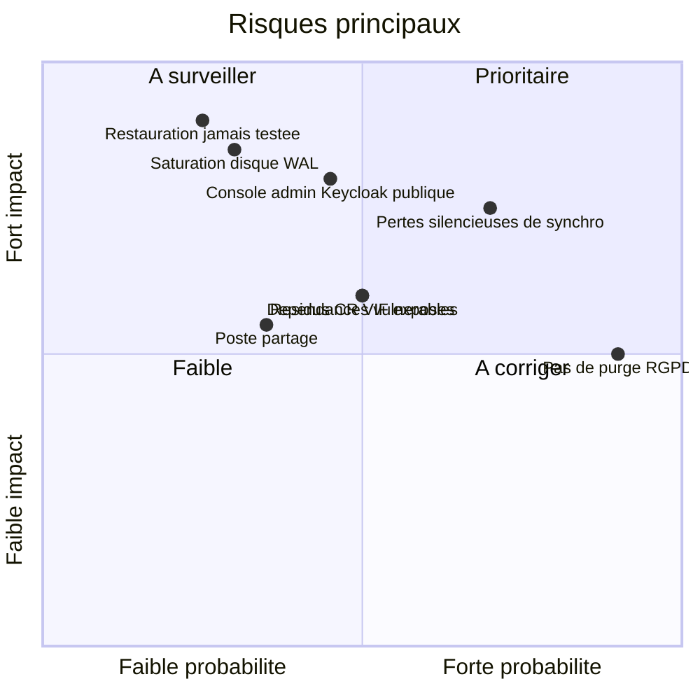

# 16 — Risques et dette technique

Ce document consolide les risques relevés pendant l'analyse du code : sécurité, perte de données, données personnelles, exploitation et dette technique. Il sert de base à l'analyse de risques de l'homologation et au plan d'action avant ou pendant le transfert vers l'infrastructure du ministère.

**Méthode.** Les constats viennent d'une lecture du code de la branche `development` (état au 23/11/2026) et du relevé de production du 17/11/2026 (lecture seule de Coolify, des bases, de Keycloak et des DNS). Ce que le relevé n'a pas pu mesurer reste marqué « à confirmer ».

**Niveaux.** Critique : exploitable par un agent connecté ou perte de données avérée, à traiter avant homologation. Élevé : à traiter avant ou pendant le transfert. Moyen : à planifier. Faible : nettoyage.

## 1. Synthèse

| ID | Risque | Niveau | Détail |
| --- | --- | --- | --- |
| DAT-01 | Pertes silencieuses d'écritures de synchronisation (erreurs et refus) | **Critique** | §3 |
| DAT-11 | PDF impossible hors ligne pour un document jamais ouvert en ligne ; worker pdf.js non précaché pouvant rendre l'application inutilisable hors ligne | Élevé | §3 |
| SEC-06 | Aucune limitation de débit | Élevé | §2 |
| SEC-19 | Durcissement de Keycloak en production | Élevé | §2 |
| SEC-20 | Préproduction authentifiée par le Keycloak de production | Élevé | §2 |
| SEC-21 | Résidus de l'ancienne application sur le serveur de production | Élevé | §2 |
| SEC-07 | Dépendances vulnérables ou plus maintenues | Élevé | §2 |
| OPS-01 | Saturation du disque PostgreSQL par le slot de réplication (aucun plafond en production) | Élevé | §5 |
| OPS-11 | Restauration jamais testée, bucket de fichiers non sauvegardé, sauvegardes dans le même compte | Élevé | §5 |
| OPS-12 | Déploiement manuel non tracé, configuration PowerSync déposée à la main | Élevé | §5 |
| OPS-02 | Démarrage malgré une migration en échec | Élevé | §5 |
| RGPD-01 | Aucune durée de conservation appliquée | Élevé | §4 |
| RGPD-02 | Sous-traitants non déclarés | Moyen | §4 |
| SEC-04 | Rattachement libre à un service (choix assumé, journalisé) | Moyen | §2 |
| SEC-17 | Serveur et interface n'appliquent pas la même règle de délégation sur les constats | Faible | §2 |
| OPS-10 | API Dataspace des UP filtrée par adresse IP, mode `mock` par défaut | Moyen | §5 |
| SEC-08 | Liens publics de 90 jours et jetons de validation lisibles indéfiniment | Moyen | §2 |
| SEC-09 | Injection HTML dans les e-mails officiels | Moyen | §2 |
| SEC-10 | Confidentialité sur poste partagé | Moyen | §2 |
| SEC-11 | Transport non chiffré vers PostgreSQL, MongoDB sans authentification | Moyen | §2 |
| OPS-03 | `vite preview` en production | Moyen | §5 |
| SEC-22 | DMARC en `p=none`, DKIM non vérifié | Moyen | §2 |
| OPS-13 | Qualité des données POP, images jamais importées, PostgreSQL non réglé | Faible | §5 |

Les identifiants ne se suivent pas : ils sont stables d'une version du dossier à l'autre, et ceux des risques qui ne se posent plus ne sont pas réattribués.

## 2. Sécurité

### Contrôles en place

Le serveur contrôle chaque écriture de synchronisation : liste blanche de tables et de colonnes, colonnes de propriété fixées par le serveur, contrôle du service, de l'auteur et des délégations, une transaction par opération ([syncPolicy.ts](../packages/backend/src/features/sync/syncPolicy.ts)). Un constat envoyé n'est plus modifiable, sauf s'il a été refusé par le validateur. Les fichiers S3 et les PDF sont limités au service du document ; les flux PowerSync de pièces jointes sont filtrés par service. Sentry ne reçoit ni corps de requête, ni jetons, ni journaux console (`beforeSend`, échantillonnage à 10 %). Détail dans [05](05-authentification-securite.md) §7, §8 et §10.

Limites de ces contrôles : les valeurs écrites ne sont pas validées, un refus est silencieux pour l'agent (DAT-01), l'utilisateur est identifié par son courriel plutôt que par le `sub` Keycloak, et le dépôt de fichiers n'a ni limite de taille ni contrôle de type (une URL de dépôt est délivrée pour un document pas encore en base). Le filtre Sentry repose sur des noms de clés.

### SEC-04 — Rattachement libre à un service (moyen)

`/api/change-service` permet de rejoindre n'importe quel service et d'en lire les données. C'est un **choix assumé** de l'équipe ; chaque changement est tracé dans `transactions`. À réexaminer pour l'homologation (validation par un administrateur, ou liste d'affectations).

### SEC-17 — Délégation sur les constats (faible)

Le serveur accepte qu'un agent ayant reçu une délégation modifie les constats de son collègue ; l'interface ne le propose pas (seul l'auteur peut modifier un constat). **Recommandation** : choisir une règle et l'appliquer aux deux.

### SEC-06 — Pas de limitation de débit (élevé)

Aucune limitation sur l'API, y compris `/api/login-user`, `/api/create-user`, la réinitialisation de mot de passe (qui permet de savoir si un compte existe) et les routes publiques. La protection contre la force brute repose donc entièrement sur Keycloak (voir SEC-19).

### SEC-19 à SEC-21 — Hébergement actuel (élevé)

Le détail de ces constats (réglages, noms d'hôte, ports) n'est pas reproduit dans ce dépôt public ; il figure dans le relevé de sécurité transmis au ministère.

- **SEC-19** : réglages de sécurité du Keycloak de production (mots de passe, force brute, durées de session, exposition de l'administration). **Prévu par l'équipe avant le transfert** : protection contre la force brute, politique de mot de passe, accès restreint à la console d'administration.
- **SEC-20** : la préproduction s'authentifie sur le Keycloak de production. Une fausse manipulation en préproduction touche la production. **Recommandation** : Keycloak ou realm dédié à la préproduction.
- **SEC-21** : des services de l'ancienne application CR VIF tournent encore sur le même serveur, dont certains sont joignables depuis Internet. **Prévu par l'équipe avant le transfert** : arrêter et supprimer ces services après une dernière sauvegarde. Voir [10](10-infrastructure-et-deploiement.md) § 6.0.

### SEC-07 — Dépendances (élevé)

`pnpm audit` sur le backend : 88 vulnérabilités dont 2 critiques et 56 élevées (relevé au moment de l'analyse). Fastify 4 n'est plus maintenu, Node 20 non plus depuis avril 2026, Sentry v7, image PowerSync `:latest` non épinglée. La CI publie les images **sans test ni audit**. Voir [05](05-authentification-securite.md) §11.

### Autres points de sécurité

| ID | Constat | Recommandation |
| --- | --- | --- |
| SEC-08 | Liens `/attachment/:id` publics pendant 90 jours ; nom du fichier de CR contenant le nom du demandeur. Jeton de validation lisible sans limite après décision. Lien S3 pré-signé de 7 jours après validation. | Durée plus courte si le métier l'accepte, nom de fichier neutre, expiration après décision. |
| SEC-09 | Textes saisis (commentaires, titres, préconisations, motif de refus) insérés **sans échappement** dans le HTML des e-mails, sauf pour les alertes de fiche ; tout agent peut envoyer un e-mail officiel à n'importe quelle adresse. | Échapper, limiter le nombre de destinataires, journaliser. |
| SEC-10 | La déconnexion ne vide pas la base locale ni la file d'écritures et ne révoque pas le jeton hors ligne. Jetons stockés en IndexedDB, lisibles par un script injecté. | Purge locale à la déconnexion (après envoi des écritures), révocation, CSP. |
| SEC-11 | `ssl:false` en dur vers PostgreSQL, `sslmode: disable` pour PowerSync, MongoDB sans authentification et port publié dans le Compose de développement ; pas de rôle de réplication dédié pour PowerSync. | Paramétrer TLS, authentifier MongoDB, rôle de réplication dédié, ne rien publier hors réseau interne. |
| SEC-12 | CORS `*`, pas d'en-têtes de sécurité, pas de CSP. | Restreindre l'origine, ajouter les en-têtes au reverse proxy. |
| SEC-13 | Jeton de réinitialisation de mot de passe haché en MD5 ; pas de politique de mot de passe côté serveur. | Hacher le jeton en SHA-256 (ou passer par le parcours natif de Keycloak) ; appliquer la politique de mot de passe côté serveur. |
| SEC-14 | Télémétrie PowerSync active (bloc `telemetry` mal indenté). | Corriger l'indentation, `disable_telemetry_sharing: true`. |
| SEC-15 | Dictée vocale par Web Speech API : sur Chrome, l'audio part chez Google. | À valider par le ministère ou à désactiver. |
| SEC-16 | Contexte de build Docker non filtré (`.git`, `.env*`, jar). | Compléter [.dockerignore](../.dockerignore). |
| SEC-22 | DMARC en `p=none` sur `patrinotes.beta.gouv.fr` et `compte-rendu-vif.beta.gouv.fr` ; DKIM introuvable publiquement. Un tiers peut usurper l'adresse d'expédition des courriels officiels sans qu'ils soient rejetés. | Relever le sélecteur DKIM de Scaleway TEM, puis passer DMARC en `quarantine` puis `reject`. |

## 3. Intégrité et perte de données

| ID | Constat | Effet | Recommandation |
| --- | --- | --- | --- |
| DAT-01 | Sur erreur SQL **ou refus de droits**, `/api/upload-data` répond **HTTP 200** `success:false` ; le client considère l'opération envoyée. | **Écriture perdue sans message.** Traces : `transactions`, journaux, message Sentry pour un refus. | Répondre en erreur, distinguer erreurs récupérables et définitives, remonter l'erreur dans l'interface. |
| DAT-02 | Le dépôt S3 par URL pré-signée ne vérifie pas `response.ok`. | Photo ou PDF marqué envoyé mais absent ; erreur `NoSuchKey` plus tard. | Vérifier le statut et réessayer. |
| DAT-03 | Un `PUT` rejoué est refusé (« la ligne existe déjà »). | Sans effet si la ligne est identique ; les colonnes modifiées dans le même `PUT` sont perdues. | `INSERT … ON CONFLICT DO UPDATE`. |
| DAT-04 | Utilisateur absent de la table `user` : chaque écriture reçoit 200 `Unauthorized`. | Toutes les écritures de l'appareil sont perdues sans message. | Gérer le cas explicitement. |
| DAT-05 | L'envoi du PDF lit PostgreSQL alors que le PDF est construit depuis la base locale, sans attendre la file d'écritures. | Courriel avec données obsolètes, ou 404. | Attendre la fin de l'envoi des écritures. |
| DAT-07 | Lignes avec `is_deprecated` NULL jamais synchronisées. (`constat_validation` est absente de la publication de production, ce qui est confirmé, mais sans effet car le frontend ne l'utilise pas.) | Photos invisibles côté client. | Migration corrective ; retirer la requête inutile de `sync-config.yaml`. |
| DAT-08 | Alertes marquées envoyées même en cas d'échec SMTP ; aucun réessai ni file d'envoi. | Alerte patrimoniale jamais reçue. | File d'envoi avec réessais. |
| DAT-09 | `ON DELETE SET NULL` sur des colonnes `NOT NULL` (`user.service_id`, `report.createdBy`). | Suppressions en échec. | Revoir les contraintes. |
| DAT-11 | PDF impossible hors ligne pour un document jamais ouvert en ligne (pages PDF qui attendent `hasSynced`) ; worker pdf.js non précaché, dont l'échec déclenche le vidage des caches et rend l'application inutilisable hors ligne. | Agent bloqué sur le terrain, application à recharger en ligne. | Précacher les `.mjs`, restreindre la récupération des *chunks* périmés, ne pas attendre la synchronisation hors ligne. Voir [09](09-documents-pdf-cartes-emails.md) § 12. |
| DAT-10 | Alerte de fiche validée hors ligne : envoyée seulement par le navigateur de son auteur, au retour du réseau. | Alerte jamais envoyée si l'appareil ne revient pas en ligne. | Envoi côté serveur après synchronisation. |

## 4. Données personnelles (RGPD)

Inventaire détaillé dans [05](05-authentification-securite.md) et [06](06-modele-de-donnees.md). Données concernées : agents (nom, e-mail, fonction), demandeurs et propriétaires (nom, adresse, e-mail, référence cadastrale), personnes présentes, validateurs, destinataires, photos.

| ID | Constat | Recommandation |
| --- | --- | --- |
| RGPD-01 | La politique de confidentialité annonce des durées (2 ans, 1 an) mais **aucune purge n'existe** : ni en base, ni dans `transactions` (copie intégrale de toutes les écritures), ni sur S3, ni dans Sentry. Les sauvegardes de la base Keycloak, de la préproduction et de l'ancienne base CR VIF sont gardées **sans limite de durée** (celles de la base de production : 7 jours en local, 90 jours sur S3). | Tâches planifiées de purge, durée de vie sur le bucket et sur toutes les sauvegardes. |
| RGPD-02 | La page de confidentialité cite OVH et Brevo. Le code utilise aussi Sentry, un stockage S3, Scaleway (stockage objet et SMTP), Matomo (`stats.beta.gouv.fr`), OpenFreeMap, l'IGN, `openmaptiles.geo.data.gouv.fr`, l'API Adresse et, via le navigateur, la reconnaissance vocale de Google. | Mettre à jour la liste des sous-traitants et destinataires selon l'hébergement cible. |
| RGPD-03 | Journaux applicatifs non structurés, avec e-mails, objets utilisateur Keycloak et URL contenant jetons et identifiants de liens. | Niveaux de journalisation, masquage. |
| RGPD-04 | L'acceptation des CGU est envoyée à l'inscription mais **pas enregistrée**. | Stocker la date d'acceptation. |
| RGPD-05 | `constat_pdf_download` trace les téléchargements par agent. | Déclarer la finalité ou supprimer. |

## 5. Exploitation

| ID | Constat | Recommandation |
| --- | --- | --- |
| OPS-01 | Si PowerSync est arrêté, le slot de réplication retient le WAL **sans limite** : c'est le réglage de production (`max_slot_wal_keep_size = -1`). Le disque PostgreSQL peut se remplir et arrêter **toute** l'application. Perdre MongoDB laisse un slot orphelin ; sur l'ancienne base CR VIF du même serveur, un slot inactif retient déjà 46 Mo de WAL. | Définir `max_slot_wal_keep_size`, superviser `pg_replication_slots`, procédure de nettoyage. Voir [12](12-exploitation-et-supervision.md) §4.1. |
| OPS-02 | `CMD pnpm migration:up;pnpm backend start` démarre même si la migration échoue ; forme *shell* qui ne relaie pas les signaux ; migrations concurrentes avec plusieurs réplicas. | Tâche de migration séparée, `&&`, forme *exec*. |
| OPS-03 | Frontend servi par `vite preview`, domaines autorisés codés en dur. | Serveur statique (nginx, Caddy) avec génération de `env.js` au démarrage. |
| OPS-04 | `/health` statique : ne vérifie ni la base ni S3. | Ajouter un point de *readiness*. |
| OPS-05 | Images de production avec chaîne de compilation, dépendances de développement et bibliothèques natives inutiles (`canvas`). | Étape d'exécution allégée. |
| OPS-06 | Étiquettes d'images mutables (`:backend`, `:frontend`) sans SHA : retour arrière difficile. | Étiqueter par commit. |
| OPS-07 | Aucune tâche planifiée, ni dans le code ni dans Coolify : imports POP (dernier import des immeubles après le 06/05/2026), purge, compaction PowerSync manuels ou absents. | Planificateur (cron, tâche Kubernetes). |
| OPS-11 | Sauvegardes (relevé du 17/11/2026) : base de production sauvegardée chaque jour (7 jours en local, 90 jours sur S3) ; **aucune restauration testée** ; bucket de fichiers `patrinotes-prod` sans sauvegarde visible ; sauvegardes stockées dans le **même compte et la même région Scaleway** que les données ; thème et configurations PowerSync hors sauvegarde. | Tester une restauration complète, sauvegarder ou versionner le bucket, copier les sauvegardes hors du compte. |
| OPS-12 | Déploiements lancés à la main dans Coolify, sans trace de la version (`commit = HEAD`) ; `sync-config.yaml` et `powersync-config.yaml` déposés à la main sur le serveur ; image PowerSync en `latest`. | Tag par commit, déploiement déclenché par la CI, configuration PowerSync versionnée et déployée avec l'application. |
| OPS-13 | 4 541 objets POP avec un champ date invalide (colonnes décalées ou encodage) ; `pop_images` vide (l'affichage des images POP passera par le protocole IIIF) ; `shared_buffers` à 128 Mo (défaut) sur un serveur de 31 Go ; empreinte de la migration 0000 différente du fichier du dépôt. | Contrôler l'import, régler PostgreSQL, ne plus modifier une migration appliquée. |
| OPS-09 | Rechargement silencieux à la mise à jour, possible pendant une saisie. | Inviter l'utilisateur à recharger. |
| OPS-10 | L'API Dataspace des unités patrimoniales n'est joignable que depuis le réseau de production (filtrage IP) ; `UP_API_MODE` vaut `mock` par défaut. | Faire autoriser l'adresse de sortie de l'hébergement cible ; vérifier `UP_API_MODE=live` après la bascule. Le cache `up_cache` sert de secours. |

## 6. Dette technique

| Sujet | Constat |
| --- | --- |
| Code mort | `relations.ts` (ne compile pas), `udap.json`, `addPDFToReport` (construit `https://https://…`), `SpeechRecorder.tsx`, `template-generique.html`, plugin *multipart* sans route, `swEnv.js` jamais chargé, `public/pdfjs`, `wa-sqlite-async`. |
| Dépendances inutiles | Backend : `linkedom`, `@react-pdf/renderer`, `react-pdf-html`, `canvas`, `jsdom`, `fastify-multer`, `@aws-sdk/lib-storage`, `jose`, `postgres`, `ws`, `@keycloak/keycloak-admin-client`, `@fastify/swagger-ui`. Frontend : `npm`, `install`, `@rawwee/react-pdf-html`. |
| Manifeste PWA | Les icônes `dsfr/favicon/android-chrome-192x192.png` et `-512x512.png` déclarées dans [vite.config.ts](../packages/frontend/vite.config.ts) n'existent pas : l'icône de l'application installée sur Android ne se charge pas. |
| Correctif orphelin | [patches/react-pdf-html@2.0.4.patch](../patches/react-pdf-html@2.0.4.patch) n'est plus appliqué (version résolue 2.1.5, qui contient déjà la correction) : à supprimer. |
| Configuration | `.env.dist` obsolète (variables ElectricSQL, AWS, proxy PG) et incomplet (une quinzaine de variables obligatoires manquantes) ; variables obligatoires inutilisées. `.env.test` est la vraie référence. |
| Documentation | README : pnpm 8.4.0 au lieu de 10.12.4 (le `package.json` déclare bien `packageManager: pnpm@10.12.4`), noms de fichiers CSV erronés, `clearDb.sh` au lieu de `clear-db.sh`. [db-workflow.png](../images/db-workflow.png) montre l'ancienne architecture ElectricSQL/Prisma. |
| Hébergement historique | [Procfile](../Procfile) et [scalingo.json](../scalingo.json) obsolètes ; branche `compte-rendu-vif` inactive mais encore construite par la CI. |
| Erreurs HTTP | Erreurs de validation TypeBox renvoyées en 500 (les routes de validation renvoient bien 404 et 410). |
| Modèle de données | Peu de clés étrangères et d'index ; formats sérialisés sans échappement ; type Kysely `Database` maintenu à la main. |
| Tests | 80 tests e2e, lancés à la main, Chromium seul, sans service worker, pas de test hors ligne ni iOS. Tests unitaires backend (règles d'écriture, UP) non lancés en CI. PostgreSQL 14 en test, 17 en développement. Biome, Prettier, ESLint et `tsc` jamais lancés en CI. Voir [13](13-tests-et-qualite.md). |
| Bugs fonctionnels | Question « bilan quinquennal » jamais affichée ; alerte Sécurité sans adresse ; duplication d'un CR envoyé ; `?mode=edit` sans écran ; onglet par défaut `"all"` ; CR PDF non trié. |
| Valeurs codées en dur | Statistiques publiques (1 102 agents, « 2026 », 46 000), Matomo `siteId` 123, codes région, centre de carte par défaut, région S3. |

## 7. Plan d'action proposé

| Priorité | Action | Risques traités |
| --- | --- | --- |
| **Immédiat (prévu)** | Régler Keycloak (force brute, politique de mot de passe, console d'administration restreinte) ; supprimer les résidus CR VIF et fermer les ports hors Traefik ; tester une restauration de la base | SEC-19, SEC-21, OPS-11 |
| **Immédiat (prévu)** | Brancher le backend sur Sentry (DSN backend) | — |
| **Immédiat** | Plafonner `max_slot_wal_keep_size`, supprimer le slot inactif CR VIF ; sauvegarder le bucket hors du compte | OPS-01, OPS-11 |
| **Immédiat** | Précacher le worker pdf.js, restreindre la récupération des *chunks* périmés, pages PDF utilisables hors ligne | DAT-11 |
| Avant homologation | Correction des erreurs et refus silencieux de synchro et de dépôt S3 | DAT-01 à 04 |
| Avant homologation | Keycloak dédié à la préproduction, DMARC en `reject` | SEC-20, SEC-22 |
| Avant homologation | Limitation de débit ; même règle de délégation côté serveur et interface | SEC-06, SEC-17 |
| Pendant le transfert | `max_slot_wal_keep_size`, supervision du slot, TLS PostgreSQL, MongoDB authentifié, versions épinglées ; ouverture de l'API Dataspace à la nouvelle adresse de sortie | OPS-01, SEC-11, OPS-10 |
| Pendant le transfert | Serveur statique pour le frontend, migration séparée du démarrage, images allégées et étiquetées par commit, déploiement tracé avec la configuration PowerSync | OPS-02, 03, 05, 06, 12 |
| Pendant le transfert | Montée Node, Fastify, Sentry ; audit en CI | SEC-07 |
| Après le transfert | Purges RGPD (base, S3, sauvegardes), mise à jour des mentions, CSP, réexamen du changement de service libre | RGPD-01 à 05, SEC-04, 12 |
| Continu | Nettoyage du code mort, tests de cloisonnement et hors ligne | §6 |
