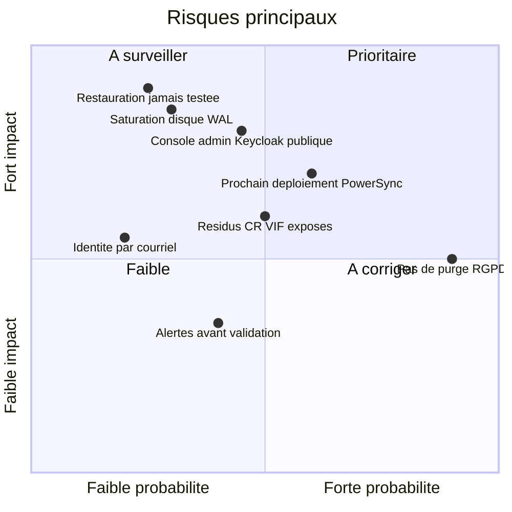

# 16 — Risques et dette technique

Ce document consolide les risques relevés pendant l'analyse du code : sécurité, perte de données, données personnelles, exploitation et dette technique. Il sert de base à l'analyse de risques de l'homologation et au plan d'action avant ou pendant le transfert vers l'infrastructure du ministère.

**Méthode.** Les constats viennent d'une lecture du code (état au 25/11/2026) et du relevé de production du 17/11/2026 (lecture seule de Coolify, des bases, de Keycloak et des DNS). Ce que le relevé n'a pas pu mesurer reste marqué « à confirmer ».

**Niveaux.** Critique : exploitable par un agent connecté ou perte de données avérée, à traiter avant homologation. Élevé : à traiter avant ou pendant le transfert. Moyen : à planifier. Faible : nettoyage.

## 1. Synthèse

| ID | Risque | Niveau | Détail |
| --- | --- | --- | --- |
| SEC-19 | Durcissement de Keycloak en production | Élevé | §2 |
| SEC-20 | Préproduction authentifiée par le Keycloak de production | Élevé | §2 |
| SEC-21 | Résidus de l'ancienne application sur le serveur de production | Élevé | §2 |
| OPS-01 | Saturation du disque PostgreSQL par le slot de réplication (aucun plafond en production) | Élevé | §5 |
| OPS-11 | Restauration jamais testée, bucket de fichiers non sauvegardé, sauvegardes dans le même compte | Élevé | §5 |
| OPS-12 | Déploiement manuel, configuration PowerSync déposée à la main | Élevé | §5 |
| OPS-14 | Prochain déploiement en production : configuration PowerSync à remplacer avant les migrations | Élevé | §5 |
| RGPD-01 | Aucune durée de conservation appliquée | Élevé | §4 |
| SEC-23 | Utilisateur identifié par son courriel et non par l'identifiant Keycloak | Moyen | §2 |
| SEC-07 | Dépendances : audit non bloquant, image PowerSync non épinglée | Moyen | §2 |
| RGPD-02 | Sous-traitants non déclarés | Moyen | §4 |
| SEC-04 | Rattachement libre à un service (journalisé) | Moyen | §2 |
| OPS-10 | API Agrégée des UP filtrée par adresse IP, mode `mock` par défaut | Moyen | §5 |
| SEC-08 | Liens publics de 90 jours, nom du demandeur dans le nom du PDF | Moyen | §2 |
| SEC-11 | MongoDB sans authentification, pas de rôle de réplication dédié, TLS non activé | Moyen | §2 |
| SEC-15 | Dictée vocale traitée par Google sur Chrome | Moyen | §2 |
| SEC-24 | Retrait de la liste blanche sans effet sur le compte | Moyen | §2 |
| OPS-03 | `vite preview` en production | Moyen | §5 |
| OPS-07 | Pas de tâche planifiée pour l'import POP, la purge et le compactage | Moyen | §5 |
| SEC-22 | DMARC en `p=none`, DKIM non vérifié | Moyen | §2 |
| DAT-11 | Alertes envoyées avant la décision du valideur | Moyen | §3 |
| DAT-12 | Alerte de constat envoyée avant la synchronisation de sa ligne : pas de suivi ni de reprise | Moyen | §3 |
| SEC-09 | Envoi de courriels officiels à des adresses libres (20 au plus par envoi) | Faible | §2 |
| SEC-10 | Confidentialité sur poste partagé (jetons lisibles par un script, session expirée) | Faible | §2 |
| SEC-12 | Pas de CSP sur le frontend | Faible | §2 |
| SEC-25 | Limitation de débit en mémoire et dépendante de `TRUST_PROXY_HOPS` | Faible | §2 |
| DAT-13 | Écriture refusée signalée mais non conservée : l'agent doit la ressaisir | Faible | §3 |
| OPS-05 | Images avec les dépendances de développement | Faible | §5 |
| OPS-13 | Qualité des données POP, images jamais importées, PostgreSQL non réglé | Faible | §5 |
| RGPD-05 | Finalité de `constat_pdf_download` non déclarée | Faible | §4 |

## 2. Sécurité

### Contrôles en place

Le serveur contrôle chaque écriture de synchronisation : liste blanche de tables et de colonnes, colonnes de propriété fixées par le serveur, contrôle du service, de l'auteur et des délégations (les constats ne sont modifiables que par leur auteur), une transaction par opération ([syncPolicy.ts](../packages/backend/src/features/sync/syncPolicy.ts)). Un constat envoyé n'est pas modifiable, sauf s'il a été refusé par le validateur. Les fichiers S3 et les PDF sont limités au service du document, et le type et la taille de chaque fichier déposé sont signés dans l'URL de dépôt ; les flux PowerSync de pièces jointes sont filtrés par service. La connexion, l'inscription, le mot de passe oublié, les routes publiques et l'API sont soumis à une limitation de débit. CORS est limité au frontend et l'API envoie des en-têtes de sécurité. Le jeton de réinitialisation est haché en SHA-256, la réponse au mot de passe oublié ne révèle pas si un compte existe, et le serveur applique la politique de mot de passe. La déconnexion révoque le jeton hors ligne et vide l'appareil. Le lien de validation ne donne plus accès au constat une fois la décision prise. Les journaux ne contiennent ni jetons ni courriels en clair. Sentry ne reçoit ni corps de requête, ni jetons, ni journaux console (`beforeSend`, `dataCollection` restrictif, échantillonnage à 10 %). Détail dans [05](05-authentification-securite.md) §6 à §10.

Limites de ces contrôles : les valeurs écrites ne sont pas validées, l'utilisateur est identifié par son courriel plutôt que par le `sub` Keycloak (SEC-23), une URL de dépôt est délivrée pour un document pas encore en base, et le filtre Sentry repose sur des noms de clés.

### SEC-04 — Rattachement libre à un service (moyen)

`/api/change-service` permet de rejoindre n'importe quel service et d'en lire les données. C'est un choix fonctionnel ; chaque changement est tracé dans `transactions`. À faire valider par le ministère (M23) ou à réexaminer pour l'homologation (validation par un administrateur, ou liste d'affectations).

### SEC-23 — Identité fondée sur le courriel (moyen)

Le backend et les règles PowerSync retrouvent l'utilisateur par le claim `email` du jeton ; l'identifiant Keycloak (`sub`) n'est pas stocké. Changer l'adresse d'un compte dans Keycloak le coupe de ses données, et une adresse réattribuée hérite des données de l'ancien titulaire. **Recommandation** : stocker le `sub` et l'utiliser comme identité pivot (backend et règles de synchronisation).

### SEC-19 à SEC-21 — Hébergement actuel (élevé)

Les réglages de sécurité du realm de production (politique de mot de passe, protection contre la force brute, durées de session et de jeton hors ligne, accès à la console) sont consignés dans le relevé de sécurité transmis au ministère, avec les noms d'hôte et les ports concernés.

- **SEC-19** : réglages de sécurité du Keycloak de production (mots de passe, force brute, durées de session, exposition de l'administration). **Recommandation** : activer la protection contre la force brute (verrouillage temporaire après plusieurs échecs), imposer une politique de mot de passe (longueur minimale, refus des mots de passe connus), borner la durée de vie des sessions et jetons hors ligne, et rendre la console d'administration joignable seulement depuis un réseau d'administration.
- **SEC-20** : la préproduction s'authentifie sur le Keycloak de production. Une fausse manipulation en préproduction touche la production. **Recommandation** : Keycloak ou realm dédié à la préproduction.
- **SEC-21** : des services de l'ancienne application CR VIF tournent encore sur le même serveur, dont certains sont joignables depuis Internet. **Recommandation** : arrêter et supprimer ces services après une dernière sauvegarde. Voir [10](10-infrastructure-et-deploiement.md) § 6.0.

### SEC-07 — Dépendances (moyen)

Node 22 LTS, Fastify 5, Sentry 11, nodemailer 10, kysely 0.28, zod 4, MapLibre 6 et TipTap 3 sont en place ; des `overrides` imposent des versions corrigées de dépendances transitives. La CI lance les tests unitaires du backend avant de publier les images et un `pnpm audit --prod` à chaque push, mais **l'audit ne bloque pas** la publication, aucune image n'est analysée, et l'image PowerSync est tirée en `:latest`. Voir [05](05-authentification-securite.md) §11. **Recommandation** : traiter les avis remontés par l'audit, épingler PowerSync, analyser les images.

### Autres points de sécurité

| ID | Constat | Recommandation |
| --- | --- | --- |
| SEC-08 | Liens courts `/attachment/:id` publics pendant 90 jours (durée voulue, voir [07](07-donnees-externes-et-stockage.md)) ; nom du fichier de CR contenant le nom du demandeur (`CR_<ville>_<demandeur>_<date>.pdf`). | Nom de fichier neutre ; durée plus courte si le métier l'accepte. |
| SEC-09 | Tout agent peut envoyer un courriel officiel à des adresses de son choix, 20 destinataires au plus par envoi ; les saisies sont échappées ([escapeHtml.ts](../packages/backend/src/features/mail/escapeHtml.ts)). Pas de journal dédié des envois. | Journal des envois si le ministère l'exige. |
| SEC-10 | Jetons stockés en IndexedDB, lisibles par un script injecté (voir SEC-12). Après une **session expirée**, la base locale et les écritures en attente restent sur l'appareil : si un autre agent s'y connecte, elles partent avec son jeton. | CSP ; vider l'appareil quand un autre compte se connecte. |
| SEC-11 | TLS vers PostgreSQL désactivé par défaut (`DATABASE_SSL`, `sslmode: disable` pour PowerSync) ; MongoDB sans authentification et port publié dans le Compose de développement ; pas de rôle de réplication dédié pour PowerSync. | `DATABASE_SSL=true` et `sslmode` si la base est distante, authentifier MongoDB, rôle de réplication dédié, ne rien publier hors réseau interne. |
| SEC-12 | Pas de CSP sur le frontend (l'API envoie `X-Content-Type-Options`, `Referrer-Policy`, `X-Frame-Options` et HSTS). | CSP au serveur du frontend (liste des domaines dans [03](03-frontend-pwa.md) § 13). |
| SEC-15 | Dictée vocale par Web Speech API : sur Chrome, l'audio part chez Google. | À valider par le ministère (M20) ou à désactiver. |
| SEC-22 | DMARC en `p=none` sur `patrinotes.beta.gouv.fr` et `compte-rendu-vif.beta.gouv.fr` ; DKIM introuvable publiquement. Un tiers peut usurper l'adresse d'expédition des courriels officiels sans qu'ils soient rejetés. | Relever le sélecteur DKIM de Scaleway TEM, puis passer DMARC en `quarantine` puis `reject`. |
| SEC-24 | Retirer une adresse de la liste blanche ne désactive pas le compte Keycloak : la personne continue de se connecter. | Désactiver le compte Keycloak en même temps. |
| SEC-25 | Les compteurs de la limitation de débit sont en mémoire, par processus : un redémarrage les remet à zéro et plusieurs réplicas comptent chacun de leur côté. La limite par IP dépend de `TRUST_PROXY_HOPS` : mal réglé, tous les agents partagent une limite, ou un client choisit son adresse. | Régler `TRUST_PROXY_HOPS` ; stockage partagé (Redis) ou limitation au proxy si plusieurs réplicas. |

## 3. Intégrité et perte de données

Contrôles en place ([08](08-synchronisation-hors-ligne.md)) : les écritures sont envoyées et acquittées une par une ; un `PUT` rejoué est appliqué comme une mise à jour ; une écriture refusée est signalée à l'agent dans un bandeau et à Sentry ; une opération en erreur 4xx répétée est mise de côté au lieu de bloquer la file ; le statut des dépôts S3 est vérifié ; l'envoi d'un PDF attend la file d'écritures (30 s au plus) ; chaque alerte est suivie et reprise en cas d'échec SMTP ; les alertes de fiche sont envoyées par le serveur dès leur synchronisation.

| ID | Constat | Effet | Recommandation |
| --- | --- | --- | --- |
| DAT-11 | Les alertes d'un constat partent **à la soumission**, avant la décision du valideur. | Une alerte est transmise pour un constat ensuite refusé. | Envoyer les alertes à l'acceptation (choix métier, visible des agents). |
| DAT-12 | Une alerte dont la ligne n'est pas encore arrivée par la synchronisation au moment de l'envoi du constat est envoyée **sans suivi** (ni `sent_at`, ni `send_attempts`). | En cas d'échec SMTP, elle n'est ni reprise ni marquée ; seule une exception Sentry en garde la trace. | Attendre la ligne de l'alerte, ou l'enregistrer côté serveur avant l'envoi. |
| DAT-13 | Une écriture refusée par le serveur (droits, erreur SQL, utilisateur absent de `user`) est signalée à l'agent, mais **pas conservée** : PowerSync remet l'état du serveur. | L'agent doit ressaisir sa modification ; seule la table `transactions` en garde la copie. | Conserver la valeur refusée sur l'appareil pour la proposer à nouveau. |

## 4. Données personnelles (RGPD)

Inventaire détaillé dans [05](05-authentification-securite.md) et [06](06-modele-de-donnees.md). Données concernées : agents (nom, e-mail, fonction), demandeurs et propriétaires (nom, adresse, e-mail, référence cadastrale), personnes présentes, validateurs, destinataires, photos.

| ID | Constat | Recommandation |
| --- | --- | --- |
| RGPD-01 | La politique de confidentialité annonce des durées (2 ans, 1 an) mais **aucune purge n'existe** : ni en base, ni dans `transactions` (copie intégrale de toutes les écritures), ni sur S3 (`deleteFile` non implémenté), ni dans Sentry. Les sauvegardes de la base Keycloak, de la préproduction et de l'ancienne base CR VIF sont gardées **sans limite de durée** (celles de la base de production : 7 jours en local, 90 jours sur S3). La date de dernière connexion n'est pas enregistrée dans la base applicative. | Tâches planifiées de purge, durée de vie sur le bucket et sur toutes les sauvegardes. |
| RGPD-02 | La page de confidentialité cite OVH et Brevo. Le code utilise aussi Sentry, un stockage S3, Scaleway (stockage objet et SMTP), Matomo (`stats.beta.gouv.fr`), OpenFreeMap, l'IGN, `openmaptiles.geo.data.gouv.fr`, l'API Adresse et, via le navigateur, la reconnaissance vocale de Google. | Mettre à jour la liste des sous-traitants et destinataires selon l'hébergement cible. |
| RGPD-05 | `constat_pdf_download` trace les téléchargements par agent. | Déclarer la finalité ou supprimer. |

## 5. Exploitation

| ID | Constat | Recommandation |
| --- | --- | --- |
| OPS-01 | Si PowerSync est arrêté, le slot de réplication retient le WAL **sans limite** : c'est le réglage de production (`max_slot_wal_keep_size = -1`). Le disque PostgreSQL peut se remplir et arrêter **toute** l'application. Perdre MongoDB laisse un slot orphelin ; sur l'ancienne base CR VIF du même serveur, un slot inactif retient déjà 46 Mo de WAL. | Définir `max_slot_wal_keep_size`, superviser `pg_replication_slots`, procédure de nettoyage. Voir [12](12-exploitation-et-supervision.md) §4.1. |
| OPS-03 | Frontend servi par `vite preview`, domaines autorisés codés en dur. | Serveur statique (nginx, Caddy) avec génération de `env.js` au démarrage. |
| OPS-05 | Les images de production contiennent les dépendances de développement (`drizzle-kit`, `vite` et `vite-node` servent au démarrage). | Étape d'exécution allégée, migrations dans une tâche séparée. |
| OPS-07 | Le backend n'a qu'une tâche périodique (reprise des alertes). Aucune tâche planifiée, ni dans le code ni dans Coolify, pour les imports POP (dernier import des immeubles après le 06/05/2026), la purge (RGPD-01) ou la compaction PowerSync. | Planificateur (cron, tâche Kubernetes). |
| OPS-10 | L'API Agrégée des unités patrimoniales n'est joignable que depuis le réseau de production (filtrage IP) ; `UP_API_MODE` vaut `mock` par défaut. | Faire autoriser l'adresse de sortie de l'hébergement cible ; vérifier `UP_API_MODE=live` après la bascule. Le cache `up_cache` sert de secours. |
| OPS-11 | Sauvegardes (relevé du 17/11/2026) : base de production sauvegardée chaque jour (7 jours en local, 90 jours sur S3) ; **aucune restauration testée** ; bucket de fichiers `patrinotes-prod` sans sauvegarde visible ; sauvegardes stockées dans le **même compte et la même région Scaleway** que les données ; thème et configurations PowerSync hors sauvegarde. | Tester une restauration complète, sauvegarder ou versionner le bucket, copier les sauvegardes hors du compte. |
| OPS-12 | Déploiements lancés à la main dans Coolify sur l'étiquette mobile (`:backend`, `:frontend`) ; `sync-config.yaml` et `powersync-config.yaml` déposés à la main sur le serveur ; image PowerSync en `latest`. La version déployée se lit dans le label `revision` de l'image et des étiquettes `-<sha>` existent. | Déployer par étiquette `-<sha>`, déploiement déclenché par la CI, configuration PowerSync versionnée et déployée avec l'application. |
| OPS-13 | 4 541 objets POP avec un champ date invalide (colonnes décalées ou encodage) ; `pop_images` vide (les images POP ne sont pas affichées) ; `shared_buffers` à 128 Mo (défaut) sur un serveur de 31 Go ; empreinte de la migration 0000 différente du fichier du dépôt. | Contrôler l'import, régler PostgreSQL, ne plus modifier une migration appliquée. |
| OPS-14 | Le prochain déploiement de `development` en production applique les migrations 0037 à 0046, dont la 0040 qui supprime la table `pictures`, encore lue par les règles de synchronisation de production. Il demande aussi de nouvelles variables (`SENTRY_DSN`, `FRONTEND_URL` exacte pour CORS, `TRUST_PROXY_HOPS`). | Au prochain déploiement : sauvegarde, configuration PowerSync remplacée **avant** les migrations, variables posées. |

## 6. Dette technique

| Sujet | Constat |
| --- | --- |
| Code mort | Quelques modules, gabarits et fichiers statiques jamais chargés ou appelés, dans le backend comme dans le frontend ; un fichier de relations Drizzle qui ne compile pas. Sans effet à l'exécution. |
| Colonnes inutilisées | `state_report.bilan_quinquennal` : la question n'est pas posée, mais la colonne reste en base, dans le schéma local et dans la politique d'écriture tant que des clients déjà installés l'envoient ; à retirer quand tous les clients sont à jour. `pop_immeubles.last_image_check_at` et `pop_objets.last_image_check_at` ne sont lues ni écrites par aucun code. |
| Repli MD5 | Les liens de réinitialisation de mot de passe hachés en MD5 restent acceptés à côté de ceux hachés en SHA-256 ([userService.ts](../packages/backend/src/services/userService.ts)). Ils ne valent que 24 h. |
| Configuration | `.env.dist` obsolète (variables ElectricSQL, AWS, proxy PG) et incomplet (une quinzaine de variables obligatoires manquantes) ; variables obligatoires inutilisées (`JWT_SECRET`, `JWT_REFRESH_SECRET`, `DATAGOUV_API`). `.env.test` est la vraie référence. |
| Documentation | Le README est en partie obsolète (versions de Node et de pnpm, noms des fichiers d'import POP, noms de scripts), et [db-workflow.png](../images/db-workflow.png) montre l'ancienne architecture ElectricSQL/Prisma. Le `package.json` fait foi : Node ≥ 22, pnpm 10.12.4. |
| Hébergement historique | [Procfile](../Procfile) et [scalingo.json](../scalingo.json) obsolètes ; branche `compte-rendu-vif` inactive mais encore construite par la CI. |
| Modèle de données | Peu de clés étrangères et d'index ; formats sérialisés sans échappement ; type Kysely `Database` maintenu à la main. |
| Tests | Tests e2e lancés à la main, sur Chromium seul, sans test hors ligne ni iOS. Les tests unitaires du backend sont lancés en CI et bloquent la publication des images, mais ceux qui demandent une base y sont ignorés. PostgreSQL 14 en test, 17 en production. Ni linter ni `tsc` en CI. Voir [13](13-tests-et-qualite.md). |
| Bugs fonctionnels | Alerte « Sécurité » sans adresse préremplie (colonne `courriel_mairie` absente). |
| Valeurs codées en dur | Statistiques publiques (1 102 agents, « 2026 », 46 000), Matomo `siteId` 123, codes région, centre de carte par défaut, région S3. |

## 7. Plan d'action proposé

| Priorité | Action | Risques traités |
| --- | --- | --- |
| **Prochain déploiement** | Remplacer la configuration PowerSync de production avant les migrations, poser `SENTRY_DSN`, `SENTRY_ENVIRONMENT`, `VITE_SENTRY_ENVIRONMENT`, vérifier `FRONTEND_URL` et `TRUST_PROXY_HOPS` | OPS-14, SEC-25 |
| **Immédiat** | Régler Keycloak (force brute, politique de mot de passe, console d'administration restreinte) ; supprimer les résidus CR VIF et fermer les ports hors Traefik ; tester une restauration de la base | SEC-19, SEC-21, OPS-11 |
| **Immédiat** | Plafonner `max_slot_wal_keep_size`, supprimer le slot inactif CR VIF ; sauvegarder le bucket hors du compte | OPS-01, OPS-11 |
| Avant homologation | Keycloak dédié à la préproduction, DMARC en `reject` | SEC-20, SEC-22 |
| Avant homologation | Désactiver le compte Keycloak au retrait de la liste blanche ; nom de fichier neutre pour le PDF de CR ; décider du moment d'envoi des alertes ; suivre les alertes envoyées avant la synchronisation de leur ligne | SEC-24, SEC-08, DAT-11, DAT-12 |
| Avant homologation | Faire valider par le ministère le changement de service libre et la dictée vocale | SEC-04, SEC-15 |
| Pendant le transfert | `max_slot_wal_keep_size`, supervision du slot et de `/health/ready`, TLS PostgreSQL, MongoDB authentifié, versions épinglées ; ouverture de l'API Agrégée à la nouvelle adresse de sortie | OPS-01, SEC-11, OPS-10, SEC-07 |
| Pendant le transfert | Serveur statique pour le frontend avec CSP, migrations séparées du démarrage, images allégées, déploiement par étiquette `-<sha>` avec la configuration PowerSync | OPS-03, OPS-05, OPS-12, SEC-12 |
| Après le transfert | Identité par `sub` Keycloak ; purges RGPD (base, S3, sauvegardes) et planificateur ; mise à jour des mentions | SEC-23, RGPD-01, RGPD-02, RGPD-05, OPS-07 |
| Continu | Retrait de `bilan_quinquennal` et du repli MD5, nettoyage du code mort, tests de cloisonnement et hors ligne | §6, DAT-13 |
